# Kingdoms at War – Dragon Warfare

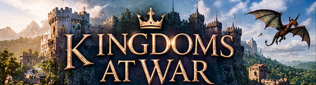

Eine eigene, mittelalterliche Minecraft-Mod für **Minecraft Java 26.3** mit **NeoForge**.
Vor langer Zeit verschlossen sechs Elementardrachen die **Schattenwelt** – jeder trägt ein Sechstel des Siegels in
seinem Herzen. Gründe dein Königreich, wirb Ritter und Soldaten an, baue deine Burg, spüre die riesigen Nester der
Drachen auf und bezwinge sie. Aus jedem besiegten Drachen bleibt ein Ei, aus dem dein eigener Drache schlüpft – und
ein Splitter des Siegels. Der sechste Splitter bricht das Siegel …

> **Version 1.1.5 – Weniger Beute bei Bossen, die wiederkommen.** Bosse, die mehrfach kommen, geben ihr **Sonderstück** (Waffe, Schwingen, Zylinder, Angel, Zaubertafel) jetzt **nie mehr sicher** – auch beim ersten Sieg nur in etwa einem von fünf Kämpfen. Sicher ist beim ersten eigenen Sieg nur noch der **Herz- oder Manakristall**. **Münzen, Gold, Edelsteine** und die übrigen Schätze sind etwa auf die Hälfte gesunken; Schrolli gibt keine doppelten Schätze mehr beim ersten Sieg, Goldapfel und Totem nur noch selten. Die Drachen und die anderen einmaligen Bosse bleiben, wie sie waren, ebenso die Erfahrung.
> In 1.1.4 kamen **neue Tierstimmen**: Wo sich Tiere bisher Laute von Minecraft liehen, die nicht zu ihnen passten, haben sie jetzt **eigene Stimmen**: Der **Hirsch** fiept leise durch die Nase und schnaubt, der **Urelch** grunzt tief, und sein **Brunftruf** schwingt sich von einem Grollen zu einem langen, hellen Pfeifen auf, das weit über das Land hallt; die **Gans** ruft ihr nasales „a-honk“ und faucht mit offenem Schnabel, der **Flamingo** schreit in seiner eigenen Stimme, der **Moorschnapper** knarrt kehlig, faucht und lässt den Hornschnabel zuschlagen. Im Meer beißen **Hai** und **Anglerfisch** mit Sog, Zähnen und Blasen, der **Mantarochen** schnellt mit Gischt aus dem Wasser und klatscht schwer zurück, die **Riesenkrabbe** tippt mit spitzen Beinen, und das Leuchten der **Leuchtqualle** erlischt in gläsernen Tönen; der **Leerenschlund** beißt, heult und fällt in sich zusammen. Der **Kommandostab** gibt ein kurzes **Hornsignal**, und der Drache, den man **in der Ferne** brüllen und mit schweren **Schwingen** über das Land ziehen hört, klingt jetzt wie die Drachen der Mod. Sehr tiefe Klänge – die Schritte und Schläge der großen Bosse, das Gebrüll des Kraken und des Karkinos, die Künste des Schöpfers – sind jetzt auch auf **kleinen Lautsprechern** (Laptop, Fernseher) gut zu hören, und zu leise Klänge (der Schmerz des Steinhüters, der Tod der Riesenkrabbe) sind lauter.
> In 1.1.3 kamen **Beute, Speere, Schnur und neue Stimmen**: **Bosse, die mehrfach kommen** (die man neu weckt, zurückruft oder in jedem ihrer Bauwerke findet) geben ihr **Sonderstück** – Waffe, Schwingen, Zylinder, Angel – und ihren **Herzkristall** nur beim **ersten eigenen Sieg** sicher; danach fällt das Sonderstück nur noch in einem von fünf Kämpfen, Kristalle gar nicht mehr, und die übrige Beute ist kleiner. Bosse mit **eigener Rüstung** (Steinhüter, Meerhexe, Seelenhirte, Sternenweberin, Stundenwächter) lassen außer ihrem Sonderstück nur noch den **Werkstoff ihrer Rüstung** fallen – etwa genug für ein Teil je Sieg. Die Erfahrung bleibt, wie sie war. Die **Speere** der Mod liegen jetzt so in der Hand wie die Speere von Minecraft: in ihrer Länge und in der Mitte gegriffen – sie ragen nicht mehr weit über den Kopf, und aus der eigenen Sicht ist die Spitze ganz im Bild. Die **Angelschnur** beginnt in jeder Sicht genau an der Rutenspitze – aus der eigenen Sicht auch bei anderem Bildformat und Sichtfeld, von außen auch beim Gehen, Schleichen und mit der Angel in der linken Hand. Und **eigene Klänge** statt geliehener: Drachen (Stimme, Schwingen, Schritte, Biss, Atem aller sechs Elemente, das Ei), Kraken (Schnabel, Schmerz, Tinte, Tentakelschlag, Woge, Strudel), Karkinos (Graben, Ausbruch, Panzer, Gezeitenlanze, Scherenschlag, Schritte, Gezeitenkraft), Nyxar (Schattenatem, Schrei), der Höhlentroll (Grummeln, Grunzen, Tod, Versteinern, Keulenschlag, Schritte) und der Lindwurm (Zischen, Biss, Schrei, Tod, Schuppengleiten).
> In 1.1 kam **der Stundenwächter**: Im **Abgrund** treiben jetzt **Uhrtürme**: In einem leer gefegten Auge des Chaos schwebt ein **großes Zifferblatt** – gut dreißig Blöcke breit, mit römischen Ziffern, Zeigern aus **Uhrbronze** und **Chronit** an jeder Stunde –, im Norden der **Turm** mit Zifferblättern auf allen Seiten, einer Treppe um den hohlen Kern, in dem das große Pendel hängt, der **Uhrwerkkammer** und der **Glockenstube** (je eine Truhe), ringsum schweben riesige **Zahnräder**. In der Nabe des Zifferblatts sitzt das **Uhrwerkherz**, und darüber steht erstarrt – eine Minute vor zwölf – **der Stundenwächter**: ein Ritter aus Uhrbronze, so groß wie zwei Männer, ein Zifferblatt als Heiligenschein, zwei Klingen wie Zeiger. Wer ihm zu nahe kommt, setzt seine Zeiger in Gang: **Zeigerhieb**, **Stundenschlag** (ein Glockenschlag rollt als Ring davon – springen!), **Zahnradwurf**, **Zeitstopp** (wer ihn ansieht, erstarrt – wer wegschaut, nicht), **Pendelschwung**, **Sanduhr**, **Zeitsprung**, **Rückspulen** (er heilt – wer ihn dabei hart trifft, bringt ihn ins Taumeln) und unter halber Kraft **die Zwölfte Stunde** mit zwölf Glockenschlägen. Eigene Bossleiste, eigene Klänge. Er hinterlässt den **Minutenzeiger** (jeder zwölfte Treffer schlägt die Stunde, Rechtsklick: Zeitsprung); Chronit im stillstehenden Herzen weckt einen neuen Wächter. Neu ist auch **Chronit** (gerinnt an den Weltennähten des Abgrunds) und daraus die **Rüstung der Zeitwächter** – Die Zeit stockt, und mit dem vollen Satz eine **Zweite Chance**: Ein tödlicher Treffer spult die Zeit drei Sekunden zurück. Seit 1.1.1 hängt die Schnur der Angeln in 3D auch von außen gesehen (bei anderen Spielern und in der Ansicht mit F5) an der Rutenspitze statt in der Luft. Seit 1.1.2 ist **`/kaw` nach Art geordnet**: `/kaw dim` zeigt nur die Dimensionen (jetzt auch Abgrund, Urmeer und Feenreich), `/kaw boss` nur die Bosse (finden, hinreisen, wecken, zurücksetzen), `/kaw structure` nur die Bauwerke (alle 60) – und die **Koordinaten lassen sich anklicken**: Man reist sofort hin, auch in eine andere Dimension.
> In 1.0.0 erwachte **der Kraken**: Der Herr des Urmeers bleibt nicht mehr an seinem Platz: **Der Kraken schwimmt** jetzt schwer und träge durch sein Becken, zieht Kreise um seine Feinde (nie über den Felsenring hinaus), wechselt dabei die Richtung, neigt den Kopf in die Fahrt, schiebt eine **Bugwelle** vor sich her und zieht **Kielwasser** hinter sich; seine Arme strömen nach hinten und rudern im Takt. Und er hat **vier neue Angriffe**: den **Rammstoß** (er saugt Wasser in den Mantel, Warnkreise zeigen die Bahn – dann schießt er mit einem Wasserstrahl quer durchs Becken und überrollt, wer im Weg ist), den **Ausbruch aus der Tiefe** (er taucht ab und ist dann unverwundbar, nur Blasen und ein dunkler Schatten verraten, wo er schwimmt; unter seinem Ziel steigt ein Ring aus Blasen auf – dann bricht er hoch aus dem Wasser und schleudert alles empor), das **Geysirfeld** (rings um seine Feinde brodelt es, dann schießen Geysire empor – ab zwei Dritteln gleich zweimal) und den **Tentakelkäfig** (sieben Arme brechen rings um sein Ziel aus dem Wasser, kreisen und ziehen sich zusammen, wer sie berührt, wird zurückgestoßen; wer die Lücke nicht findet, wird zermalmt – ein harter Schlag trennt einen Arm ab, und der Kraken spürt es). Dazu sechs neue Klänge.
> In 0.99 kam **die Sternenweberin**: In den leeren Weiten der **Leere** hängen jetzt **Sternennetze**: eine runde Netzplatte aus leuchtender **Sternenseide** (acht Speichen, vier Ringe) und **Sternengewebe**, durch das man ins Nichts hinabsieht, am Rand offen; sechs **Ankerfelsen** mit Adern aus Himmelseisen halten das Netz an durchhängenden Tauen, hoch darüber die **Sternenkrone**, an den Tauen und unter dem Rand **Sternenkokons** (zerschlagen geben sie frei, was sich verfing), auf dem größten Anker eine Truhe. In der Mitte liegt das **Sternengelege** – und darüber hängt kopfüber an ihrem Faden **die Sternenweberin**: eine riesige Spinne aus nachtblauem Chitin mit acht Sternenaugen, auf dem Hinterleib eine **Spiralgalaxie**, aus dem Rücken wachsen Kristalle der Leere. Wer ihr zu nahe kommt, weckt sie: **Giftbiss**, **Fangfaden**, **Netzwurf**, **Sternbild**, **Sternschnuppen**, **Umgarnen**, **Brut** (Sternspinnlinge), **Abseilen** und im Zorn die **Spindel**. Eigene Bossleiste, eigene Klänge. Sie hinterlässt den **Sternenbogen** (schwerelose, schnellere Pfeile; im Schleichen ein **Netzpfeil**, der sein Ziel einspinnt); ein **Himmelseisenbarren** im erloschenen Gelege ruft eine neue Weberin. Neu ist auch **Himmelseisen** (Erz in der ganzen Leere, im Kern gefallener Sterne) und daraus die **Rüstung der Sternwandler** – leichter, Sternenschweben, Sternenanker. Außerdem: **Rüstungen ohne offene Stellen** (Kragen, Ellbogen, Masken mit Sehschlitzen), Rüstungs-Effekte wirken **still ohne Symbol** und die Nachtsicht **flackert nicht mehr**, die volle **Taucherausrüstung gibt Wasseratmung**, die **Meerjungfrauen handeln wie alle anderen Händler** (Münzen, gleiches Handelsfenster), **8369 Fischarten** (die meisten im Urmeer), **seltene Fische sind schwerer zu drillen**, und im Urmeer gibt es **keine Lava** und **kein Trockenlegen mit Schwämmen**.
> In 0.98 kam **der Seelenhirte**: Im **Seelensumpf** der Schattenwelt liegen jetzt **Seelenpferche**: ein runder Pferch auf aufgeschüttetem Grund mitten im Sumpf, umgeben von einem Zaun aus Schattenholz mit **Seelenlaternen** und **Schafsschädeln** auf den Pfosten, vier Feuerschalen mit Seelenfeuer, **Stege auf Stelzen** hinaus über den Sumpf und im Norden die **Hütte des Hirten** mit einer Truhe. In der Mitte hängt unter einem Glockenstuhl die **Seelenglocke** – und vor ihr steht in Andacht **der Seelenhirte**: ein hagerer, gebeugter Riese in zerschlissener Kutte, ein Schaffell über den Schultern, unter der Kapuze ein **Widderschädel** mit gerollten Hörnern und türkis glimmenden Augen, in der Rechten ein **Hirtenstab**, an dessen Haken eine Laterne voll Seelenfeuer hängt, in der Linken eine Handglocke; drei **Irrlichter** kreisen um ihn. Wer ihm zu nahe kommt, weckt ihn: **Hakenzug**, **Laternenschwung**, **Irrlichter**, **Seelenglocke**, **Nebelgang**, ein **Pferch aus Seelenfeuer**, der **Hirtenstoß** und im Zorn der **Seelensturm**; unter halber Kraft läutet er dreimal. Eigene Bossleiste, eigene Klänge. Er hinterlässt den **Hirtenstab** (in 3D, Rechtsklick: eine Kette aus Seelenlicht reißt das Ziel heran); die verstummte Glocke ruft mit einem **Seelenkristall** einen neuen Hirten. Neu ist auch **Dämmerquarz** in der ganzen Schattenwelt (Dämmerquarz, Dämmerquarzblock) und daraus die **Dämmerrüstung** der Schleicher – Monster bemerken dich später, mit dem vollen Satz beim Schleichen kaum noch, du schleichst schneller, landest weich und siehst beim Schleichen im Dunkeln; in 3D mit Kapuze, Halbmaske, Umhang, Quarzschließe, Gürteltaschen und Dolch.
> In 0.97 kam **die Meerhexe**: Am Grund des Urmeers liegen jetzt **Hexengrotten**: buckelige Kuppeln aus Gezeitenstein in einer **toten Zone**, in der nichts mehr wächst, mit einem Eingang durch die **Rippen eines Wals**, Knochensäulen mit Seelenlaternen, zwei Blasensäulen, Nischen voller Hexenkram, Laternen an Ketten, dem Wrack eines Bootes und zwei Truhen. In der Mitte brodelt der **Hexenkessel** – und über ihm schwebt in Trance **die Meerhexe**, eine verstoßene Meerjungfrau mit einer Krone aus schwarzer Koralle, Haar aus Tang und einem Aalschwanz, gebändert wie ein Feuerfisch. Wer ihr zu nahe kommt, weckt sie: **Tintengeschosse**, **Strudel**, **Sirenengesang** (wegsehen!), **Blasengefängnis**, **Haie**, **Korallenspieße**, **Schwanzhieb**, im Zorn der **Fluch der Tiefe** und eine **Woge aus Tinte**. Eigene Bossleiste, eigene Klänge. Sie hinterlässt den **Hexenstab** (in 3D, Rechtsklick: drei Tintenkugeln, die dem Ziel folgen); den erkalteten Kessel weckt eine **Perle**. Neu ist auch **Aquamarinerz** am Meeresgrund (Aquamarin, Aquamarinblock) und daraus die **Taucherrüstung** – länger atmen, schneller schwimmen und abbauen, mit dem vollen Satz klare Sicht unter Wasser; in 3D mit Taucherhelm und Bullaugen, Luftflaschen, Bleigürtel und Flossen.
> In 0.96 kam **der Steinhüter**: Im Feenreich liegen jetzt **alte Mondsteinbrüche**: runde Gruben, zwölf Blöcke tief, in drei Stufen abgebaut, mit Rampen an den Wänden, offenen **Adern aus Mondsteinerz**, gemeißelten Lampen, überhängendem Moos mit Leuchtranken, zwei Gerüsten aus Glimmerholz, einem **Kran**, an dessen Kette noch ein behauener Block hängt, und der **Hütte des Vorarbeiters** mit einer Truhe. Am Grund kniet vor dem leuchtenden **Hüterstein** der **Steinhüter** und schläft – ein Riese aus Feenstein mit Lavendelmoos, Mondsteinkristallen und einem pulsierenden Herzen. Wer hinabsteigt, weckt ihn: **Faustschlag**, **Stampfer**, **Felswurf**, **Kristallspur**, **Felssprung** (er folgt dir auf die Terrassen) und im Zorn der **Mondstrahl**; unter halber Kraft wächst ihm ein **Kristallpanzer**, der zerspringt – dann ist er benommen. Eigene Bossleiste, eigene Klänge. Er hinterlässt den **Hüterhammer** (in 3D, Rechtsklick: eine Spur aus Mondsteinkristallen); der erloschene Stein ruft mit einem **Mondstein** einen neuen Hüter. Neu ist auch das **Mondsteinerz** im ganzen Feenreich (Mondstein, Mondsteinblock) und die **Mondsteinrüstung** der Zauberer – Schutz wie Eisen, sehr gut verzauberbar, **mehr Mana** und schnellere Erholung (der volle Satz 80 Mana mehr), in 3D mit Stirnreif, Sternenmantel, Schulterstücken mit Mondsicheln und spitzen Zauberschuhen.
> In 0.95 kamen **Rüstungen in 3D**: Getragene Rüstungen haben jetzt **echte 3D-Teile passend zu ihrem Material** – an Spielern und auf Rüstungsständern, für **alle Rüstungen der Mod und die von Minecraft**. Die **Stahlrüstung** ist ein Ritter: Kamm und roter **Helmbusch**, Schulterstücke aus drei Platten mit Goldsaum, Ellbogenkacheln, Beintaschen, Kniebuckel und goldene **Sporen**. **Konterit** (leicht und schnell) trägt **Flügel an den Schläfen und Knöcheln**, einen Stirnstein, sichelförmige Schulterstücke und einen **kurzen Umhang**. **Nachtstahl** hat eine **Krone aus Nachtkristallen** und Kristallstacheln auf Schultern, Rücken, Knien und Fersen, deren Spitzen leuchten. **Abyssit** hat zwei große **Hörner** mit leuchtenden Adern, einen Stirnkristall, schwere Schulterstücke und leuchtende Kristalle. Die **Drachenschuppen** tragen die **Hörner ihres Drachen** (Feuer geschwungen mit Glut, Eis aus Kristall, Blitz gezackt, Natur ein **Geweih mit Blättern**, Erde **Widderhörner**, Wasser **Flossen**), Rückenstacheln (Blätter, ein Flossensaum, Steinplatten), Schulterschuppen mit Kralle, Krallen an den Stiefeln und zu den Beinschienen einen **Drachenschwanz** mit der Spitze ihres Elements (eine glühende Flamme, ein Eiskristall, eine Blitzklinge, ein Blatt, eine Steinkeule mit Bernstein, eine Flosse). Die **Edelsteinkrone** bekommt Zacken mit Perlen und Edelsteine. Und die Rüstungen von Minecraft: **Leder** (Feder, Pelzkragen, Gürtel mit Tasche, Pelzstulpen), **Kettenhemd** (Kettenkragen, Kettenschultern, Kettenschurz), **Kupfer** (Helmspitze, Platten mit Grünspan), **Eisen** (Nasenschutz, Schulterstücke, Kniebuckel), **Gold** (Strahlenkamm, Rubine, Sonnenscheibe), **Diamant** (Kamm und Schultern aus Diamantsplittern), **Netherit** (Hörner, schwere Schulterstücke mit Dornen) und der **Schildkrötenpanzer**. Verzauberte Rüstungen schimmern auch an ihren 3D-Teilen.
> In 0.94 kamen **schönere Bossleisten**: Die Leisten aller Bosse leben jetzt: Erscheint ein Boss, **senkt sich seine Leiste herab**, das **Namensband entrollt sich** (ein Band mit Borte, Ziersteinen und Schwalbenschwänzen in den Farben des Bosses) und die Füllung **lädt sich auf** – die Phasen-Edelsteine leuchten auf, sobald sie erreicht sind. Die Edelsteine sitzen jetzt **genau bei den Kampfphasen** jedes Bosses (beim Kraken bei zwei Dritteln und einem Drittel, beim Weltenfresser dreimal, bei der Wahren Gestalt Schrollis bei Nova, Apokalypse und Neuschöpfung, bei Noctua, Malleus, Asteria und Anni bei der Hälfte …), mit einer **Kerbe** in der Leiste. **Treffer** lassen den Rahmen beben, das verlorene Stück weiß aufblitzen und das Bildnis rot; **Heilung** schimmert. Ein **Glanz** zieht über die Rahmen, um jede Leiste schweben **Teilchen ihres Bosses** – Glut, Schneeflocken, Funken, Blätter, Staub, Luftblasen, Schattenrauch, Sterne, Flügelstaub, Konfetti, Störpixel oder Tinte –, **mit jeder Phase mehr**. Erreicht ein Boss eine Phase, **zerspringt ihr Edelstein** klirrend in Splitter, Rahmen und Namensband blitzen auf; in der **letzten Phase** strömt und pulsiert die Füllung schneller, der Rahmen glüht, das Bildnis färbt sich vor Wut rot. **Der Kraken** hat jetzt seine eigene Leiste (bisher zeigte er nur die Leiste von Minecraft): Bronze mit Patina und Seepocken, zwei purpurrote Arme mit Saugnäpfen klammern sich an den Rahmen, als Spitze ein eingerollter Arm, darunter Tang und Tinte, im Medaillon sein Bildnis mit den goldenen Augen und eine Füllung aus wirbelnder Tinte mit leuchtenden Punkten. Bosse mit **Namensschild** behalten ihre eigene Leiste.
> In 0.93 kamen **Meeresdörfer**: Im Urmeer lebt jetzt **das Meervolk**: Auf dem Grund der Tangwälder, Korallengärten, Perlmuttgründe und Weiten stehen **Meeresdörfer** – ein Platz aus Prismarin und Perlmutt mit einer **Dreizacksäule**, deren Zinken leuchten, ringsum **Muschelhäuser** (runde Kuppeln aus dem Holz der Landschaft mit Bullaugen und einer leuchtenden Perle obenauf), der gewundene **Gesangsturm** aus Perlmutt, Tanggärten, Korallenbeete und Marktstände. Dort wohnen **Meerjungfrauen** in sechs Gestalten (Koralle, Tang, Perle, Lagune, Gold und die leuchtende Tiefsee): Sie treten Wasser, wenn sie stehen, schwimmen waagrecht wie Delfine, summen kleine Melodien und tauschen gegen **Perlen** – die **Perlentaucherin** (Perlmutt, Nautilusschalen, ein Herz des Meeres), die **Korallengärtnerin** (die Setzlinge der Meeresbäume, Korallen), die **Muschelbauerin** (Meereshölzer, Türen, Laternen, Prismarin) und die **Gezeitensängerin** (Tränke, Bücher mit den Verzauberungen des Wassers, ein Aquisitor). **Tritonwachen** mit Flossenhelm und Dreizack halten Haie und Ertrunkene fern und werfen ihren Dreizack nach jedem, der eine Meerjungfrau angreift. Perlen gibt es für Fisch, Tang, Prismarin und Tinte, in den Truhen der Dörfer und manchmal in Muscheln.
> In 0.92 kamen **Wälder unter Wasser**: **vier Meereshölzer** – das olivbraune, faserige **Tangholz**, das rosarote **Korallenholz**, das helle, schimmernde **Perlholz** und das dunkle **Tiefseeholz** mit leuchtenden Adern –, jedes mit Stamm, Holz, entrindeten Stämmen, Brettern, Treppen, Stufen, Tür, Falltür, Zaun, Zauntor, Blättern und Setzling. Die Setzlinge wachsen **unter Wasser** (auf Sand, Kies, Ton, Schlamm oder Erde, auch ohne Licht) zu **Meeresbäumen**: Der Tangbaum schwankt bis zu zwanzig Blöcke hoch und trägt Wedel voller goldener Schwimmblasen, der Korallenbaum verzweigt sich zu Fächern, der Perlbaum neigt sich unter seiner runden, schimmernden Krone, und der Tiefseebaum windet sich und lässt leuchtende Vorhänge herabhängen. Dazu kommen **vier neue Landschaften im Urmeer**: der **Tangwald**, der **Korallengarten**, die **Perlmuttgründe** und die **Leuchtende Tiefe** – jede mit ihren Bäumen, eigenen Tieren und Klängen und **vierzig eigenen Fischarten** in allen fünf Seltenheiten, darunter zwei Legenden (etwa der **Dämmergrünkaiser** im Tangwald und die **Scheinkaiserin** in der Leuchtenden Tiefe). Zusammen sind es jetzt **2053 Arten**.
> In 0.91 kam **der Kraken**, der Herr des Urmeers – nach Anni dem Troll der stärkste Boss der Mod. Er schläft im **Krakenschlund**: Mitten im offenen Meer senkt sich der Grund zu einem weiten Becken, in dessen Mitte ein Trichter aus Abgrundstein gut siebzig Blöcke in die Tiefe stürzt, gesäumt von Meereslaternen wie Augen; im Becken liegen das Gerippe eines Seedrachens und ein Wrack mit einer Truhe, ringsum ragen zwölf schiefe Brandungsfelsen hoch über das Wasser. Wer den Felsenring betritt, weckt ihn: Er steigt aus der Tiefe empor und kämpft mit acht Armen und zwei Fangarmen – **Tentakelschlag**, **Armfeger**, **Würgegriff** (wer ihn hart genug trifft, befreit die Beute), **Tintenwolke**, **Strudel**, **Ruf der Tiefe** (Haie) und im Zorn die **Flutwelle**. Besiegt lässt er die **Krakenangel** fallen, die stärkste Angel im Wasser – in 3D mit Saugnäpfen, Bronzebeschlägen und einem leuchtenden Auge als Köder. Das Gezeitenhorn zeigt im Urmeer den Weg zum Schlund.
> In 0.90 kam **das Angeln in 3D**: **Alle Angeln sind jetzt 3D:** Die Angel von Minecraft und die sechs Angeln der Mod sind in der Hand echte Ruten mit Griff, Rollenhalter, Rolle und Kurbel, Ringen und farbigen Wicklungen – die Holzangel mit Bindfaden, die Eisenangel mit Lederwicklung, die Goldangel mit rotem Griff und Rubin, die Drachenangel mit Hörnern und Flossen, die Schattenangel mit leuchtenden Wicklungen, die **glühende Glutangel** und die Sternenangel mit einem Stern an der Spitze. Ruhend hängt an der Schnur ein Schwimmer oder Köder (Goldlöffel, Drachenschuppe, Schattenkristall, Glutperle, Stern) mit Haken; ausgeworfen biegt sich die Spitze, und die Schnur läuft von ihr bis zum Schwimmer. Im Inventar bleibt das gewohnte Bild. **Angeln unter Wasser:** Wer taucht und auswirft, dessen Haken treibt nicht mehr zur Oberfläche – er gleitet ein paar Blöcke durchs Wasser und bleibt dann in der Tiefe stehen. Dort beißt es wie oben, statt Spritzern steigen Bläschen auf, und der Fang landet gleich beim Taucher. **Fünf Seltenheiten:** Gewöhnlich, Ungewöhnlich, Selten, **Mystisch** (bisher „episch“) und **Legendär** – und in **jedem Biom gibt es jetzt jede Seltenheit**: **113 neue Legenden**, eine in jedem Biom und zwei in jedem Biom des Urmeers, etwa der **Kohlentitan** in den Lavaadern der Aschefelder, der **Kristallriese** in den Schmelzwasserseen der Frostgipfel, der **Donnergebieter**, der sich an der Sturmküste nur im Gewitter zeigt, und der **Türkishüter** über den Korallenbänken. Legenden sind riesig, schwer zu drillen, tragen ihren Namen in Gold, funkeln im Inventar und geben drei oder vier starke Wirkungen ohne Nebenwirkung. Das **Urmeer hat jetzt die meisten Fische**: **vierzig Arten in jedem Biom** (72 neue). Zusammen sind es **1893 Arten**. Der Fischer kauft jetzt auch Legenden (40 Bronze).
> In 0.89 kam **das Urmeer**, eine neue Dimension: ein Meer ohne Küsten, so alt wie die Welt – mit vier Landschaften: die tiefen **Urmeer-Weiten** mit Tangwäldern und Felsnadeln, flache, warme **Korallenbänke**, dunkle **Tiefseegräben** aus Abgrundstein und die **Sturminseln** mit Stränden, Palmen und Klippen. Sein Fels ist der grünblaue **Gezeitenstein**; auf dem Grund liegen Gebeine von Seedrachen, Muschelfelder und Korallenpaläste, im Wasser leben Haie, Mantarochen, Delfine, Anglerfische und Riesenkrabben, und an der Angel warten **80 neue Fischarten**. Der Weg hinein führt durch den **Versunkenen Tempel** auf dem Grund der tiefen Ozeane: In der Mitte des runden Heiligtums mit seinen zwölf Säulen und der halb eingestürzten Kuppel wirbelt das **Gezeitentor** – hineinschwimmen, einen Moment bleiben, und man taucht im Urmeer auf einer Plattform über dem Wasser auf. Eigene Tore baut man aus **Gezeitensteinziegeln** und erweckt sie mit einem **Herz des Meeres**.
> In 0.88 kamen **Waffen und Werkzeuge in 3D**: Die letzten flachen Waffen und Werkzeuge sind jetzt echte **3D-Modelle** wie die Waffenkammer: die Sätze aus **Stahl**, **Nachtstahl** und **Abyssit** (Schwert, Axt, Spitzhacke, Schaufel, Hacke), **Draconiumschwert** und **-axt** mit goldenen Schneiden und glühenden Adern, die **Mondsilberklinge**, die **Trollkeule** mit Eisenbändern und Nägeln, der **Kommandostab** und der rot-weiße **Vermessungsstab** – 21 Stücke. Sie liegen richtig in der Hand, aus eigener Sicht und von außen (F5); im Inventar bleibt das gewohnte Bild. Dazu sind **89 weitere Gegenstände plastisch**: Barren und Erze, Edelsteine und Splitter, Drachenschuppen, Runen und Zaubertafeln, Siegelsplitter, Münzen, Monsterteile, Hörner und Kronen, Speisen und Getränke – in der Hand, im Rahmen und am Boden haben sie Dicke statt wie Papier zu wirken.
> In 0.87 kamen **Kampf, Wurf, Zauber und Angeln**: Die **Drachen** finden ihre Gegner seitdem sicher und kämpfen sauber: Eigene Drachen **verteidigen ihren Herrn von sich aus** gegen Monster, die ihn oder sie angreifen, kämpfen am Boden mit gezieltem Biss – auch nach unten und nach oben – und Feueratem, steigen gegen Schützen auf Säulen, gegen Flieger und im Wald in die Luft, kreisen dort, stoßen herab und speien aus der Luft. Sie halten Abstand zu ihrem Herrn, **landen sauber neben ihm** statt auf ihm und fliegen keine weiten Schleifen mehr. Die **Drachen-Bosse** fliegen über Mauern, wenn sie am Boden nicht weiterkommen, und treten beim Drehen auf der Stelle. **Speere, Lanzen und Dreizacke** fliegen jetzt **schnurgerade mit der Spitze voran** – auch im Bogen und beim Wurf aus dem Laufen –, und Glaciaras Eisspeer und Eiszapfen sind echte Modelle aus Eis. **Sieben neue Verzauberungen** gibt es am Zaubertisch und beim Bibliothekar: **Donnerschlag** (ein knisternder Funkenschlag fährt in den Getroffenen), **Giftzahn**, **Standhaft**, **Lebenskraft** (mehr Herzen), **Eulenauge** (Nachtsicht), **Hasenfuß** (höher springen, tiefer fallen) und **Drillmeister** (größere Fangzone beim Angeln). Die **Verzauberungen von Minecraft wirken etwas stärker** – Schärfe, Bann, Nemesis, Harpune, Stärke, Schutz, Effizienz und Köder –, aber nicht übertrieben. Und es gibt **sechs eigene Angeln**: die robuste **Eisenangel**, die glückbringende **Goldangel**, die **Drachenangel**, die alles ein wenig besser kann, die **Schattenangel** für Nacht und Dunkel, die **Glutangel** für die Lava und die **Sternenangel** für das End und die Leere.
> In 0.86 kamen **weitere Wesen**: Vier weitere Tiere zogen in die Biome ein – wieder jedes mit eigenem Modell, eigenen Bewegungen, eigenem Verhalten und eigenen Klängen. In den **Aschefeldern** kriecht der **Glutsalamander** über Asche und Lava: schwarz wie erkaltete Schlacke, mit Flecken und Rissen, die **wie Glut leuchten** – auch im Dunkeln (orangerot und als gelb glühender Goldsalamander). Er ist feuerfest, **läuft über Lava wie über festen Boden**, sonnt sich an Lava und Magma und glüht dann heller; wer ihn schlägt, **verbrennt sich an seiner Haut**, Wasser verträgt er nicht, und mit Magmacreme zieht man Junge auf. Im **Nebelmoor** und in den Sümpfen lauert der **Moorschnapper**, eine riesige Schnappschildkröte mit gezacktem, bemoostem Panzer und Hakenschnabel: Reglos liegt er im flachen Wasser, nur Panzer und Kopf ragen heraus – und **schnappt blitzschnell zu**, wenn Spieler, Monster, Frösche, Hasen oder Hühner vor seiner Nase vorbeikommen. Wer sich nähert, den warnt er mit einem **Fauchen**; getroffen **zieht er sich in den Panzer zurück**, und dann richtet man kaum etwas aus. An der **Korallenküste** und in den Mangrovensümpfen waten **Flamingos** in Scharen durchs flache Wasser (Rosaflamingo und kräftig roter Kubaflamingo): Sie **gründeln mit dem Kopf nach unten**, ruhen **auf einem Bein**, stecken nachts den Kopf ins Gefieder und **fliegen auf**, wenn man ihnen zu nahe kommt – mit vorgestrecktem Hals, nach hinten gestreckten Beinen und rot-schwarzen Schwingen. Und über den **Königsauen**, Blumenwäldern, Wiesen, Sonnenblumenebenen und Kirschhainen gaukeln **Schmetterlinge** in **sechs Arten** (Tagpfauenauge, Zitronenfalter, Schwalbenschwanz, Bläuling, Admiral und Monarch): Sie setzen sich auf Blumen und Gräser, öffnen und schließen dort langsam die Flügel und flattern auf, wenn man ihnen zu nahe kommt; nachts und bei Regen sitzen sie still.
> In 0.85 kamen **neue Wesen in den eigenen Biomen**: Vier Tiere leben seitdem dort, wo bisher keins war – jedes mit eigenem Modell, eigenen Bewegungen, eigenem Verhalten und eigenen Klängen. Auf den **Frostgipfeln** schleicht der **Schneeleopard**: rauchweiß mit dunklen Rosetten und einem buschigen Schwanz, fast so lang wie er selbst. Er duckt sich, pirscht an Ziegen und Hasen heran und **springt sie aus bis zu sieben Blöcken an**; mit rohem Hammel-, Hasen- oder Hirschfleisch lässt er sich **zähmen** und folgt dir dann, kämpft an deiner Seite und legt sich neben dich (zwei Fellarten, auch als Junges). Im **Urhain** zieht der **Urelch** über die Lichtungen: riesig, mit hohem Buckel und Kinnbart, die Bullen mit gewaltigen **bemoosten Schaufeln, an denen Leuchtbeeren glühen**. Zähm ihn, leg ihm einen **Sattel** auf und schnall ihm eine **Truhe** um – dann trägt er dich und dein Gepäck; greift man einen wilden Bullen an, **stürmt er mit gesenkten Schaufeln** los. An der **Sturmküste** kreisen **Sturmmöwen** (hell und als dunkle Mantelmöwe) über Strand und Brandung, landen auf Pfählen, Felsen und dem Wasser, picken und lachen – und wer einen gewöhnlichen **Fisch in der Hand** hält, dem **schnappt eine Möwe ihn weg** und fliegt damit davon (triff sie, dann lässt sie ihn fallen; seltene und legendäre Fische sind sicher). Über den **Felsschluchten** kreist der **Greif**: vorn Adler mit weißem Kopf, gelbem Hakenschnabel und schwarzen Krallen, hinten Löwe, mit Schwingen von **fast fünf Blöcken Spannweite** (golden und als Rostgreif). Er sitzt aufrecht wie ein Wappentier auf den höchsten Felsnadeln, jagt Hasen, Hühner und Gürteltiere im **Sturzflug** und frisst sie nach der Landung; wer ihn angreift, auf den **stößt er immer wieder aus der Luft herab**, und wer ihm beim Ruhen zu nahe kommt, den warnt er mit einem Schrei.
> In 0.84 kam **die Waffenkammer**: Dreizehn neue Stücke zum Kämpfen, Graben und Blocken – alle als **3D-Modelle**, richtig gehalten in der eigenen Sicht und mit F5 von vorn und hinten, die Schilde auch beim Blocken. **Fünf Waffen:** die **Stahl-Hellebarde** (reicht 4,5 Blöcke weit und **durchbohrt** bis zu zwei Gegner hinter dem Ziel), der **Draconium-Kriegshammer** (Benutzen halten und loslassen: der **Erdstoß** schleudert alle Gegner ringsum fort und setzt sie in Brand), der **Nachtstahl-Dolch** (sehr schnell, **von hinten doppelter Schaden**), das **Abyssit-Großschwert** (ein voller Schlag **spaltet** alles im Halbkreis vor dir) und die **Stahl-Doppelaxt** (legt Schilde **zehn Sekunden** lahm). **Vier Spitzhacken:** der **Bergmannshammer** (baut **drei mal drei** Blöcke ab), die **Glutspitzhacke** (Erze kommen **geschmolzen** heraus), der **Adernbrecher** (bricht eine **ganze Erzader** auf einmal) und der **Erzspürer** (Erze im Umkreis **leuchten durch die Wände**). **Vier Schilde:** der **Stahl-Rundschild** (gleich beim Heben geblockt ist **pariert** – der Angreifer fliegt zurück und ist geschwächt), der **Drachenschild** (wer dagegen schlägt, **brennt**), der **Turmschild** (deckt auch die **Flanken** und steht fest, macht aber etwas langsamer) und der **Spiegelschild** (Geschosse **prallen zurück** – dorthin, wohin du schaust).
> In 0.83 kamen **sechshundert neue Fische**: **628 neue Arten** beißen jetzt in den Biomen: acht mehr in jedem der 39 eigenen Biome der Mod (dort sind es nun **zwanzig**), vier oder fünf mehr in jedem Biom von Minecraft (**zehn oder zwölf**) – auch in den Höhlen, in der Lava des Nethers und in der Leere des Ends. Mit ihnen kommen **19 neue Gestalten** an den Haken: Dorsch und Schellfisch, Hering und Alse, Schmerlen mit langen Barteln, Sonnenbarsche, giftstachelige **Rotfeuerfische**, Doktorfische mit Skalpell, Lipp- und Papageifische mit Schnabel, Drückerfische, **Hammerhaie**, **Sägefische**, Sterngucker, **Seeschlangen und Lindwürmer**, bunte Anemonenfische, Knurrhähne mit Flügelflossen, **Seeigel**, **Muscheln** (manche mit Perle), Seegurken, leuchtende Fadenschnecken und der **Fangkrebs**. Jedes Biom hat jetzt **zwei große Fänge** (episch). Zusammen sind es **1628 Arten** – jede mit eigenem Bild, Namen, Notiz im Fischbuch und eigener Wirkung, keine zwei wirken gleich. Außerdem: Das **Angel-Minispiel** wird nur noch mit der **Maus** gespielt – Maustaste halten hebt die Fangzone wie bisher, und **jeder Klick gibt ihr einen kleinen Schubs nach oben**, so lässt sie sich auch antippen; die Leertaste hat ausgedient.
> In 0.82 kam **die Himmelswacht**: Die Bosse lassen sich nicht mehr aus der Luft austanzen: **Jeder Boss wacht im Kampf über den Himmel.** Wer in seiner Nähe länger als zwei Sekunden gleitet – mit Elytren oder mit den Schwingen der Bosse –, den nimmt er **ins Visier**: Über ihm lädt ein Runensiegel mit durchgestrichener Schwinge, eine Lichtlinie zeigt auf den Flieger, ein Warnton schlägt an, und um das Fadenkreuz ziehen sich vier Winkel zusammen („IM VISIER – Jetzt landen!“). Wer jetzt landet, dem geschieht nichts. Sonst löst sich der **Bannpfeil**: Er hält vor und jagt dem Flieger nach, wendet aber nur begrenzt scharf – ein Haken im letzten Moment lässt ihn vorbeischießen, eine Anzeige weist die Richtung, aus der er kommt, und wie weit er noch ist. Trifft er, endet das Gleiten, und der **Flugbann** hält den Getroffenen acht bis zwölf Sekunden am Boden (der Sturz tut dabei um 60 % weniger weh, Milch hilft nicht). Jeder Boss hat seine eigene Farbe und seine eigene Zugabe: Pyrrhons Pfeil setzt in Brand, Glaciaras lässt erstarren, Malleus reißt an der Kette zu sich, der Weltenfresser saugt in den Schlund – und Anni stellt den Flieger kurzerhand auf den Boden zurück: „Fliegen ist auf diesem Server nicht erlaubt.“ Gute Schwingen verkürzen den Bann (Feen-Elytren um 15 %, Sternenschwingen um 30 %, Fehlerflügel um 40 %, die Schwingen des Schöpfers um 60 %).
> In 0.81 kamen **tausend Fische**: In **jedem Biom** beißen jetzt eigene Fische: zwölf Arten in jedem der 39 eigenen Biome der Mod, sechs oder sieben in jedem Biom von Minecraft – auch in den **Höhlen** (Tropfsteinhöhlen, Üppige Höhlen, Schwefelhöhlen, Tiefes Dunkel, Abgrundgrotte, Schattentiefen), in der **Lava** des Nethers und in der **Leere** des Ends. Mit den bisherigen sind es genau **1000 Arten**: Jede hat ihr eigenes Bild, ihren Namen, ihre Größe und ihren Drill, und **keine zwei wirken beim Essen gleich**. Neben Fischen gehen Krabben, Krebse, Garnelen, Quallen, Schnecken, Seesterne, Molche, Rochen und Kalmare an den Haken; in jedem Biom gibt es Gewöhnliches und einen **großen Fang** (episch, schwer zu halten), dazu **acht neue Legenden** (Nachtfürst, Rissleviathan, Sternenwal, Der Lichtlose, Eiskaiser, Riffkönigin, Moormutter, Sonnenkönig). Das **Fischbuch** (Taste H) führt zehn Kapitel und zeigt in jedem die **Gewässer**: „Überall“ und jedes Biom mit seinem Stand (gefangen / vorhanden), ein Stern für jedes vollständige. Neu ist der **Fischbeutel** (Leder, Faden, Truhe): Wer ihn bei sich trägt, dem **wandert jeder Fang hinein**; ein Rechtsklick öffnet ihn, und man nimmt die Fische einzeln, stapelweise oder alle wieder heraus. Er fasst 64 Fische, und sein Platz lässt sich **ohne Obergrenze erweitern** – jede Stufe bringt 32 Plätze und kostet mehr als die vorige (12 Bronze für die erste, 53 für die elfte, über 1000 für die einunddreißigste). Die Erweiterung verkauft der **Fischer in den Dörfern**; er verkauft auch den Beutel selbst und **kauft den Fang auf** – beliebige Fische nach Seltenheit, auch direkt aus dem Beutel.
> In 0.80 kamen **Totems und Äpfel der Macht**: Neun neue **Totems**: Jedes wirkt **in der Zweithand** dauernd – und hält den Tod auf wie das Totem der Unsterblichkeit, nur stehst du **mit mehr Herzen wieder auf** (8 bis 12 statt eines halben) und entfesselst die Kraft seines Elements. Sechs gehören den Drachen (je vier ihrer Schuppen um ein Totem der Unsterblichkeit): **Glut** (feuerfest, Angreifer brennen – Feuernova), **Frost** (kein Erfrieren, Angreifer erstarren – Frostnova), **Sturm** (schneller laufen und schlagen – Blitze fahren in die Feinde), **Fels** (Rüstung, Härte, fester Stand – Erdstoß und zehn Extraherzen), **Hain** (heilt langsam, kein Gift – zwölf Herzen und Heilung für Tiere und Truppen), **Gezeiten** (Meereskraft – Flutwelle). Dazu das **Totem der Schatten** (Nachtsicht, Feinde bemerken dich erst aus halber Entfernung – beim Tod verschwindest du), das **Totem der Leere** (kein Fallschaden – und es **rettet auch aus dem Nichts** unter der Welt, zurück auf den letzten festen Boden) und das **Totem des Schöpfers** aus den sechs Totems der Drachen und einem Schöpferfunken: fünf Herzen mehr, beim Tod **alle Herzen** und eine Lichtnova – und es hält **dreimal**. Vier **Äpfel der Macht**, weit stärker als der verzauberte goldene Apfel und sehr schwer herzustellen: **Drachenapfel** (die Schuppen aller sechs Drachen), **Sternenapfel**, **Schattenapfel** und der **Apfel der Unsterblichkeit** aus den drei anderen und einem Schöpferfunken – mit zwanzig Extraherzen, zehn Herzen mehr und dem **Zweiten Leben**: Zehn Minuten lang kann dich einmal nichts töten. Totems und Äpfel liegen **plastisch in der Hand** – aufrecht wie ein Götzenbild, auch in der Außenansicht, im Rahmen und am Boden –, als erste Gegenstände mit dem neuen Verfahren, das nach und nach alle Gegenstände bekommen.
> In 0.79 kam **das Angeln** („Petri Heil“): Angeln ist seitdem ein Spiel im Spiel: Wer beim Biss anzieht, **drillt** den Fisch – er zieht in einer Wassersäule auf und ab, und du hältst ihn mit Maustaste oder Leertaste in der **Fangzone**, bis die Leiste voll ist; bleibt er zu lange draußen, reißt er sich los. Jede Art kämpft anders (ruhig, zäh, zappelnd, in jähen Sprüngen), und manche sind **wirklich schwer zu halten**. Es gibt **76 Arten** – 72 neue und die vier von Minecraft –, **für jedes Biom und jede Welt**: Hecht, Wels und Stör in Flüssen und Seen, Piranha und Arapaima im Dschungel, den Sculk-Aal im Tiefen Dunkel, Thunfisch, Schwertfisch und Mondfisch im Meer, Anglerfisch, Riemenfisch und Quastenflosser über der Tiefsee … Und geangelt wird jetzt **überall**: im Nether **in Lava** (Magmakarpfen, Seelenaal, Glutrochen – jedes Biom des Nethers hat seinen Fisch), im End, in der Leere und im Abgrund **im Nichts** – wirf den Haken über den Rand einer Insel, und die Leere trägt ihn wie Wasser (Endlachs, Chorusfisch, Leerenrochen) –, dazu eigene Fische im Feenreich, in der Schattenwelt und im Abgrund. **Sieben Legenden** beißen nur unter besonderen Umständen: der Sturmsegler nur im Gewitter, Goldschuppe nur bei Regen, der Alte vom See nur nachts. **Jeder Fisch bewirkt beim Essen etwas anderes** – von Schnelligkeit und Nachtsicht über Absorption IV bis zur Wirrflosse, die dich ein paar Schritte versetzt, und dem Seelenfisch, der alle Leiden nimmt. Zwei **Köder** (Köderwurm und Glühköder) locken bestimmte Arten und lassen alles schneller beißen, im Drill treibt manchmal eine **Schatzkiste** vorbei, und das **Fischbuch** (Taste **H**) verzeichnet jeden Fang mit Rekordgröße, Fundort, Zeit und Wirkung – was noch nie am Haken hing, bleibt ein Schattenriss. Außerdem: Die **Schwingen des Schöpfers** sind neu aus einzelnen Federn gebaut (nichts ist mehr abgeschnitten, nichts flackert mehr); die **Klangwelten** gibt es jetzt in **jedem Biom** – auch im End, im Tiefen Dunkel, in den Kampfdimensionen und in Biomen anderer Mods –, sie setzen sofort ein und haben einen **eigenen Regler** unter *Optionen → Musik & Geräusche*; die **Chronik des Siegels** schlägt man mit der Taste **J** auf (das Buch zu Beginn entfällt); die **Truppen sprechen nicht mehr**; **alle Bauwerke stehen seltener und weiter auseinander** – in allen Dimensionen; **Schärfe, Bann und Nemesis** wirken auf den starken Waffen der Mod jetzt im Verhältnis zu ihrem Schaden und auch auf ihre Fähigkeiten (Lichtspeer, Lichtwelle, Lichtsäule, Sterne, Weltenbrocken …); und die **Speere** der Mod liegen richtig in der Hand.
> In 0.78 kam **Schrolli der Allmächtige**: Der Schöpfer hat eine **dritte Gestalt**: Besiegt man auch seine Wahre Gestalt, verschlingt ein **Schwarzes Loch** alles Licht – und aus einer Sonne tritt **Schrolli der Allmächtige** hervor: das Gewand eine glühende Sonne, Federspitzen aus Flammen, **drei Räder** voller Augen, ein **Kranz aus zweiunddreißig Flammen** und ein Lichthof hinter ihm, noch größer, schneller und härter, mit eigener Musik und einer dritten vollen Leiste. Er kämpft mit **sechs eigenen Künsten** – **Sonnensturz** (kleine Sonnen stürzen auf leuchtende Kreise und hinterlassen Glut), **Prismenkäfig** (sechs Prismen spannen einen drehenden Sechsstern aus Strahlen – springen!), **Klingenkranz** (ein Kranz aus Speeren um jeden Gegner, mit einer leuchtenden Lücke), **Sonneneruption** (wandernde Wände aus Glut), **Sonnenspalter** (am Boden: drei Spalten aus Glut) und zweimal dem **Gericht der Sonne** (außen – innen – außen, und am Ende schützen nur vier Lichtkreise) –; dazu kennt schon die erste Gestalt den **Lichtkäfig** und die Wahre Gestalt das **Schwarze Loch** (jetzt 41 Künste). Und mit **jeder Gestalt wechselt der Hof**: In gleißendem Licht zerbricht er zum **Firmament** (eine Scheibe aus Nacht mit Sternbildern, Obelisken, einer Armillarsphäre und fünf schwebenden Welten) und dann zum **Herzen der Sonne** (Sonnenglut mit Pylonen, Glutbögen, einer Sonnenscheibe und einer zweiten Sonne über allem) – und der Himmel brennt. Seine Beute ist neu: der **Speer des Schöpfers** (schöner, stärker: Klinge aus Licht in goldener Fassung mit Ring und Federflügeln; jeder dritte Treffer eine Lichtwelle), die **Schwingen** sehen jetzt aus wie **echte Flügel** (sie falten sich, breiten sich im Gleitflug aus, schlagen) und schützen wie ein Harnisch, dazu der **Heiligenschein** (Nachtsicht, keine Blindheit, Segen, Untote brennen) und die **Räder des Schöpfers** als Beinschutz (sie enthüllen Feinde und lenken Geschosse zurück); alle drei zusammen: das **Ebenbild des Schöpfers**. Hat ein Held mehr als 20 Rüstungspunkte, zeigt die Leiste sie **in Schichten** wie die Heldenherzen (bis 60 zählen). Und wer auf **Heldenstufe 200** in einer Kampfdimension fällt, **behält jetzt sein Inventar**. In 0.78.1 bekamen **der Allmächtige und der Weltenfresser eigene Bossleisten** (bisher zeigten beide nur die rote Leiste von Minecraft): der Allmächtige mit Schwingen aus brennenden Federn, einer Sonnenkrone aus Flammen und Strahlen, der Sonne hinter seinem Bildnis und einer Füllung wie das Plasma einer Sonne – der Weltenfresser mit einem Rahmen aus Chaosgestein und glühenden Fugen, den Welten auf seinem Rücken, seinem Gebiss, Kronensplittern, Hauer und Kristallflosse, seinem Rachen im Medaillon und der Glut seines Schlunds, durch die ein violetter Riss zieht.
> In 0.77 kam **der Weg zum Unsterblichen**: Der Held kann seitdem bis **Heldenstufe 200** aufsteigen (bisher 100) – hinter der Legende warten fünf neue Ränge mit eigenen Abzeichen und Wahrzeichen: **Mythos** (120), **Halbgott** (140), **Titan** (160), **Sternenwanderer** (180) und der **Unsterbliche** (200), den einmal alle 20 Minuten das **Licht der Unsterblichkeit** vor dem Tod bewahrt. Jede Stufe macht jetzt auch **von selbst stärker** – die **Heldenkraft**: alle zehn Stufen ein Herz, dazu Schaden, Mana, schnellere Erholung des Manas und alle 25 Stufen Rüstungshärte (auf Stufe 200: 19 Herzen, fast 8 Schaden, 398 Mana, 7 Härte mehr). Jedes Talent fasst **40 Punkte** statt 20 – die zweiten zwanzig sind die **Meisterschaft** und leuchten golden –, und du kannst **25 Herz- und 25 Manakristalle** aufnehmen statt je zehn. Die Heldenerfahrung für Monster, Bosse, Erz und Entdeckungen bleibt genau gleich; Stufe 100 braucht wie bisher rund 1,17 Millionen, jede Stufe danach wächst nur sanft (Stufe 200: rund 4,3 Millionen). Ab 21 Herzen zeigt die Lebensleiste die **Heldenherzen**: eine Reihe in farbigen Schichten statt einer Wand aus Herzreihen.
> In 0.76 griff **Schrolli der Schöpfer zur Klinge** – er kämpft nicht mehr nur aus der Luft: Immer wieder **landet** er – ein Warnkreis, der Einschlag, ein Ring rollt über den Hof (springen!) –, aus dem Licht seines Saums formen sich **Beine in goldenen Beinschienen**, und sein Zepter wird zur **Klinge aus Licht**. Am Boden schreitet er auf euch zu und ficht mit **sieben neuen Künsten**: **Klingenhieb** (schräge Schnitte, zuletzt ein Spaltschlag, der den Boden aufreißt), **Lichtsicheln** (über den Boden gleitend – springen!), **Sturmlauf** (eine goldene Linie zeigt den Weg), **Klingenwirbel**, **Himmelssturz** (danach steckt die Klinge im Boden – jetzt zuschlagen!), **Schwingenwehr** (er pariert alles von vorn und schlägt zurück – greift ihn von hinten an!) und in der Wahren Gestalt die **Weltenklinge**, die zu zwanzig Blöcken Länge wächst. Jeder Hieb zieht eine **Spur aus Licht**. Am Boden erreicht ihn jedes Schwert – leichte Hiebe fängt ein Schild ab, die goldenen nicht. Dazu **neue Klänge**: alle Klänge und die Musik des Schöpfers sind jetzt warm, tief und leiser – nichts gellt oder schrillt mehr.
> In 0.75 kam **Schrolli der Schöpfer**, der stärkste Gegner von allen: Wer einen **Schöpferfunken** (Beute des Weltenfressers – oder aus den Trophäen aller großen Gegner geschmiedet) in den **Altar des Schöpfers** legt und ihn berührt, wird mit allen, die im goldenen Kreis stehen, in **die Schöpfung** gehoben – die größte aller Kampfdimensionen: ein Kreis aus weißem Quarz und Gold über einem Meer aus Wolken, zwölf Säulen, der Thron mit der Sonnenscheibe, vier Brücken zu vier Welten, hoch darüber die Räder des Himmels – unter einem **eigenen Himmel** mit Sonnenrad, Nebeln, einer Galaxie und fernen Welten, dazu eigene Musik. In einer Säule aus Licht steigt **Schrolli der Schöpfer** herab: ein Seraph mit sechs Schwingen, Krone aus Lichtstrahlen und Heiligenschein, Zepter und Weltkugel – **3.200 Lebenspunkte**, und mit **26 eigenen Künsten** (Lichtspeere, Heiligenschein-Klinge, Säulen des Lichts, Sternenregen, Zepterschlag, Strahl der Schöpfung, Weltkugel, Federsturm, Göttliches Urteil, Seraphim, Lichtsprung, Schwingensturm, Sonnenrad, Engelschor, „Es werde Licht!“ und die **Zeit, die stillsteht**). Fällt er, stirbt er nicht: Er steigt in seine **Wahre Gestalt** auf – größer, das Gewand ein Weltall, Räder voller Augen um ihn, eine neue volle Leiste –, und der Himmel öffnet sich: ein **Auge aus Sternen** und Risse aus Licht. Dann wirft er **Welten**, entfacht die **Supernova** (nur hinter einer Säule ist man sicher), ruft den **Urknall**, Sternbilder, Kometen, das **Jüngste Gericht** und den **Weltenriss** – und versucht, sich **neu zu erschaffen** (unterbrecht ihn!). Wer ihn bezwingt, erhält das **Zepter des Schöpfers** (3D, Lichtspeere und Säulen aus Licht), die **Schwingen des Schöpfers** (Schwingenschlag im Gleitflug, kein Fall- und Aufprallschaden) und den höchsten Titel: **„Gottbezwinger“**.
> In 0.74 kamen die Kampfdimensionen: Die sechs großen Bosse nach den Erzmagiern kämpfen jetzt wie die Erzmagier in ihrer eigenen Welt: Wer ihren Hort betritt, wird – mit allen Mitstreitern am Hort und ihren Soldaten – in die **Kampfdimension** des Bosses gezogen. Dort schwebt ein Abbild seines Horts unter einem fremden Himmel: MissMystiks **Mondbühne** (die Zauberbühne als Feeninsel unter dem Vollmond, tief unten ein rosa Wolkenmeer), Malleus' **Glutesse** (der Glutdom als Vulkan unter einem brennenden Himmel), Asterias **Sternenzelt** (die Sternwarte auf ihrer Endinsel zwischen unzähligen Sternen), Annis **Fehlerraum** (die Fehlerzone als herausgerissener Chunk im Bildrauschen), die **Thronwelt** des Zerbrochenen Königs und der **Weltenschlund** des Weltenfressers unter flammenden Rissen. Es gelten die Regeln der Arkanen Sphäre: nichts bauen, nichts abbauen, wer stirbt, verliert alles, was er bei sich trägt, wer abstürzt, wird zurückgeworfen – und wer später an den Hort kommt, folgt den anderen. Fällt der Boss, kehren alle mit Beute und Erfahrung an den Hort zurück. Fallen alle, die gegen ihn stehen, **vergeht der Boss und erwacht beim nächsten Mal mit voller Kraft und in seiner ursprünglichen Gestalt** – auch dann, wenn (etwa nach einem Angriff aus der Ferne) am Hort selbst gekämpft wird. Dazu: ein **Spawn-Ei des Weltenfressers**, und `/locate structure` findet jetzt den Schlund der Welten (im Abgrund) und den Thron der Alten (in der Leere).
> In 0.73 kam der Weltenfresser: Im Abgrund schwebt der **Schlund der Welten**: ein Ring aus Chaosgestein in einem weiten, leer gefegten Auge des Chaos, in der Mitte ein Loch bis ins Nichts. Um den Schlund schweben sieben **Kronensplitter** – die Splitter der Krone, die der Zerbrochene König einst zerbrach, um das Wesen darunter zu versiegeln –, und Ketten aus Licht laufen von ihnen zu einem Siegelstern. Wer den Ring betritt, weckt den **Weltenfresser**: Die Splitter zerspringen, und aus dem Schlund bricht ein gewaltiger Wurm aus Chaosgestein mit einem Rachen wie eine Blüte und zwölf Gliedern, auf denen Stücke der Welten liegen, die er verschlungen hat – das **stärkste Wesen der Mod** (2.600 Lebenspunkte), mit Biss, Weltenhunger, Weltenspucke, Leibhieb, Rissatem, Schwerkraftsturz, Ruf der Welten und seinem **Zorn**, in dem der Himmel aufflammt und der Ring zerbricht. Besiegt hinterlässt er den **Weltenspeer** (3D, jeder Treffer trägt eine von vier Welten in sich, jeder vierte ruft einen Weltbrocken vom Himmel) und seinen **Kopf** als Trophäe – und wer dabei war, trägt fortan den Titel **„Weltenretter“** in Gold vor seinem Namen. Damit ist der Weg der Geschichte bis zum Ende gegangen. In 0.73.1 lernten die großen Gegner, wirklich so viel auszuhalten, wie für sie vorgesehen ist – Minecraft erlaubt einem Wesen nur 1.024 Lebenspunkte, und der Zerbrochene König (1.800), Nyxar (1.400), Terragon (1.150) und die Drachen auf „Schwer“ oder gegen mehrere Spieler blieben bisher darunter; ihre Leiste fasst weiter 1.024, aber jeder Treffer zählt entsprechend weniger.
> In 0.72 kam der Abgrund: eine Dimension aus Bruchstücken aller Welten – gekippt, kopfüber, mit glühenden **Weltennähten**, Lava- und Wasserfällen ins Nichts – unter einem Himmel voller weißglühender Risse; fünf Biome mit Monstern aus allen Welten und eigener Klangwelt, **Schwebe- und Hebekristalle** der verdrehten Schwerkraft, der **Abgrundriss** hinter dem Thron des Zerbrochenen Königs und der **Rissschlüssel**, der Risse in der Leere öffnet.
> In 0.71 kamen vier Monster in die Schattenwelt und ins End, jedes mit eigenem Modell, eigenen Animationen, Angriffen und Klängen: der **Seelenreiher** in den Seelensümpfen (Speerschnabel, Schwingenschlag und Sturzflug aus der Luft), der **Nachtwidder** auf den Schattengipfeln (scharrt und stürmt los – wer ausweicht, lässt ihn gegen die Wand krachen), die **Rissjäger** auf den äußeren End-Inseln (versinken in einem Riss und tauchen hinter ihrem Opfer auf) und der **Chorusschlund**, der zwischen den Chorusbäumen wie eine Knospe wartet, bis er zu einem Schlund mit Zähnen aufblüht.
> In 0.70 kamen Waffen und Rüstungen aus Monsterteilen: vier Waffen – die **Krallenklinge** (nachts härter, Blutrausch nach jedem Sieg), die **Moorkeule** (Wurzeln packen zu), die **Glutzahn-Klinge** (setzt in Brand) und die **Seelensense** (Rechtsklick: **Verwehen**) – und zwei Rüstungen: der **Werwolfspelz** mit Wolfskopf, Umhang und Schwanz (voller Satz: nachts schneller, Nachtsicht) und der **Glutwurm-Panzer** mit glühenden Hörnern, Flossenkamm und Rückenstacheln (voller Satz: feuerfest, Angreifer fangen Feuer) – in der Hand und am Körper als echte 3D-Modelle.
> In 0.69 kamen vier neue Monster in die Oberwelt und den Nether – mit eigenen Modellen, Animationen, Angriffen und Klängen. Der **Werwolf** streift nachts durch Wälder und Taiga (bei Vollmond öfter): Er heult und wird danach schneller und stärker, jagt auf allen vieren und springt sein Opfer aus mehreren Blöcken an – im Tageslicht wird er matt, und die **Mondsilberklinge** trifft ihn besonders hart. Der **Moorschlurfer** lauert halb versunken in Sümpfen und Mooren, steigt aus dem Schlamm, sobald man herankommt, schleudert Schlammklumpen (verlangsamen und blenden) und packt mit Wurzeln zu; in Wasser und Regen heilt er. Im Nether bricht der **Glutwurm** aus großen Lavaseen hervor, richtet sich wie eine Kobra auf, beißt zu oder spuckt Magma – an Land erkaltet er. Und durch das Seelensandtal schweben **Aschengeister**: Sie werfen Seelenfeuer, lassen Aschewolken aufwallen und verwehen zu Asche, um hinter ihrem Gegner wieder aufzutauchen.
> In 0.68 lernten fünf Bosse je zwei neue Angriffe, mit eigenen Effekten und Klängen: **Karkinos** stemmt sich in den Sand und dreht sich zum **Mahlstrom**: Ein Strudel zieht alle in einer Spirale zu ihm, dann bricht eine Wassersäule los; seine **Blasenfalle** schließt bis zu drei Gegner in schillernde Blasen ein, in denen sie hilflos emporschweben und Luft verlieren. **Noctua** lässt den Mond sich **verfinstern** – Dunkelheit, dann stürzen Mondstrahlen in leuchtende Kreise – und spinnt ihr Ziel in einen **Seidenkokon**. **Malleus** schleudert die **Glutkette**, reißt dich heran und schmettert den Hammer nieder; sein **Glutfächer** jagt Feuersäulen über das Dach. **Asteria** öffnet ein **Schwarzes Loch**: ein Wirbel aus Sternenstaub um einen schwarzen Kern mit gleißendem Lichtring, der alles ansaugt – Wesen, Pfeile, Licht – und schließlich in sich zusammenstürzt; dazu schickt sie **Mondsicheln** aus Licht dicht über den Boden (zur Seite treten oder darüber springen!). Der **Zerbrochene König** gräbt die Klauen in den Boden und reißt die **Risse der Leere** auf, aus denen die Leere Säule um Säule hervorbricht, und im **Leerenbeben** rollen Ringe aus Leerenenergie über den ganzen Platz.
> In 0.67 kam Anni der Troll: In seltenen **Fehlerzonen** der Oberwelt wird er aus dem Fehlerkern geladen – ein riesiger Troll, der glitcht wie ein Spielfehler (1.500 Lebenspunkte, acht Angriffe, Absturz und Neustart unter halber Kraft); beim ersten Tod lädt er eine Sicherung und kehrt als **Anni 2.0** mit dem Speedhack zurück. Besiegt hinterlässt er den **Bannhammer** und die **Fehlerflügel**.
> In 0.66 kam MissMystik, die Feen-Zauberkünstlerin: Auf verlassenen **Zauberbühnen** im Feenreich springt sie aus dem Großen Zauberzylinder, sobald man herantritt – neun Tricks mit Karten, Lichttauben, Spiegelbildern, Hut, Schwertern und Feuerwerk, eine Zugabe unter 60 % und das große Finale; besiegt hinterlässt sie das **Kartendeck der Mystik** und den **Zylinder der Mystik** (ein 3D-Hut, der dich in höchster Not unsichtbar macht).
> In 0.65 kam Asteria, die Sternenreiterin: Der zweite neue Boss wartet im End: Mitten im Sternenhof jeder **Sternwarte** leuchtet jetzt der **Sternstein** – tritt man an ihn heran, stößt **Asteria, die Sternenreiterin**, in einer Säule aus Sternenlicht vom Himmel herab: die letzte Reiterin des Sternenordens in silberner Rüstung mit Sternenkrone, auf einem gewaltigen, gepanzerten **Sternenrochen** (gut acht Blöcke Spannweite). Sie ist stärker als die Drachen (700 Lebenspunkte, Rüstung 14, Zähigkeit 6), kämpft aus der Luft und hat sechs Angriffe: die **Tjost** (ein Sturmritt mit eingelegter Lanze, die Bahn zeigen Sternfunken), den **Sternenregen** (Sterne stürzen auf leuchtende Ringe), das **Sternbild** (ein Pentagramm aus Licht – wer drinnen bleibt, schwebt hilflos empor), den **Kometen** (die Lanze fliegt als Komet und kehrt zurück), den **Schwingenschlag** (eine Druckwelle, die auch Pfeile fortbläst) und unter halber Kraft die **Supernova** – wer sie dann sehen kann, wird geblendet und schwer getroffen; Deckung hinter Mauern und Pfeilern schützt. Besiegt hinterlässt sie die **Sternenlanze** (ein 3D-Speer, der im End und unter dem Nachthimmel härter trifft, Getroffene leuchten lässt und bei jedem dritten Treffer einen Stern herabruft) und die **Sternenschwingen** (Elytren mit **Sternenschub** wie eine Rakete und einer Spur aus Sternenlicht). Der Sternstein erlischt; ein **Endkristall** entzündet ihn neu und ruft sie zurück.
> In 0.64 kam Malleus, der Glutschmied: Der erste der neuen Bosse jenseits des Feenreichs wartet im Nether: Auf dem Dach jeder **Aschenesse** kniet **Malleus, der Glutschmied**, an seinem **Glutamboss** und schmiedet am **Glutspeer** – ein knapp vier Blöcke großes, verkohltes Gerippe mit Widderschädel, Flammen auf dem Kopf und einer glühenden Herzesse in der Brust. Wer die Treppe hinaufsteigt, hört schon von Weitem seine Hammerschläge; tritt man an den Amboss heran, richtet er sich auf, nimmt den Speer vom Amboss und brüllt. Er ist stärker als die Erzmagier (560 Lebenspunkte, Rüstung 12) und kämpft mit sechs Angriffen: **Speerstoß**, **Hammerschlag** mit einer Schockwelle über das Dach, **Funkenflug**, **Glutwurf** mit Klumpen geschmolzenen Metalls, **Ruf der Gesellen** (Brandgebeine) und unter halber Kraft das **Anfachen der Esse** – dann wird er weißglühend. Besiegt lässt er den **Glutspeer** fallen, einen eigenen 3D-Speer, der im Nether (und wenn du brennst) härter trifft, jeden Getroffenen in Brand setzt, einen Flammenring auflodern lässt und dich in der Hand vor Feuer und Lava schützt. Der Amboss erkaltet; ein **Netheritbarren** facht ihn neu an und ruft den Schmied zurück. Neu ist auch der Kreativ-Reiter **„Legenden“**; der Gezeiten-Speer und der Glutspeer lassen sich jetzt wie die Speere von Minecraft verzaubern.
> In 0.63 kam das Feenreich: Noch vor den Drachen öffnet sich eine neue Welt: das **Feenreich**, eine Dimension im ewigen Abendrot. Ein Rahmen aus **Mondsteinziegeln** (mindestens 4 × 5), bestreut mit **Feenstaub**, wird zum schimmernden **Feenportal**. Dahinter liegen fünf Biome – **Blütenwiesen**, der **Glimmerwald** mit leuchtenden Bäumen in Rosa und Türkis, der **Pilzhain** mit Riesenpilzen, die **Mondseen** mit Mondlilien und die **Dornenwildnis** –, dazu Ruinen eines alten Volkes, Feenringe und vier Wesen: **Feen**, die für eine Blume tanzen und Feenstaub schenken, **Feen-Irrlichter**, die zu verborgenen Schätzen führen, scheue **Pilzlinge** und der gefährliche **Dornwicht**. Auf den **Mondhainen** – Lichtungen mit Steinkreisen aus Mondstein – schläft in einem Seidenkokon **Noctua, die Mottenkönigin**: ein riesiger Mondfalter mit eigener Bossleiste, eigenen Klängen und sechs Angriffen (Flügelsturm, Schuppenwolke, Mottenschwarm, Mondstrahl, Sturzflug und Schlaflied). Besiegt hinterlässt sie die **Feen-Elytren**: Sie gleiten wie Elytren, schlagen im Gleitflug mit einem Druck auf Springen kräftig mit den Flügeln und fangen den Aufprall an Wänden ab.
> In 0.62 kam die Tiefe des Meeres: das **Versunkene Atoll** mit **Karkinos, dem Riffkoloss** (acht Angriffe, eigene Bossleiste), der **Gezeiten-Speer** als erste eigene 3D-Waffe und das Gezeitenhorn, dazu sechs Landschaften am Meeresgrund (Tangwälder mit Riesentang, Felsnadeln, Anemonengärten, Muschelbänke, heiße Quellen, Leuchtfelder) und das Meeresleuchten.
> In 0.61 kam das lebendige Meer: Mantarochen, Leuchtquallen, Hai, Anglerfisch und Riesenkrabbe mit eigenen Modellen, dazu Tiefsee-Laterne, Haizahn-Pfeile und Nachtsicht aus Leuchtgelee. Die 53 Standard-Biome der Oberwelt bekamen eine eigene Klangwelt (die Klangteppiche kommen und gehen und lassen sich in der Konfiguration leiser stellen), das Leveln dauert länger (Heldenstufe 100 bei rund 1,17 Millionen Heldenerfahrung; die Erfahrung, die du bekommst, bleibt gleich), und der Zerbrochene König wurde zum stärksten Gegner der Mod.
> In 0.60 kam der Zerbrochene König: Hoch in der Leere schwebt der Thron der Alten. Wer ihn betritt, weckt den letzten König der Alten, einen schwebenden Riesen aus Marmor und Gold mit zersprungenem Herzen, einer Krone aus sieben Kristallsplittern und zwei frei schwebenden Händen. Besiegt lässt er seine Krone fallen: ein Helm als echtes 3D-Modell, mit dem du sanft fällst. Dazu kam `/kaw dim <oberwelt|nether|end|schattenwelt|leere>`, das im Kreativmodus (oder mit Cheats) sofort zwischen den Dimensionen wechselt.
> In 0.59 kam die Leere: eine eigene Dimension hinter dem Herz der Schatten mit sechs Biomen aus treibenden Bruchstücken, Ruinen der Alten und vier Wesen.
> In 0.58 bekam jedes eigene Biom seine eigene Klangwelt: Laub, Vogelchor, Spechte und Kuckuck im Urhain, Grillen, Käuzchen und ferne Wölfe in der Nacht, Brandung an der Sturmküste, singendes Eis auf den Frostgipfeln, knisternde Glut in den Aschefeldern, ein Drache in der Ferne über den Nestern, Dröhnen und Flüstern in der Schattenwelt.
> In 0.57 wuchsen drei neue, leuchtende Pflanzen in der Schattenwelt: Mondfarn, Sternblüte und Seelenschilf.
> In 0.56 kamen die lebendigen Drachen: zwölf neue Angriffe der Drachen-Bosse (Feuerwirbel, Magmaspalten, Frostlanze, Splittersturm, Kugelblitze, Blitzkäfig, Dornenwelle, Sonnenstrahl, Felslawine, Erdspalter, Geysirfeld, Wasserschlangen), und die eigenen Drachen bewegen sich wie die Bosse – Schritt und Galopp ohne Rutschen, Abheben und Landen mit den Flügeln, Kurvenflug, Sitzen, Launen. 0.56.1 behob einen Absturz beim Erzeugen der Schattenwelt (an den Felsbrücken der Schattengipfel), ließ die Roben der Umbrer beim Laufen mitgehen und den Kupferknecht seine Arme ruhiger schwingen.
> In 0.55 wurde sauber gebaut: Alle Häuser werden automatisch auf Baufehler geprüft (Betten nicht mehr in Wänden, Laternen an Ketten vom Dach, Leitern mit Halt …), der Feldherrentisch zittert bei vielen Truppen nicht mehr, und die Schwäche nach dem Tod ist kein Statuseffekt mehr.
> In 0.54 kamen die Fahrzeuge: der Belagerungsturm (7, 10 oder 13 Blöcke, Fallbrücke auf die Zinnen) und der Planwagen am Pferd (sechs Reihen Ladung, vier Mitfahrer), dazu Cheat-Befehle für die Erfahrung (`/kaw hero`, `/kaw army xp`).
> In 0.53 kam der Weg zur Legende: Heldenstufe bis 100 (damals 392.040 Heldenerfahrung, seit 0.61 rund 1,17 Millionen), sechs Ränge mit eigenen Abzeichen, Talente bis 20 Punkte, die Heldenstufe als leuchtender Pfad (Taste K), eine Aufstiegs-Szene und das Streicheln der Legende wie in PatPat.
> In 0.52 kam das eigene Levelsystem: Heldenerfahrung für Monster, Erz, Fortschritte, neue Biome und eroberte Burgen, Talentpunkte für Stärke, Lebenskraft, Gewandtheit, Zähigkeit, Zauberkunst und Glück – die Erfahrung von Minecraft bleibt genau, wie sie ist.
> In 0.51 kam die Kampferfahrung der Truppen: Soldaten lernen im Kampf, steigen bis Stufe 20 auf, und über Elite gibt es die Ränge Meister und Legende (zweiter Atem, Vorbild für die Kameraden) – Ränge erst ab ihrer Stufe.
> In 0.50 kamen die Herz- und Manakristalle: Jeder Herzkristall gibt für immer ein Herz mehr, jeder Manakristall 20 Mana mehr (je bis zu zehn) – sie wachsen leuchtend in Höhlen, liegen in Schatztruhen und fallen von Drachenbossen und Erzmagiern.
> In 0.49 kam die Königsburg: Der Dragon Architect hat eine ganze Burg mit 300 × 300 Blöcken entworfen – als eingebauten Bauplan und als .litematic, mit zwei Mauerringen, Graben, Kernburg, Bergfried, Palas, Kapelle, Marstall, Königsgarten und einer ganzen Stadt davor. 0.49.1 reparierte die Eroberung der Stammburgen: Das Reichsbanner lässt sich jetzt sicher ergreifen.
> In 0.48 kamen die Großbaustellen: Baupläne bis 320 × 128 × 320 Blöcke, viele Baumeister zugleich, jeder in seinem Abschnitt von 16 × 16 Säulen, und im Stadtfenster eine Karte der Abschnitte.
> In 0.47 kamen die Schematiken: Dateien von Litematica (.litematic), WorldEdit (.schem) und dem Strukturblock (.nbt) lassen sich als eigener Bauplan einlesen, und jeder eigene Plan lässt sich in allen drei Formaten ablegen.
> In 0.46 kam der Dragon Architect: Mit dem Vermessungsstab vermisst du ein Gebäude, das du selbst gebaut hast, und zeichnest es als eigenen Bauplan – mit Ansicht und Grundriss auf Blaupausen-Papier; die Baumeister bauen es nach, Block für Block oder abschnittsweise, kostbare Blöcke nehmen sie genau so aus dem Lager.
> In 0.45 kamen die Drachen in den Krieg: Mit dem Drachenhorn stoßen deine Drachen im Sturzflug auf einen Feind herab oder fliegen einen Luftangriff auf einen Ort; gegen Heerhaufen verteidigen sie die Siedlung von selbst, schwer verwundet ziehen sie sich zurück.
> In 0.44 kamen neue Truppen: Speerträger, Armbrustschützen, Schildträger, Waffenknechte, Lanzenreiter auf dem eigenen Schlachtross und Belagerungsknechte; am Feldherrentisch wählst du den Ausbildungsweg mit Pfeilen.
> In 0.43 kamen die Heerhaufen: Reiche, mit denen du im Krieg liegst, schicken alle paar Tage einen Heerhaufen gegen deine Siedlung – sie sammeln sich auf der Seite ihrer Stammburg, stoßen ins Horn und ziehen zum Stadtbanner; besiegt liegt ihre Kriegskasse in deinem Lager, sonst plündern sie ein Drittel.
> In 0.42 kamen die Belagerungswaffen: Katapult, Tribok, Balliste und Rammbock – selbst bedient (zielen mit dem Blick, Leuchtspur mit Einschlagkreis) oder von Soldaten mit dem Kommandostab; Breschen in Mauern, Bolzen durch bis zu drei Gegner, Tore aufbrechen.
> In 0.41 kamen neue Kräfte der Erzmagier: ein Heilritual (wer genug Schaden macht, bricht es) und je eine neue Fähigkeit – Phönixwiedergeburt, Eiskokon, Blitzableiter, Dornenhaut, Erdwacht, Gegenwelle; die sichere Heimkehr in den Turm; der Aetherit-Stab mit Mana-Leiste und sechs Stufen bis zum Aetherfürsten (150 % Kraft).
> In 0.40 kam die Macht der Erzmagier: je zwei Meisterzauber mit eigener Gestalt, eine besondere Fähigkeit, deutlich stärker; der Aetherit-Stab unzerstörbar, nur herstellbar und zum Aufladen.
> In 0.39 kam die Arkane Sphäre: Die Erzmagier ziehen dich, deine Mitspieler und deine Soldaten in ihre eigene Dimension – eine schwebende Arena im Element des Magiers. Dort lässt sich nichts bauen, und wer stirbt, verliert alles, was er bei sich trägt.
> In 0.38 kam der Krieg der Königreiche, Teil 1: vier feindliche Reiche mit je einer großen Stammburg, Besatzung, Herrscher, Eroberung und Tribut. Dazu: Kingdoms at War läuft nur noch ohne andere Mods, keine Koordinaten mehr (F3), viel härter (Schwer fest, stärkere Gegner, halbe Heilung, Schwäche nach dem Tod), acht eigene Verzauberungen und ein Arachnophobie-Modus.
> In 0.37 kam das Finale der Geschichte: ein neues erzähltes Intro „Das Siegel“ und der Erzähler, der zu jedem Kapitel spricht; dazu friedliche Drachen, logische Ketten (eigenes Gestein gibt Bruchstein für Steinwerkzeuge und Öfen, Blumen geben Farbstoff …), Köpfe und Schädel im Gesicht der eigenen Wesen und die Sternwarte statt der Endstadt.
> Die Geschichte mit Chronik, Kapiteln und Siegelkreis, **sechs riesige Drachen-Bosse** mit eigenem Körperbau,
> eigenen Angriffen und je einem gewaltigen Nest in einem eigenen Biom, **Nyxar, der Schattendrache**, in seiner
> Schattenzitadelle und die Bauwerke der Schattenwelt, die **Wirtschaft** mit Münzen, Stadt, Bürgern, Handel und
> Krönung, die **Magie** mit sechs Erzmagiern in ihren Magiertürmen, **acht eigene Biome** – dazu Drachen zum Reiten,
> Soldaten, Kreaturen, Ausrüstung, Bau-Blöcke, Essen und das erzählte Intro.
> Dazu **eigene Dörfer** in vier Bauweisen mit **eigenen Dorfbewohnern** in 17 Berufen.
> In 0.9 kam **kein einziges Vanilla-Bauwerk mehr in der Oberwelt** – an ihrer Stelle stehen **17 ganz eigene
> Bauwerke**: der Sternensturz mit dem Portal ins Ende, die Wasserstollen der Alten, Gezeitenschrein, Seedrachen-Gebeine,
> Karawanserei, Schlangentempel, Hexenbaum, Frostgrotte, Räuberlager, Köhlerei, Glutpforte, Muschelfeld, Korallenpalast,
> das verschüttete Kloster, die Stille Kathedrale im Reich des Sculk, die Arena der Prüfungen und die Raubritterburg.
> Alles, was man dort finden musste, bleibt erhältlich.
> In 0.10 kamen **eigene Hof- und Weidetiere statt der Vanilla-Tiere** – Hausrind, Hausschwein, Schaf, Huhn, Pferd,
> Esel, Maultier, Ziege und Hase in **40 Rassen**.
> In 0.11 kamen **eigene Wildtiere statt der Vanilla-Wildtiere** – Wolf, Fuchs, Bär, Panda, Hauskatze, Wildkatze,
> Papagei, Biene, Fledermaus, Gürteltier, Kamel und Lama (samt Händlerlama) in **50 Arten und Rassen** mit eigenen
> Modellen und Fellbildern: Grau-, Polar-, Schwarz-, Timber-, Steppen- und Rotwolf, der Fennek mit Riesenohren,
> Braunbär mit Schulterbuckel, Luchs mit Ohrpinseln, Hummel, Vampirfledermaus, Trampeltier mit zwei Höckern …
> Zähmen, Halsband, Wolfspanzer, Teppiche, Sattel, Bienenstöcke, der Papagei auf der Schulter und alle Beute bleiben,
> wie man sie kennt.
> In 0.12 kamen **eigene Monster statt der Vanilla-Monster** – alle Untoten und Nachtwesen der Oberwelt in 19 Arten und
> 39 Gestalten, dazu 51 untote Dorfbewohner: Wiedergänger als Bauer, Söldner oder Mönch, Mumien in Leinenbinden,
> Wasserleichen im Streifenhemd, Gerippe mit Ritterhelm oder Köcher, Frost-, Moor- und Dörrgebein, Kriecher mit Moos,
> Kakteen, Eiszapfen oder Leuchtpilzen, Spinnen nach Land, glimmende Höhlenspinnen, Schleime mit Gesicht, Hexen mit
> spitzem Hut, Nachtmahre, untote Pferde und Dörrkamele. Untote Dorfbewohner lassen sich heilen und werden wieder genau
> der Dorfbewohner, der sie waren. Spinnenreiter, Hühnerreiter, Skelettfallen, Überfälle, Prüfkammern und alle Beute
> funktionieren wie gewohnt.
> In 0.13 kamen **die übrigen Monster der Oberwelt** – statt der Illager ziehen **Gesetzlose** durchs Land: Wegelagerer
> mit Armbrust (in grüner Gugel, mit Indigo-Turban und Schleier oder in Pelz), Schlächter als Henker oder Berserker,
> Beschwörer in tiefer Kapuze oder als Runenpriester, die Plagegeister in ihrer Farbe rufen, und der Gaukler mit
> Narrenkappe und Halbmaske. Dazu der **Verwüster** als Kriegsauerochse oder zotteliges Steppenungetüm, der
> **Riffwächter** und der riesige **Uralte Riffwächter**, der **Windgeist** mit Steinmaske und Runensteinen, der **Knorz**
> mit Astgeweih und glühenden Augen und der **Tiefenhüter** mit leuchtendem Herzen im Rippenkäfig. Überfälle mit
> Hauptmann und Reitern, Patrouillen, Räuberlager, Raubritterburg, Korallenpalast, Knarzherzen und Kreischer bringen die
> eigenen Wesen; Totem, unheilvolle Flasche, Schwämme, Windruten und alle Beute bleiben.
> In 0.14 kamen **eigene Wassertiere statt der Vanilla-Wassertiere** – 13 Arten in 23 Gestalten mit eigenen Modellen:
> Dorsch und Seelachs mit Bartel, Lachs und Rotlachs mit Hakenkiefer in drei Größen, der Kugelfisch, der sich zur
> Stachelkugel aufbläht, Rifffische mit zwölf eigenen Mustern in allen Farben, Tintenfisch und leuchtende Tiefseekrake,
> Großer Tümmler und Schwertwal, Suppen- und Karettschildkröte, fünf Molche vom Grottenolm bis zum Blaumolch mit
> leuchtenden Kiemen, Teichfrosch, Feuerkröte und Grasfrosch, die Kaulquappe, der Nautilus und der Geisternautilus.
> Eimer, Spielarten, Zucht, Eiablage, Froschlichter, Delfingnade, Sattel und Nautilus-Rüstung und alle Beute bleiben.
> Außerdem sitzen jetzt alle Texturen der eigenen Wesen exakt auf ihren Modellen (keine Ritzen mehr an krummen Maßen).
> In 0.15 lernte der **Baumeister**, aus der Nähe zu arbeiten – höchstens vier Blöcke neben dem Block, auf dem Boden,
> auf den schon gebauten Böden oder auf dem Dach – und baut auch hohe Häuser sicher fertig: an hohen Mauern stellt er
> sich ein **Baugerüst** auf, stapelt es Lage für Lage unter sich hoch, klettert darin hinauf und hinunter und baut es
> zum Schluss wieder ab. Er zieht die Mauern im Kreis hoch, statt hin und her zu laufen. Die **Fensterläden** sitzen
> jetzt außen neben den Fenstern. **Uralt- und Kohlestämme** lassen sich zu Brettern verarbeiten (mit Treppen und
> Platten). **Münzen:** 9 Bronze = 1 Silber, 9 Silber = 1 Gold – am Werktisch zusammenlegen und wechseln, gestapelt
> sehen sie aus wie eine einzelne. Die **Beute ist härter**: in Truhen nur noch wenige Bronzemünzen, Banditen geben
> weniger. **Schwerere Rezepte** für die eigene Ausrüstung: Stahlwerkzeug braucht den beschlagenen Griff, Rüstungen
> ein Lederpolster, Schuppenrüstungen das passende Stück Stahlrüstung darunter, Stahl zwei Eisenbarren.
> In 0.16: **Bauen kostet Baustoffe** – jedes Gebäude braucht Holz, Stein und Metall (eine Einheit je Block). Der
> Baumeister holt sie aus dem **Lager** (Truhen und Fässer am Stadtbanner und im neuen **Lagerhaus**) und wartet, wenn
> etwas fehlt; das Stadtfenster zeigt Vorrat, Kosten und was fehlt. **Abends bringen Bauern, Holzfäller und Bergleute
> alles ins Lager**, was sie gesammelt haben – so lassen sich alle Baustoffe von den eigenen Bürgern erwirtschaften.
> Jedes Haus und jeder Magierturm wird jetzt automatisch **zu Fuß begangen** (ohne Springen und ohne etwas abzubauen):
> die zu kurze Treppe im Bürgerhaus, fehlende Stufen vor Schmiede und Mine und zu kleine Treppenlöcher im Magierturm
> sind behoben. Und die **Erzmagier sperren dich ein**: Sobald der Kampf beginnt, versiegelt ein Bannsiegel in der Farbe
> seines Elements das Treppenloch, im Sanktum lässt sich nichts abbauen oder sprengen, keine Enderperle trägt hinaus –
> erst sein Sieg löst das Siegel.
> In 0.17: **Jedes Gebäude der Siedlung gibt es in mehreren Entwürfen** – zusammen 28 –, und welcher gebaut wird,
> entscheidet der Zufall, wenn du den Bauplan nimmst (der Plan zeigt den Entwurf und seine Baustoffe). Neu sind unter
> anderem die **Steinkate** mit Krüppelwalmdach, offenem Kamin und Holzstapel, das **Haus mit Giebelvorbau** in
> Lehmputz, das **zweigeschossige Haus** mit Walmdach und vorkragendem Fachwerk, das **Treppengiebelhaus** aus Kalkstein,
> das **Kaufmannshaus** mit Doppelgiebel, Ladenfenster und Markise, der **Gasthof mit Biergarten**, die **Sägehütte**,
> die **Feldsteinscheune** mit Heuboden, der **Ziehbrunnen**, die **Steinschmiede** mit hohem Essenschornstein, das
> **Förderhaus** mit Fördergerüst und Stollen, die **Markthalle** auf Steinsäulen mit Marktglocke, das **Wachhaus mit
> Turm**, das **Gelehrtenhaus mit Aussichtsturm** und Fernrohr und der **Gemüsegarten** mit Geräteschuppen. Dächer
> setzen sich jetzt aus mehreren Dachkörpern zusammen (mit Kehlen, Graten, Zwerchgiebeln und Krüppelwalmen), dazu
> Blumenkästen, Fensterbänke, Laternen an Auslegern und Inneneinrichtungen, die zusammenpassen (Küche am Schornstein,
> Schlafkammer, Stube). Jeder Entwurf wird automatisch gebaut, begangen und geprüft – dabei fielen auch in den alten
> Gebäuden Laternen und Kronleuchter auf, die frei in der Luft hingen; sie hängen jetzt an Balken.
> In 0.18: **Jedes Dorf hat ein Söldnerhaus** – vorn ein Übungshof mit Strohzielen, Übungspuppe und der
> **Söldnertafel**, hinten Schankraum mit Kamin und langer Tafel und oben der Schlafsaal, in allen vier Bauweisen. An der
> Tafel warten jeden Morgen bis zu drei Söldner: Ritter, Schwertkämpfer, Bogenschützen und Hauptleute, manche schon
> **Veteran** oder **Elite**. Die Tafel zeigt Gesicht, Rang, Werte und Sold, angeheuert wird mit Münzen. Ritter und
> Hauptleute gibt es am Tisch nicht mehr zu kaufen – dafür **bildet der Tisch (heute Feldherrentisch) jetzt aus**: Im neuen Reiter
> „Ausbilden“ beförderst du deine Leute zum Veteranen und zur Elite (je Rang +25 % Leben, +2 Rüstung, +1 Schaden) und
> bildest Schwertkämpfer zu Rittern und Ritter zu Hauptleuten aus – Name, Rang und Herr bleiben. Den Rang erkennt man
> an Schärpe, Ärmelstreifen, Schulterstücken und Ehrenmedaille und an den Sternen im Namen.
> In 0.19 kam: **Kein Dorf sieht mehr aus wie das andere.** Es gibt vier Grundrisse: das **Haufendorf** mit dem
> gepflasterten Platz und Wegen in alle Richtungen, das **Straßendorf** an einer langen Dorfstraße mit kleinem
> Marktplatz und kurzen Quergassen, das **Angerdorf** um einen langen Anger – Brunnen bzw. Maibaum, Dorflinde, ein Teich
> mit Seerosen und Schilf, Bäume und ein Trampelpfad, im Lehmland eine Oase mit Palmen – und den **Rundling**, dessen
> Häuser rings um eine runde Dorfwiese mit Linde, Maibaum oder Springbrunnen stehen; hinaus führen nur ein, zwei Wege zu
> den Feldern. Welcher Grundriss es wird, entscheiden Zufall und Bauweise (Pfahldörfer sind Haufen- oder Straßendörfer),
> und auch Handwerker, Felder und Häuser wechseln: Straßendörfer und Rundlinge sind Bauerndörfer, im Angerdorf steht die
> Kapelle immer. Die **Dörfer der Umbrer** liegen jetzt als Stern, lange Gasse, Dreiweg oder als Ring um den Platz, und
> jeder Platz hat eines von vier Mittelstücken: den Mondbrunnen, einen Kristallhain, einen alten Schattenbaum mit
> Glimmerranken oder einen Steinkreis der Seher; Häuser, Langhäuser, Felder und Kristallgärten sind jedes Mal anders
> gemischt, und nicht jedes Dorf hat einen Seherturm.
> Neu in 0.20: **Eigene Golems und Wichtel statt der Vanilla-Wesen.** Der **Eisenwächter** ist ein geschmiedeter Wächter
> in Plattenrüstung mit Topfhelm; in seiner Brust glüht ein Schmiedefeuer hinter einem Gitter, aus dem Abzug auf dem
> Rücken steigt Rauch, im Sehschlitz glimmen die Augen. Je nach Land, in dem er entsteht, ist er aus blankem
> Schmiedeeisen, moosbewachsen mit Efeu (**Mooswächter**), bereift mit Eiszapfen (**Frostwächter**) oder rostig
> (**Rostwächter**). In jedem Dorf wacht einer am Platz und beschützt die Bewohner, er schenkt ihnen Mohn und reicht den
> Kupferknechten eine Blume für ihren Blitzableiter. Der **Schneemann** besteht aus drei runden Schneekugeln mit
> Ästen als Armen, Kohleknöpfen und einem Strickschal; schert man ihm den Kürbis ab, sieht man sein Kohlegesicht mit
> Möhrennase und eine Strickmütze. Der **Kupferknecht** ist ein kleiner Diener aus getriebenem Kupfer mit Kesselkopf,
> leuchtenden Glasaugen, Zeigerwerk und Aufziehschlüssel; er läuft an und wird grün, und auch seine Statuen zeigen ihn.
> Die **Wichtel** sind kleine Hausgeister mit Libellenflügeln: Moos-, Pilz-, Laub- und Sternwichtel. Gebaut werden die
> Golems wie gewohnt, alles Gelernte (Eisen flicken, Wachsen, Abschleifen, Sammeln, Tanzen, Verdoppeln) und alle Beute
> bleiben, wie man sie kennt.
> Neu in 0.21: **Die letzten Vanilla-Dorfwesen sind ersetzt.** Der **Urwühler** (statt Schnüffler) ist ein uraltes,
> zotteliges Grabtier wie ein Moschusochse: das lange Fell fällt in drei Lagen bis über die Knie, auf dem Rücken wächst
> eine Moosmatte mit Farnen und Blumen aus alter Zeit, vorn sitzt eine breite, ledrige Rüsselplatte mit Hauern. Er
> schnuppert, gräbt alte Samen aus und legt Eier wie gewohnt – je nach Land als **Zottelwühler**, **Steppenwühler** oder
> **Frostwühler**. Die **Wolkenqualle** (statt glücklicher Ghast) ist eine freundliche Haufenwolke mit großen Augen und
> Dunstfäden, deren Ballen über alle Seiten hinweg gewölbt sind und unten als Kranz hervorquellen; Geschirr,
> Schutzbrille und Seile passen wie beim Ghast, und es gibt sie als **Schönwetterwolke**, **Abendwolke** und
> **Regenwölkchen**. Wo noch ein Vanilla-Dorfbewohner auftaucht (Spawn-Ei, Befehl, andere Mods), wird er ein eigener
> Bewohner mit dem passenden Beruf. Und der **fahrende Händler** kommt mit breitkrempigem Hut, langem Reisemantel und
> einer hohen Weidenkiepe samt Deckenrolle, Kupferkessel und Laterne – er handelt jetzt gegen Münzen: Setzlinge,
> Blumen, Farben, Korallen, Eis und Höhlenfunde aus fernen Ländern.
> Neu in 0.22: **Das Nether-Volk.** Statt Piglins leben im Nether die **Borstlinge** – ein stolzes Keilervolk mit
> schwerer Stirn, Knopfaugen, Rüssel mit Nasenring, Hauern, Borstenkamm und Zopf, im Waffenrock mit Fellumhang, Gürtel
> mit Goldschnalle und Armreifen. Im Karmesinwald tragen sie Rot und schwarze Kriegsbemalung (**Karmesinborstling**),
> im Ödland Aschgrau (**Aschenborstling**), und selten trifft man einen reich geschmückten **Goldborstling**. Der
> **Borstenhüne** (statt Piglin-Barbar) trägt einen gehörnten Eisenhelm und einen Brustpanzer mit Keilerwappen, der
> **Moderborstling** (statt Zombie-Piglin) ist faulig, mit offenem Schädel, Rippen und einem glimmenden Auge. Sie lieben
> Gold, tauschen, jagen, tanzen und verwandeln sich in der Oberwelt wie gewohnt; ein Borstling weicht auch vor den
> eigenen Untoten zurück. Außerdem finden Frösche, Molche, Nautilusse und Urwühler jetzt wieder zueinander und bekommen
> Nachwuchs.
> Neu in 0.23: **Die Tiere des Nethers.** Der **Glutkeiler** (statt Hoglin) ist ein schwerer Keiler mit Schulterbuckel
> unter einem zotteligen Fellumhang, einer Borstenmähne aus drei Fächern, glühenden Augen und langen, nach oben
> geschwungenen Hauern – im Karmesinwald rostrot mit Karmesinpilzen auf dem Rücken (**Karmesinkeiler**), sonst aschgrau
> mit glimmenden Borstenspitzen (**Aschenkeiler**), selten schwarz mit glühender Magmakruste (**Schlackenkeiler**); seine
> Frischlinge tragen helle Streifen. In der Oberwelt verwest er zum **Moderkeiler** (statt Zoglin) – und behält dabei
> seine Farbe, ebenso wie verwesende Borstlinge. Der **Lavastelzer** (statt Schreiter) watet auf langen Stelzbeinen mit
> glühend heißen Füßen durch die Lava, ein warziges Lavawesen mit großen Augen, breitem Maul und sechs Lappen aus
> feurigem Haar, im Seelensandtal türkis wie Seelenfeuer (**Seelenstelzer**); an Land friert er, wird fahl und zittert.
> Sattel, Wirrpilzrute, Paarung und Jockeys wie gewohnt.
> Außerdem gelten **alle eigenen Wesen für das Spiel jetzt als die ersetzten**: Eisenwächter lassen Kriecher in Ruhe,
> Ziegen rammen keine Ziegen, Wölfe jagen die eigenen Schafe und Hasen, Lamas ziehen in Karawanen, Karotten- und
> Wirrpilzrute treiben Hausschwein und Lavastelzer an, und die Tiere mit Vanilla-Gehirn finden ihre Partner wieder ganz
> wie bei Vanilla. Und aus dem Rekrutierungstisch wurde der **Feldherrentisch**: Angeworben wird nur noch bei den
> Rittern und Söldnern der Dörfer; am Tisch heilt der Feldscher alle Verwundeten im Feldlager (24 Blöcke) für ein paar
> Münzen, und du bildest deine Leute aus – höhere Ränge, Ritter und Hauptleute.
> Neu in 0.24: **Nahrung, Proviant und Garnison.** Deine **Bürger essen jetzt**: Jeden Morgen nimmt sich jeder eine
> Mahlzeit aus dem Stadtlager – Brot, Fleisch, Fisch, Gemüse; Weizen, Kartoffeln und rohes Fleisch bereiten sie selbst
> zu, so ernährt die Ernte der Bauern die Siedlung. Ist nichts mehr da, hungern sie und arbeiten nicht, bis wieder Essen
> kommt – das Stadtfenster zeigt, für wie viele Tage es reicht. **Angeworbene Ritter und Soldaten ziehen in die
> Garnison** deiner Siedlung und gehen vor der Kaserne (oder am Stadtbanner) Streife, auch wenn du sie in einem fernen
> Dorf angeworben hast; dort essen sie aus dem Stadtlager. Am **Feldherrentisch** teilst du ihnen **Proviant** zu (bis zu
> sieben Tagesrationen, erst aus dem Lager, dann aus deinem Gepäck) und nimmst sie **auf einen Schlachtzug** mit: Dann
> folgen sie dir und leben von ihrem Proviant – wer nichts mehr hat, hungert, heilt nicht mehr und schlägt schwächer zu.
> Am Tisch oder mit dem Kommandostab schickst du sie wieder heim.
> Neu in 0.25: **Die Standard-Biome im Stil der eigenen.** Auch die bekannten Landschaften bekommen, was die eigenen
> Biome so lebendig macht: Felsnadeln aus gebänderter Terrakotta im Tafelland, Granitnadeln in der Savanne,
> Sandsteinnadeln und **Oasen mit Palmen** in der Wüste, Moosfelsen, umgestürzte Stämme mit Leuchtkappen, Farne,
> Hainglocken und Dornengestrüpp in den Wäldern, Blumeninseln und hin und wieder eine Königseiche auf den Ebenen,
> Schilf und tote Bäume im Sumpf und an den Flüssen, Windkiefern und Felsnadeln auf den windgepeitschten Hügeln,
> verschneite Felsen, Schneewehen, Eisnadeln und Eiszapfen in den Schneelanden – dazu Glühwürmchen, Pollen,
> Schneeflocken und Staub in der Luft.
> Neu in 0.37: **Das neue Intro „Das Siegel“ und der Erzähler.** Beim ersten Betreten einer Welt erzählt das Intro jetzt
> die Geschichte des Siegels – in der eigenen Welt, vor den eigenen Augen: Eine Säule aus Schatten steigt aus der Erde,
> in ihr erhebt sich der Schattendrache, die Welt wird dunkel. Pyrrhon, Glaciara, Voltarion, Verdantis und Thalassa
> stürzen aus dem Himmel herab, Terragon bricht aus dem Boden; im Sechseck schicken sie Strahlen aus ihren Herzen, eine
> Lichtkugel drückt die Dunkelheit unter die Erde, Blitz und Druckwelle – und am Boden leuchtet das Siegel. Sechs
> Splitter fliegen in die Herzen der Drachen, die Last macht sie wild, in schnellen Schnitten zieht jeder zu seinem
> Nest. Ein Heer salutiert, am Horizont stehen sechs Lichtsäulen, unter der Erde pocht es … Elf neue Zeilen mit
> derselben Erzählerstimme, eigene Musik mit düsterem Anfang. Dazu **spricht der Erzähler zu jedem Kapitel** der
> Geschichte: zum neuen Königreich, zur Chronik, zum Siegelkreis, zu jedem gefallenen Drachen (mit seinem Namen) und wie
> viele noch übrig sind, zum Siegelbruch, zur Schattenwelt, zu Nyxars Fall und zur Krönung – auf Deutsch und Englisch,
> mit seinen Worten auf der Titelkarte (abschaltbar unter `narratorVoice`).
> Seit 0.37.1: **Logische Ketten wie in Vanilla.** Sturmstein gibt beim Abbau **Sturmbruchstein** (mit Behutsamkeit
> Sturmstein), und aus Sturmbruchstein werden **Steinwerkzeuge, Öfen und Braustände**; im Ofen wird er wieder Sturmstein.
> Dasselbe gilt für Vulkangestein, Raureifstein, Schiefer, Abgrundstein, Schattenstein und Tiefschattenstein – jeder mit
> eigenem Bruchstein samt Treppe, Stufe und Mauer. Dazu: Zierblumen geben Farbstoff, Leuchtpilze kommen in die
> Pilzsuppe, Abgrundsand und Fulgurit schmelzen zu Glas, Geröll gibt wie Kies manchmal Feuerstein, Schilf wird zu
> Papier, vier Bernsteindrusen ergeben einen Bernsteinblock, ein Sturmkristall lädt Sturmstein auf und Magmacreme bringt
> Vulkangestein zum Glühen.
> Seit 0.36.1: **Drachen sind friedlich.** Ein Drache, der aus dem Ei schlüpft, gehört dem Spieler, der dabei ist, und
> folgt ihm – ebenso ein Drache aus dem Spawn-Ei (er gehört dem, der das Ei benutzt). Kein Drache greift mehr von sich aus
> Spieler an; Drachen verschonen ihren Herrn, seine Soldaten und seine Tiere auch nach einem versehentlichen Treffer. Ein
> Drache ohne Herrn (aus älteren Welten) schließt sich dem an, der ihn füttert. Ohne einen Spieler in der Nähe schlüpft
> kein Ei – auch nicht nach einem Blitzschlag.
> Seit 0.36: **Köpfe und Schädel.** Die Köpfe von Vanilla tragen jetzt das Gesicht der eigenen Wesen: der
> **Gerippeschädel** (statt Skelettschädel), der **Brandgebeinschädel** mit Flammen (statt Witherskelettschädel), der
> **Wiedergängerkopf** (statt Zombiekopf), der **Kriecherkopf** aus Laub mit Blüte (statt Creeperkopf), der
> **Borstlingskopf** mit Rüssel, Hauern und wackelnden Ohren (statt Piglinkopf) und der **Sternenfresserkopf** mit
> Hörnern aus Purpurkristall und klappendem Kiefer (statt Drachenkopf) – als Block, als Gegenstand und auf dem Kopf
> getragen. Es bleiben die Blöcke von Vanilla: Sie fallen wie gewohnt, wenn ein geladener Kriecher ein Wesen sprengt,
> rufen den Wither, tarnen ihren Träger und spielen auf Notenblöcken. Den Sternenfresserkopf gibt es als Trophäe in
> jeder Sternwarte (in der Reliquienkammer unter den Elytren).
> Seit 0.35: **Die Sternwarte.** Statt der Endstädte und Endschiffe steht auf den äußeren Inseln des Ends die
> **Sternwarte** eines vergessenen Ordens: eine schwebende Plattform mit dem **Sternenhof** (ein achtzackiger Stern im
> Pflaster, in der Mitte der Sternstein aus Amethyst), dahinter ein achteckiger Turm aus Endsteinziegeln mit
> Quarzpfeilern und violetten Fenstern – unten die Halle der Schreine, darüber die Bibliothek der Sternkarten, die
> Instrumentenhalle mit einer **Armillarsphäre** aus Kupferstäben und die **Reliquienkammer**, in der meist die
> **Schwingen** eines gefallenen Sternenreiters hängen: die **Elytren**. Eine **Wendeltreppe** führt durch alle
> Geschosse bis unter die **Kuppel aus grünspanigem Kupfer**, aus deren Spalt ein großes Fernrohr in den Himmel zeigt.
> Zwei Seitentürme mit Kristallspitzen hängen über Brücken am Turm; Schreinlinge halten Wache. Damit gibt es kein
> Vanilla-Bauwerk mehr.
> Seit 0.34: **Riesengebeine und die Verlorene Pforte.** Im Seelensandtal liegen statt der Netherfossilien die
> **Gebeine gewaltiger Wesen** halb im Sand: ein Brustkorb, unter dessen Rippen man hindurchgeht, ein gehörnter
> **Schädel** mit Seelenfeuer in den Augenhöhlen, das Rückgrat einer **Riesenschlange**, das sich in Bögen durch den
> Sand windet, oder eine **Knochenhand**, die aus dem Boden greift – manchmal mit einem vertrockneten Ghast. Statt der
> Portalruinen steht im Nether die **Verlorene Pforte**: das Ankunftstor der Feuerdiener unter einem Spitzbogen auf
> einem Stufenpodest, mit Obelisken und Seelenfeuer, ihrem letzten Lager und einer Truhe; im Lavameer trägt sie eine
> Insel aus Basalt. Damit ist der Nether ganz neu.
> Seit 0.33: **Die Hortfeste.** Statt der Bastionen horten die Borstlinge ihr Gold in einer **Stufenburg** aus
> Schwarzstein: drei Absätze mit goldenem Fries und Zinnen, vier Ecktürme mit Feuerschalen und eine Freitreppe, die vom
> Vorhof mit seinem Tor bis auf die oberste Plattform führt. Dort steht der **goldene Keiler**, das Götzenbild der
> Borstlinge aus Blattgold, mit glühenden Augen, schlanken weißen Hauern und einem Kamm aus dunklen Borsten. Innen liegen
> die Tauschhalle mit dem Feuerbecken, die Ställe der Glutkeiler, Schlafsaal und Waffenkammer und ganz oben die
> **Hortkammer** mit glänzenden Haufen (echtes Gold ist darin nur wenig), Netheritschutt in den Wänden, zwei
> Glutschleim-Spawnern und dem Hort – mit der Netherit-Vorlage. Dazu: Bienen aus einem Nest, das nachts geleert wird,
> fliegen als eigene Bienen zurück.
> Borstlinge, Borstenhünen und Glutkeiler wohnen darin, und die Truhen haben die Beute der Bastion.
> Seit 0.32: **Unterholz und Farben.** In Wäldern, Taiga, Savanne, Kirschhain und auf den Ebenen wachsen jetzt
> **Büsche** – Hügel aus Laub, die bis auf den Boden reichen und den kurzen Stamm ganz verdecken (Eiche, Birke, Fichte,
> Schwarzeiche, Akazie, Kirsche) – und **junge Bäume** zwischen den großen (Eichen, Birken, Fichten). Gras und Laub der
> Standard-Biome haben ein satteres, frischeres Grün wie in den eigenen Biomen; die Taiga ist kühler, der dunkle Wald
> tiefer.
> Seit 0.31: **Die Aschenesse.** Statt der Netherfestungen ragen **Aschenessen** aus den Lavaseen des Nethers –
> achteckige Schmiedetürme aus Netherziegeln auf einem Sockel aus Schwarzstein, frei in einer weiten Höhlenkuppel. In
> ihrem Kern steigt hinter Gittern eine Säule aus Lava auf, um die sich die Treppe windet; auf fünf Böden liegen die
> Schlackenhalle mit dem Anleger, die Schmiede mit zwei gebundenen Glutgeistern, der Warzengarten, die Gebeinkammer und
> der Thronsaal des Aschenkönigs mit seinem Hort, oben trägt der Schlot die Glutkrone. Vier Brücken führen über die
> Lava – in den Fels zu Glutkammern, Vorräten, Wachstuben und Kerkern oder zu Wachtürmen über dem See. Brandgebeine
> halten Wache; Netherwarzen, Lohenruten und Schädel gibt es weiterhin.
> Dazu **Bäume in neuer Gestalt**: Eichen mit gewölbten Kronen auf knorrigen Ästen, lichte Birken, Fichten in Etagen,
> Kiefern und Akazien mit Schirmkronen, Schwarzeichen mit Wurzelanläufen, Kirschen und Sumpfeichen mit hängenden
> Zweigen, Urwaldriesen mit Brettwurzeln – in der Welt wie aus dem Setzling. **Truhen sind karg** geworden (was man für
> den Fortgang braucht, bleibt darin), **die Bauwerke der Oberwelt sind deutlich seltener** und bleiben unter der Erde,
> wo sie hingehören, und **der Holzfäller** arbeitet wieder – mit einem eigenen Hain hinter der Hütte. Behoben:
> **Bienennester** ließen ohne Ende Bienen heraus – jetzt kommen nur ihre eigenen, höchstens drei je Nest (alte Schwärme
> lösen sich beim Laden auf), und die **Spawner der Verliese** halten ihre Obergrenze wieder ein.
> Seit 0.30: **Der Sternenfresser.** Über dem End kreist statt des Enderdrachen der **Sternenfresser** – Schuppen wie
> Nachthimmel mit schwach leuchtenden Sternen, ein Riss in die Leere über Kehle und Brust, zwei geschwungene Hörner und
> ein Kamm aus Purpurkristall über Kopf, Hals, Rücken und Schwanz, violett gleißende Augen, Flughäute wie ein Nebel im
> All mit leuchtenden Adern und ausgebuchtetem Hinterrand, eine Kristallklinge am Schwanzende. Er stirbt in violetten
> Strahlen und zerfällt nach eigenem Muster. Der Kampf selbst bleibt, wie er ist: Endkristalle, Heilstrahlen, Odem,
> Portal, Ei und Endtore.
> Seit 0.29: **Schreinlinge.** Statt Shulkern hausen in den Endstädten **Schreinlinge** – bleiche Wesen mit einem
> einzigen großen Auge und zwei Fühlern in geschnitzten Reliquienschreinen aus Stein: Bogennischen mit glimmenden Runen,
> ein Rautenfries, oben ein achtzackiger Stern mit Medaillon und Seelenstein, Eckbeschläge aus angelaufener Bronze und
> Zähne unter dem Deckelrand, die beim Öffnen blecken. Sie feuern **Schreinfunken** – Sterne aus Kristallnadeln –, lassen
> sich in allen sechzehn Farben färben und lassen ihre Schalen fallen.
> Seit 0.28: **Die Wesen des Ends.** Statt Endermen wandern **Leerwandler** durch Oberwelt und End – Leiber wie aus
> dem Nachthimmel geschnitten, voller schwach leuchtender Sterne, über der Brust ein Riss in die leuchtende Leere, ein
> langer Kopf mit zwei schmalen, schrägen, gleißenden Augen, über dem drei Splitter aus Purpurkristall kreisen. Sieht man
> ihnen in die Augen, hebt sich der Kopf vom Kiefer, und darunter klafft ein Schlund voller dünner Zähne und violettem
> Licht (im Nether als türkiser **Wirrwandler**). Aus Enderperlen kriechen statt Endermiten **Leermilben** mit einem
> Panzer aus Purpurkristall, glimmenden Fugen, Punktaugen und Kristalldornen. Blöcke tragen, Fortspringen, Wasserscheu,
> Kürbis, Milbenjagd und Enderperlen wie gewohnt.
> Seit 0.27: **Brandgebeine und der Aschenkönig.** Statt Witherskeletten bewachen **Brandgebeine** die
> Netherfestungen – verkohlte Knochen, in deren Rissen, Schädelnähten und Gelenken noch Glut glimmt, Flammen auf dem
> Schädel (sie flackern und verlöschen unter einem Helm) und ein angesengter Wappenrock in den Farben ihres Königs mit
> seiner Dreizackkrone auf der Brust (in den Festungen des Seelensandtals als türkises **Seelengebein**). Und aus vier
> Seelensand und drei ihrer Schädel erwacht statt des Withers der **Aschenkönig**: ein schwebender König aus verkohlten
> Knochen mit drei Häuptern – der mittlere unter einer Goldkrone, in der Seelenfeuer lodert, die seitlichen mit
> geschwungenen Hörnern –, einem Brustkorb, in dem ein Herz aus Seelenfeuer schlägt, langen Krallenarmen, einem Schwanz
> mit Knochenklinge und einem zerschlissenen Königsmantel. Beim Erwachen glüht er ganz im Seelenfeuer, bei halber Kraft
> hüllt ihn ein Seelenschild ein, und er feuert **Seelenschädel** mit einem Schweif aus Seelenfeuer (die gefährlichen
> lodern weißblau). Verdorren, Blockzerstören, Boss-Leiste und der Netherstern wie gewohnt.
> Seit 0.26 schweben **Rauchquallen** statt Ghasts über dem Nether, **Glutgeister** statt Lohen bewachen die Festungen
> und **Glutschleime** hüpfen statt Magmawürfeln.
> Alles läuft auf einem echten Minecraft-26.3-Server und besteht die automatischen Tests.
> **Als Nächstes:** was ihr euch noch wünscht.

Das Konzept steht in [docs/KONZEPT.md](docs/KONZEPT.md) (mit allen Konzeptbildern), die Geschichte und der Plan des
großen Umbaus in [docs/DAS_SIEGEL.md](docs/DAS_SIEGEL.md).

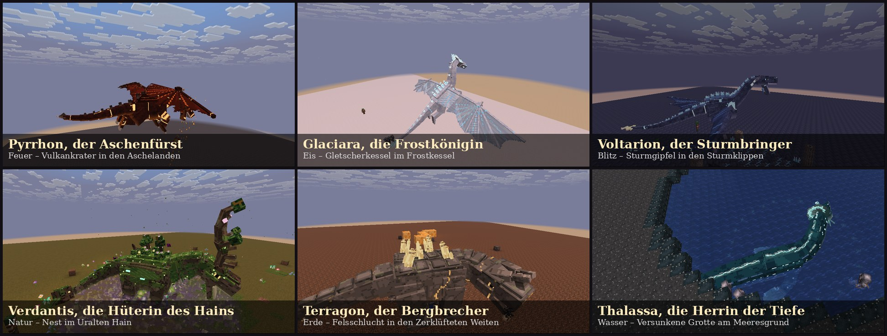

---

## Entwicklungsstand

| Bereich | Stand |
|---|---|
| NeoForge-Projekt für Minecraft 26.3, Java 25, Gradle; Build und Tests auf GitHub | ✅ fertig |
| Erzähltes Intro „Das Siegel“ beim ersten Betreten einer Welt (die sechs Drachen schmieden das Siegel, Musik, Erzähler DE/EN) | ✅ fertig |
| Der Erzähler spricht zu jedem Kapitel der Geschichte (Stimme und Text, DE/EN) | ✅ fertig |
| Geschichte „Das Siegel“: Chronik (seit 0.79 per Taste J statt als Buch), Kapitel mit Titelkarten, Siegelkreis mit sechs Monolithen, Siegelbruch, Schattentor | ✅ fertig |
| Sechs Drachen-Bosse (je ca. 25 Blöcke), jeder mit eigenem Körperbau, eigener Erweckung, eigenen Angriffen (je zwei große neue seit 0.56) und Bossleiste | ✅ fertig |
| Sechs riesige Nester – genau eins je Art und Welt – mit eigenem Biom und neuen Blöcken; Drachenkompass | ✅ fertig |
| Eigene Drachen: Eier nur von besiegten Bossen, fünf Wachstumsstufen, Reiten, Fliegen, Odem, Drachenpanzer, lebendige Bewegungen (Schritt und Galopp, Abheben, Landen, Kurvenflug, Sitzen, Launen) | ✅ fertig |
| Ritter und Soldaten: Söldnerhaus in den Dörfern, Feldherrentisch mit Heilen, Ausbildung, Rängen und Proviant, Garnison und Schlachtzug, Kommandostab, Banditen | ✅ fertig |
| Wilde Kreaturen: Wildschwein, Rothirsch, Gans, Irrlicht, Höhlentroll, Lindwurm | ✅ fertig |
| Erze mit Bestimmung: Stahl, Konterit, Aetherit, Draconium, Wyvernit, Edelstein | ✅ fertig |
| Ausrüstung: Stahl, Konterit, Draconium, Drachenschuppen (mit Set-Bonus), Gleiter, Krone, Trollkeule; Waffen und Rüstungen aus Monsterteilen (3D) | ✅ fertig |
| Magie: Aetherit-Stab, sieben Zauber in drei Stufen, Zaubertafeln, Magietisch, Zauberkreis (Radialmenü) | ✅ fertig |
| Sechs Erzmagier als Bosse, jeder in seinem eigenen Magierturm (sechs Bauweisen, je Element im passenden Land) | ✅ fertig |
| Bauen: Steine, Dächer, Fachwerk, Putz, Bleiglas, Burgtür, Fensterläden, Laternen, Kronleuchter, Zinnen, Möbel | ✅ fertig |
| Landwirtschaft: sieben Feldfrüchte, Gerichte, Getränke, Festmahl, Zierblumen | ✅ fertig |
| **Die Leere**: eigene Dimension hinter dem Herz der Schatten – sechs Biome aus treibenden Bruchstücken, Ruinen der Alten, eigene Blöcke, Klangwelten und vier Wesen (Leerenschlund, Splitterwächter, Zerrling, reitbarer Sternenrochen) | ✅ fertig |
| **Der Zerbrochene König**: Boss der Leere auf dem schwebenden Thron der Alten – eigenes Modell mit frei schwebenden Händen, acht Angriffe mit Sternenstrahl, Rissen der Leere und Leerenbeben, eigene Bossleiste, Stimmen und Klänge; seine Krone als 3D-Helm; seit 0.61 der stärkste Gegner (1.800 Lebenspunkte, Zorn des Königs, Doppelschlag) | ✅ fertig |
| **Das lebendige Meer**: Mantarochen, Leuchtquallen, Hai, Anglerfisch und Riesenkrabbe mit eigenen Modellen, eigenem Verhalten und eigenen Klängen; Tiefsee-Laterne, Haizahn-Pfeile, Krabbenfleisch, Krabbenschere, Nachtsicht aus Leuchtgelee | ✅ fertig |
| **Die Tiefe des Meeres**: sechs Landschaften am Meeresgrund (Tangwälder mit Riesentang, Felsnadeln, Anemonengärten, Muschelbänke, heiße Quellen, Leuchtfelder) und Meeresleuchten; das Versunkene Atoll mit **Karkinos, dem Riffkoloss** (zehn Angriffe, eigene Bossleiste), dem **Gezeiten-Speer** als 3D-Waffe und dem Gezeitenhorn | ✅ fertig |
| **Das Feenreich**: eigene Dimension im ewigen Abendrot, schon vor den Drachen über ein Portal aus Mondsteinziegeln und Feenstaub erreichbar – fünf Biome, Riesenpilze, leuchtende Glimmerbäume, Ruinen und Feenringe, vier Wesen (Fee, Feen-Irrlicht, Pilzling, Dornwicht); die Mondhaine mit **Noctua, der Mottenkönigin** (acht Angriffe, eigene Bossleiste) und die **Feen-Elytren** mit Flügelschlag | ✅ fertig |
| **Malleus, der Glutschmied**: Boss auf dem Dach jeder Aschenesse im Nether – kniet schmiedend an seinem Glutamboss, erwacht, wenn man herantritt; acht Angriffe, Weißglut unter halber Kraft, eigene Bossleiste und Klänge; der **Glutspeer** als 3D-Waffe; Rückruf mit einem Netheritbarren | ✅ fertig |
| **Asteria, die Sternenreiterin**: Boss jeder Sternwarte im End – stößt vom Himmel herab, wenn man an den Sternstein tritt; fliegend auf einem gepanzerten Sternenrochen, acht Angriffe (mit Schwarzem Loch und Mondsicheln) und die Supernova unter halber Kraft, eigene Bossleiste und Klänge; die **Sternenlanze** als 3D-Speer und die **Sternenschwingen** mit Sternenschub; Rückruf mit einem Endkristall | ✅ fertig |
| **MissMystik, die Feen-Zauberkünstlerin**: Boss der Zauberbühne im Feenreich – springt aus dem Großen Zauberzylinder, wenn man herantritt; schwebend, neun Tricks mit Karten, Tauben, Spiegelbildern, Hut, Schwertern und Feuerwerk, Zugabe und großes Finale, eigene Bossleiste und Klänge; das **Kartendeck der Mystik** und der **Zylinder der Mystik** als 3D-Hut; Rückruf mit Feenstaub | ✅ fertig |
| **Anni der Troll**: Boss der Fehlerzone in der Oberwelt (Boden aus falschen Biomen, schwebende Chunkfetzen, ausgestanzte Schächte, „404“) – wird aus dem Fehlerkern geladen; glitcht wie ein Spielfehler (Ruckler, Ladekreis, durch Wände, nicht registrierte Treffer), acht Angriffe, Absturz und Neustart unter halber Kraft, **Wiederherstellung als Anni 2.0** statt zu sterben (mit dem Speedhack), eigene Bossleisten und Klänge; der **Bannhammer** als 3D-Waffe und die **Fehlerflügel** mit Blinzeln; Neustart mit einem Redstoneblock | ✅ fertig |
| **Neue Angriffe** (neu): je zwei für Karkinos (Mahlstrom, Blasenfalle), Noctua (Mondfinsternis, Seidenkokon), Malleus (Glutkette, Glutfächer), Asteria (Schwarzes Loch, Mondsicheln) und den Zerbrochenen König (Risse der Leere, Leerenbeben) – mit neuen Effekten (Mondsicheln aus Licht, ein Schwarzes Loch mit Wirbelscheibe und Lichtring, Bebenringe, aufreißende Risse im Boden) und eigenen Klängen | ✅ fertig |
| Längeres Leveln: Heldenstufe 100 bei rund 1,17 Millionen Heldenerfahrung, Soldaten-Stufe 20 bei 5.610 Kampferfahrung; alte Spielstände werden umgerechnet | ✅ fertig |
| Deutsch und Englisch | ✅ fertig |
| Schattenwelt: eigene Dimension mit Biomen, Schattenvolk und Dörfern, Erzen, Kreaturen, leuchtenden Pflanzen (Mondfarn, Sternblüte, Seelenschilf …); Nyxar und seine Schattenzitadelle | ✅ fertig |
| Bauwerke der Schattenwelt: Mondtempel mit Gruft, Kristallminen, Mondleuchttürme, Ruinen der alten Welt, Felsbrücken | ✅ fertig |
| Wirtschaft: Münzen, Stadtbanner, Bürger mit acht Berufen, Baumeister und zwölf Gebäude, Handel, Ansehen, Krönung | ✅ fertig |
| Acht eigene Oberwelt-Biome mit eigenem Boden, eigenen Bäumen, Pflanzen, Felsen, Farben und Klängen | ✅ fertig |
| Klänge der Welt: eigene Klangwelt für alle 39 eigenen Biome und seit 0.61 für 53 Standard-Biome der Oberwelt (Tag/Nacht, drinnen/draußen, Regen, Höhe); die Klangteppiche kommen und gehen; seit 0.79 in jedem Biom (auch End, Tiefes Dunkel, Kampfdimensionen und Biome anderer Mods), sofort beim Betreten, mit eigenem Regler unter Musik & Geräusche | ✅ fertig |
| Eigene Dörfer in vier Bauweisen und vier Grundrissen, Dorfbewohner in 17 Berufen mit Tagesablauf, Handel, Gerüchten und Dorfwachen | ✅ fertig |
| Keine Vanilla-Bauwerke mehr in der Oberwelt: 17 eigene Bauwerke an ihrer Stelle, alle wichtigen Funde bleiben erhältlich | ✅ fertig |
| Eigene Hof- und Weidetiere statt Vanilla: Rind, Schwein, Schaf, Huhn, Pferd, Esel, Maultier, Ziege, Hase in 40 Rassen | ✅ fertig |
| Eigene Wildtiere statt Vanilla: Wolf, Fuchs, Bär, Panda, Katzen, Papagei, Biene, Fledermaus, Gürteltier, Kamel, Lama in 50 Arten | ✅ fertig |
| Eigene Monster statt Vanilla: Untote und Nachtwesen in 19 Arten und 39 Gestalten, 51 untote Dorfbewohner (heilbar) | ✅ fertig |
| Übrige Monster statt Vanilla: Gesetzlose (Wegelagerer, Schlächter, Beschwörer, Gaukler), Plagegeist, Verwüster, Riffwächter, Windgeist, Knorz, Tiefenhüter | ✅ fertig |
| Neue Monster: Werwolf, Moorschlurfer, Glutwurm, Aschengeist (0.69); Seelenreiher, Nachtwidder, Rissjäger, Chorusschlund in der Schattenwelt und im End (0.71) | ✅ fertig |
| **Der Abgrund** (0.72): eine Dimension aus Bruchstücken aller Welten – gekippt, kopfüber, mit glühenden Weltennähten, Lava- und Wasserfällen ins Nichts – unter einem Himmel voller glühender Risse; fünf Biome mit Monstern aus allen Welten und eigener Klangwelt; Schwebe- und Hebekristalle der verdrehten Schwerkraft; der Abgrundriss hinter dem Thron des Zerbrochenen Königs und der Rissschlüssel | ✅ fertig |
| **Der Weltenfresser** (0.73): der Schlund der Welten im Abgrund mit sieben schwebenden Kronensplittern und ihren Lichtketten; der Weltenfresser – zwölf Glieder mit Stücken verschlungener Welten, acht Angriffe und sein Zorn –; der Weltenspeer (3D), der Kopf des Weltenfressers als Trophäe und der Titel „Weltenretter“ | ✅ fertig |
| **Schrolli der Schöpfer** (0.75): der stärkste Gegner – Schöpferfunke und Altar des Schöpfers, die Schöpfung (die größte Kampfdimension, eigener Himmel, eigene Musik), ein Seraph mit 26 Künsten, die Wahre Gestalt statt des Todes (der Himmel öffnet sich), Seraphlinge, eigene Bossleisten; Zepter des Schöpfers (3D), Schwingen des Schöpfers und der Titel „Gottbezwinger“ | ✅ fertig |
| **Schrolli der Allmächtige** (0.78): die dritte Gestalt (Schwarzes Loch, Herz der Sonne, drei Räder, Flammenkranz, eigene Musik), sechs Künste des Allmächtigen, Lichtkäfig und Schwarzes Loch (jetzt 41 Künste), mit jeder Gestalt ein neuer Hof (Firmament, Herz der Sonne), neuer Speer, Schwingen wie echte Flügel, Heiligenschein und Räder des Schöpfers, Rüstung in Schichten bis 60, das Inventar bleibt auf Heldenstufe 200; seit 0.78.1 eigene Bossleisten für den Allmächtigen und den Weltenfresser | ✅ fertig |
| **Angeln** (0.79): der Drill als Minispiel (Fangzone, Leiste, perfekte Fänge, Schatzkisten), 76 Fischarten für jedes Biom und jede Welt, Angeln in Lava und im Nichts, sieben Legenden, jede Art mit eigener Wirkung beim Essen, Köderwurm und Glühköder, das Fischbuch (H); dazu die Chronik per Taste (J), stumme Truppen, Bauwerke in allen Dimensionen weiter auseinander, Verzauberungen im Verhältnis zur Waffe und auf ihre Fähigkeiten, Speere richtig in der Hand | ✅ fertig |
| **Totems und Äpfel der Macht** (0.80): neun Totems (Glut, Frost, Sturm, Fels, Hain, Gezeiten, Schatten, Leere, Schöpfer) mit Wirkung in der Zweithand, mehr Herzen beim Aufstehen und der Kraft ihres Elements; vier Äpfel (Drachen-, Sternen-, Schattenapfel, Apfel der Unsterblichkeit mit dem Zweiten Leben); plastische Modelle für Hand, Rahmen und Boden | ✅ fertig |
| **Tausend Fische** (0.81): eigene Arten für jedes Biom (105 Biome – auch Höhlen, Lava und Leere), mit den bisherigen genau 1000, jede mit eigenem Bild, eigenem Namen und eigener Wirkung; acht neue Legenden; das Fischbuch mit den Gewässern je Kapitel; der Fischbeutel (der Fang wandert hinein, Platz unbegrenzt erweiterbar) und der Fischer im Dorf als Händler dafür | ✅ fertig |
| **Die Himmelswacht** (0.82): Jeder Boss nimmt Flieger ins Visier (Siegel, Ziellinie, Warnanzeige) und holt sie mit einem verfolgenden Bannpfeil herunter; die Wirkung Flugbann (kein Gleiten, gedämpfter Sturz), 17 Themen mit eigener Farbe und Zugabe für alle Bosse, gute Schwingen verkürzen den Bann | ✅ fertig |
| **Sechshundert neue Fische** (0.83): 628 neue Arten (zwanzig in jedem eigenen Biom, zehn oder zwölf in jedem von Minecraft), 19 neue Gestalten (Hammerhai, Sägefisch, Seeschlange, Rotfeuerfisch, Seeigel, Muscheln, Fangkrebs …), zwei große Fänge je Biom, zusammen 1628 Arten; das Angel-Minispiel nur noch mit der Maus (halten oder klicken) | ✅ fertig |
| **Die Waffenkammer** (0.84): fünf Waffen (Stahl-Hellebarde, Draconium-Kriegshammer mit Erdstoß, Nachtstahl-Dolch, Abyssit-Großschwert, Stahl-Doppelaxt), vier Spitzhacken (Bergmannshammer 3×3, Glutspitzhacke, Adernbrecher, Erzspürer) und vier Schilde (Stahl-Rundschild mit Parade, Drachenschild, Turmschild, Spiegelschild) – alle in 3D, jede mit eigener Fähigkeit | ✅ fertig |
| **Neue Wesen in den eigenen Biomen** (0.85): Schneeleopard (Frostgipfel; pirscht, springt an, zähmbar), Urelch (Urhain; Bullen mit bemoosten, leuchtenden Schaufeln, Sattel und Truhe, Ansturm), Sturmmöwe (Sturmküste; Schwärme, schwimmt, klaut Fisch aus der Hand) und Greif (Felsschluchten; sitzt auf Felsnadeln, jagt im Sturzflug) – je mit Modell, Animationen, Verhalten, Klängen und Spawn-Ei | ✅ fertig |
| **Weitere Wesen** (0.86): Glutsalamander (Aschefelder; feuerfest, läuft über Lava, glüht, verbrennt Angreifer), Moorschnapper (Nebelmoor und Sümpfe; lauert im Wasser, schnappt zu, faucht, zieht sich in den Panzer zurück), Flamingos (Korallenküste und Mangroven; Scharen, gründeln, ruhen auf einem Bein, fliegen auf) und Schmetterlinge (Königsauen, Blumenwälder, Wiesen; sechs Arten, setzen sich auf Blumen) – je mit Modell, Animationen, Verhalten, Klängen und Spawn-Ei | ✅ fertig |
| **Kampf, Wurf, Zauber und Angeln** (0.87): Drachen finden ihre Gegner (Wache für den Herrn, Boden- und Luftkampf, gezielter Biss, sauberes Landen neben dem Herrn), Bosse fliegen über Mauern; Speere, Lanzen und Dreizacke fliegen mit der Spitze voran; sieben neue Verzauberungen am Zaubertisch (Donnerschlag, Giftzahn, Standhaft, Lebenskraft, Eulenauge, Hasenfuß, Drillmeister), etwas stärkere Verzauberungen von Minecraft; sechs eigene Angeln (Eisen, Gold, Drache, Schatten, Glut, Stern) | ✅ fertig |
| **Waffen und Werkzeuge in 3D** (0.88): die Sätze aus Stahl, Nachtstahl und Abyssit, Draconiumschwert und -axt, Mondsilberklinge, Trollkeule, Kommandostab und Vermessungsstab als 3D-Modelle (richtig gehalten, auch mit F5); 89 weitere Gegenstände plastisch (Barren, Steine, Schuppen, Runen, Münzen, Monsterteile, Speisen) | ✅ fertig |
| **Das Urmeer** (0.89): eine Meeresdimension mit vier Biomen (Urmeer-Weiten, Korallenbänke, Tiefseegraben, Sturminseln), Gezeitenstein, Klangwelten, 80 neuen Fischarten und den Bauwerken des Meeres; der Versunkene Tempel in den tiefen Ozeanen mit dem Gezeitentor; eigene Tore aus Gezeitensteinziegeln, mit dem Herz des Meeres erweckt | ✅ fertig |
| **Angeln** (0.90): alle sieben Angeln in 3D (ruhend mit Schnur, Schwimmer oder Köder und Haken, ausgeworfen mit gebogener Spitze); Angeln unter Wasser; fünf Seltenheiten (Mystisch statt Episch) und in jedem Biom jede davon – 113 Legenden der Biome; das Urmeer mit vierzig Arten je Biom; zusammen 1893 Arten | ✅ fertig |
| **Der Kraken** (0.91): ein Boss im Urmeer knapp unter Anni dem Troll (sieben Angriffe, Würgegriff mit Befreiung, Haie, Flutwelle, eigene Bossleiste und Klänge); der Krakenschlund mit Trichter, Becken, Wrack, Gerippe und Felsenring; die Krakenangel in 3D als Beute | ✅ fertig |
| **Unter Wasser** (0.92): vier Meereshölzer (Tangholz, Korallenholz, Perlholz, Tiefseeholz) mit allen Holzblöcken; Setzlinge, die unter Wasser zu Meeresbäumen wachsen; vier neue Landschaften im Urmeer (Tangwald, Korallengarten, Perlmuttgründe, Leuchtende Tiefe) mit je vierzig Fischarten; zusammen 2053 Arten | ✅ fertig |
| **Meeresdörfer** (0.93): das Meervolk im Urmeer – Meerjungfrauen in sechs Gestalten und vier Berufen (Perlentaucherin, Korallengärtnerin, Muschelbauerin, Gezeitensängerin), die gegen Perlen tauschen, Tritonwachen mit Dreizack; Meeresdörfer mit Dreizacksäule, Muschelhäusern, Gesangsturm, Gärten und Marktständen; Perlen als Währung | ✅ fertig |
| **Schönere Bossleisten** (0.94): die Leisten aller Bosse leben – Erscheinen mit entrollendem Namensband und Aufladen, Phasen-Edelsteine genau bei den Kampfphasen jedes Bosses (sie zerspringen in Splitter), Beben und Aufblitzen bei Treffern, Schimmer bei Heilung, ein Glanz über dem Rahmen, Teilchen je Boss und Phase, die letzte Phase pulsierend; die eigene Leiste des Kraken; mit Namensschild bleibt die eigene Leiste | ✅ fertig |
| **Rüstungen in 3D** (0.95): getragene Rüstungen mit 3D-Teilen passend zum Material – Stahl (Helmbusch, Schulterstücke, Sporen), Konterit (Flügel, Umhang), Nachtstahl (Kristallkrone und Stacheln), Abyssit (Hörner, Kristalle), Drachenschuppen je Element (Hörner oder Geweih, Rückenstacheln, Drachenschwanz, Krallen), Edelsteinkrone; dazu Leder, Kettenhemd, Kupfer, Eisen, Gold, Diamant, Netherit und Schildkrötenpanzer | ✅ fertig |
| **Der Steinhüter** (0.96): der alte Mondsteinbruch im Feenreich (drei Stufen, Rampen, Erzadern, Lampen, Gerüste, Kran, Hütte mit Truhe); der Steinhüter als Boss (schläft vor dem Hüterstein, sieben Angriffe, Kristallpanzer, Benommenheit, eigene Bossleiste und Klänge, Rückruf mit Mondstein); der Hüterhammer in 3D; Mondsteinerz, Mondstein, Mondsteinblock und die Mondsteinrüstung (mehr Mana, in 3D) | ✅ fertig |
| **Die Meerhexe** (0.97): die Hexengrotte im Urmeer (Kuppel aus Gezeitenstein in einer toten Zone, Eingang durch die Rippen eines Wals, Knochensäulen, Blasensäulen, Nischen, Wrack, zwei Truhen); die Meerhexe als Boss (schwebt in Trance über ihrem Kessel, acht Angriffe und der Zorn mit der Woge aus Tinte, eigene Bossleiste und Klänge, Rückruf mit einer Perle); der Hexenstab in 3D; Aquamarinerz, Aquamarin, Aquamarinblock und die Taucherrüstung (länger atmen, schneller schwimmen und abbauen, klare Sicht, in 3D) | ✅ fertig |
| **Der Seelenhirte** (0.98): der Seelenpferch im Seelensumpf der Schattenwelt (runder Pferch mit Zaun, Seelenlaternen und Schafsschädeln, Glockenstuhl mit der Seelenglocke, Feuerschalen, Stege auf Stelzen, Hütte mit Truhe); der Seelenhirte als Boss (steht in Andacht vor seiner Glocke, sieben Angriffe, im Zorn der Seelensturm, eigene Bossleiste und Klänge, Rückruf mit einem Seelenkristall); der Hirtenstab in 3D; Dämmerquarz, Dämmerquarzblock und die Dämmerrüstung (schwerer zu entdecken, schneller schleichen, weiche Landung, Nachtsicht beim Schleichen, in 3D) | ✅ fertig |
| **Die Sternenweberin** (0.99): das Sternennetz in den leeren Weiten der Leere (Netzplatte aus Sternenseide und Sternengewebe, sechs Ankerfelsen mit Tauen, Sternenkrone, Kokons, Truhe); die Sternenweberin als Boss (hängt in Andacht über ihrem Gelege, acht Angriffe, im Zorn die Spindel, eigene Bossleiste und Klänge, Rückruf mit einem Himmelseisenbarren); der Sternenbogen mit Netzpfeil; Himmelseisen und die Rüstung der Sternwandler; Rüstungen ohne offene Stellen, stille Rüstungs-Effekte, Wasseratmung der Taucherausrüstung; Handel der Meerjungfrauen wie bei allen Händlern; 8369 Fischarten, Drill nach Seltenheit; keine Lava und kein Trockenlegen im Urmeer | ✅ fertig |
| **Der Kraken erwacht** (1.0): der Kraken schwimmt in seinem Becken umher (Kreise um sein Ziel, Bugwelle und Kielwasser, Ruderschlag der Arme); vier neue Angriffe – Rammstoß, Ausbruch aus der Tiefe, Geysirfeld und Tentakelkäfig mit abschlagbaren Armen; sechs neue Klänge | ✅ fertig |
| **Der Stundenwächter** (1.1): der Uhrturm im Abgrund (großes Zifferblatt mit römischen Ziffern und Zeigern aus Uhrbronze, Turm mit Treppe, Pendel, Uhrwerkkammer und Glockenstube, schwebende Zahnräder, zwei Truhen); der Stundenwächter als Boss (steht erstarrt über dem Uhrwerkherz, neun Angriffe mit Zeitstopp, Rückspulen und Taumeln, die Zwölfte Stunde, eigene Bossleiste und Klänge, Rückruf mit Chronit); der Minutenzeiger; Chronit und die Rüstung der Zeitwächter mit Zweiter Chance; `/kaw boss stundenwaechter` | ✅ fertig |
| **Der Weg zum Unsterblichen** (0.77): Heldenstufe bis 200, fünf neue Ränge (Mythos, Halbgott, Titan, Sternenwanderer, Unsterblicher) mit Abzeichen und Wahrzeichen, Heldenkraft je Stufe, Talente bis 40 Punkte (Meisterschaft), je 25 Herz- und Manakristalle, das Licht der Unsterblichkeit, Heldenherzen in Schichten | ✅ fertig |
| **Schrolli greift zur Klinge** (0.76): Nahkampf am Boden – Landung, Beine in goldenen Beinschienen, die Klinge aus Licht mit Lichtspur, sieben Künste der Klinge (Klingenhieb, Lichtsicheln, Sturmlauf, Klingenwirbel, Himmelssturz, Schwingenwehr mit Gegenschlag, Weltenklinge), jetzt 33 Künste; warme, leisere Klänge und Musik | ✅ fertig |
| **Die Kampfdimensionen** (0.74): Mondbühne, Glutesse, Sternenzelt, Fehlerraum, Thronwelt und Weltenschlund – die sechs großen Bosse ziehen ihre Gegner in ein Abbild ihres Horts unter einem fremden Himmel (Regeln wie in der Arkanen Sphäre, Nachzügler folgen); nach der Niederlage erwacht der Boss unversehrt in seiner ursprünglichen Gestalt; Spawn-Ei des Weltenfressers; `/locate` findet Schlund und Thron | ✅ fertig |
| Eigene Wassertiere statt Vanilla: Fische, Tintenfische, Delfine, Schildkröten, Molche, Frösche, Nautilusse in 23 Gestalten | ✅ fertig |
| Überarbeitung von Siedlung und Dörfern: Bauarbeiter, Häuser mit Baukosten, Lager, Sammler, Söldner, Münzen, Beute, Dorfanlagen | ✅ fertig |
| Eigene Golems und Wichtel statt Vanilla: Eisenwächter (vier Gestalten, einer in jedem Dorf), Schneemann, Kupferknecht mit Statuen, Wichtel (vier Gestalten) | ✅ fertig |
| Urwühler, Wolkenqualle, Dorfbewohner und fahrender Händler statt Vanilla (Händler mit Münzhandel) | ✅ fertig |
| Nether-Volk statt Piglins: Borstlinge (drei Gestalten), Borstenhüne, Moderborstlinge | ✅ fertig |
| Tiere und Geister des Nethers: Glutkeiler, Moderkeiler, Lavastelzer, Rauchqualle, Glutgeist, Glutschleim | ✅ fertig |
| Brandgebein (statt Witherskelett) und Aschenkönig (statt Wither) mit Seelenschädeln | ✅ fertig |
| Leerwandler (statt Enderman, zwei Gestalten) und Leermilbe (statt Endermite) | ✅ fertig |
| Schreinling (statt Shulker, siebzehn Farben) mit Schreinfunken | ✅ fertig |
| Sternenfresser (das Aussehen des Enderdrachen) | ✅ fertig |
| Die Standard-Biome im Stil der eigenen (Felsnadeln, Oasen, Moosfelsen, Stämme, Schilf, Schneewehen …) | ✅ fertig |
| Eigene Baumformen für alle Standardbäume, in der Welt und aus Setzlingen | ✅ fertig |
| Unterholz (Büsche, junge Bäume) und sattere Farben in den Standard-Biomen | ✅ fertig |
| Karge Truhen, seltenere Bauwerke, Holzfäller mit eigenem Hain | ✅ fertig |
| Aschenesse statt Netherfestung | ✅ fertig |
| Hortfeste der Borstlinge statt Bastion | ✅ fertig |
| Riesengebeine statt Netherfossilien, Verlorene Pforte statt Portalruine im Nether | ✅ fertig |
| Sternwarte statt Endstadt und Endschiff (mit den Elytren) | ✅ fertig |
| Köpfe und Schädel der eigenen Wesen (als Block, Gegenstand und getragen) | ✅ fertig |
| Krieg der Königreiche, Teil 1: vier Reiche, Stammburgen, Besatzung, Herrscher, Eroberung, Tribut | ✅ fertig |
| Regeln: nur ohne andere Mods, keine Koordinaten, Schwierigkeit fest auf Schwer, stärkere Gegner, halbe Heilung | ✅ fertig |
| Acht eigene Verzauberungen (nur als Beute), Arachnophobie-Modus | ✅ fertig |
| Die Arkane Sphäre: Kampf gegen die Erzmagier in einer eigenen Dimension (Arena je Element, Bauverbot, alles verloren beim Tod) | ✅ fertig |
| Erzmagier: je zwei Meisterzauber mit eigenen Modellen und Effekten, je eine besondere Fähigkeit, deutlich stärker | ✅ fertig |
| Aetherit-Stab: unzerstörbar, nur herstellbar (Aetherkern), Meisterschaft in vier Rängen, Aufladen, neue Zaubereffekte | ✅ fertig |
| Erzmagier: Heilritual, je eine weitere Fähigkeit, sichere Heimkehr in den Turm nach dem Sieg | ✅ fertig |
| Aetherit-Stab: Mana-Leiste, sechs Stufen bis 150 % Kraft, Heilende Blüte heilt sofort, prächtigere Zauber | ✅ fertig |
| Belagerungswaffen: Katapult, Tribok, Balliste, Rammbock – selbst bedient oder mit Bedienmannschaft (Kommandostab) | ✅ fertig |
| Heerhaufen: Reiche im Krieg greifen die eigene Siedlung an (Sammelplatz, Horn, Leiste, Kriegskasse, Plündern) | ✅ fertig |
| Neue Truppen: Speerträger, Armbrustschützen, Schildträger, Waffenknechte, Lanzenreiter mit Schlachtross, Belagerungsknechte | ✅ fertig |
| Drachen im Krieg: Drachenhorn, Sturzangriff mit Odem, Luftangriff, Verteidigung gegen Heerhaufen | ✅ fertig |
| Dragon Architect, Teil 1: Gebäude vermessen, eigene Baupläne, Nachbau Block für Block oder abschnittsweise | ✅ fertig |
| Dragon Architect, Teil 2: Schematiken einlesen und ablegen (.litematic, .schem, .nbt) | ✅ fertig |
| Dragon Architect, Teil 3: Großbaustellen bis 320 × 320 – viele Baumeister zugleich, jeder in seinem Abschnitt | ✅ fertig |
| Die Königsburg: eine fertige Burg mit 300 × 300 Blöcken als Bauplan und als .litematic | ✅ fertig |
| Herz- und Manakristalle: für immer mehr Herzen und Mana (Höhlen, Schatztruhen, Drachenbosse, Erzmagier) | ✅ fertig |
| Truppen weiter leveln: Kampferfahrung, 20 Stufen, die Ränge Meister und Legende | ✅ fertig |
| Eigenes Levelsystem für den Charakter: Heldenerfahrung, 50 Heldenstufen, sechs Talente, Charakterfenster (K) | ✅ fertig |
| Heldenstufe bis 100 mit sechs Rängen, neues Charakterfenster, Aufstiegs-Szene, Streicheln als Belohnung | ✅ fertig |
| Fahrzeuge und Belagerungsturm: Planwagen für Baustoffe und Soldaten, Turm mit Fallbrücke | ✅ fertig |
| Cheat-Befehle für Heldenerfahrung und Kampferfahrung (`/kaw hero`, `/kaw army xp`) | ✅ fertig |
| Bauprüfung aller Häuser (Betten, Türen, Truhen, Halt) und die gefundenen Baufehler behoben | ✅ fertig |

---

## Herunterladen und spielen

**Voraussetzungen**

- Minecraft Java Edition **26.3**
- **NeoForge 26.3.0.98** oder neuer ([NeoForge-Installer](https://neoforged.net/))
- Java 25 – bringt der Minecraft-Launcher automatisch mit

**Die Test-JAR bekommen**

1. Auf GitHub oben auf **Actions** klicken.
2. Den neuesten erfolgreichen Lauf von **Build** öffnen (grüner Haken).
3. Unten bei **Artifacts** die Datei **kingdomsatwar-1.1.5.jar** herunterladen
   (dafür musst du bei GitHub angemeldet sein).

Sobald es ein Release gibt, liegt die JAR auch dauerhaft unter **Releases**.

**Installieren**

1. NeoForge für 26.3 installieren und das NeoForge-Profil einmal im Launcher starten.
2. Die Datei `kingdomsatwar-1.1.5.jar` in den Ordner `mods` kopieren
   (Windows: `%appdata%\.minecraft\mods`).
3. Minecraft mit dem NeoForge-Profil starten und eine **neue** Welt anlegen: Die neuen Biome gibt es nur in neu
   angelegten Welten; Dörfer, die neuen Bauwerke, Erze, Kreaturen, Blumen, der Siegelkreis, die Drachennester und
   Burgruinen entstehen nur in neu erzeugten Gebieten.

Beim ersten Betreten einer Welt läuft das **Intro „Das Siegel“**: Vor deinen Augen schmieden die sechs Drachen das
Siegel gegen die Dunkelheit – mit eigener Musik und Erzähler. Überspringen mit Leertaste, Enter oder Esc, wieder
ansehen mit `/kaw intro`.

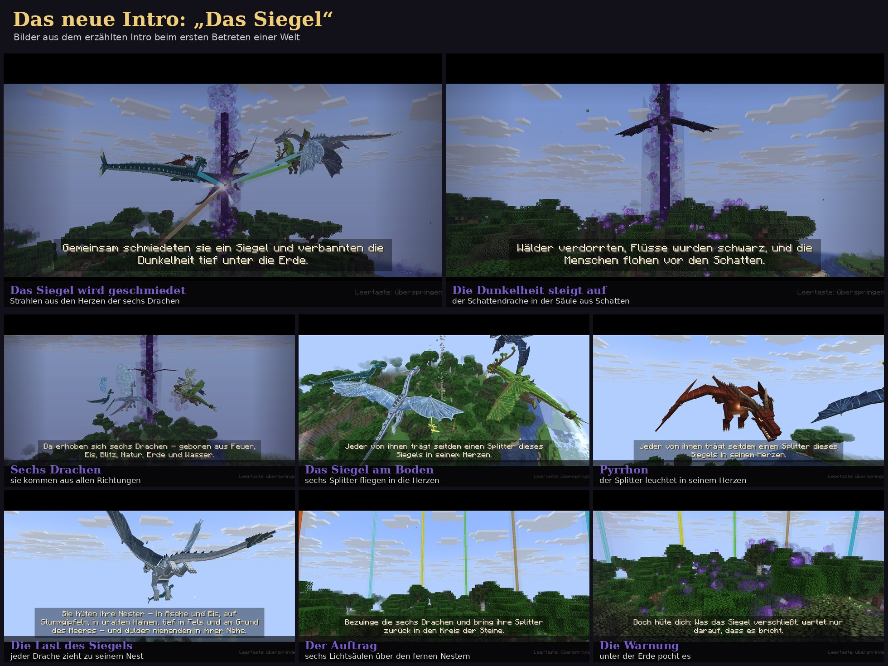

Danach nennt dir das Spiel die Taste für die **Chronik des Siegels** (anfangs **J**) – sie erzählt die Geschichte und zeigt
dir den nächsten Schritt. Ein Buch dafür gibt es seit 0.79 nicht mehr: Die Chronik hat jeder immer bei sich.
Im Kreativmodus gibt es sechzehn eigene Tabs.

---

## Inhalte

### Die Geschichte: „Das Siegel“

Die **Chronik des Siegels** schlägt man mit der Taste **J** auf (seit 0.79; vorher lag sie als Buch im Inventar). Sie ist
ein aufgeschlagenes Buch: links die Kapitel (erreicht, aktuell, noch verborgen) und
der Zustand des Siegels, rechts die Ziele des Kapitels, Hinweise und die Erzählung. Zu Beginn jedes Kapitels erscheint
eine Titelkarte, und **der Erzähler spricht** (dieselbe Stimme wie im Intro, Deutsch oder Englisch je nach Spielsprache,
seine Worte stehen auf der Karte): zum neuen Königreich, zur Chronik, zum Siegelkreis, zu jedem gefallenen Drachen mit
seinem Namen und wie viele noch das Siegel bewachen, zum Siegelbruch, zur Schattenwelt, zu Nyxars Fall und zum
Abschluss bei der Krönung.

| Kapitel | Was zu tun ist |
|---|---|
| Prolog | das Intro – die Welt, die Drachen, das Siegel |
| I Ein neues Königreich | mit dem Stadtbanner die Siedlung gründen und den ersten Bürger oder Soldaten anheuern |
| II Die Chronik des Siegels | den **Siegelkreis** finden (die Chronik verrät die Richtung) |
| III–VIII Die sechs Drachen | die Drachen in beliebiger Reihenfolge bezwingen und ihre Splitter einsetzen |
| IX Das Siegel bricht | der sechste Splitter öffnet das Tor in die Schattenwelt |

Der **Siegelkreis** liegt genau einmal pro Welt einige Hundert Blöcke vom Weltursprung entfernt auf ebenem Land:
eine runde Plattform aus Siegelstein mit sechs unzerstörbaren **Monolithen** – Gegensätze stehen sich gegenüber
(Feuer und Eis, Blitz und Wasser, Natur und Erde) – und dem großen Siegel in der Mitte. Jeder besiegte Drache
hinterlässt einen **Siegelsplitter**; in seinen Sockel eingesetzt, erwacht der Monolith und leuchtet in seiner Farbe.
**Der sechste Splitter bricht das Siegel:** Lichtsäulen, eine wachsende Lichtkugel, Risse, ein Blitz, eine
Druckwelle – und das Siegel wird zum **Schattentor**. Kapitel I und II gehören jedem Spieler selbst, die Drachen und
das Siegel der ganzen Welt.

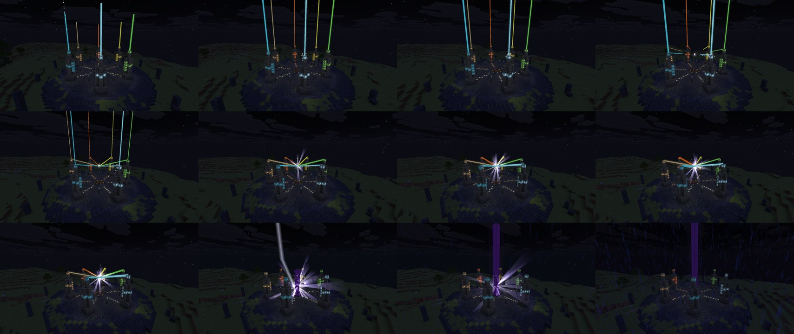

### Die Drachen-Bosse

Sechs einzigartige Bosse, je etwa 25 Blöcke lang. Jeder hat einen eigenen Körperbau (runde Formen, einzelne Zähne,
spitz zulaufende Hörner und Stacheln, Texturen in doppelter Auflösung), weiche, lebendige Bewegungen (Hals und
Schwanz schwingen nach, kraftvoller Flügelschlag, sauber angelegte Flügel, Gangarten mit Körperrollen, Atmen,
Ausholen und Nachschwingen), eine eigene Erweckung und eine eigene Bossleiste.

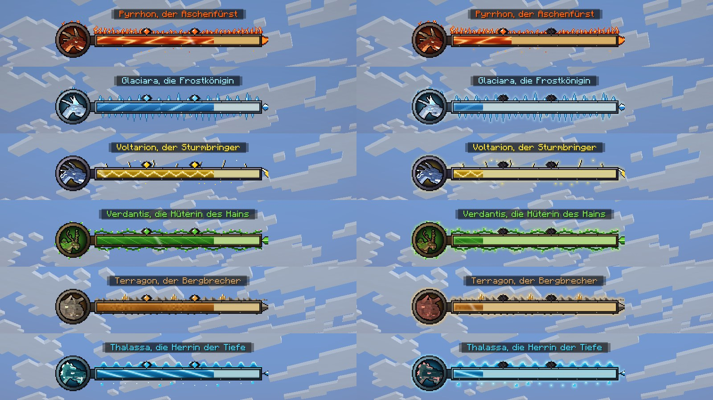

| Drache | Körperbau | Erweckung | Besondere Angriffe |
|---|---|---|---|
| **Pyrrhon**, der Aschenfürst (Feuer) | schwerer Drache mit vier Beinen, geschwungenen Hörnern und glühendem Feuersack | steigt aus dem Lavasee, Ascheregen | Flammenodem (auch im Flug), Feuerball-Salve, Meteorregen, Lava-Geysire, Flammenring, **Feuerwirbel** (zwei bis drei Flammenwirbel jagen über das Nest, ziehen hinein und heben an), **Magmaspalten** (glühende Risse reißen sternförmig auf – dann bricht eine Feuerwand hervor) |
| **Glaciara**, die Frostkönigin (Eis) | schlank, langer Hals, Kristallkrone, Flügel mit Eisfedern | ruht unsichtbar im Eiskristall, bis er zerspringt | Frostodem, Eisspeere aus dem Boden, Schneesturm, Eisgefängnis, Eiszapfenregen, **Frostlanze** (ein gleißender Strahl schwenkt über den Boden, lässt erstarren und hinterlässt Raureif), **Splittersturm** (ein Kranz aus Eiskristallen schießt nach allen Seiten – die Lücken finden) |
| **Voltarion**, der Sturmbringer (Blitz) | Wyvern: Flügel als Vorderbeine, Peitschenschwanz mit Klinge, Blitzstreifen | Gewitter zieht auf, er fährt mit einem Blitz herab | Kettenblitz, Blitzfeld, Sturzflug-Ansturm, Gewitter, Donnerschrei (betäubt), **Kugelblitze** (knisternde Kugeln jagen ihre Gegner und schlagen als Blitz ein), **Blitzkäfig** (Blitzsäulen und Bögen sperren ein – eine Lücke bleibt, dann trifft der große Blitz die Mitte) |
| **Verdantis**, die Hüterin des Hains (Natur) | Hirschgeweih, Hauer, Flügel aus Blättern, Moosmantel und Bäumchen auf dem Rücken | erhebt sich aus dem überwucherten Hügel | Giftsporen, Wurzelfessel, Dornensäulen, Samenregen, Rankendiener, Heilung aus den Blüten, **Dornenwelle** (Ringe aus Dornenranken breiten sich aus – darüber springen), **Sonnenstrahl** (eine goldene Linie zeigt das Ziel, dann ein gleißender Strahl, der sie heilt) |
| **Terragon**, der Bergbrecher (Erde) | flügellos, massig, Felsplatten und Kristalle, Keulenschwanz | Erdbeben, bricht aus dem Boden | Felsbrocken, Erdbeben-Stampfer, Stalagmitenreihe, Eingraben und Auftauchen, Kristallpanzer, **Felslawine** (Brocken brechen aus dem Boden und rollen auf die Gegner zu), **Erdspalter** (ein Riss läuft im Zickzack heran, dahinter schießen Felsnadeln empor) |
| **Thalassa**, die Herrin der Tiefe (Wasser) | Seeschlange mit Flossen, Kopfkragen und Schwanzflosse | Strudel, steigt aus der Tiefe | Wasserstrahl, Flutwelle, Strudel, Blasengefängnis, Tiefensprung, **Geysirfeld** (unter jedem Gegner brodelt es – dann schießt ein Geysir zehn Blöcke hoch), **Wasserschlangen** (Schlangen aus Wasser springen in hohem Bogen auf die Gegner) |

Dazu kommen Biss, Klaue, Schwanzhieb, Flügelschlag, Stampfen und Brüllen. Jeder Angriff kündigt sich an (Ausholen,
Ausführen, Erholen).

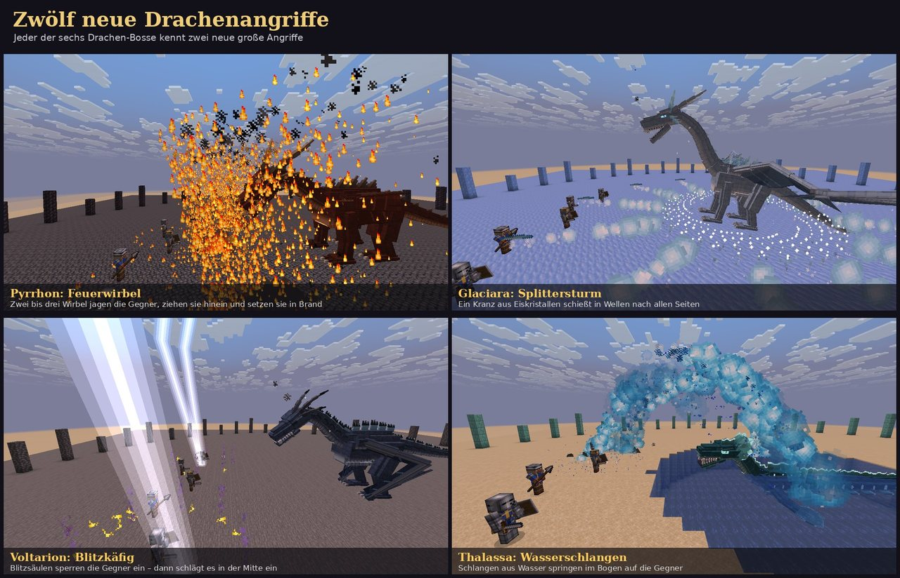

- **Erwacht erst aus nächster Nähe:** Der Drache schläft, bis man höchstens fünf Blöcke an ihn herankommt – wer nur
  am Nest vorbeiläuft, weckt ihn nicht (und sieht auch noch keine Bossleiste).
- **Trefferzonen:** Kopf, Hals, Körper, Flügel und Schwanz nehmen unterschiedlich viel Schaden.
- **Je mehr Schaden, desto gefährlicher:** Mit sinkendem Leben schlägt der Drache härter zu (bis zu 70 % mehr
  Schaden), greift schneller an (bis zu 40 %), bewegt sich schneller, macht kürzere Pausen, hängt Angriffe
  aneinander und setzt seine großen Angriffe häufiger ein.
- **Drei Phasen und ein letztes Aufbäumen:** Bei 60 % und 30 % Leben bäumt er sich brüllend auf – kurz
  unverwundbar, eine Druckwelle fegt über die Arena – und entfesselt dann seinen großen Angriff. Ab der zweiten Phase
  schlagen Gefahren seines Elements bei den Gegnern ein (Meteore, Eiszapfen, Blitze, Dornensaat, Felsbrocken,
  Wasserfontänen), jede mit leuchtendem Warnkreis; in der letzten Phase doppelt so oft, dazu eine Wut-Aura. Unter
  12 % bäumt er sich ein letztes Mal auf. Die Lebensleiste wächst mit dem Schwierigkeitsgrad und der Zahl der Spieler.
- **Bossleisten:** Jedes Element hat einen eigenen Rahmen (Flammen, Eiskristalle, Blitze, Ranken, Felsen, Wellen) mit
  dem Bildnis des Drachen, zwei Edelsteinen für die Phasen bei 60 % und 30 % (sie zerspringen), strömender Füllung,
  einer Spur für erlittenen Schaden und Wut-Glühen in der letzten Phase – seit 0.94 lebendig (siehe
  [Die Bossleisten](#die-bossleisten-seit-094)).
- **Gemacht für den Kampf mit dem eigenen Heer:** Die Drachen greifen auch Soldaten an, Flächenangriffe treffen alle.
- Verlassen alle Spieler das Nest, kehrt der Drache in seinen Schlaf zurück und heilt sich.
- **Sieg:** Auf dem Nest-Altar erscheint im Lichtstrahl ein **reines Drachenei**, darüber schwebt der
  **Siegelsplitter**; dazu fallen viele Drachenschuppen, Draconium, Edelsteine und Schätze des Nests.

### Nyxar und die Schattenzitadelle

Hinter dem Siegel wartet der Endgegner: **Nyxar, der Schattendrache**, der „Lichtverschlinger“ – größer als die
sechs Elementdrachen (ca. 30 Blöcke), fast schwarz, mit einem Kamm aus Nachtkristallen, drei Augenpaaren, einer Krone
aus sechs Hörnern und zerfetzten Schwingen mit leuchtenden Adern. Zwischen seinen Rippen glimmt Seelenlicht.

- **Die Schattenzitadelle** steht genau einmal in der Schattenwelt (900–1700 Blöcke von der Mitte): eine achteckige
  Festung aus Schattenstein mit acht Türmen (Wohngeschosse, Leitern, Truhen, Turmhelme mit Kristallspitzen), Wehrgang
  mit Zinnen und leuchtenden Schießscharten, einem Torhaus mit Fallgitter und Freitreppe. Im offenen Thronhof liegt ein
  Siegel aus Seelenkristall, ein Prozessionsweg mit Seelenfeuer-Schalen führt zum Podest mit Nyxars Thron zwischen
  zwei Obelisken. In der Schattenwelt zeigt der **Drachenkompass** zur Zitadelle.
- **Erwachen:** Wer den Thronhof betritt, sieht Schatten sich spiralförmig sammeln – Nyxar nimmt Gestalt an, reißt
  die Schwingen auf und brüllt.
- **Angriffe:** Biss, Prankenhieb, Schwanzhieb, Flügelschlag, Schattenodem (auch im Flug, zehrt und verdunkelt die
  Sicht), Seelenpfeil-Salve, **Schattenschrei** (Dunkelheit und Schwäche), **Schattensprung** (zerfließt, gleitet als
  Seelenspur über den Boden und schlägt hinter seinem Ziel zu), **Schattenklauen** (greifen aus dunklen Flecken unter
  allen Gegnern empor), **Seelenraub** (Seelenfäden heilen ihn – weit genug weglaufen zerreißt sie), **Finsternis**
  (die Arena versinkt im Dunkel, Irrlichter jagen die Spieler) und in der letzten Phase **Schattenregen**.
- Magie und Gift von Nicht-Spielern prallen an ihm ab, Feuer trifft ihn härter.
- **Sieg:** Licht bricht über dem Thronhof durch, das **Herz der Schatten** schwebt dort, wo er fiel, dazu Abyssit,
  Seelenkristalle und Schattenessenz – und beim ersten Sieg endet die Geschichte vom Siegel.

### Die Dörfer der Umbrer

Das Schattenvolk lebt in Dörfern aus Schattenstein und Schattenholz mit Mondlaternen und Nachtkristallen. Jedes Dorf
hat seinen eigenen Grundriss – **Stern** (vier Wege), **Gasse** (eine lange Gasse durch den Platz), **Dreiweg** oder
**Ring** (eine Ringstraße um den Platz, die Häuser schauen zur Mitte, zwei Wege hinaus) – und auf dem Platz eines von
vier Mittelstücken: den **Mondbrunnen**, einen **Kristallhain**, einen alten **Schattenbaum** mit Glimmerranken oder
den **Steinkreis der Seher**. Häuser, Langhäuser, Dämmerkornfelder und Kristallgärten sind jedes Mal anders gemischt,
nicht jedes Dorf hat einen Seherturm; an den Wegenden stehen Wachtürme.

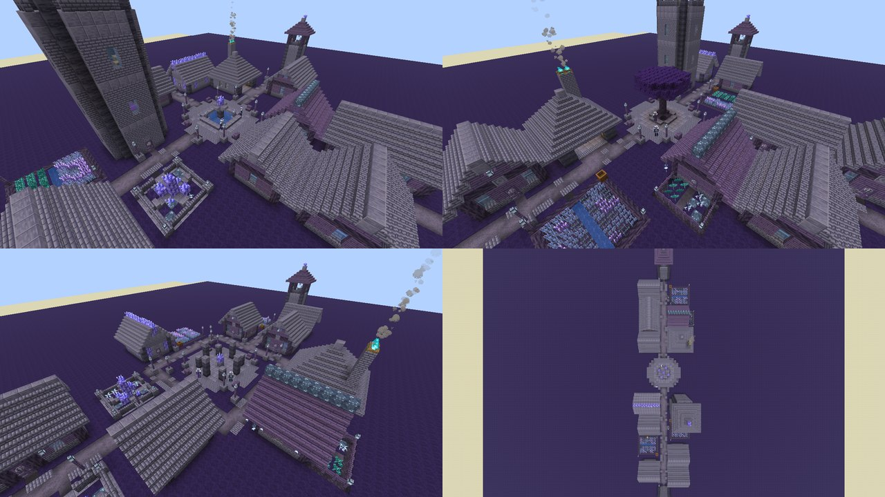

### Bauwerke der Schattenwelt

Neben den Dörfern der Umbrer und der Zitadelle liegen überall in der Schattenwelt kleinere Bauwerke – etwa alle
200–300 Blöcke eines. Jedes sucht sich passendes Gelände (eben genug, nie unter Wasser, Leuchttürme nur an der Küste),
hält Abstand zu Dörfern und anderen Bauwerken und steht auf einer Lichtung. Mit `/locate structure` findet man sie
(`kingdomsatwar:moon_temple`, `crystal_mine`, `lighthouse`, `old_world_ruin`).

- **Verlassener Mondtempel** (Schattenwald, Bleiche Öde, Glimmerweiten): auf einem dreistufigen Sockel ein Säulenportikus
  mit Rosenfenster aus Nachtkristall, ein Schiff mit zwei Säulenreihen, Bänken und hängenden Mondlaternen, ein steiles
  Steindach, an drei Stellen eingestürzt (darunter Trümmer, Moos und Glimmerranken), und hinten die Apsis mit
  Halbkuppel, Mondaltar, Seelenkristall und einer Mondsichel aus Mondsilber. Eine Treppe führt hinab in die **Gruft**
  mit Sarkophagen – zwei Truhen mit Mondsilber, Seelenkristallen, Schattenessenz, verzauberten Büchern, selten einer
  Mondsilberklinge oder der Abyssit-Schmiedevorlage.
- **Kristallmine** (Kristallschluchten, Schattengipfel, Bleiche Öde): ein Förderturm aus Schattenholz über dem Schacht, eine
  Leiter 26 Blöcke hinab in eine Halle mit Stützbalken, Seelenlaternen und Truhe. Zwei Stollen mit Gleisen: nach
  Osten zu einer **Lore mit Beute**, nach Westen in eine **Kristallkammer** voller Nachtkristall – mit einem Spawner,
  aus dem Kristallkriecher kommen. In den Wänden glitzern Seelenkristall- und Mondsilberadern.
- **Mondleuchtturm** (an den Küsten): Felssockel, ein runder, nach oben schmaler werdender Turm mit Streifen aus
  Mondsilber, drei Geschosse mit Leiter, eine Galerie und der gläserne Laternenraum mit leuchtender Lampe unter einem
  Zeltdach. Daneben das Haus des Wärters (Bett, Ofen, Schornstein, Truhe) und ein Steg aufs Meer hinaus.
- **Ruine der alten Welt** (Glimmerweiten, Bleiche Öde, Schattenwald, Seelensumpf): ein Hof aus der Zeit vor dem Siegel – bemooste
  Mauerreste aus Bruchstein, Eichenpfosten, ein eingestürzter Balken, Kamin, Amboss, Truhe mit Vorräten der alten Welt
  (Stahl, Eisen, Saatgut, manchmal eine Karte) und ein Brunnen.
- **Felsbrücken**: natürliche Bögen aus Schattenstein über Schluchten und Senken, oben bewachsen, unten hängen
  Glimmerranken.

### Pflanzen der Schattenwelt

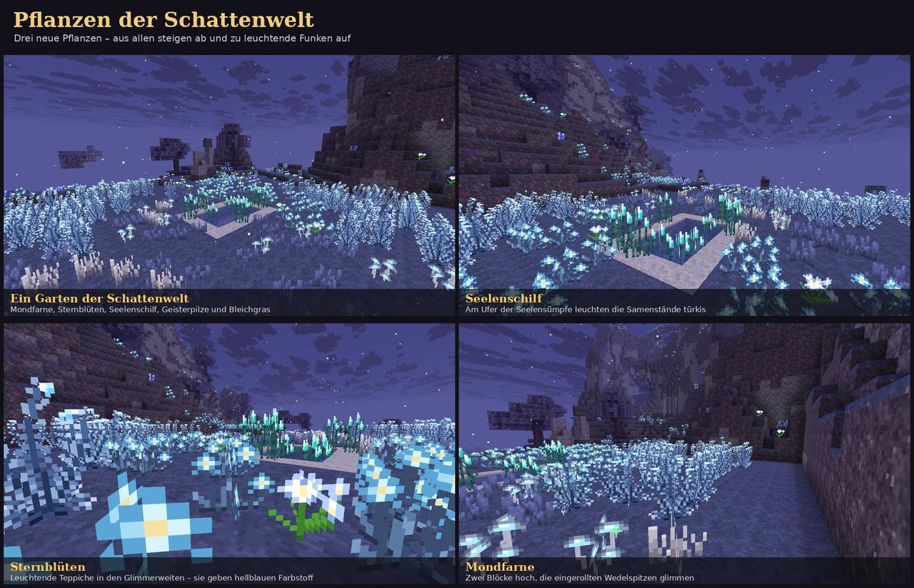

Im ewigen Zwielicht leuchtet vieles, was wächst – und aus manchem steigen ab und zu Lichtfunken auf:

| Pflanze | Wo | Besonderes |
|---|---|---|
| **Schattenhalme**, **Bleichgras** | überall, Bleichgras in der Bleichen Öde und auf den Gipfeln | Gras der Schattenwelt (mit der Schere) |
| **Geisterpilze** | Wald, Sumpf, Inseln, Tiefen | leuchten wie kleine Laternen |
| **Mondblumen** | Wald, Glimmerweiten, Inseln | weißer Farbstoff |
| **Seelenbeerensträucher** | Wald, Sumpf | Seelenbeeren (leuchtend türkis, wenn reif) |
| **Glimmerranken** | unter den Baumkronen, an Höhlendecken | mit leuchtenden Knospen |
| **Nachtkristalldrusen** | Kristallschluchten, Glimmerweiten | leuchtende Kristalle |
| **Mondfarn** (neu) | Schattenwald, Seelensumpf, Glimmerweiten, Schwebende Inseln | zwei Blöcke hoch, die eingerollten Wedelspitzen glimmen |
| **Sternblüte** (neu) | dichte Teppiche in den Glimmerweiten, vereinzelt auf Gipfeln und Inseln | sternförmige, leuchtende Blüten; hellblauer Farbstoff |
| **Seelenschilf** (neu) | an den Ufern und im flachen Wasser der Seelensümpfe | türkis leuchtende Samenstände |

Knochenmehl auf Schattengras lässt Schattenhalme, Geisterpilze, Sternblüten und Mondfarne sprießen.

### Der Seelenhirte und der Seelenpferch (seit 0.98)

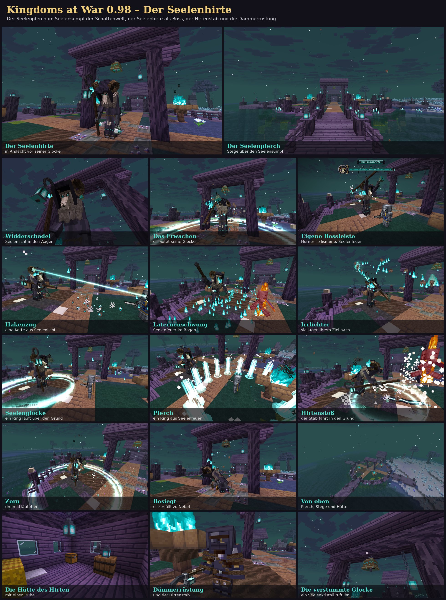

Seit 0.98 liegen im **Seelensumpf** der Schattenwelt **Seelenpferche** – dort, wo der Sumpf eben genug ist und nicht zu tief
unter Wasser steht (der Pferch sucht sich seinen Platz bis knapp hundert Blöcke weit). Ein Pferch ist ein runder,
**aufgeschütteter Grund** mitten im Sumpf, knapp dreißig Blöcke breit: oben Seelenerde, gestampfter Schlamm, Schattenerde und
am Rand Moos, darin halb versunkene Knochen, ein paar Schädel und Schattensprossen; an der Böschung Schlamm und Moos, über die
das schwarze Wasser leckt. Rundherum läuft ein **Steg** aus Schattenholz, auf dem ein **Zaun** steht – auf den Pfosten
**Seelenlaternen** und **Schafsschädel**, an den vier Toren höhere Pfosten mit Laternen. Bäume wachsen dort nicht; Schilf und
Sprossen weichen. Vom Süd-, Ost- und Westtor führen **Stege auf Stelzen** mit Geländer und Laternenpfosten hinaus über den
Sumpf, jeder endet an einer Plattform. Im Norden steht auf Stelzen die **Hütte des Hirten**: Schattenholz mit einem steilen
Giebeldach, Fenstern und einer Tür zum Pferch; innen ein Heulager mit einem Schaffell, ein Fass mit einer Laterne, Kerzen, ein
Block Dämmerquarz, eine Laterne an einer Kette – und eine **Truhe** (Dämmerquarz, Seelenkristalle, Mondsilber, Schattenessenz,
Dämmerbrot, Wolle, Leinen, Knochen, Seelenfackeln und -laternen, Kerzen, Münzen – mit etwas Glück eine Dämmerkapuze,
Dämmerstiefel oder ein verzaubertes Buch).

In der Mitte steht auf einem **Podest** aus Schlammziegeln (an den Ecken leuchtet **Dämmerquarz**) der **Glockenstuhl**: zwei
Pfosten, ein Balken mit Streben, ein kleines Giebeldach, zwei Seelenlaternen an Ketten – und unter dem Balken die
**Seelenglocke**, eine schwere Glocke aus dunkler, grün angelaufener Bronze mit einem Band aus Seelenrunen; in ihrem Mund
wirbelt **Seelenfeuer**. Rings um das Podest brennen vier **Feuerschalen** mit Seelenfeuer. Höchstens ein Pferch je Gebiet von
gut 220 × 220 Blöcken, fern von Nyxars Zitadelle und den Dörfern der Umbrer (Finden: `/kaw structure seelenpferch`, den Hirten
wecken oder zurücksetzen: `/kaw boss seelenhirte awaken|reset`).

Vor der Glocke steht in Andacht **der Seelenhirte**. Einst führte er die Seelen der Toten ins Licht; seit das Siegel die
Schattenwelt verschloss, hütet er die Verlorenen in seinem Pferch – und wartet. Er ist ein hagerer, vorgebeugter Riese, gut
dreieinhalb Blöcke hoch: eine lange, aschgraue **Kutte**, die nach unten weiter wird und am Saum in Fetzen hängt (knapp darüber
glimmt ein Band aus **Seelenrunen**), über den Schultern ein zotteliges **Schaffell**, hinten ein zerrissener Umhang bis fast
zum Boden. Unter der tiefen **Kapuze** ist kein Gesicht, sondern ein **Widderschädel**: die lange Schnauze ragt aus der Kapuze,
in den tiefen, schrägen Augenhöhlen brennt **türkises Seelenlicht**, und zwei schwere, gerippte **Widderhörner** rollen sich
seitlich um die Kapuze. Lange, knochige Arme mit weiten Ärmeln, dürre Finger mit dunklen Krallen, um die Hüfte ein Strick mit
**Talismanen** (ein Knochen, ein Schädelchen, ein Fläschchen mit einer gefangenen Seele). In der Rechten hält er seinen
**Hirtenstab** aus Sumpfeiche – oben ein eiserner Haken, an dem an einer Kette eine **Laterne voll Seelenfeuer** hängt (sie
pendelt und hängt immer lotrecht, wie er den Stab auch schwingt) –, in der Linken eine **Handglocke** aus angelaufener Bronze.
Drei **Irrlichter** kreisen um ihn. In Andacht hält er den Schädel tief gesenkt, das Licht in seinen Augen glimmt nur, die
Irrlichter ziehen langsam und tief ihre Bahnen. Wer sich dem Pferch nähert, hört von fern die Glocke („Irgendwo im Nebel läutet
eine Glocke … jemand wacht über diesen Sumpf.“). Wer ihm näher als zwölf Blöcke kommt (oder ihn schlägt), weckt ihn: Er hebt
den Schädel, die Augen und die Laterne lodern auf, er reckt den Stab empor – und läutet seine Glocke, ein Ring aus Seelenlicht
läuft über den Grund. In Andacht und beim Erwachen ist er unverwundbar.

Er steht in der Reihe der Bosse **zwischen den Drachen und Asteria** (900 Lebenspunkte, Rüstung 10, Zähigkeit 4, lässt sich
kaum wegstoßen; Feuer, Stürze und Wände schaden ihm nicht, seine eigenen Irrlichter auch nicht). Er geht schwer auf den Stab
gestützt auf seine Gegner zu und greift abwechselnd an. Wer ihn aus dem Pferch fortlockt, dem entkommt er im **Sumpfnebel**
zurück zu seiner Glocke. Eigene Bossleiste (geschwärztes Eisen und Bein, hinter dem Medaillon zwei gerippte Widderhörner, unter
der Leiste hängen Talismane an Ketten – ein Knochen, ein Schädelchen mit leuchtenden Augen, ein Laternchen –, über dem Rahmen
treiben Irrlichter, als Spitze der Haken seines Stabs mit der Laterne; die Füllung züngelt wie Seelenfeuer), eigene Klänge
(sein hohler Atem durch den Schädel, die Glocke, die klirrende Kette, fauchendes Seelenfeuer, gläserne Irrlichter, Stimmen im
Sturm).

| Angriff | Was geschieht |
|---|---|
| **Hakenzug** | er holt aus, der Haken schnellt an einer **Kette aus Seelenlicht** vor (bis 18 Blöcke weit) und reißt sein Ziel zu ihm – kurz verlangsamt –, dann schlägt er zu |
| **Laternenschwung** | er schwingt die Laterne über die Schulter und in einem weiten Bogen vor sich her: Seelenfeuer, wer davor steht, brennt und fliegt zurück |
| **Irrlichter** | er reckt die Laterne empor, und seine Irrlichter fliegen davon: vier (im Zorn sechs) Lichter, die kurz schweben und dann ihrem Ziel nachjagen – Schaden, und man verdorrt ein wenig |
| **Seelenglocke** | er hebt die Handglocke und läutet: ein **Ring** läuft über den Grund – wer darin steht (und nicht springt), wird getroffen, ist langsam und schwach |
| **Nebelgang** | er duckt sich in seinen Umhang und zerfließt zu Sumpfnebel – im nächsten Augenblick steht er **hinter seinem Ziel** und schlägt zu (kurz Blindheit) |
| **Pferch** | er zieht mit der Laterne einen Kreis in die Luft, ein leuchtender Kreis warnt – dann schließt ein **Ring aus Seelenfeuer** sein Ziel drei Sekunden lang ein: wer die Flammen berührt, brennt und wird zurück in den Pferch gestoßen |
| **Hirtenstoß** | den Stab hoch über den Kopf – und mit aller Wucht vor ihm in den Grund: ein Riss läuft über den Boden, wer davor steht, fliegt |
| **Seelensturm** | nur im Zorn: die Arme weit ausgebreitet wirbeln die Seelen um ihn und **ziehen alle in seine Nähe** – wer ihm zu nahe kommt, verdorrt |

Unter halber Kraft wirft er den Schädel zurück, reißt das Maul auf – und **läutet dreimal im Zorn**: drei Ringe laufen
nacheinander über den Grund. Danach ist er schneller, mehr Irrlichter folgen ihm, und der Seelensturm kommt hinzu. Findet er
niemanden mehr, kehrt er zu seiner Glocke zurück und versinkt nach einer Weile wieder in Andacht – geheilt und ohne Zorn.
Besiegt sinkt er in die Knie, der Schädel fällt, die Laterne erlischt – und er **zerfällt zu Nebel**, die Seelen steigen frei
auf. Er hinterlässt manchmal den **Hirtenstab** (in etwa einem von fünf Kämpfen, auch beim ersten), beim ersten eigenen
Sieg einen **Herzkristall** und Dämmerquarz für etwa ein Teil der Dämmerrüstung. Die Glocke **verstummt** (das Seelenfeuer in ihr erlischt) – ein **Seelenkristall** an ihr (Rechtsklick) ruft ihn zurück,
und er erwacht sofort.

**Der Hirtenstab** – Sumpfeiche mit eisernem Fuß und Strick am Griff, oben der eiserne Haken mit der Laterne voll Seelenfeuer
und ein Knochen an einer Schnur (in der Hand in 3D):

| Eigenschaft | Wirkung |
|---|---|
| Schlag | wie ein Schwert: 8 Schaden, 1,2 Schläge je Sekunde |
| **Hakenzug** | Rechtsklick: eine **Kette aus Seelenlicht** hakt das anvisierte Wesen (bis 16 Blöcke weit), es nimmt 4 Schaden (mit Schärfe mehr), wird kurz verlangsamt und **zu dir gerissen** – schwere Wesen bewegen sich kaum; danach ruht er drei Sekunden |
| Haltbarkeit | 900, mit **Dämmerquarz** zu reparieren, gut verzauberbar, episch |

**Dämmerquarz:** **Dämmerquarzerz** – violette, gläserne Kristalle mit einem glimmenden Kern – steckt in Adern im Schattenstein
und im tiefen Schattenstein der ganzen Schattenwelt (und leuchtet ein wenig). Mit einer **Eisenspitzhacke** abgebaut gibt es
**Dämmerquarz** (Glück bringt mehr, das Erz lässt sich auch schmelzen): ein violetter Stein, in dem die Dämmerung gefangen ist.
Neun ergeben einen **Dämmerquarzblock** mit Facetten, durch die ein Leuchten zieht.

**Die Dämmerrüstung** aus Leder und Dämmerquarz – Schutz wie Eisen, sehr gut verzauberbar, für alle, die lieber ungesehen
bleiben:

| Teil | Rezept | Wirkung |
|---|---|---|
| **Dämmerkapuze** | zwei Leder und drei Dämmerquarz | beim Schleichen **Nachtsicht** (endet, sobald man aufsteht) |
| **Dämmerumhang** | drei Leder und fünf Dämmerquarz | – |
| **Dämmerbeinlinge** | drei Leder und vier Dämmerquarz | schneller schleichen |
| **Dämmerstiefel** | zwei Leder und zwei Dämmerquarz | schneller schleichen, **weiche Landung** (zwei Blöcke mehr Fallhöhe ohne Schaden) |

Jeder Teil lässt Monster einen erst später bemerken (mit allen vier Teilen nur noch auf gut die halbe Reichweite); wer den
**vollen Satz** trägt und **schleicht**, wird fast nur noch aus nächster Nähe entdeckt. In 3D trägt sie eine tiefe **Kapuze**
mit herabhängendem Zipfel und eine Halbmaske, einen **Umhang** mit einer Schließe aus Dämmerquarz, Wickel um Arme und Beine,
einen Gürtel mit **Taschen** und einem **Dolch**, Knieschützer und Stulpen an den Stiefeln.

Dämmerquarzerz, Dämmerquarz, Dämmerquarzblock, die Rüstung, die Seelenglocke, der Hirtenstab und das Spawn-Ei des Seelenhirten
liegen im Kreativ-Reiter **„Schattenwelt“**.

### Die Sternenweberin und das Sternennetz (seit 0.99)

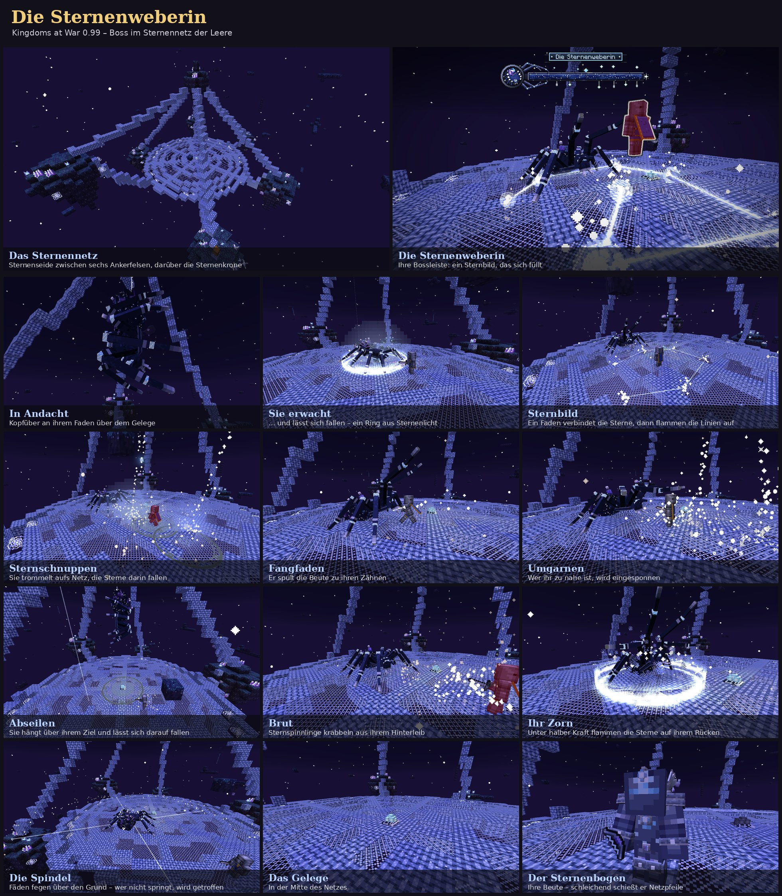

Seit 0.99 hängen in den leeren Weiten der **Leere** (im Sternennichts zwischen den Archipelen) **Sternennetze** – frei im
Nichts, dort, wo kein Bruchstück in das Netz ragt (`/kaw structure sternennetz` findet das nächste, `/kaw boss sternenweberin`
mit `tp`, `awaken` und `reset`). Ein Sternennetz ist eine runde **Netzplatte**, gut dreißig Blöcke breit: acht Speichen und vier Ringe aus
leuchtender **Sternenseide**, dazwischen **Sternengewebe** – man geht darauf wie auf festem Grund und sieht hindurch ins
Nichts. Am Rand wird das Netz offen (nur noch Speichen und der äußere Ring – Vorsicht!). Sechs **Ankerfelsen** aus
Leerenstein mit Moos, Kristallen und Adern aus **Himmelseisen** stehen ringsum, sechs durchhängende **Taue** aus Sternenseide
halten das Netz; hoch über der Mitte schwebt die **Sternenkrone**, ein kleiner Fels, von dem Fäden zu allen Ankern führen. An
den Tauen und unter dem Rand hängen **Sternenkokons** (zerschlagen geben sie frei, was sich verfing: Knochen, Fäden,
Sternenseide, mal Pfeile, Münzen, Leerensplitter oder rohes Himmelseisen), in den Ecken spannen sich **Sternenspinnweben**
(sie halten fest wie Spinnweben; mit Schere oder Behutsamkeit nimmt man sie mit), und auf dem größten Ankerfelsen steht eine
**Truhe** (Himmelseisen, Leerensplitter, Sternenseide, Sternenstaub, Pfeile – mit etwas Glück ein Teil der Rüstung der
Sternwandler oder ein verzaubertes Buch).

In der Mitte liegt das **Sternengelege**: sieben Eier auf einem Bett aus Seide, in denen Sternenlicht glimmt. Darüber hängt
kopfüber an ihrem Faden, sieben Blöcke hoch, **die Sternenweberin** und dreht sich langsam. Als die Welten zerbrachen, fing sie
die fallenden Sterne in ihrem Netz – seither webt sie aus ihrem Licht neue Sternbilder. Sie ist eine riesige Spinne, gut sechs
Blöcke von Fuß zu Fuß: der Vorderleib aus nachtblauem, schimmerndem **Chitin** mit silbernen Rändern, vorn **acht Augen wie
Sterne**, darunter Kieferklauen mit silbernen Giftzähnen und zwei Taster; der Hinterleib groß und rund wie ein Stück
Nachthimmel, darauf eine **Spiralgalaxie** mit rosaweißem Kern, aus dem Rücken wachsen drei **Kristalle der Leere**, aus den
Spinnwarzen leuchtet Sternenseide; acht lange Beine mit silbernen Bändern, deren Gelenke im Licht der Sterne leuchten. Wer sich
dem Netz nähert, hört es von fern („Die Fäden zittern … etwas Riesiges wacht über dieses Netz.“). Wer ihr näher als vierzehn
Blöcke kommt (oder sie trifft), weckt sie: Ihre Augen flammen auf, der Faden reißt, sie stürzt auf ihr Netz, kreischt und
richtet sich auf. In Andacht und beim Erwachen ist sie unverwundbar.

Sie steht in der Reihe der Bosse **zwischen Anni dem Troll und dem Zerbrochenen König** (1600 Lebenspunkte, Rüstung 12,
Zähigkeit 5; Stürze und Wände schaden ihr nicht, ihre Brut auch nicht). Sie läuft über ihr Netz auf ihre Gegner zu und greift
abwechselnd an; wer sie zu weit fortlockt, dem entkommt sie an einem Faden zurück auf ihr Netz. Findet sie niemanden mehr,
klettert sie wieder an ihren Faden (geheilt). Eigene Bossleiste (nachtblaues Chitin mit Silbersaum, hinter dem Medaillon
greifen vier gegliederte Spinnenbeine mit leuchtenden Gelenken, unter der Leiste hängen an Fäden Kokons und Sterne, als Spitze
ein Stern in einem Knoten aus Sternenseide; die Füllung ist ihr Netz vor dem Nachthimmel), eigene Klänge (das Klicken ihrer
Mundwerkzeuge über dem gläsernen Summen der Sterne, sirrende Fäden, Sternbilder, fallende Sterne, die Brut).

| Angriff | Was geschieht |
|---|---|
| **Giftbiss** | ein Satz nach vorn, die Giftzähne schlagen zu – Schaden und Gift |
| **Fangfaden** | ein Faden aus Sternenlicht trifft ihr Ziel (bis 22 Blöcke weit) und spult es zu ihren Zähnen – dort beißt sie zu |
| **Netzwurf** | sie spuckt einen Ballen Sternennetz (im Zorn drei im Fächer): wo er landet, spannen sich Spinnweben, und man klebt fest (sie zerfallen nach einer Weile) |
| **Sternbild** | um ihr Ziel leuchten nacheinander Sterne auf, ein Faden verbindet sie zu einem Sternbild – dann flammen die Linien auf: wer eine berührt, wird getroffen und leuchtet |
| **Sternschnuppen** | sie trommelt auf ihr Netz, und die Sterne, die darin hängen, fallen – leuchtende Kreise zeigen, wo |
| **Umgarnen** | wer ihr zu nahe ist, wird eingesponnen: eine Weile kein Laufen, kein Springen, und die Fäden zehren |
| **Brut** | ihr Hinterleib pulsiert, und **Sternspinnlinge** krabbeln heraus (höchstens sechs) |
| **Abseilen** | sie klettert an einem Faden hinauf, hängt kopfüber über ihrem Ziel (ein Kreis am Grund zeigt, wo) und lässt sich fallen |
| **Die Spindel** (im Zorn) | sie dreht sich, und vier Fäden fegen dicht über das ganze Netz – wer nicht springt, wird getroffen |

Unter halber Kraft kreischt sie auf – die Sterne auf ihrem Rücken flammen, sie wird schneller, und gleich darauf dreht sich
die Spindel. Besiegt rollt sie die Beine ein und zerfällt zu Sternenstaub; das **Gelege erlischt**. Sie hinterlässt den
manchmal den **Sternenbogen** (in etwa einem von fünf Kämpfen, auch beim ersten), beim ersten eigenen Sieg einen
Herzkristall und Himmelseisen für etwa ein Teil der Sternenwandlerrüstung, manchmal einen Leerensplitter.
Ein **Himmelseisenbarren** im erloschenen Gelege lockt eine neue Weberin – sie lässt sich sofort fallen.

**Der Sternenbogen** (3D in der Hand, gespannt in drei Stufen): ein Bogen aus nachtblauem Chitin, bespannt mit Sternenseide.
Seine Pfeile fliegen **schwerelos** und schneller als die eines gewöhnlichen Bogens und ziehen eine Spur aus Sternenstaub; wer ihn
**im Schleichen voll spannt**, schießt einen **Netzpfeil**, der sein Ziel einspinnt (kaum noch beweglich, leuchtend; danach ruht
der Bogen acht Sekunden). Er lässt sich verzaubern wie jeder Bogen und mit Himmelseisen reparieren.

**Himmelseisen** wächst als Erz in der ganzen Leere (Adern im Leerenstein, im Kern gefallener Sterne) und schimmert; daraus
werden Barren und ein Block – und die **Rüstung der Sternwandler**: blaustählerne Platten mit Säumen aus Sternsilber, in 3D mit
Sternenkamm, Kometenflossen, Schulterplatten mit schwebenden Splittern und einem kurzen Kometenmantel. Sie macht **leichter**
(weniger Schwerkraft), mit dem vollen Satz lässt sich durch Halten der Sprungtaste **schweben** (Sternenschweben), und wer in
die Leere stürzt, den trägt der **Sternenanker** einmal zurück auf festen Grund.

### Rüstungen, Handel und das Urmeer (seit 0.99)

- **Geschlossene Rüstungen:** Getragene Rüstungen haben keine offenen Stellen mehr – ein Kragen statt des Halsausschnitts,
  eine Ellbogenkachel statt der Lücke am Arm, und wo das Gesicht frei lag, eine **Maske mit Sehschlitzen** (beim Werwolfspelz
  mit Bernsteinaugen, bei Glutwurm und Drachenschuppen mit leuchtenden Augen, beim Taucher ein dunkles Glasvisier).
- **Stille Rüstungs-Effekte:** Was Rüstungen an Effekten geben (Nachtsicht, Feuerschutz, Schnelligkeit, Wasseratmung,
  sanfter Fall …), wirkt jetzt **ohne Symbol** und ohne Partikel. Die **Nachtsicht flackert nicht mehr** – sie wird rechtzeitig
  erneuert und endet sofort, wenn man das Teil ablegt; ein Trank darunter bleibt erhalten.
- **Taucherausrüstung:** Der volle Satz aus Aquamarin gibt jetzt **Wasseratmung** (und unter Wasser wie bisher klare Sicht).
- **Meerjungfrauen** handeln wie alle anderen Händler (siehe *Das Meervolk*).
- **8369 Fischarten:** Jedes eigene Biom der Mod hat jetzt einundfünfzig Arten, jedes Biom von Minecraft einunddreißig oder
  dreiunddreißig, und die meisten leben im **Urmeer** – 518 oder 519 in jedem seiner acht Biome (zusammen 4146).
- **Drill nach Seltenheit:** Je seltener der Fisch, desto unruhiger ist er im Drill – er überlegt kürzer, schwimmt weitere
  Wege und schneller, und ab *selten* bricht er ab und zu plötzlich aus.
- **Die Regeln des Urmeers:** Im Urmeer gibt es **keine Lava** – ein Eimer Lava erlischt zischend (er bleibt voll), auch aus
  Werfern, und kein Kessel lässt sich mit Lava füllen. Und das Urmeer lässt sich **nicht trockenlegen**: Ein Schwamm saugt
  sich dort sofort voll, aber das Wasser bleibt.

### Die Leere

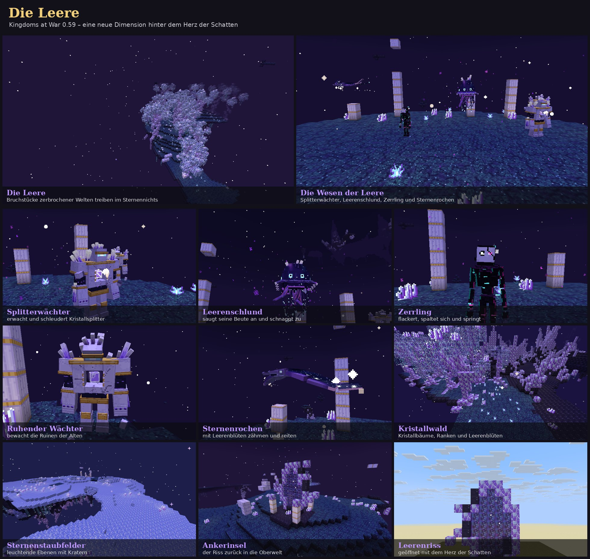

Wer Nyxar besiegt hat, trägt sein **Herz der Schatten**. Richtet man es auf den Boden, sammeln sich Funken, das Herz
schlägt dreimal – und vor einem reißt die Welt auf: ein senkrechter **Leerenriss** (9 Blöcke breit, 10 hoch) mit einem
Saum aus Leerenkristall, hinter dem die Sterne treiben. Wer hineintritt, wird nach kurzem Schwindel in die **Leere**
gezogen und landet auf einer Ankerinsel mit dem Riss zurück. Auf einen Riss gerichtet schließt das Herz ihn wieder; das
Herz selbst bleibt erhalten.

Die Leere hat keinen Boden und kein Meer: Bruchstücke zerbrochener Welten treiben in Gruppen durch ein ewiges
Sternennichts, mit flachen Oberseiten und langen, zerklüfteten Unterseiten, dazwischen einzelne Felsbrocken und hoch
darüber flache Splitter. Wer ins Nichts stürzt, wird verwundet auf die nächste Ankerinsel zurückgespuckt. Schlafen kann
man hier nicht.

| Biom | Was dort ist |
|---|---|
| **Sternennichts** | die weiten, leeren Strecken zwischen den Archipelen: einzelne Felsbrocken, ferne Bruchstücke, das Funkeln der Sterne |
| **Kristallwald** | verdrehte Kristallbäume mit leuchtendem Kristalllaub, Sternenranken, Leerenblüten und Kristalldrusen |
| **Schwerelose Ruinen** | die Trümmer der Alten aus Sternenmarmor – Säulenhallen, Torbögen, Schreine mit Truhen, Treppen ins Nichts, zerfallene Türme; darüber schweben Mauerstücke frei in der Luft |
| **Sternenstaubfelder** | fahl leuchtende Ebenen aus Sternenstaub mit Kratern und gefallenen Sternen |
| **Splitterklippen** | zerklüftete Bruchstücke, aus denen riesige Kristallspitzen schräg in die Leere ragen |
| **Weltenreste** | seltene Bruchstücke fremder Welten – ein Stück Wiese, Wüste oder Gletscher mit den Resten der Häuser, die einmal darauf standen |

**Neue Blöcke:** Leerenstein (mit Ziegeln, poliert, gemeißelt, rissig, Treppen, Stufen, Mauern), Sternenmarmor (Ziegel,
Säule, leuchtend gemeißelt – nur aus den Ruinen), Leerenmoos, Sternenstaub, Leerenkristall und Leerenkristall-Druse,
Kristalllaub, Leerenblüte und Sternenranken. Aus Drusen und Kristallen fallen **Leerensplitter**.

**Die Wesen der Leere** – alle mit eigenem Modell, eigenen Bewegungen und eigenen Stimmen:

| Wesen | Wie es aussieht | Was es tut |
|---|---|---|
| **Leerenschlund** | eine schwebende Glocke wie aus dem Nachthimmel geschnitten, mit Nebelschleiern, Sternen und sechs leuchtenden Augen; drei Kristallsplitter stecken in der Kuppel; darunter ein Maul aus vier Lippen voller Zähne und lange Fangfäden mit Leuchtpunkten | treibt pumpend wie eine Qualle; sieht er Beute, reißt er das Maul auf und **saugt** sie an – an einer Kante zieht er sie ins Nichts; ist sie nah, schnappen die Lippen zu (Hunger). Ducken schwächt den Sog, Treffer unterbrechen ihn |
| **Splitterwächter** | ein uralter Wächter aus Sternenmarmor mit goldenen Bändern; in seiner offenen Brust kreist ein Herz aus Leerenkristall, aus Schultern und Rücken wachsen Kristalle, um ihn kreisen schwerelose Marmorbrocken | **ruht** wie eine Statue in den Ruinen (die Brocken liegen am Boden), bis man ihm nahe kommt oder ihn trifft – dann erwacht er, schleudert **Kristallsplitter** (drei kurz nacheinander, mit einem Schlag zurückzuschlagen), stößt mit beiden Fäusten einen **Erdstoß** in den Boden und kehrt danach an seinen Platz zurück |
| **Zerrling** | ein Fehler im Bild: ein hagerer Leib aus Bruchstücken mit Lücken dazwischen, schwarz wie ein Loch, verrutschte Bildzeilen, eine gesprungene Maske mit einem leuchtenden Auge; seine Farben spalten sich in Türkis und Magenta | **springt** ruckhaft durch den Raum – am liebsten in den Rücken seiner Beute – und hinterlässt ein Nachbild; getroffen springt er oft davon; seine Krallen verlangsamen |
| **Sternenrochen** | ein riesiger Rochen mit fast fünf Blöcken Spannweite, nachtblau mit Sternbildern auf dem Rücken, violettem Nebel an den Schwingen, durchscheinenden Flügelspitzen und einem Peitschenschwanz mit leuchtender Spitze | gleitet friedlich in weiten Bögen um die Bruchstücke und singt; mit **Leerenblüten** gefüttert, fasst er Vertrauen und **trägt seinen Freund durch die Leere**: er gleitet stets voran, schneller mit „vorwärts“, steigt und sinkt mit dem Blick, „springen“ hebt ihn an |

**Klänge der Leere:** ein tiefes, schwebendes Dröhnen mit feinem Sternensirren überall, dazu gläserne Akkorde und
singende Kristalle im Kristallwald, rieselnder Sternenstaub, ferne Chöre der Alten und schabende Steine in den Ruinen,
dumpfe Erinnerungen an verlorene Welten über den Weltenresten – und aus der Ferne der Gesang der Sternenrochen.

### Der Zerbrochene König

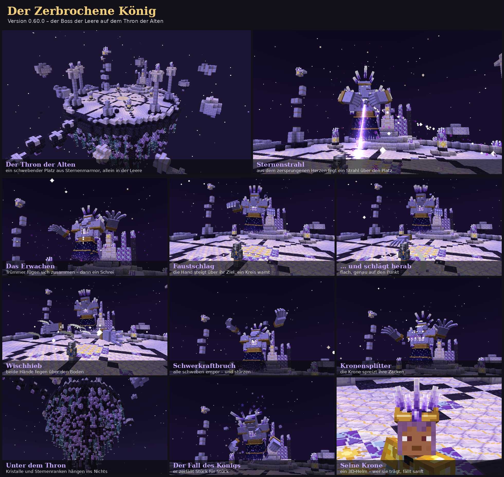

Einmal in jeder Welt schwebt in der Leere, 450 bis 800 Blöcke von ihrer Mitte entfernt, der **Thron der Alten**: ein
runder Platz aus Sternenmarmor (44 Blöcke breit) allein in einem weiten, leeren Raum – mit dunklen Bändern, acht
Strahlen voller leuchtender Kristalle und einem Siegel in der Mitte, einer niedrigen, zerbrochenen Brüstung, sechs
Säulen (zwei zerbrochen, ihre Trommeln schweben über dem Stumpf), vier Kristalllampen und im Norden einem Podest in drei
Stufen mit dem Thron, zwei Obelisken und einem Turm aus Kristall. Darunter hängt ein zerklüfteter Kegel aus Leerenstein,
aus dem Kristalle und Sternenranken ins Nichts hängen; im Süden führen schwebende Trittsteine heran, ringsum treiben
Trümmer. Der **Drachenkompass** zeigt in der Leere den Weg dorthin (Rechtsklick nennt Richtung und Entfernung).

Wer sich nähert, spürt, dass dort etwas wacht. Wer den Platz betritt, weckt den **Zerbrochenen König**: die Trümmer
fliegen zusammen, Leib, Hände und Krone erheben sich vom Boden und fügen sich – dann ein Schrei. Er ist ein schwebender
Riese aus bleichem Sternenmarmor mit goldenen Säumen; durch Risse leuchtet die Leere, in seiner offenen Brust schwebt
sein **zersprungenes Herz**, über dem Haupt kreist eine Krone aus sieben Kristallsplittern, sein Gewand aus Sternennacht
läuft in Fetzen aus. Seine Arme enden in gezackten Bruchstellen – die **Hände schweben frei** neben ihm und führen jeden
Angriff aus.

| Angriff | Was geschieht |
|---|---|
| **Faustschlag** | eine Hand steigt hoch über die Stelle, an der du stehst, krümmt die Finger zur Klaue – ein leuchtender Kreis warnt – und schlägt flach herab; ab der Hälfte seiner Kraft folgt sofort der zweite Schlag der anderen Hand |
| **Wischhieb** | beide Hände holen weit hinten aus und fegen gegeneinander in einem Bogen vor ihm über den Boden |
| **Kronensplitter** | der Kopf hebt sich, die Krone steigt und spreizt die Zacken: zwei Fächer aus Kristallsplittern (mit einem Schlag zurückzuschlagen) – fünf je Fächer, unter der Hälfte sieben, im letzten Viertel neun |
| **Risse der Leere** (seit 0.68) | er gräbt die Klauen vor sich in den Boden und reißt ihn auf: knisternde **Risse** aus violettem Licht laufen fächerförmig auf dich zu (im Zorn fünf statt drei) – kurz darauf bricht die Leere Säule um Säule aus ihnen hervor, von ihm fort; wer auf einem Riss steht, fliegt empor. Die Risse enden an Säulen und Wänden |
| **Leerenbeben** (seit 0.68) | beide Fäuste steigen hoch über sein Haupt (ein Kreis zeigt, wo sie einschlagen), dann rammt er sie in den Boden – drei **Bebenringe** rollen über den ganzen Platz (im Zorn vier): darüber springen oder auf einem Block stehen |
| **Schwerkraftbruch** (unter 70 %) | die Hände heben sich mit offenen Handflächen – alle auf dem Platz schweben empor –, klatschen über seinem Kopf zusammen und stoßen herab: alle stürzen |
| **Ruf der Wächter** (bei 70 %, 45 % und 20 %) | die Hände senken sich zum Boden und reißen Splitterwächter aus dem Platz empor – zweimal zwei, beim dritten Ruf drei |
| **Zorn des Königs** (einmal, bei 50 %) | er brüllt, der Platz bebt, Splitter stieben – „Der Zerbrochene König zürnt!“: von da an greift er schneller an und schlägt doppelt zu |
| **Sternenstrahl** (unter 50 %) | die Hände reißen die Brust auf, die Herzhälften klaffen – aus dem Herzen fegt ein Strahl in weitem Bogen über den Platz: hinter Säulen ducken oder darüber springen; im letzten Viertel noch öfter |

Seit 0.61 ist er der **stärkste Gegner** der Mod: 1.800 Lebenspunkte, Rüstung 18 mit Härte 10 und Schläge mit 12
Grundschaden – mehr als jeder Drache (760 bis 1.150, Nyxar 1.400) und weit mehr als die Erzmagier (420). Je schwächer er
wird, desto schneller folgt Angriff auf Angriff. So steigt der Weg an: erst die Erzmagier, dann die Drachen, dann der
Zerbrochene König. Verlässt jeder den Platz, zerfällt er nach einer halben Minute wieder zu Trümmern und kann später erneut erwachen; besiegt
zerfällt er Stück für Stück, und der Thron bleibt für immer leer.

**Beute:** immer die **Krone des Zerbrochenen Königs** – ein Helm, der als echtes **3D-Modell** getragen wird: ein
goldener Reif mit einem Leerenkristall über der Stirn, darüber schweben sieben Kristallsplitter (Rüstung 3, Härte 2,5,
feuerfest, mit Leerensplittern zu reparieren). Wer sie trägt, **fällt sanft wie schwerelos** (Schleichen: normal fallen).
Dazu der **Rissschlüssel** (seit 0.72), ein Herzkristall, ein Manakristall, ein verzaubertes Buch der Arkanen,
Goldmünzen, Leerensplitter, Leerenkristalle, gemeißelter Sternenmarmor und Edelsteine. Und wenn er fällt, reißt **hinter
dem Thron** die Leere auf: der Weg in den **Abgrund** (siehe unten).

### Der Abgrund

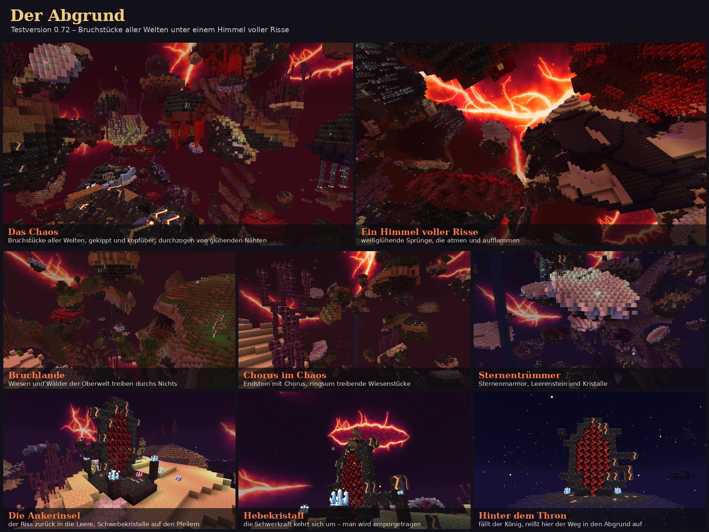

Hinter der Leere liegt der **Abgrund** – das reine Chaos, in das zerbrochene Welten stürzen. Es gibt keinen Boden und
keinen Horizont: In allen Höhen treiben **Bruchstücke** durcheinander, gekippt, steil wie Wände oder ganz kopfüber, aus
dunklem **Chaosgestein** gebacken und überzogen mit dem, was einmal ihre Welt war – Wiese und Wald der Oberwelt,
Netherrack und Karmesinnyzel, Endstein mit Chorus, Schattengras, Sternenmarmor, Eis und Wüste. Wo Welten aneinanderstoßen,
glühen **Weltennähte**; von den Rändern stürzen **Lava- und Wasserfälle** ins Nichts; kopfüber treibende Inseln lassen
Laub, Ranken und Endstäbe nach unten hängen. Darüber – und darunter, denn unten ist hier nur wieder Himmel – klafft ein
Himmel aus tiefem Karmesin voller weißglühender **Risse**: ein großer Sprung quer über den Zenit, sternförmige
Einschläge, ein klaffendes „Auge“, hinter dem fremde Sterne funkeln. Sie atmen langsam und flammen ab und zu auf. Asche
rieselt, das Licht ist rot und gedämpft, die Zeit steht still, und schlafen kann man hier nicht.

**Der Weg hinein** öffnet sich, wenn der Zerbrochene König fällt:

- **Hinter dem Thron** reißt die Leere auf: 28 Blöcke nördlich der Mitte des Thronplatzes entsteht auf einer Plattform
  aus Chaosgestein ein **Abgrundriss** (fünf Blöcke breit, elf hoch), mit einer Brücke zum Platz. Er bleibt für immer
  offen – auch in Welten, in denen der König schon vor 0.72 besiegt wurde.
- Der König lässt den **Rissschlüssel** fallen. Richtet man ihn **in der Leere** auf den Boden, sammeln sich Glutfunken,
  die Welt knirscht dreimal – und nach vier Sekunden reißt zwei Schritte vor einem ein Abgrundriss auf. Auf einen Riss
  gerichtet schließt der Schlüssel ihn wieder (nur den hinter dem Thron nicht); der Schlüssel bleibt erhalten.

Wer hindurchgeht, landet auf einer **Ankerinsel**: einem Platz aus poliertem Chaosgestein mit glühender Naht und vier
zerbrochenen Pfeilern, auf denen Schwebekristalle sitzen – in der Mitte der Riss zurück. Wer ins Nichts stürzt, wird vom
Abgrund **ausgespien**: verwundet, geblendet und benommen auf die nächste Ankerinsel.

| Biom | Was dort treibt | Wesen |
|---|---|---|
| **Bruchlande** | Wiesen und Wälder der Oberwelt mit Eichen und Blumen, dazwischen Eis- und Wüstenstücke | Untote, Skelette, Spinnen, Zerrlinge |
| **Glutsturz** | Netherrack, Karmesinnyzel, Basalt und Magma, Karmesinpilze, Lava, die von den Rändern stürzt | Glutgeister, Brandgebeine, Aschengeister, selten ein Ghast |
| **Sternentrümmer** | Endstein mit Chorus, Sternenmarmor und Leerenstein mit Leerenblüten und Kristallen | Leerwandler, Rissjäger, Chorusschlünde, Leerenschlünde |
| **Schattenschlund** | Schattengras, Schattenbäume und Mondfarn; Sternenranken hängen von kopfüber treibenden Inseln | Schattenpirscher, Nachtwidder, Seelenreiher |
| **Die Naht** | alles durcheinander, durchzogen von unzähligen glühenden Weltennähten – hier ist das Chaos am dichtesten | Zerrlinge, Splitterwächter, Leerenschlünde, Rissjäger, Schattenpirscher |

**Verdrehte Schwerkraft:** An den Rändern der Bruchstücke wachsen Kristalle, die sich abbauen und anderswo aufstellen
lassen. Um einen **Schwebekristall** (eisblau) wiegt man in sieben Blöcken Umkreis nur ein Fünftel: Man springt fünf
Blöcke hoch, sinkt sanft und nimmt keinen Fallschaden. Über einem **Hebekristall** (rosenrot) kehrt sich die Schwerkraft
um – in einer Säule aus aufsteigenden Funken wird man langsam bis zu zwanzig Blöcke emporgetragen, hinüber zum nächsten
Bruchstück; wer schleicht, sinkt darin sachte.

**Neue Blöcke:** Chaosgestein (mit Ziegeln, rissigen Ziegeln – aus den Rissen glüht es –, poliert und gemeißelt mit einem
glimmenden Auge, dazu Treppen, Stufen und Mauern), die leuchtende **Weltennaht**, Schwebe- und Hebekristall und der
Abgrundriss.

**Klänge des Abgrunds:** Unter allem liegt ein tiefes, schiefes Dröhnen aus Tönen, die nicht zueinander passen, durch das
ab und zu ein fernes Reißen geht. In der Ferne **reißt die Welt**: erst ein immer dichteres Splittern, dann ein langes
Bersten und ein hohles Einatmen, als sauge der frische Spalt die Luft an. Dazu klingt in jedem Biom die Welt nach, aus
der seine Bruchstücke stammen – Laub, Krähen und schabende Felsen in den Bruchlanden, Lava, Glut und fauchende Spalten
im Glutsturz, singende Kristalle in den Sternentrümmern, Klagen und Flüstern im Schattenschlund, knisternde Nähte und
flackernde Bildfehler in der Naht.

Was im Abgrund wartet, steht im nächsten Abschnitt.

### Der Weltenfresser

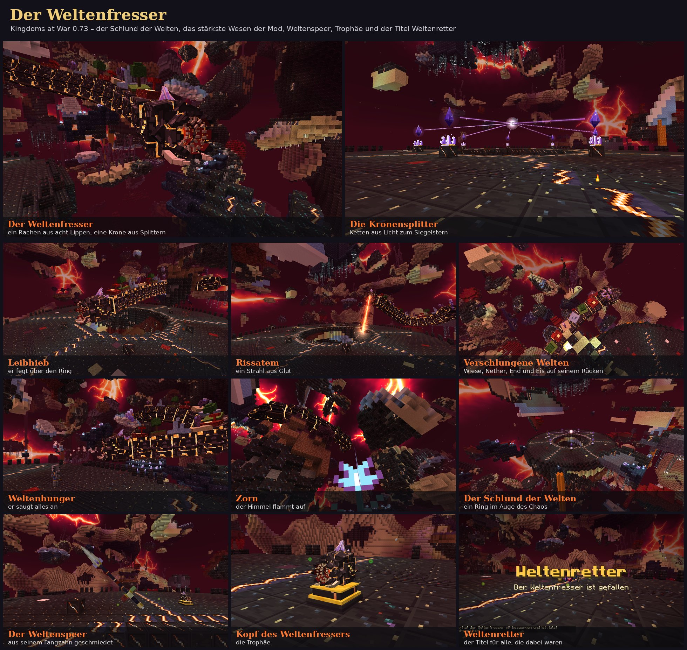

Einmal in jedem Abgrund, 500 bis 900 Blöcke von seiner Mitte entfernt, schwebt der **Schlund der Welten**: ein Ring aus
poliertem Chaosgestein (56 Blöcke breit) in einem weiten, leer gefegten Auge des Chaos – an seinem Rand enden die
Bruchstücke zerklüftet, ringsum treiben Trümmer verschlungener Welten. In der Mitte klafft der **Schlund**, ein Loch bis
ins Nichts, gesäumt von einer glühenden Naht; sieben Weltennähte laufen wie Speichen über den Ring, außen eine niedrige,
zerbrochene Brüstung, darunter ein zerklüfteter Kegel, von dessen Rand drei Lavafälle ins Nichts stürzen. Um den Schlund
stehen sieben Sockel mit den **Kronensplittern** – den Splittern der Krone, die der Zerbrochene König einst zerbrach, um
das Wesen darunter zu versiegeln: Über jeder Druse schwebt ein großer violetter Kristall, und von allen sieben laufen
**Ketten aus Licht** zu einem Siegelstern hoch über dem Schlund. Der **Drachenkompass** zeigt im Abgrund den Weg dorthin;
wer sich nähert, spürt, dass unter dem Ring etwas lauert.

Wer den Ring betritt, weckt den **Weltenfresser**: Der Abgrund grollt, die Kronensplitter zerspringen einer nach dem
anderen, Glut steigt aus der Tiefe – dann bricht er durch den Schlund empor und brüllt. Er ist **das stärkste Wesen der
Mod**: ein gewaltiger Wurm aus Chaosgestein, vorn ein Kopf mit glühenden Augen, Hauern, einer Krone aus Kristallsplittern
und einem Rachen aus acht Lippen, der sich wie eine Blüte öffnet – darin Zahnreihen und ein glühender Schlund. Dahinter
folgen zwölf gepanzerte Glieder und ein Schwanz, durchzogen von glühenden Nähten, und auf jedem Glied liegt ein Stück
einer Welt, die er verschlungen hat: eine Wiese mit Baum, Netherrack mit Pilzen, Endstein mit Chorus, Eis. Er umkreist
den Ring, und dann und wann taucht er unter ihm hindurch und durch den Schlund wieder empor. Seit 0.78.1 hat er eine
**eigene Bossleiste**: ein Rahmen aus Chaosgestein mit glühenden Fugen, auf dem – wie auf seinem Rücken – Stücke
verschlungener Welten liegen (eine Wiese mit Eiche, Netherrack mit Magma und Karmesinpilz, Endstein mit Chorus, Packeis
mit Zacken), darunter sein Gebiss, am Medaillon drei Kronensplitter und ein Hauer, im Medaillon sein Rachen, als Spitze
die Kristallflosse seines Schwanzes; die Füllung glüht wie sein Schlund, und ein violetter Riss zieht hindurch.

| Angriff | Was geschieht |
|---|---|
| **Biss** | er bäumt sich hoch über dir auf, ein glühender Kreis warnt – dann stößt der Kopf herab und schlägt in den Ring |
| **Weltenhunger** | er hängt sich an den Rand des Rings, reißt den Rachen auf und saugt alles an (Schleichen hält dagegen) – dann schnappt er zu |
| **Weltenspucke** | er speit Brocken verschlungener Welten, die ringsum zerschellen: **Glut** setzt in Brand, **Frost** lähmt, **End** lässt schweben, **Schatten** blendet |
| **Leibhieb** | eine glühende Bahn zeigt, wo sein Leib gleich über den Ring fegt – wer auf ihr steht, fliegt davon |
| **Rissatem** (unter 75 %) | hoch über dem Schlund reißt er den Rachen auf: ein gewaltiger Strahl aus Glut fegt in Kreisen über den Ring |
| **Schwerkraftsturz** (unter 70 %) | alle auf dem Ring schweben empor (Schleichen hält am Boden) – dann kehrt die Schwere mit aller Wucht zurück |
| **Ruf der Welten** (bei 66 % und 33 %) | Risse reißen auf dem Ring auf, Zerrlinge und Rissjäger springen hervor |
| **Zorn** (einmal, bei 50 %) | „Der Weltenfresser tobt – der Ring bricht!“: alle Risse am Himmel flammen auf, der äußere Rand des Rings bricht weg und stürzt ins Nichts; von da an ist er schneller und greift öfter an |

Er hat 2.600 Lebenspunkte, Rüstung 20 mit Härte 12 und beißt mit bis zu 20 Schaden. Seine Glieder sind gepanzert (ein
Treffer dort zählt nur gut die Hälfte), der Kopf ist die verwundbarste Stelle – am verwundbarsten, solange der Rachen
offen steht. Verlässt jeder den Ring, sinkt er nach einer halben Minute zurück in den Schlund und kann erneut erwachen.
Besiegt windet er sich, Glied um Glied zerbirst vom Schwanz zum Kopf, dann zerspringt der Kopf.

**Beute und Titel:** Auf dem Ring bleiben der **Weltenspeer**, der **Kopf des Weltenfressers**, zwei Herz- und zwei
Manakristalle, ein verzaubertes Buch der Arkanen, Goldmünzen, Weltennähte, gemeißeltes Chaosgestein, Edelsteine und
500 Erfahrungspunkte – und alle, die dabei waren, werden **Weltenretter**: ein Titel in Gold vor ihrem Namen (im Chat,
über dem Kopf und in der Spielerliste), auf dem Bildschirm „Weltenretter – Der Weltenfresser ist gefallen“, und alle
Spieler erfahren davon.

- Der **Weltenspeer** (in der Hand als 3D-Modell): aus dem Fangzahn des Weltenfressers geschmiedet – ein Schaft aus
  Chaosgestein mit glühenden Nahtringen, am Kreuz vier Bruchstücke der Welten (Wiese, Netherrack, Endstein, Eis), am
  Knauf und am Kragen Splitter der Königskrone. Ein Speer wie die Speere von Minecraft (Stoß und Ansturm, verzauberbar),
  härter als die Sternenlanze (3.600 Haltbarkeit, mit Weltennähten zu reparieren). **Weltenkraft:** im Abgrund und in der
  Leere trifft er um ein Drittel härter. **Weltenmal:** jeder Treffer trägt reihum eine Welt in sich – Glut setzt in
  Brand, Frost lähmt, End hebt empor, Schatten blendet und schwächt. **Weltenbrocken:** jeder vierte Treffer reißt einen
  Brocken dieser Welt vom Himmel, der auf das Ziel stürzt und ringsum zerschellt – den Träger und die Seinen verschont er.
- Der **Kopf des Weltenfressers**: die Trophäe – der Kopf, auf ein Viertel geschrumpft, auf einem Sockel aus
  Chaosgestein mit Goldband, in dessen Flanken gemeißelte Augen glimmen; seine Nähte glühen, der Rachen atmet langsam,
  ab und zu steigt Glut aus ihm auf. Er blickt den an, der ihn aufstellt.

**Klänge:** ein Grollen aus der Tiefe, Kronensplitter, die glockenhell zerspringen, ein Brüllen, das den Ring erbeben
lässt, mahlendes Gestein, das Einsaugen und Zuschnappen des Rachens, das Fauchen des Rissatems und das Zerbersten seiner
Glieder – alles eigene Klänge.

Seit 0.74 kämpft der Weltenfresser im **Weltenschlund**, seiner eigenen Kampfdimension (siehe „Die Kampfdimensionen der
großen Bosse“). Im Kreativ-Reiter liegt ein **Spawn-Ei des Weltenfressers** (ohne Hort kreist er um die Stelle, an der
er erscheint), und `/locate structure kingdomsatwar:world_eater_hoard` findet den Schlund im Abgrund (ebenso
`kingdomsatwar:void_throne` den Thron der Alten in der Leere).

### Der Stundenwächter und der Uhrturm (seit 1.1)

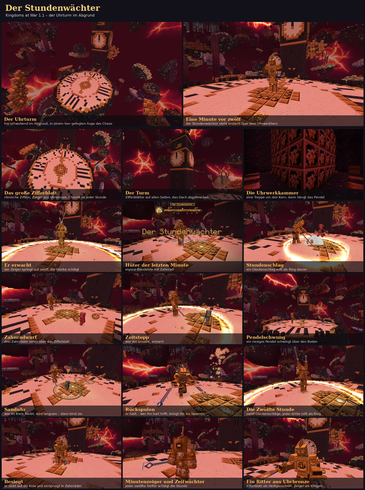

Als die Welten zerbrachen, blieb in einer von ihnen die große Uhr stehen – **eine Minute vor Mitternacht**. Ihr Turm
stürzte in den Abgrund, wo die Zeit stillsteht, und mit ihm ihr Wächter. Seit 1.1 treiben im **Abgrund** (in jedem seiner
Biome, weit verstreut und fern des Schlunds der Welten) **Uhrtürme** – frei schwebend in einem leer gefegten Auge des
Chaos, auf verschiedenen Höhen (`/kaw structure uhrturm` findet den nächsten, `/kaw boss stundenwaechter` mit `tp`, `awaken`
und `reset`).

**Der Uhrturm:** In der Mitte liegt das **große Zifferblatt**, gut dreißig Blöcke breit – altes Email mit feinen Rissen,
ein Ring der Stunden mit **römischen Ziffern** (XII, III, VI und IX) und Balken, eine dunkle Minutenbahn mit leuchtendem
**Chronit** an jeder Stunde, eine Lünette aus **Uhrbronze** und zwei Zeiger aus Uhrbronze mit Chronit – sie stehen eine
Minute vor zwölf, der lange hat hinten ein rundes Gegengewicht. Ringsum eine Brüstung aus Chaosziegeln (an jeder Stunde
eine Lücke, stellenweise zerbrochen). In der Nabe sitzt das **Uhrwerkherz**. Im Norden, wo die Zwölf steht, führt eine Brücke zum **Turm**: elf Blöcke breit,
Chaosziegel mit Gesimsen aus Uhrbronze, auf jeder Seite ein Zifferblatt. Innen windet sich eine Treppe um einen hohlen
Kern, in dem das große **Pendel** hängt; auf halber Höhe die **Uhrwerkkammer**, oben die offene **Glockenstube** mit der
großen Glocke – in beiden eine Truhe (Chronit, Uhrbronze, Uhrwerk, Gold, Uhrmacherzeug, selten ein Teil der Rüstung der
Zeitwächter). Das Dach ist abgebrochen, seine Spitze schwebt ein Stück darüber. Ringsum schweben riesige **Zahnräder** aus
Uhrbronze, schräg im Raum, mit Uhrwerknabe und Chronitkern; unter dem Zifferblatt hängen drei **Uhrgewichte** an Ketten.
Auf dem Zifferblatt und im Turm entstehen keine Monster.

**Der Stundenwächter** – ein Ritter aus Uhrbronze, so groß wie zwei Männer: hinter dem Kopf ein Zifferblatt wie ein
Heiligenschein, in der Brust ein Uhrwerk, am Gürtel ein Pendel und zwei Uhrgewichte, in den Händen zwei Klingen wie
Zeiger – rechts der lange Minutenzeiger, links der breite Stundenzeiger. Er steht **erstarrt** über dem Uhrwerkherz (eine
Minute vor zwölf). Wer näher als dreizehn Blöcke kommt – oder ihn trifft –, setzt die Zeiger in Gang: Das Uhrwerk zieht
sich auf, die Augen glimmen, der Zeiger springt auf zwölf, die Glocke schlägt, und er hebt die Klingen (solange er erstarrt
steht und erwacht, ist er unverwundbar). Er hat **1.800 Lebenspunkte**, eine eigene Bossleiste mit Zahnrad und Glitzer und
diese Angriffe:

- **Zeigerhieb** – ein weiter Hieb mit dem Minutenzeiger (im Zorn schlägt der Stundenzeiger nach).
- **Stundenschlag** – beide Zeiger über dem Kopf, ein Kreis zeigt, wo sie einschlagen; dann ein Glockenschlag, der als
  **Ring** über das Zifferblatt rollt (darüber springen!).
- **Zahnradwurf** – drei Zahnräder rollen auf der Kante über das Zifferblatt und prallen vom Rand ab.
- **Zeitstopp** – er hebt die Hand, die Uhr tickt immer schneller … dann steht die Zeit still: **Wer ihn in diesem
  Augenblick ansieht, erstarrt** (wer wegschaut, nicht) – und er tritt hinter den Erstarrten und schlägt zu.
- **Pendelschwung** – hoch über seinem Ziel erscheint ein riesiges Pendel und schwingt dreimal über den Boden; eine Linie
  aus Bernstein zeigt seine Bahn.
- **Sanduhr** – um seine Gegner rinnt Sand: Wer im Kreis bleibt, wird langsam, und ist die Zeit abgelaufen, birst er.
- **Zeitsprung** – er vergeht in Bernsteinlicht und schlägt von hinten zu; wo er stand, hallt sein Schlag nach.
- **Rückspulen** – angeschlagen kniet er nieder und dreht seine Zeit zurück (er heilt). **Wer ihn dabei hart genug
  trifft, bringt sein Uhrwerk aus dem Takt:** Er taumelt und nimmt mehr Schaden.
- **Die Zwölfte Stunde** – unter halber Kraft springen seine Zeiger auf zwölf, und die große Glocke schlägt zwölfmal:
  Jeder dritte Schlag rollt als Ring über das Zifferblatt, der zwölfte am stärksten. Danach ist er schneller und härter.

Fortgelockt springt er zurück auf sein Zifferblatt; findet er niemanden mehr, kehrt er auf das Herz zurück und erstarrt
wieder (geheilt). Besiegt sinkt er auf die Knie, sein Uhrwerk läuft aus, die Zeiger fallen – dann zerspringt er in
Zahnräder. Er lässt manchmal den **Minutenzeiger** fallen (in etwa einem von fünf Kämpfen, auch beim ersten), beim ersten
eigenen Sieg einen **Herzkristall**, dazu Chronit für etwa ein Teil der Zeitwächterrüstung (und wie jeder Boss immer gleich
viel Erfahrung). Das Herz bleibt stehen; legt man **Chronit** hinein, zieht es sich
wieder auf, und ein neuer Wächter erwacht.

**Der Minutenzeiger** – ein Schwert aus Uhrbronze und Chronit, stärker als Netherit, verbrennt nicht, mit Chronit
auszubessern: **Jeder zwölfte Treffer schlägt die Stunde** – ein Glockenschlag um das Ziel, Schaden ringsum, und alle
Getroffenen geraten ins Stocken (beim elften Treffer zeigt eine Meldung, dass die volle Stunde bevorsteht). **Rechtsklick: Zeitsprung** – bis zu acht Blöcke in
Blickrichtung, vor Wänden hält er an (danach ruht der Zeiger sechs Sekunden).

**Chronit und die Rüstung der Zeitwächter:** An den glühenden **Weltennähten** des Abgrunds gerinnt die stillstehende Zeit
zu **Chronit** – ein Erz im Chaosgestein unter und neben den Nähten, das ab einer Diamantspitzhacke einen bernsteinfarbenen
Kristall gibt (schmelzen geht auch). Daraus entsteht die **Rüstung der Zeitwächter** (so stark wie Netherit, verbrennt
nicht): Chronit in Gold gefasst, im Harnisch das Herz der Uhr – eine Weltennaht.
- **Die Zeit stockt** (jeder Teil): Wer den Träger trifft, gerät manchmal ins Stocken – für einen Augenblick langsamer,
  auch seine Schläge.
- **Zweite Chance** (voller Satz): Ein tödlicher Treffer **spult die Zeit zurück** – man steht wieder dort, wo man vor drei
  Sekunden stand, mit den Herzen von damals (mindestens vier), schädliche Wirkungen sind fort, für drei Sekunden ist man
  unverwundbar. Danach steht die Uhr drei Minuten still; tickt sie wieder, hört man es. Ein Totem kommt zuerst. Mit dem
  vollen Satz erstarrt man im Zeitstopp des Stundenwächters nur kurz.

**Neue Blöcke:** Uhrbronze (mit Treppe, Stufe und Mauer; aus Kupfer und Gold), Uhrwerk (das sich dreht; aus Uhrbronze und
Chronit), Zifferblatt (aus Kalzit und Knochenmehl), Chronit-Erz, Chronitblock und das Uhrwerkherz.

### Klänge der Welt

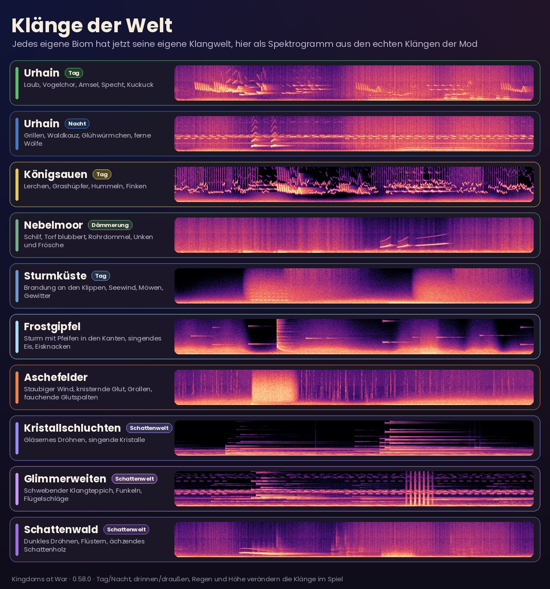

Jedes eigene Biom – die acht Biome der Oberwelt, die sechs Drachennester, die neun Biome der Schattenwelt, die sechs
Biome der Leere, die fünf des Feenreichs und die fünf des Abgrunds – und seit 0.61 auch **53 Standard-Biome der Oberwelt** haben ihre eigene Klangwelt. **Seit 0.79 ist kein Biom mehr still:**
Auch das End, das Tiefe Dunkel und die Kampfdimensionen der Bosse haben eine, und Biome ohne eigene Klangwelt – etwa die
anderer Mods – bekommen eine nach ihren Merkmalen (Wald, Nadelwald, Meer, Fluss, Strand, Gebirge, Trockenland, End oder
Grasland); nur der Nether behält die Klangschleifen von Minecraft. Die Stimmung tragen
vor allem **Einzelklänge**, die alle paar Sekunden an einem Ort in der Nähe erklingen: rauschendes Laub im Baum, Wind im Gras, ein
Specht, ein Bussard hoch über der Schlucht, Blubbern zu deinen Füßen, ein Drache in der Ferne – viele davon echte
Naturaufnahmen von Minecraft. Darunter liegen leise Klangteppiche (Wind, Wasser, Brandung, Glut, Eis, das
Dröhnen fremder Welten). Seit 0.79 ist jedes Biom **sofort zu hören**: Wer es betritt, hört nach einer halben Sekunde
seinen ersten Einzelklang, und seine Teppiche setzen gleich ein. Der Grundteppich eines Bioms verstummt nie ganz – er
atmet nur, wird leiser und wieder lauter –, die übrigen klingen eine halbe bis anderthalb Minuten und schweigen dann
zehn bis fünfundzwanzig Sekunden. Die künstlichen Teppiche aus Laubrauschen, Grillen, Insektensummen, Vogelchor, Schilf
und Fröschen von 0.58 sind entfallen; zwischen zwei Einzelklängen liegen mindestens 3 Sekunden, und derselbe Klang kehrt
frühestens nach 12 Sekunden wieder.

| Biom | Am Tag | In der Nacht |
|---|---|---|
| **Urhain** | rauschendes Laub, Amsel, Meise, Fink, Specht, Kuckuck, knarrende Bäume, knackende Zweige | Waldkauz, Glühwürmchen, ferne Wölfe |
| **Königsauen** | Wind im Gras, Bienen, Finken, Meisen, Amsel, Kuckuck | Nachtigall, Eule, Glühwürmchen |
| **Nebelmoor** | hohler Wind, blubbernder Torf, Brachvogel, Krähen, in der Dämmerung die Rohrdommel | Frösche, Eule, ferne Wölfe, Irrlichtfunkeln |
| **Sturmküste** | Brandung an den Klippen, Seewind, Möwen, Gewitter | Brandung, Gewitter |
| **Korallenküste** | plätschernde Lagune, sanfte Wellen, Möwen, Schildkröten, Papageien, Delfine | Wellen, Glühwürmchen |
| **Felsschluchten** | trockener Wind im Gras, raschelndes Gestrüpp, kreisender Bussard, rieselnde Steine | ferne Wölfe, Glühwürmchen |
| **Frostgipfel** | Sturm, knackendes und arbeitendes Eis, Grollen aus der Tiefe | dazu heulende Wölfe |
| **Aschefelder** | staubiger Wind, knisternde Glut, Grollen, fauchende Glutspalten | ebenso |
| **Drachennester** | je nach Element Lava, Eis, Sturm, Fels, Zauberhain oder Grotte – und ein Drache brüllt in der Ferne | ebenso |
| **Schattenwelt** | Dröhnen und Flüstern im Schattenwald, singende Kristalle in den Schluchten, Seelenklagen im Sumpf, schwebende Klänge auf den Glimmerweiten, ein Herzschlag in den Tiefen | ewiges Zwielicht |
| **Die Leere** | tiefes Dröhnen und Sternensirren, gläserne Akkorde im Kristallwald, rieselnder Sternenstaub, Chöre und schabende Steine in den Ruinen, dumpfe Erinnerungen über den Weltenresten, Gesang der Sternenrochen | ewige Nacht |
| **Der Abgrund** | ein tiefes, schiefes Dröhnen, durch das ab und zu ein fernes Reißen geht; in der Ferne reißt die Welt (Splittern, Bersten, ein hohles Einatmen); dazu je Biom die Welt seiner Bruchstücke – Laub und Krähen, Lava und Glut, singende Kristalle, Klagen und Flüstern, knisternde Nähte | ewiges Rot |
| **Das End** (seit 0.79) | ein tiefes Summen und der Wind der Leere, ferner Sternengesang, schabender Fels, Funkeln, ein Stöhnen aus der Tiefe | ewige Nacht |
| **Das Tiefe Dunkel** (seit 0.79) | tropfendes Wasser, ein Grollen in der Erde, Flüstern, ein Stöhnen aus der Tiefe | ewige Finsternis |
| **Kampfdimensionen** (seit 0.79) | jede klingt wie ihr Hort: Zauberhain und Funkeln in der Arkanen Sphäre und auf der Mondbühne, Lava, Glut und zischender Dampf in der Glutesse, Sternenstaub und Sternengesang im Sternenzelt, fernes Glitchen und Knistern im Fehlerraum, Chöre und schabende Steine in der Thronwelt, reißende Welten im Weltenschlund, Chöre und Kristallklang in der Schöpfung | ebenso |

**Die Standard-Biome der Oberwelt** (neu in 0.61) klingen so:

| Biome | Was du hörst |
|---|---|
| **Ebenen, Sonnenblumenebenen, Wiesen** | Wind im Gras, Finken, Meisen, Krähen, Bienen über den Blumen, Ziegen auf den Wiesen; nachts Nachtigall, Eule und Glühwürmchen |
| **Wälder** (Eichen- und Birkenwald, Blumenwald, Kirschhain) | rauschendes Laub, Amsel, Meise, Fink, Specht, Kuckuck, knarrende Stämme, Bienen im Blumenwald; nachts Eulen und Glühwürmchen |
| **Dunkler Wald, Blasser Garten** | Laub, knackende Zweige, Krähen; nachts Eulen und Wölfe – im Blassen Garten raschelt das Moos, und nachts wispern die Augenblüten |
| **Taiga** (auch Riesenbaumtaiga und verschneite Taiga) | Wind, knarrende Stämme, Specht, Krähen; nachts Eulen, Füchse und ferne Wölfe |
| **Schnee, Eis und Gipfel** | Sturmwind, knackendes Eis (am meisten zwischen den Eiszapfen), rieselnde Steine, Ziegen, ein Bussard über den Steingipfeln; nachts Wölfe |
| **Wüste, Savanne, Tafelberge** | trockener Wind, rieselnder Sand, raschelnde Büsche, Wind im Gras der Savanne, ein kreisender Bussard |
| **Dschungel** | rauschendes Laub, Papageien, Spechte; nachts Frösche, Eulen und Glühwürmchen |
| **Sumpf, Mangrovensumpf** | hohler Wind, blubbernder Morast, Krähen, in der Dämmerung die Rohrdommel; nachts Froschkonzert, Eulen und Glühwürmchen |
| **Flüsse, Strände, Küsten** | fließendes Wasser, Brandung, Seewind, Möwen, Schildkröten, Delfine; am gefrorenen Fluss knackendes Eis |
| **Meere** | sanftes Plätschern, Seewind, Möwen, Delfine; über tiefem Wasser ferne Walgesänge, in kalten und gefrorenen Meeren Sturm und Eis |
| **Pilzland, Tropfsteinhöhlen, Üppige Höhlen** | Wellen und Möwen um die Pilzinsel; in den Höhlen tropfendes Wasser und Blubbern |

Das Tiefe Dunkel und das End, die bei Minecraft still sind, klingen seit 0.79 ebenfalls (siehe oben); nur der Nether behält
die Klangschleifen von Minecraft.

Die Klänge folgen den Umständen: Vögel singen am Tag und verstummen bei Regen, nachts summen die Glühwürmchen; in Häusern
und Höhlen verklingen Laub und Vögel, vom Wind bleibt nur ein Hauch; auf Gipfeln pfeift der Wind lauter; unter Wasser
wird es still. Beim Wechsel des Bioms blenden die Klangwelten in zwei Sekunden ineinander.

**Der eigene Regler (seit 0.79):** Unter *Optionen → Musik & Geräusche* steht unter den Reglern von Minecraft die Zeile
„Kingdoms at War“ mit dem Regler **Biom-Klänge** (0 % = aus, anfangs 70 %); er wirkt sofort. Derselbe Wert steht unter
*Mods → Kingdoms at War → Konfiguration* (**Lautstärke der Biom-Klänge**; dort lassen sich die **Biom-Klänge** auch ganz
abschalten). Der Regler „Atmosphäre/Umgebung“ von Minecraft gilt für sie nicht mehr – nur noch die Gesamtlautstärke. Die Klangteppiche und
viele Einzelklänge sind eigens für die Mod erzeugt (`tools/audio/ambience.py`); die übrigen Einzelklänge verweisen auf
Naturaufnahmen von Minecraft selbst.

### Die neue Oberwelt

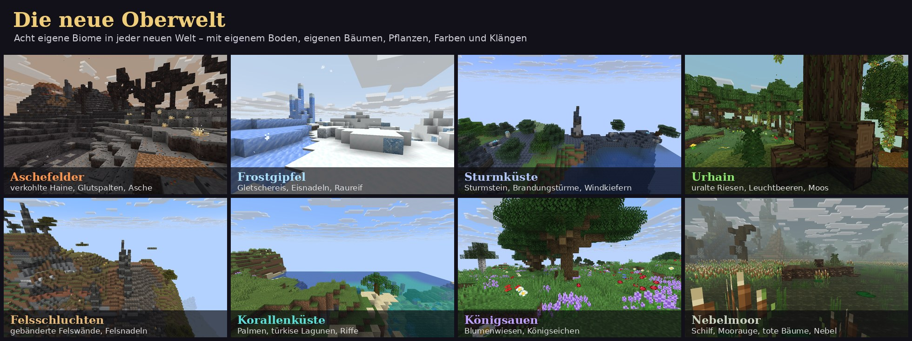

In jeder neuen Welt wachsen **acht eigene Biome** zwischen den bekannten Landschaften. Jedes hat seinen eigenen Boden,
eigene Bäume, Pflanzen und Felsen, eigene Farben für Himmel, Nebel, Wasser, Gras und Laub, eigene Partikel in der
Luft, eigene Musik und Klänge.

| Biom | Wo | Was es ausmacht |
|---|---|---|
| **Aschefelder** | in einem Teil der Wüsten | Asche, Aschenerde und Vulkangestein; verkohlte Haine, Aschedünen, Glutspalten mit glühendem Grund, rauchende Schlote, Felsnadeln aus Vulkangestein, Feuerlilien; Asche weht durch die Luft |
| **Frostgipfel** | auf allen vereisten Gipfeln und einem Teil der Schneehänge | Schnee, Gletschereis, Packeis, Raureifstein, tückische Pulverschnee-Mulden; Eisnadeln mit Adern aus Blaueis und Frostkristallen auf den Spitzen, Eiszapfen unter Überhängen, Schneewehen, Frostblumen |
| **Sturmküste** | an allen steinigen Küsten | Sturmstein mit Kiesbändern; Brandungstürme aus Sturmstein und Schiefer, Findlinge in der Brandung, Fulgurite mit Sturmkristallen, vom Wind gebeugte Fichten, fernes Donnergrollen und Funken in der Luft |
| **Urhain** | in einem Teil der kühlen Wälder | uralte Riesenbäume aus Urholz auf Wurzelfüßen, mit Ranken voller Leuchtbeeren; umgestürzte, bemooste Stämme, Podsol, Moos und Leuchtmoos, Farne, Leuchtkappen, Hainglocken, Dornengestrüpp, Laubstreu und Glühwürmchen |
| **Felsschluchten** | auf den Savannen-Hochebenen und den windgepeitschten Savannen | Felswände in Bändern aus Tuff, Schiefer, Kalzit, Andesit, Terrakotta und Tropfstein; hohe Felsnadeln, Geröll, Bernsteindrusen, Akazien und trockenes Gras |
| **Korallenküste** | an den warmen Stränden und im flachen Wasser davor | weißer Sand, türkise Lagunen mit Korallengärten, Riffen, Seegras und Meeresgurken; Palmen, Perlmuttfelsen, Schildkröten und Tropenfische |
| **Königsauen** | in einem Teil der gemäßigten Ebenen | wogende Blumenwiesen aus Lavendel, Kornblumen, Gartenrosen, Margeriten und Mohn; mächtige Königseichen, kleine Eichenhaine, einzelne Birken; Rothirsche |
| **Nebelmoor** | in den kühlen Sümpfen | Torf, Schlamm und Moos; Mooraugen mit Schilf und Seerosen, tote Bäume und Moorbirken mit fahlem Moos, Blasseichen, Mondblumen; trübes Wasser und dichter Nebel |

- **Torf** brennt im Ofen so lange wie ein Boot, **Schilf** wächst im flachen Wasser und am Ufer.
- Die Biome entstehen in den Weltarten **Standard**, **Große Biome** und **Zerklüftet** – auch auf Servern. Bestehende
  Welten behalten ihre Landschaft; die neuen Biome gibt es nur in neu angelegten Welten.
- Drachennester, Magiertürme, der Siegelkreis, Erze, Blumen und Kreaturen kennen die neuen Biome (siehe die Tabellen
  unten).
- Finden mit `/locate biome kingdomsatwar:ash_fields` (bzw. `frost_peaks`, `storm_coast`, `primeval_forest`,
  `rock_gorges`, `coral_coast`, `royal_meadows`, `mist_moor`).

**Die Standard-Biome im neuen Stil:** Auch die bekannten Landschaften bekommen, was die eigenen Biome so lebendig
macht – passend zu jeder Gegend und nur dort:

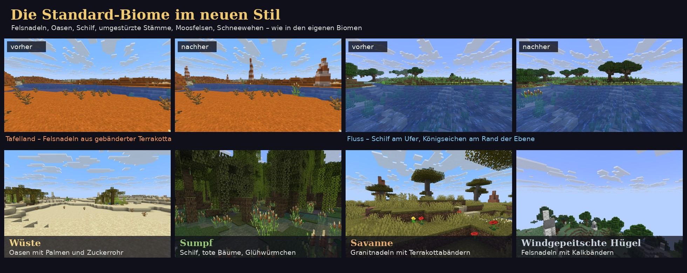

| Standard-Biome | Was dazukommt |
|---|---|
| Ebenen, Sonnenblumenebenen | Findlinge mit Moospolstern, Blumeninseln (Lavendel, Gartenrosen, Kornblumen, Margeriten …), hin und wieder eine mächtige Königseiche |
| Bergwiese, Kirschhain | Findlinge aus Stein und Kalk, Hainglocken; auf der Bergwiese Blumeninseln und Königseichen, im Kirschhain umgestürzte Kirschstämme |
| Wälder, Birkenwälder, dunkler Wald | bemooste Felsen, umgestürzte Stämme mit Moos und Leuchtkappen, Farne, Moosteppiche, Dornengestrüpp und Hainglocken; im dunklen Wald Leuchtkappen und Glühwürmchen |
| Taiga, Ur-Taiga | Moosfelsen, umgestürzte Fichten, Farne, Moos, Dornengestrüpp; in der Ur-Taiga Leuchtkappen |
| Bleicher Garten | Felsen mit fahlem Moos, umgestürzte Blasseichen |
| Schneelande, Schneehänge, Hain, zerklüftete Gipfel | verschneite Felsen mit Eis und Frostkristallen, Schneewehen, Eiszapfen unter Überhängen, kleine Eisnadeln auf den Gipfeln, Schneeflocken in der Luft |
| Wüste | **Oasen** – ein klarer Teich mit grünem Saum, Zuckerrohr, Seerosen und Palmen –, Sandsteinnadeln und -brocken |
| Savanne, Tafelland | Felsnadeln aus Granit mit Terrakottabändern bzw. aus gebänderter Terrakotta, Felsbrocken, Bernsteindrusen; Staub über dem Tafelland |
| Sumpf, Mangrovensumpf | Schilf, abgestorbene Bäume mit fahlem Moos, Moosfelsen, Farne, Glühwürmchen |
| Dschungel | umgestürzte Urwaldstämme, Moosfelsen, Farne, Moos, Leuchtkappen |
| Windgepeitschte Hügel, Steingipfel | Windkiefern, grauer Fels, Felsnadeln mit Kalkbändern |
| Flüsse | Schilf an den Ufern |

Auch das gilt nur für neu erzeugtes Land – in bestehenden Welten kommt es dort dazu, wo du zum ersten Mal hinkommst.

**Die Bäume in neuer Gestalt:** Die Standardbäume wachsen nicht mehr als Vanilla-Klötze. Jeder Stamm teilt sich in
Äste, kann sich neigen und spreizt am Fuß Wurzelanläufe; an den Ästen sitzt das Laub in einer Form, die zur Art passt.
So wachsen sie überall in der Welt – und genauso aus jedem Setzling.

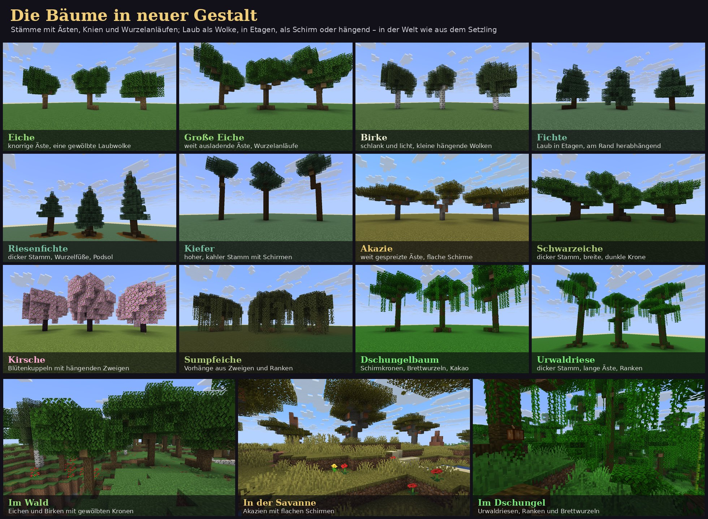

| Baum | Gestalt |
|---|---|
| Eiche | knorriger Stamm mit zwei, drei Ästen, eine gewölbte, zerfranste Laubwolke darüber; die große Eiche mit vier, fünf weit ausladenden Ästen und Wurzelanläufen |
| Birke | schlank und licht, ein, zwei steile Äste, kleine Wolken aus Laub, die hier und da herabhängen |
| Fichte | gerader Stamm, Laub in Etagen, die nach unten breiter werden und am Rand herabhängen; die Riesenfichte mit dickem Stamm, Wurzelfüßen und Podsol |
| Kiefer | hoher, kahler Stamm mit kurzen Ästen und flachen Schirmen; die Riesenkiefer mit dickem Stamm und Wurzelfüßen |
| Akazie | kurzer Stamm, drei, vier weit gespreizte Äste mit flachen Laubschirmen – wie in der Steppe |
| Schwarzeiche | dicker Stamm mit Wurzelanläufen, breite Äste, eine dichte, dunkle Krone |
| Kirsche | Äste in alle Richtungen, eine Kuppel aus Blüten, von deren Rand Zweige wie Vorhänge herabhängen |
| Sumpfeiche | geneigter Stamm, hängende Zweige voller Ranken |
| Dschungelbaum, Urwaldriese | Schirmkronen auf langen Ästen, Brettwurzeln, Ranken und Kakaobohnen; der Urwaldriese mit dickem Stamm |
| Büsche | ein Stummel, ganz verdeckt von einem Hügel aus Laub, der bis auf den Boden reicht – aus Eiche (Wälder, Ebenen, Bergwiese), Birke, Fichte (Taiga, verschneite Taiga, windgepeitschter Wald), Schwarzeiche, Akazie (Savanne) und Kirsche |
| Junge Bäume | zwischen den großen: kleine Eichen mit runder Krone, dünne Birken, kleine Fichten als Kegel bis fast auf den Boden |

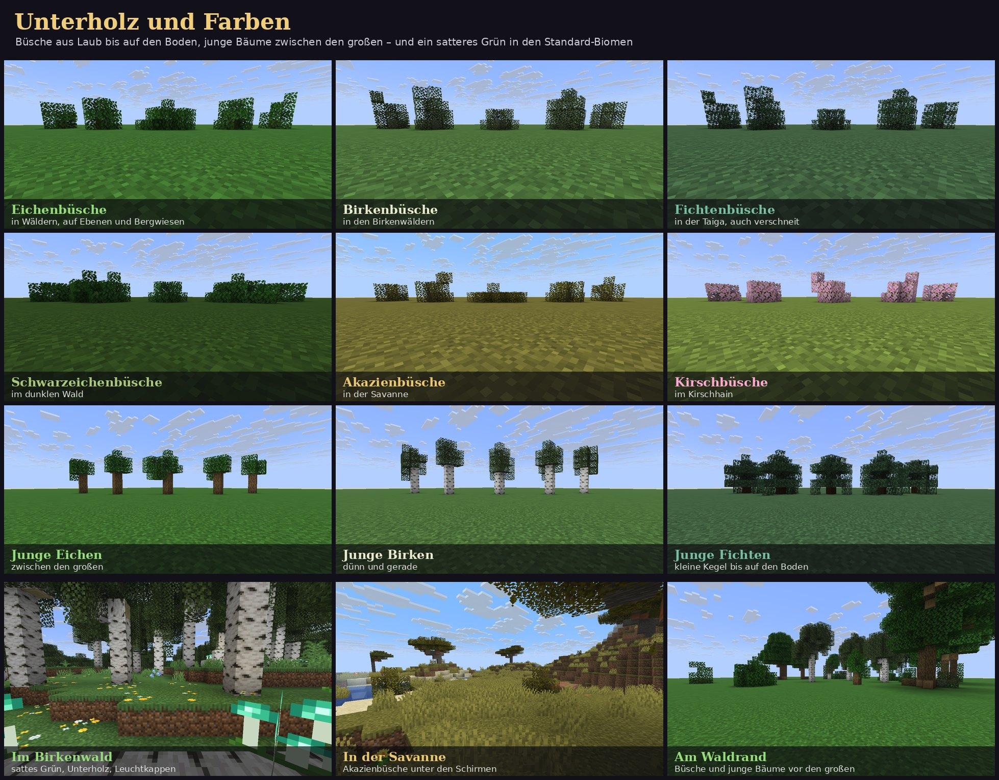

Die Blätter liegen überall nah genug am Holz – nichts verdorrt von selbst. Mangrove, Blasseiche und Azalee bleiben,
wie sie sind. Gras und Laub der Ebenen, Wälder, Birkenwälder, der Taiga, der Bergwiese und der windgepeitschten Hügel
haben seit 0.32 ein satteres Grün wie in den eigenen Biomen (die Taiga kühler, das Laub des dunklen Walds tiefer).

### Dörfer und Dorfbewohner

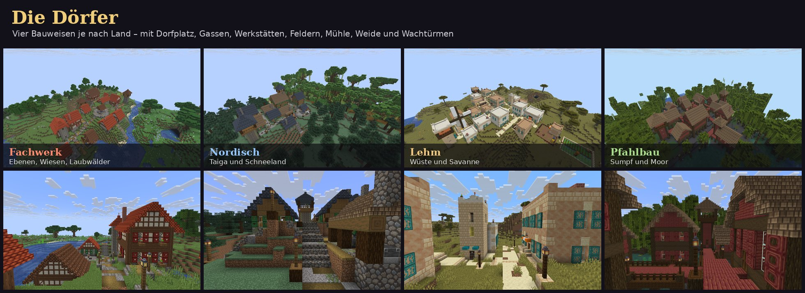

Jedes Gebäude wird automatisch auf Baufehler geprüft (in jeder Bauweise, Spielart und Drehung): Betten stehen im Raum
und nicht in der Wand, unter keiner Decke eingeklemmt; Türen sind frei, Truhen lassen sich öffnen, Öfen schauen in den
Raum, und Laternen, Kronleuchter und Leitern haben Halt – unter offenen Dachstühlen hängen Laternen an Ketten vom Dach.

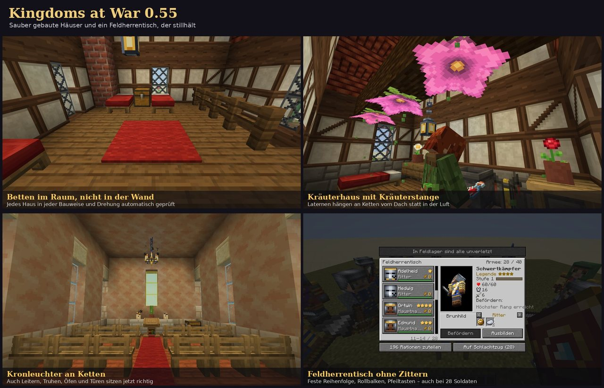

Die Vanilla-Dörfer sind fort – an ihrer Stelle stehen **eigene Dörfer in vier Bauweisen**, jede passend zu ihrem Land:

| Bauweise | Wo | Wie sie aussieht |
|---|---|---|
| **Fachwerk** | Ebenen, Sonnenblumenebenen, Wiesen, Laub-, Birken- und Blumenwälder, Königsauen | weißer Kalkputz zwischen dunklen Balken auf einem Sockel aus Mauerstein, rote oder braune Ziegeldächer, Bleiglasfenster mit grünen oder roten Läden |
| **Nordisch** | Taiga, verschneite Taiga, Schneeebenen, Urwald-Taiga | Blockhäuser aus Fichtenstämmen auf einem Feldsteinsockel, steile Dächer aus Schiefer oder Holzschindeln |
| **Lehm** | Wüste und Savanne | Lehm- und Kalkputz auf behauenem Sandstein, Flachdächer mit Brüstung, vorstehende Balken, bunte Sonnensegel |
| **Pfahlbau** | Sumpf, Mangrovensumpf, Nebelmoor | Holzhäuser auf Pfählen über Wasser und Schlamm, Stege statt Wegen, Schindeldächer |

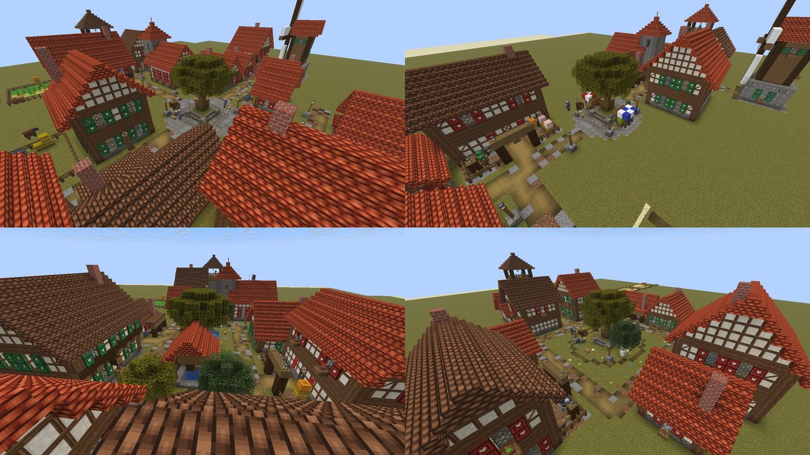

- **Der Dorfplatz** in der Mitte ist gepflastert (im Moor eine Plattform auf Pfählen) – im Angerdorf ist es der lange
  Anger mit Teich und Bäumen, im Rundling die runde Dorfwiese. Darauf steht ein Brunnen mit
  Dach und Dorfglocke, eine Dorflinde, ein Maibaum, ein Springbrunnen oder eine Feuerstelle; ringsum Bänke, Laternen
  und Marktstände.
- **Vier Grundrisse:** Haufendorf (Platz mit Wegen in alle Richtungen und Seitengassen), Straßendorf (lange
  Dorfstraße mit kleinem Marktplatz und Quergassen), Angerdorf (zwei Straßen um einen langen Anger mit Brunnen, Linde,
  Teich und Bäumen, im Lehmland eine Oase mit Palmen) und Rundling (Häuser rings um eine runde Dorfwiese, nur ein, zwei
  Wege hinaus). Die Wege haben Stufen am Hang und Brücken über Wasser. Daran stehen
  im Schnitt **17 Gebäude**: Wohnhäuser in drei Größen, Gasthaus, Schmiede, das **Söldnerhaus** mit Übungshof und
  Söldnertafel, Bäckerei, meist eine Kapelle und vier bis sechs Werkstätten (Schreibstube, Kartenhaus, Kräuterhaus, Metzgerei, Gerberei, Steinmetz, Bogner). Am Dorfrand
  liegen Windmühle, Scheune, Felder (auch hinter den Häusern), eine Schafweide und am Wasser eine Fischerhütte mit Steg
  und Boot; an den Wegenden stehen Wachtürme.
- In den Truhen liegt, was in das Haus gehört (Vorräte, Werkzeug, Fisch, Wolle, Kräuter …), dazu ein paar Münzen.
- Dörfer liegen nie in der Nähe eines Drachennests (mindestens rund 450 Blöcke entfernt) und nicht am Siegelkreis.
  Vanilla-Dörfer und die Außenposten der Plünderer gibt es nicht mehr.
- Finden mit `/locate structure kingdomsatwar:village_timber` (bzw. `village_nordic`, `village_clay`, `village_stilt`).

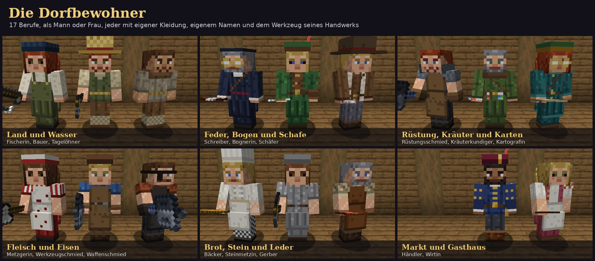

**Die Bewohner** sind Männer und Frauen in 17 Berufen, jeder mit eigenem Namen und eigener Kleidung (Strohhut, Kapuze,
Kappe mit Feder, Schürze, Bäckermütze, Gewand, Umhängetasche, Köcher …). **Rechtsklick** öffnet den **Handel** – mit
Münzen, wie bei den Bürgern deiner Siedlung; dein Ansehen senkt die Preise, nach einer Pause gibt es neue Ware.
**Schleichen + Rechtsklick** fängt ein **Gespräch** an.

| Beruf | Wohnt und arbeitet in | Handelt mit |
|---|---|---|
| Tagelöhner | Wohnhaus, Gasthaus | – (erzählt dafür gern) |
| Bauer | großem Haus, Windmühle, Scheune, Feld | Feldfrüchten, Saatgut und Brot |
| Fischer | Fischerhütte | Fisch, Eimern, Angel (auch verzaubert) und Booten; verkauft den **Fischbeutel** und dessen Erweiterungen und kauft Fänge nach Seltenheit auf (seit 0.81) |
| Schäfer | Schafweide | Wolle, Farben, Betten, Bannern, Gemälden und dem Webstuhl |
| Bogner | Bogner | Pfeilen, Bögen und Armbrüsten (auch verzaubert) und Trankpfeilen |
| Schreiber | Schreibstube | verzauberten Büchern, Uhr, Kompass und Namensschild |
| Kartograf | Kartenhaus | Karten zum nächsten Dorf, zum Siegelkreis, zu einem Magierturm oder einem Drachennest; Fernrohr, Drachenkompass |
| Kräuterkundiger | Kräuterhaus | Redstone, Lapis, Glowstone, Enderperlen, Erfahrungsfläschchen, Tränken und dem Braustand |
| Rüstungsschmied | Schmiede | Eisen-, Ketten- und Stahlrüstung, Schild, verzauberter Diamantrüstung |
| Waffenschmied | Schmiede | Eisen- und Stahlwaffen, Speer, verzauberten Waffen |
| Werkzeugschmied | Schmiede | Stein-, Eisen- und Stahlwerkzeug, auch verzaubert |
| Metzger | Metzgerei | Fleisch, Wildbret und Fleischpastete |
| Gerber | Gerberei | gefärbter Lederrüstung, Pferderüstung, Sattel, Bündel und Leine |
| Steinmetz | Steinmetz | Steinen, Terrakotta, Quarz und den Bau-Blöcken der Mod |
| Bäcker | Bäckerei | Brot, Gebäck, Kuchen und Gerichten |
| Wirt | Gasthaus | Essen, Bier, Wein und Met |
| Händler | Marktstand am Platz | Alltäglichem und wechselnden Raritäten aus der Ferne |

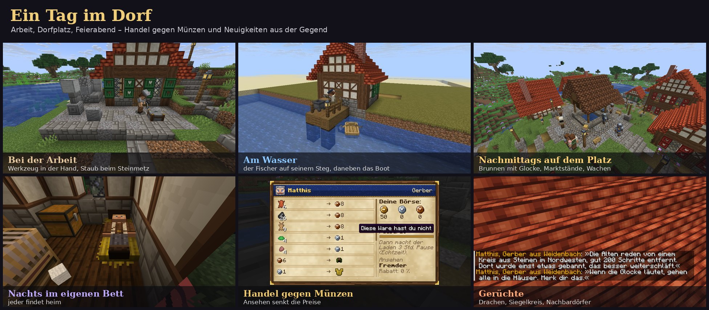

**Ein Tag im Dorf:**
- **Morgens** gehen alle an die Arbeit: mit dem Werkzeug ihres Berufs in der Hand, mit Hammerschlägen und Funken am
  Amboss, Staub beim Steinmetz, Rauch beim Bäcker und Metzger; der Bauer geht übers Feld, erntet und sät gleich nach.
  Zwischen den Schichten machen sie Pause.
- **Nachmittags** trifft sich das Dorf auf dem Platz.
- **Abends** geht jeder heim, **nachts** schläft jeder in seinem eigenen Bett.
- Bei **Regen** stellen sie sich unter, vor Monstern laufen sie davon.

**Gerüchte:** Im Gespräch erzählen die Bewohner, was man sich so erzählt – wo ein Drache haust (mit Himmelsrichtung und
ungefährer Entfernung), wo der Siegelkreis liegt, wo das nächste Dorf ist, ob Regen kommt, und was man in ihrem Beruf
wissen sollte.

**Dorfwachen:** Schwertkämpfer am Dorfplatz und Bogenschützen auf den Wachtürmen beschützen die Bewohner vor Monstern –
und vor dir: Wer einen Bewohner angreift, hat die Wachen am Hals, und wer einen tötet, verliert 40 Ansehen.
Dorfwachen lassen sich nicht anheuern.

### Bauwerke der Oberwelt

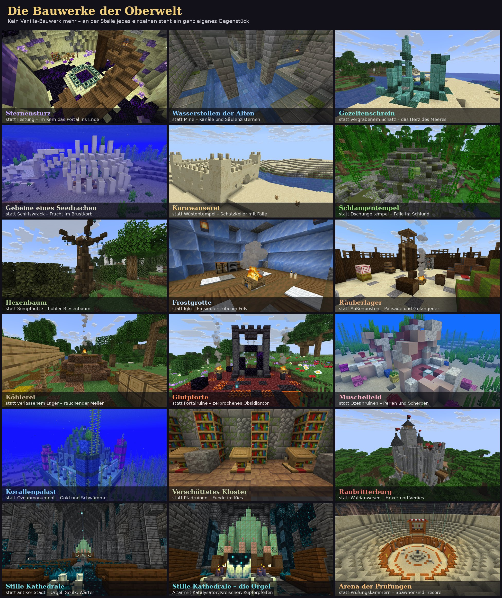

Kein einziges Vanilla-Bauwerk entsteht mehr in der Oberwelt. An die Stelle jedes Bauwerks tritt ein **ganz eigenes
Gegenstück** – andere Gestalt, anderes Thema, aber dieselbe Rolle in der Welt: Es steht im selben Land, ist ungefähr
gleich häufig, und was man dort unbedingt braucht (das Portal ins Ende, das Herz des Meeres, die Prüfungsschlüssel und
Tresore, die Totems der Hexer …), findet man weiterhin. In den Truhen liegt die Beute des alten Bauwerks, dazu eigene
Funde und Münzen – aber karg (siehe unten).

| Bauwerk | statt | Wo | Was man dort findet |
|---|---|---|---|
| **Sternensturz** | Festung | wie die Festungen in Ringen um den Ursprung | ein Meteoritenkrater (oder ein Sternfels auf dem Wasser bzw. am Hang), im glühenden Kern das **Portal ins Ende**; eine Wendeltreppe hinab, ein Lager der Sternforscher mit Fernrohr |
| **Wasserstollen der Alten** | Mine | tief unter der Erde | gewölbte Kanäle mit Wasserrinnen, Säulenzisternen, Treppen; manchmal führt ein Brunnenhaus an der Oberfläche hinab |
| **Gezeitenschrein** | vergrabener Schatz | Strände und Korallenküste | ein Schrein mit Säulen und einem Dreizack aus Prismarin, unter dem Altar das **Herz des Meeres** |
| **Gebeine eines Seedrachen** | Schiffswrack | im Meer und an Stränden | ein riesiges Drachenskelett, im Brustkorb die verschluckte Fracht (Karten, Ladung, Schatz) |
| **Karawanserei** | Wüstentempel | Wüste | eine verfallene Herberge mit Arkadenhof und Brunnen; darunter der Schatzkeller – mit Falle |
| **Schlangentempel** | Dschungeltempel | Dschungel | ein steinerner Schlangenkopf auf einer Lichtung, eine Pfeilfalle im Schlund, eine Halle mit Wassergraben darunter |
| **Hexenbaum** | Sumpfhütte | Sumpf und Nebelmoor | ein hohler, abgestorbener Riesenbaum, unten die Höhle der Hexe, oben eine Plattform in der Krone |
| **Frostgrotte** | Iglu | verschneite Ebenen, Taiga und Hänge | die Felsgrotte eines Einsiedlers mit Holzvorbau, unter dem Teppich eine Luke zum Keller |
| **Räuberlager** | Plünderer-Außenposten | Ebenen, Savanne, Taiga, Wüste … | eine Palisade mit Wachturm und Zelten, ein Gefangener im Käfig, Wegelagerer mit Armbrüsten |
| **Köhlerei** | verlassenes Lager | Wälder und Taiga | ein rauchender Meiler auf einer Lichtung, Holzstapel, Unterstand, ein vergrabenes Versteck |
| **Glutpforte** | Portalruine | überall in der Oberwelt | ein zerbrochenes Tor aus Obsidian zwischen Basaltsäulen, ringsum glühender Boden; wer die Steine ergänzt, kann es entzünden |
| **Muschelfeld** | Ozeanruinen | Ozeane | Riesenmuscheln mit leuchtenden Perlen und Truhen, alte Scherben im Sand (warm mit Korallen, kalt mit Seetang) |
| **Korallenpalast** | Ozeanmonument | tiefe Ozeane | eine Halle unter einer Glaskuppel, vier Türme aus lebenden Korallen, ein Thron auf **acht Goldblöcken**, ein alter Wächter, die **Schwammgrotte** |
| **Verschüttetes Kloster** | Pfadruinen | Taiga, Urwald, Dschungel | nur der Glockenturm schaut aus dem Waldboden; unten Kreuzgang, Skriptorium, Kapelle – und Funde im Kies für den Pinsel |
| **Stille Kathedrale** | antike Stadt | tief im Reich des Sculk | eine Kathedrale aus Tiefenschiefer in einer riesigen Höhle: Türme, Fensterrose, Strebebögen, eine Kupferorgel – und Kreischer, die den Wärter rufen |
| **Arena der Prüfungen** | Prüfungskammern | tief unter der Erde | ein Kolosseum aus Sandstein in einer Höhle; sechs Käfige mit **Prüfungsspawnern**, der Spawner der Böen in der Mitte, **Tresore** (einer unheilvoll) auf der Ehrentribüne |
| **Raubritterburg** | Waldanwesen | dunkler Wald, Blasser Garten | eine Burg auf einem Hügel mit Graben und Brücke, Ringmauer, Rundtürme, Bergfried mit Verlies (gefangene Hellegeister), Palas – und die Leute des Raubritters (Diener, **Hexer**, Armbrustschützen) |

- Enderaugen finden den Sternensturz; Schatzkarten, Ozean-Entdeckerkarten, Waldkarten, Prüfungskarten und die
  übrigen Karten der Kartografen zeigen auf die neuen Bauwerke.
- Finden mit `/locate structure kingdomsatwar:fallen_star` (bzw. `aqueduct`, `tide_shrine`, `sea_dragon`,
  `caravanserai`, `serpent_temple`, `witch_tree`, `frost_grotto`, `bandit_camp`, `charcoal_camp`, `ember_gate`,
  `clam_field`, `coral_palace`, `buried_abbey`, `silent_cathedral`, `trial_arena`, `robber_castle`).
- Die neuen Bauwerke entstehen nur in neu erzeugten Chunks.
- **Seltener als früher:** Seit 0.31 liegen die Bauwerke deutlich weiter auseinander, damit jedes ein Fund bleibt –
  von den meisten gibt es nur noch halb bis zwei Drittel so viele, von den Burgruinen ein Siebtel und von den
  Brunnenhäusern der Wasserstollen ein Fünftel. Was unter die Erde gehört, bleibt dort: Die Gänge der Wasserstollen
  haben überall mindestens sechs Blöcke Gestein über sich, nur zu manchen führt ein Brunnenhaus hinab, und das
  verschüttete Kloster liegt so tief, dass nur der Glockenturm herausschaut.
- **Noch seltener seit 0.79 – in allen Dimensionen:** Die Felder, in denen je ein Bauwerk entsteht, sind rund 1,6-mal so breit
  wie bisher (von den meisten Bauwerken gibt es damit nur noch etwa 40 % so viele), und zwei Bauwerke derselben Art halten
  fast die halbe Feldbreite Abstand – nichts steht mehr dicht an dicht. Dörfer liegen jetzt in Feldern von 64 statt 40
  Chunks, die Türme der Erzmagier in 74 statt 46, Burgruinen in 58 statt 36; im Nether teilen sich Festungen und
  Bastionen Felder von 40 statt 27 Chunks, im End stehen die Endstädte in Feldern von 30 statt 20 – und ebenso weiter
  auseinander liegen die Bauwerke des Feenreichs, der Schattenwelt und der Leere. Kein Bauwerk steht näher als zehn Chunks
  an einer Stammburg. (Gilt für neu erzeugte Gebiete.)
- **Karge Truhen:** In allen Truhen – in den eigenen Bauwerken, Dörfern und Türmen wie in den übrigen Vanilla-Bauwerken
  – bleibt nur ein Teil dessen liegen, was gezogen wurde: Knapp ein Drittel der Stapel fehlt, von Wertvollem
  (Diamanten, Smaragde, Gold, Netherit, Edelsteine, Verzaubertes, Ausrüstung) mehr als die Hälfte, und die übrigen
  Stapel schrumpfen auf drei Fünftel.
  Ganz leer ist keine Truhe, und was man für den Fortgang braucht, liegt immer darin: das Herz des Meeres, die Netherit-
  und die Abyssit-Vorlage, der Drachenkompass, die Zaubertafeln und die Prüfungsschlüssel.

### Bauwerke des Nethers

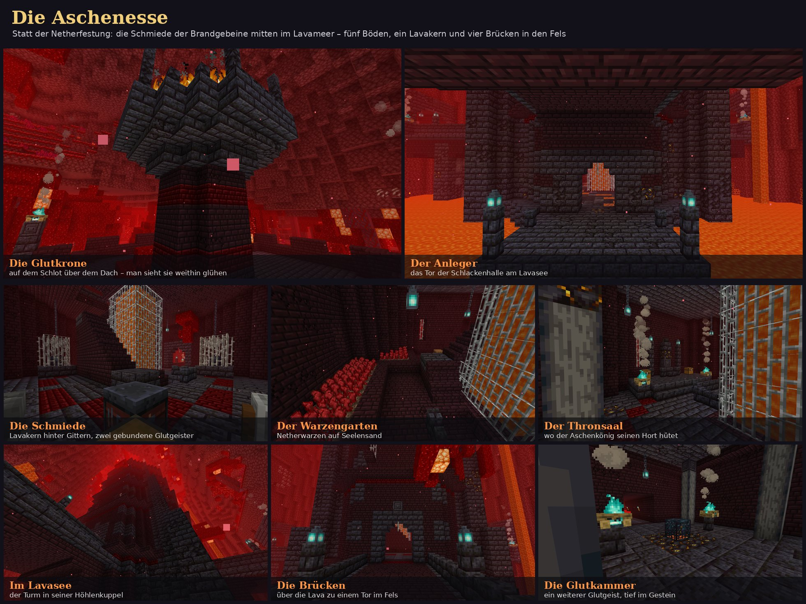

**Die Aschenesse** (statt der Netherfestung): Mitten im Lavameer haben die Brandgebeine ihrem König eine Esse errichtet.
Sie steht frei in einer weiten Höhlenkuppel über einem Lavasee – ein achteckiger Turm aus Netherziegeln auf einem Sockel
aus Schwarzstein, gestützt von Strebepfeilern, mit roten Bändern an jedem Boden, Schießscharten, Fenstern und Toren.

- **Im Kern** steigt hinter Eisengittern eine Säule aus Lava auf; um sie windet sich die Treppe von Boden zu Boden.
- **Fünf Böden:** die Schlackenhalle am Lavasee mit einem Anleger für Lavastelzer, die Schmiede mit Lavarinne,
  Hochöfen, Ambossen und zwei **Glutgeistern in Käfigen**, der Warzengarten mit **Netherwarzen** auf Seelensand, die
  Gebeinkammer mit Sarkophagen, Seelenlaternen und Nischen und ganz oben der **Thronsaal** des Aschenkönigs – mit dem
  Thron, einem Schädel darauf und dem **Hort** (Gold, vergoldeter Schwarzstein, Edelsteine, Diamanten,
  Netheritschrott, selten ein Witherskelettschädel).
- **Auf dem Dach** Zinnen, Dornen, Seelenfeuer auf den Spitzen und ein schlanker Schlot mit der **Glutkrone**, einer
  Feuerschale, die man weithin glühen sieht. Vor dem Schlot steht der **Glutamboss** – dort schmiedet **Malleus, der
  Glutschmied** (siehe unten).
- **Vier Brücken** gehen von der Schmiede nach allen Seiten, auf Bögen und Pfeilern, mit Geländern und Laternen. Wo sie
  auf Fels treffen, enden sie hinter einem Tor mit Feuerschalen in **Stuben im Gestein** – eine Glutkammer mit einem
  weiteren Glutgeist, ein Vorrat, eine Wachstube, ein Kerker mit Ketten –, oft mit einem Stollen in die nächste Höhle;
  sonst enden sie auf einem **Wachturm** über der Lava.
- **Brandgebeine** halten Wache; Glutgeister, Brandgebeine, Gerippe, Glutschleime und Moderborstlinge erscheinen in
  der Esse wie einst in der Festung. Die Beute der Festung bleibt (dazu Münzen, Netherwarzen, Magmacreme, Quarz).
- Finden mit `/locate structure kingdomsatwar:ash_forge`; die Aschenessen teilen sich ihre Plätze mit den Hortfesten.
  Der Erfolg „Eine schreckliche Festung“ heißt jetzt „Die Aschenesse“ und verlangt, eine zu betreten.

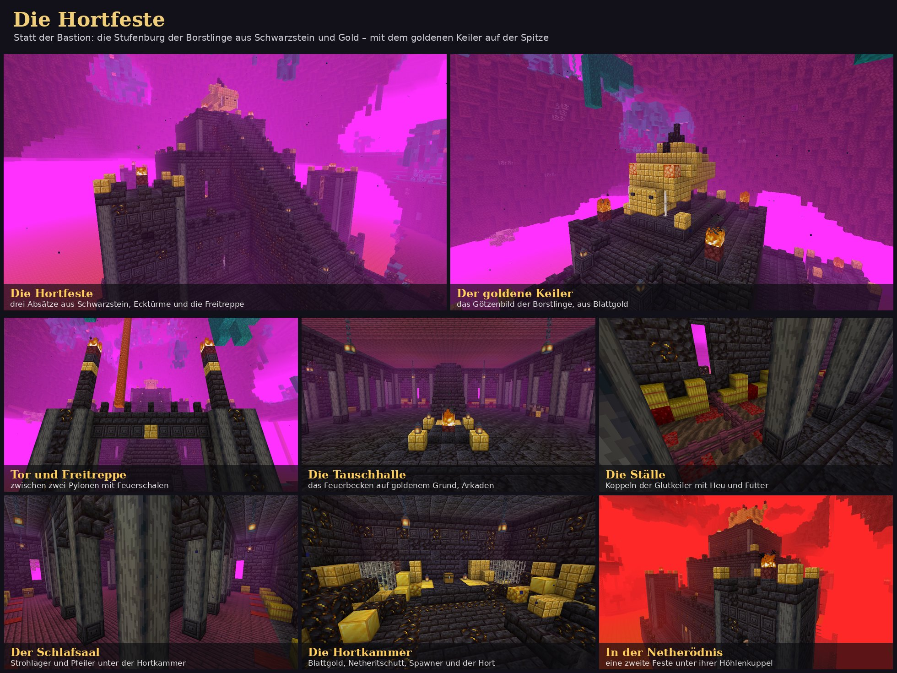

**Die Hortfeste** (statt der Bastion): Die Borstlinge horten ihr Gold in einer Stufenburg. Sie steht frei in einer
weiten Höhlenkuppel auf einem Sockel, der bis auf den Grund oder in den Lavasee reicht – in den Karmesin- und
Wirrwäldern, den Netherwüsten und im Seelensandtal, wo früher die Bastionen standen.

- **Drei Absätze** aus Schwarzstein übereinander, jeder mit einem Fries aus gemeißelten Platten und Gold, Zinnen am
  Rand der Terrassen und hohen Fenstern; an den Ecken des untersten vier **Türme** mit Feuerschalen (eine Leiter führt
  von der Terrasse hinauf).
- **Der Vorhof** mit einem Tor zwischen zwei Pylonen, Feuerschalen und der Wachstube; von dort steigt die
  **Freitreppe** mit Brüstung, Pfosten und Laternen über alle Absätze bis auf die oberste Plattform.
- **Der goldene Keiler** auf der Spitze: das Götzenbild der Borstlinge auf einem Sockel zwischen vier Feuerschalen – ein
  Rumpf aus **Blattgold** mit rundem Bauch und hohem Widerrist, darauf ein Kamm aus dunklen Borsten; der schwere Kopf
  hängt tiefer als der Rücken, mit Rüsselscheibe und Nüstern, schlanken weißen Hauern, glühenden Augen und abstehenden
  Ohren; dazu ein Ringelschwanz.
- **Unten** die Tauschhalle mit einem Feuerbecken auf goldenem Grund, Arkaden unter dem nächsten Absatz, Vorräte an den
  Seiten (Fässer, Truhen) und hinten die **Ställe der Glutkeiler** mit Koppeln aus Karmesinzaun, Heu und Futter;
  große Tore an beiden Seiten und hinten.
- **In der Mitte** der Schlafsaal mit Strohlagern und die Waffenkammer (Schmiedetisch, Amboss, Schleifstein); Türen
  führen auf die Terrassen.
- **Oben** die **Hortkammer**: glänzende Haufen aus Blattgold und vergoldetem Schwarzstein mit echtem Gold und Rohgold
  dazwischen, Netheritschutt in den Wänden, zwei Glutschleim-Spawner in Käfigen und der Hort auf einem Podest. Treppen im
  Inneren verbinden die Absätze. Zierde wie Zinnenkappen, Schlusssteine und der Keiler ist aus Blattgold – die Feste
  glänzt, ist aber kein Goldbergwerk: Echtes Gold und Rohgold sind nur ein paar Blöcke in den Haufen der Hortkammer.
- **Bewohner:** Borstlinge in der Halle, im Schlafsaal und auf den Terrassen, Borstenhünen als Wache (auch beim Keiler),
  Glutkeiler in den Ställen. Licht geben nur gelbe Flammen – Seelenfeuer fürchten die Borstlinge.
- **Beute:** die der Bastion – im Hort die **Netherit-Vorlage**, in den übrigen Truhen Gold, Ausrüstung, Leitsteine
  und mit etwas Glück ebenfalls eine Vorlage. Der Erfolg für das Betreten einer Bastion heißt jetzt „Die Hortfeste“ und
  verlangt, eine zu betreten; der für das Plündern einer Bastion-Truhe gilt für die Truhen der Hortfeste.
- Finden mit `/locate structure kingdomsatwar:hortfeste`; sie hat die Plätze der Bastionen übernommen.

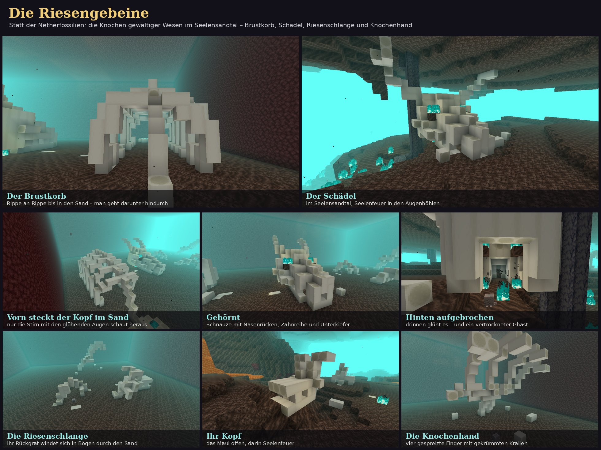

**Die Riesengebeine** (statt der Netherfossilien): Im Seelensandtal liegen die Knochen gewaltiger Wesen aus alter Zeit,
halb im Sand versunken – auf dem Grund der Täler, auf Hängen und Absätzen. Es gibt vier Arten, jede ein wenig anders
gewachsen und zerbrochen:

- **Der Brustkorb** eines Riesen, der auf dem Bauch liegt: ein Rückgrat im hohen Bogen, alle drei Blöcke ein
  Rippenpaar bis in den Sand (groß genug, um darunter hindurchzugehen), hinten das Becken; vorn steckt der Schädel im
  Sand – nur die Stirn schaut heraus, in den Augenhöhlen brennt Seelenfeuer, manchmal ragen die Hörner hervor.
- **Der Schädel** eines gehörnten Tiers, der auf seinem Unterkiefer ruht: Schädelkapsel, lange Schnauze mit
  Nasenrücken und Zahnreihe, Jochbögen, zwei mächtige Hörner (weit ausladend oder steil nach hinten), tiefe
  Augenhöhlen mit Seelenfeuer. Hinten ist er aufgebrochen; drinnen glüht es.
- **Die Riesenschlange:** ein Rückgrat, das sich in Bögen durch den Sand windet, mit Dornen und kurzen Rippen, die
  Schwanzspitze im Sand, vorn der lange Kopf mit offenem Maul, in dem Seelenfeuer brennt.
- **Die Knochenhand:** Elle und Speiche schräg aus dem Boden, vier gespreizte Finger aus drei Gliedern mit gekrümmten
  Krallen und ein abgespreizter Daumen; ringsum aufgewühlter Grund.
- Ringsum liegen einzelne Knochen, der Sand ist hier und da zu Seelenerde geworden, und bei jedem zweiten Gerippe liegt
  ein **vertrockneter Ghast**. Keine Beute – die Gebeine sind ein Anblick, kein Schatz.
- Finden mit `/locate structure kingdomsatwar:giant_bones`; sie haben die Plätze der Netherfossilien übernommen
  (seltener: seit 0.79 etwa eins je Feld von zwölf Chunks, vorher von vier).

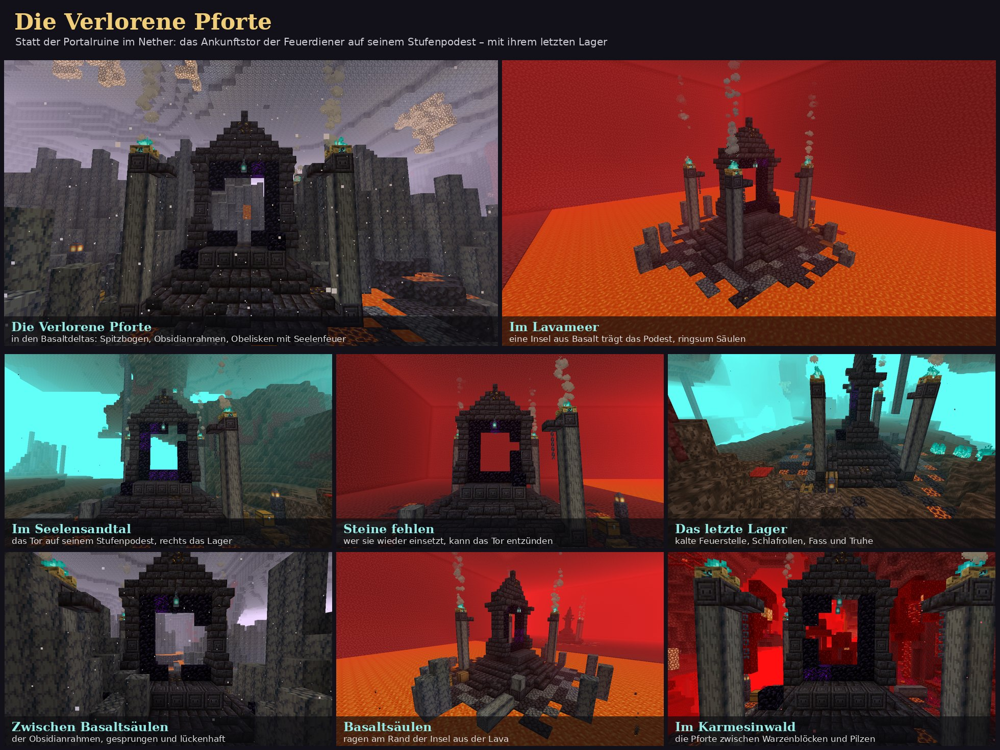

**Die Verlorene Pforte** (statt der Portalruine im Nether): Hier kamen die Feuerdiener an, die einst den Weg in die
Unterwelt suchten – das Gegenstück zur Glutpforte der Oberwelt. Zurück kamen sie nicht.

- **Das Tor:** ein Rahmen aus Obsidian unter einem Spitzbogen aus Schwarzsteinziegeln mit Pfeilern, Sturz und
  vergoldetem Schlussstein; vorn und hinten hängt je eine Seelenlaterne. Einige Steine sind gesprungen (weinender
  Obsidian), einige herausgebrochen – sie liegen auf den Stufen. **Wer sie wieder einsetzt (und den weinenden Obsidian
  ersetzt), kann das Tor entzünden.** Manchmal ist eine Seite des Bogens eingestürzt.
- **Das Podest:** drei Stufen aus Schwarzsteinziegeln mit Treppenkanten, gesprungen und ausgebrochen, oben ein Ring aus
  gemeißelten Platten; ein Riss im Podest glüht. Ringsum verbrannter Boden aus Schwarzstein, Basalt und Magma.
- **Vier Obelisken** aus Basalt mit Seelenfeuer auf der Spitze und Ketten daran; einer ist umgestürzt.
- **Das letzte Lager** der Feuerdiener: eine kalte Feuerstelle, zwei Schlafrollen, ein Fass, eine Laterne an einem
  Pfahl und eine **Truhe** mit der Beute der Portalruine und ein paar Münzen.
- Im **Lavameer** trägt eine Insel aus Basalt das Podest, am Rand ragen Basaltsäulen aus der Lava; sonst steht die
  Pforte auf dem Grund einer Höhle, die sie zu einer flachen Kuppel aushöhlt (Lava daneben erstarrt zu Schwarzstein) –
  in allen Biomen des Nethers.
- Finden mit `/locate structure kingdomsatwar:lost_gate`; sie hat die Plätze der Portalruinen im Nether übernommen.

### Bauwerke des Ends

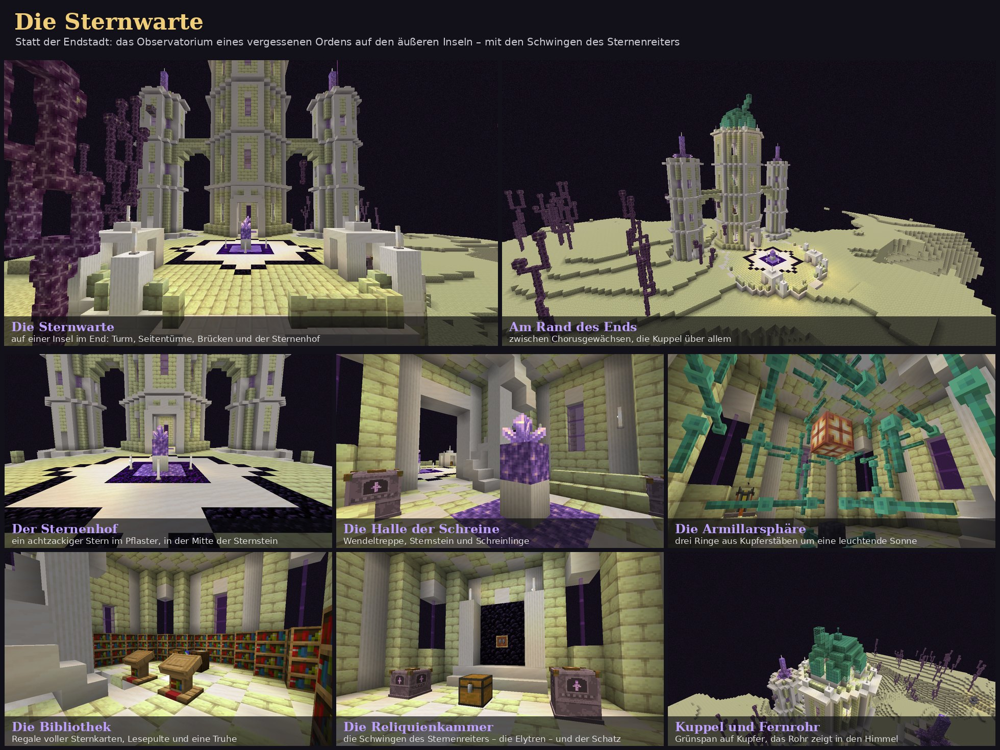

**Die Sternwarte** (statt der Endstadt und des Endschiffs): Auf den äußeren Inseln des Ends hat ein vergessener Orden
die Sterne beobachtet, die der Sternenfresser verschlingt. Seine Sternwarte steht auf einer Plattform, deren Unterbau
wie ein Zapfen unter der Insel hängt, wo sie nicht trägt.

- **Der Sternenhof:** ein achtzackiger Stern aus Quarz mit schwarzem Umriss im Pflaster, in der Mitte der **Sternstein**
  (seit 0.65 ein leuchtender Sternkristall auf einem Quarzpfeiler zwischen Leuchtstäben – er ruft **Asteria, die
  Sternenreiterin**, siehe unten), ringsum eine Brüstung mit Laternenpfosten, vorn eine
  Treppe hinab; zu beiden Seiten ein kleiner **Schrein** unter einem Plattendach – im einen eine Truhe, im anderen ein
  Schreinling.
- **Der Turm:** achteckig, aus Endsteinziegeln mit Quarzpfeilern an den Ecken, Gesimsen an jedem Geschoss und schmalen
  violetten Fenstern; das Tor unter einem Bogen aus Quarz. Eine **Wendeltreppe** um eine Quarzsäule führt durch alle
  Geschosse bis in die Kuppel:
  - unten die **Halle der Schreine** mit dem Sternstein, Bänken und Schreinlingen,
  - die **Bibliothek der Sternkarten** mit Regalen, Lesepulten, Kartentisch und einer Truhe,
  - die **Instrumentenhalle** mit einer **Armillarsphäre**: drei Ringe aus dünnen Kupferstäben um eine leuchtende
    Kupferlampe, dazu Braustände,
  - die **Reliquienkammer**: hinten ein Schrein aus Obsidian zwischen Quarzpfeilern, darin – in drei von fünf
    Sternwarten – in einem Rahmen die **Schwingen eines gefallenen Sternenreiters: die Elytren**; davor die Truhe mit dem
    Schatz der Warte.
- **Kuppel und Fernrohr:** auf dem Dach eine Brüstung mit Leuchtstäben, darauf eine **Kuppel aus grünspanigem Kupfer**
  über einer Trommel mit Gitterfenstern; aus ihrem Spalt ragt das große **Fernrohr** in den Himmel.
- **Zwei Seitentürme** mit Leitern und Spitzen aus **Amethyst**, über Brücken mit Bögen darunter am Turm.
- **Schreinlinge** halten Wache – in der Halle, in der Reliquienkammer, auf dem Dach, auf den Seitentürmen und im Schrein.
- **Beute:** die der Endstadt (dazu ein paar Münzen) in drei Truhen; die Elytren im Rahmen. Der Erfolg „Die Stadt am
  Ende des Spiels“ heißt jetzt „Die Sternwarte“ und verlangt, eine zu betreten.
- Finden mit `/locate structure kingdomsatwar:starwatch`; sie hat die Plätze der Endstädte übernommen.

### Die Nester

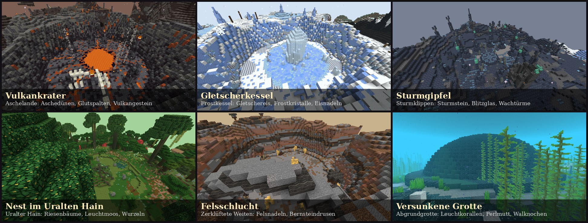

Jedes Nest ist ein riesiges Bauwerk, das es **genau einmal pro Welt** gibt – immer im passenden Biom. Um jedes Nest
liegt ein eigenes Biom von gut 200 Blöcken Durchmesser, das die Landschaft mit neuen Blöcken umgestaltet und eigene
Farben, Partikel und Geräusche hat.

| Nest | Wo | Biom ringsum |
|---|---|---|
| Pyrrhons **Vulkankrater** | Badlands, Wüste, Aschefelder | **Aschelande:** Aschedünen, Aschenerde, verkohlte Bäume, Vulkangestein mit Glutrissen, rauchende Glutspalten, fallende Asche |
| Glaciaras **Gletscherkessel** | Eiszapfen-Ebene, Schneeebene, Schneehänge, Frostgipfel | **Frostkessel:** Gletschereis, Raureifstein, Frosterde, Frostkristalle, Eiszapfen, Schneetreiben |
| Voltarions **Sturmgipfel** | zerklüftete und steinige Gipfel | **Sturmklippen:** Sturmstein, geladener Sturmstein, Fulgurit, Sturmkristalle, Kupferadern, verfallene Wachtürme |
| Verdantis' Nest im **Uralten Hain** | Dschungel, dunkler Wald, Urhain | **Uralter Hain:** Riesenbäume aus Urholz, Leuchtmoos, Leuchtkappen, Dornengestrüpp, knorrige Wurzeln |
| Terragons **Felsschlucht** | windgepeitschte Hügel, Felsschluchten | **Zerklüftete Weiten:** Felsnadeln, Schiefer, Geröll, Spaltgestein, Bernsteindrusen |
| Thalassas **Versunkene Grotte** | am Grund des tiefen Ozeans | **Abgrundgrotte:** Abgrundstein und -sand, Leuchtkorallen, Perlmutt, Schlote, Walknochen, versunkene Säulen |

**Nester finden**

- Der **Drachenkompass** (Kompass, Draconium, 2 Edelsteine, Aetherit) zeigt zum nächsten Nest; Schleichen +
  Rechtsklick wählt das nächste.
- Die **Chronik** kennt Gerüchte über jedes Nest („weit im eisigen Norden …“), nach der Entdeckung die genaue
  Entfernung.
- Rauchsäulen und Warnungen in der Statuszeile kündigen ein Nest schon von Weitem an.
- Nester liegen weit auseinander, Dörfer und andere Bauwerke halten großen Abstand zu ihnen.

### Drachen

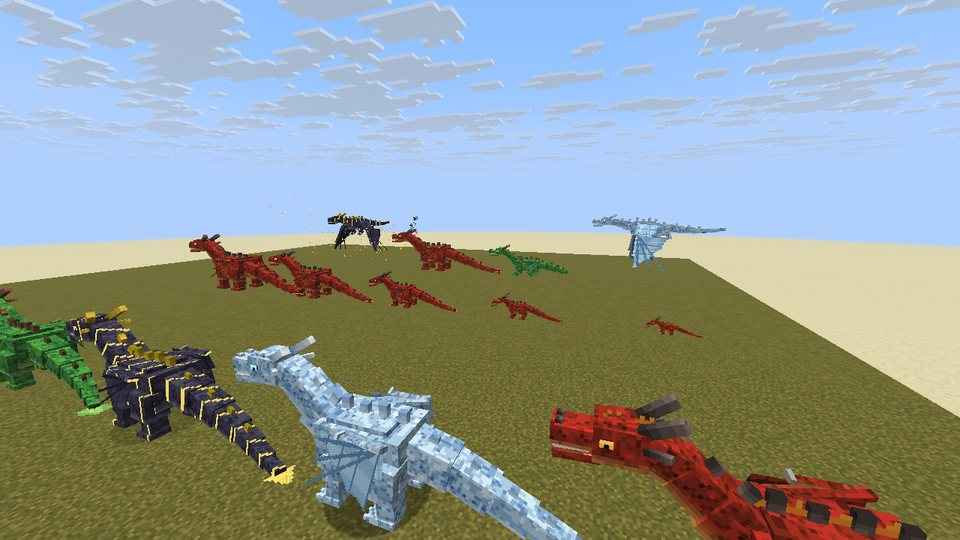

Wilde Drachen gibt es nicht mehr: **Dracheneier bekommt man nur von besiegten Drachen-Bossen.** Ein Ei schlüpft,
wenn es am richtigen Ort liegt **und ein Spieler in der Nähe ist** (bis 24 Blöcke) – ein Drache schlüpft nie allein,
und der Schlüpfling gehört dem, der dabei war, und folgt ihm. **Drachen sind friedlich:** Sie greifen nie von sich aus
Spieler an, verteidigen ihren Herrn und verschonen ihn, seine Soldaten und seine Tiere selbst nach einem
versehentlichen Treffer. Ein Drache aus dem Spawn-Ei gehört dem, der das Ei benutzt.

**Im Kampf (seit 0.87).** Ein eigener Drache, der seinem Herrn folgt, **hält Wache**: Greift ein Monster den Herrn oder den
Drachen an – auch ein Schütze aus der Ferne –, stellt er sich ihm von selbst (bis 20 Blöcke um den Herrn). Am Boden läuft
er heran, beißt **gezielt** – Kopf und Hals senken sich zu kleinen Gegnern und heben sich zu größeren –, weicht zurück,
wenn ihm einer unter den Hals gerät, und speit Feuer, Frost oder Gift, sobald er den Gegner vor sich hat. Steht der Gegner
erhöht (auf einer Säule, einer Mauer), fliegt er selbst oder findet der Drache keinen Weg (Wald, Gräben), **steigt er auf**:
Er kreist um den Gegner, speit aus der Luft und stößt herab, um zuzubeißen. Folgt er seinem Herrn, fliegt er ohne weite
Schleifen herbei, bremst rechtzeitig, hält Abstand und **landet neben ihm**, nicht auf ihm. Die Drachen-Bosse **fliegen über
Mauern**, wenn sie am Boden nicht weiterkommen, und treten beim Drehen auf der Stelle, statt zu gleiten.

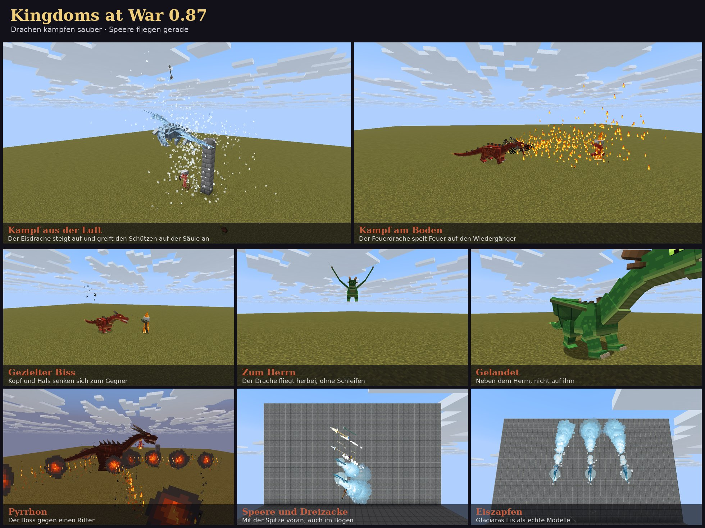

| Drachenart | Zum Ausbrüten … | Odem |
|---|---|---|
| Feuerdrache | nahe Lava oder Feuer legen | Flammen, setzen in Brand |
| Eisdrache | auf Eis oder Schnee legen | Frost, verlangsamt und lässt erstarren |
| Blitzdrache | bei Gewitter oder neben einem Blitzableiter | Funken und Blitzschläge |
| Naturdrache | im Hellen auf Gras, nahe Pflanzen | Sporen, vergiften |
| Erddrache | unter der Erde auf Stein | Geröll, wirft zurück und lähmt |
| Wasserdrache | unter Wasser | Wasserstrahl, wirft zurück und löscht Feuer |

- **Fünf Wachstumsstufen:** Schlüpfling, Jungdrache, Halbwüchsiger (kann fliegen und Odem speien), Ausgewachsen
  (reitbar), Uralt. Füttern mit Fleisch oder **Drachenfutter** (rohes Rind-, Schweine- und Hammelfleisch + Süßbeeren,
  ergibt 2) lässt ihn schneller wachsen und heilt ihn.
- **Schleichen + Rechtsklick:** folgen / sitzen / frei umherstreifen. **Rechtsklick** auf einen ausgewachsenen
  Drachen: aufsitzen. Springen zum Abheben und Steigen, Schleichen zum Sinken, **R** speit Odem.
- **Drachenpanzer** aus Stahl oder Draconium (feuerfest) für ausgewachsene Drachen; mit der Schere abnehmen.
- **Drachenschuppen** fallen von den Bossen und liegen in den Nestern (mit dem Pinsel freilegen).
- **Lebendige Bewegungen:** Drachen bewegen sich nach derselben Bewegungslehre wie die Bosse – sichtbares Atmen,
  Gewicht verlagern, Hals, Kopf und Schwanz federn nach (dreht sich der Drache, schwingt der Schwanz hinterher). Langsam
  geht er im ruhigen Schritt, schnell galoppiert er mit schaukelndem Rumpf; die Schrittlänge passt zur Geschwindigkeit
  und zur Größe, die Füße bleiben in der Standphase stehen. Beim Abheben entfalten sich die Flügel nach oben, beim
  Landen bremsen sie, im Kurvenflug legt er sich schräg, im Sinkflug gleitet er. Sitzend richtet er die Brust auf und
  legt den Schwanz um den Körper; in ruhigen Momenten schnaubt er (mit Rauch und einem Hauch seines Elements), gähnt,
  schüttelt den Kopf, sieht sich um oder lockert die Flügel.

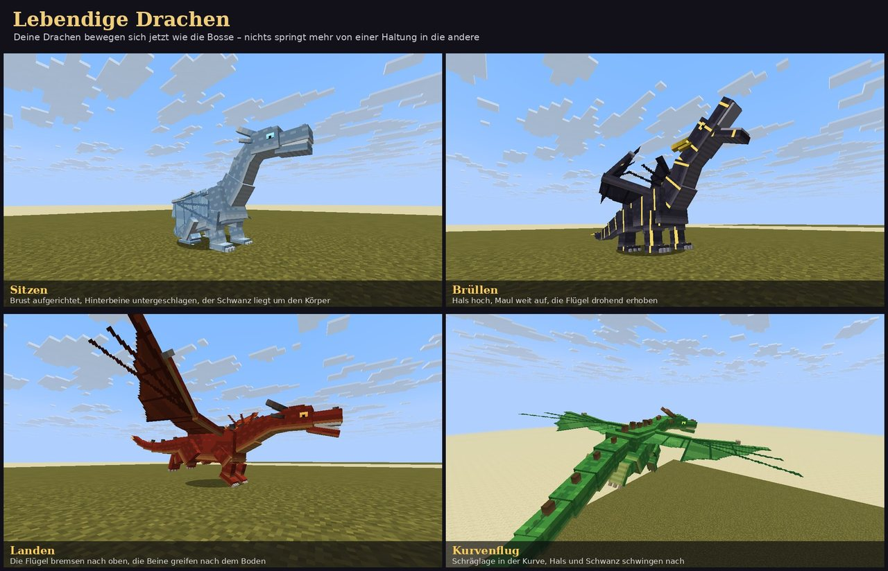

**Drachen im Krieg:** Mit dem **Drachenhorn** (Ziegenhorn, 2 Gold, 2 Drachenschuppen) schickst du alle eigenen
Drachen in Hörweite (160 Blöcke), die schon fliegen können und gerade niemanden tragen, in den Kampf:

| Horn blasen und … | Die Drachen … |
|---|---|
| auf einen Feind zeigen | steigen auf und stoßen im **Sturzflug** mit ihrem Odem auf ihn herab – fällt er, nehmen sie sich die Feinde gleich daneben vor |
| auf einen Ort zeigen | fliegen einen **Luftangriff**: kreisen darüber und stoßen nacheinander auf jeden Feind im Umkreis von 20 Blöcken herab (höchstens zwei Minuten, ohne Feinde kehren sie nach einer halben Minute zurück) |
| in den Himmel zeigen oder schleichen | kehren zu dir zurück |

Feinde sind Monster, Banditen und die Krieger der Reiche, mit denen du im Krieg liegst – nie Spieler und nie deine
Leute. Kommt ein **Heerhaufen** gegen deine Siedlung, steigen deine Drachen in der Nähe von selbst auf und verteidigen das
Stadtbanner. Die **Schützen der Reiche** holen Drachen vom Himmel: Ist ein Drache schwer verwundet (ein Viertel seines
Lebens), bricht er den Angriff ab und kehrt zu dir zurück. Bauten nimmt der Odem nicht auseinander – dafür gibt es die
Belagerungswaffen.

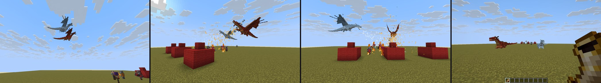

### Ritter und Soldaten

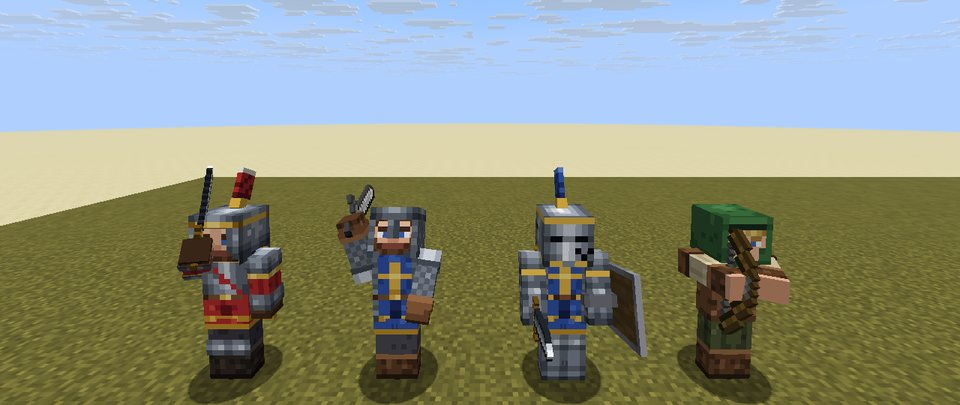

Soldaten wirbst du bei den **Rittern und Söldnern der Dörfer** an: im **Söldnerhaus**, bezahlt wird der Sold in
Münzen. Am **Feldherrentisch** (2 Smaragde, Buch, 3 Bretter, 2 Stöcke) heilst du sie und bildest sie aus:

| Soldat | Woher | Rolle |
|---|---|---|
| Schwertkämpfer | Söldnerhaus (ab 5 Silber) | Nahkämpfer – das Rückgrat jeder Armee |
| Bogenschütze | Söldnerhaus (ab 7 Silber) | Fernkämpfer, schießt nie auf Freunde |
| Ritter | Söldnerhaus (ab 2 Gold 2 Silber) oder Ausbildung | Plattenrüstung und Schild, hält die vorderste Reihe |
| Hauptmann | Söldnerhaus (ab 3 Gold 5 Silber) oder Ausbildung | macht Soldaten in seiner Nähe stärker |
| Speerträger | Söldnerhaus (ab 7 Silber) oder Ausbildung | lange Reichweite, trifft Reiter, Pferde und große Ungetüme um drei Viertel härter |
| Armbrustschütze | Söldnerhaus (ab 1 Gold 2 Silber) oder Ausbildung | spannt langsam, schießt weit, flach und härter als ein Bogen – nie auf Freunde |
| Schildträger | Söldnerhaus (ab 1 Gold 4 Silber) oder Ausbildung | hält den großen Schild fast immer oben, schlägt darauf und zieht die Angreifer seiner Kameraden auf sich |
| Waffenknecht | Söldnerhaus (ab 3 Gold) oder Ausbildung | Plattenpanzer (Pfeile gleiten oft ab), der Streitkolben trifft auch die Gegner neben dem Ziel |
| Lanzenreiter | Söldnerhaus (ab 4 Gold 3 Silber) oder Ausbildung | reitet sein eigenes Schlachtross, Lanzenangriff mit gesenkter Lanze – je schneller, desto härter |
| Belagerungsknecht | Söldnerhaus (ab 1 Gold 1 Silber) oder Ausbildung | lädt Belagerungswaffen um die Hälfte schneller nach und bessert sie aus |

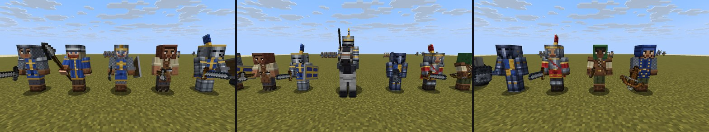

Seit 0.79 **sprechen die Truppen nicht mehr**: Sie salutieren, gehorchen und kämpfen stumm (vorher riefen sie beim Anwerben, bei
Befehlen, im Angriff und nach dem Sieg). Wer die Stimmen wiederhaben will, schaltet in den Einstellungen der Welt
`soldierVoices` („Truppen sprechen“) ein.

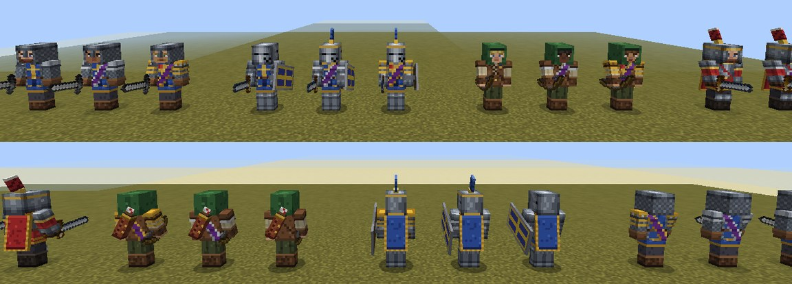

**Söldnerhaus:** In jedem Dorf steht eines – vorn der Übungshof mit der **Söldnertafel**, an der jeden Morgen bis zu
drei Söldner warten (fast immer ein Ritter). Die Tafel zeigt Art, Rang, Werte und Sold; Söldner mit Rang kosten mehr
(je Rang die Hälfte), wer seine Ausrüstung selbst mitbringt, will mehr Sold. Ein Lanzenreiter wartet zu Fuß – sein Ross
steht im Stall und kommt, sobald du ihn anheuerst.

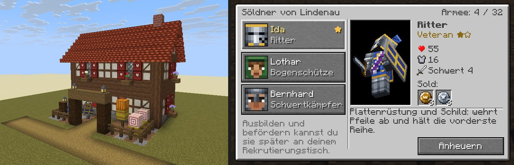

**Am Feldherrentisch** stehen links alle deine Soldaten im **Feldlager** (bis 24 Blöcke um den Tisch) mit ihrer
Gesundheit – in fester Reihenfolge (nach Art, die höchsten Ränge und Stufen zuerst), auch wenn sie umherlaufen. Bei vielen
Soldaten rollst du die Liste mit dem Mausrad, am Rollbalken oder wählst mit den Pfeiltasten (Bild auf/ab blättert). **„Alle heilen“** ruft den Feldscher: Er versorgt alle Verwundeten auf einmal – volle Gesundheit, kein Gift
und kein Feuer mehr – und nimmt dafür 1 Bronze je 4 fehlende Leben; ein Lanzenreiter, der sein Ross verloren hat, bekommt
für 3 Silber ein neues aus den Ställen. **Ausbilden** kannst du jeden einzeln – gibt es mehrere Wege, wählst du die neue
Art mit den Pfeilen neben ihrem Namen:

| Ausbildung | Preis | Wirkung |
|---|---|---|
| Rekrut → Veteran ★ (ab Stufe 3) | halber Sold + 3 Eisenbarren | +25 % Leben, +2 Rüstung, +1 Schaden, Schärpe mit Silbersaum |
| Veteran → Elite ★★ (ab Stufe 6) | ganzer Sold + 2 Stahlbarren | noch einmal so viel, Goldsaum, Schulterstücke, Ehrenmedaille |
| Elite → Meister ★★★ (ab Stufe 10) | anderthalbfacher Sold + 3 Stahlbarren + 1 Edelstein | noch einmal so viel, erholt sich außerhalb des Kampfes doppelt so schnell, karmesinrote Schärpe, zwei Orden |
| Meister → Legende ★★★★ (ab Stufe 15) | doppelter Sold + 2 Edelsteine + 1 Draconium | noch einmal so viel, **zweiter Atem** und **Vorbild** (siehe unten), elfenbeinweiße Schärpe, goldener Stern, Lorbeerkranz, goldener Schimmer |
| Schwertkämpfer → Ritter | 1 Gold + 2 Stahlbarren | wird Ritter mit Schild – Name und Rang bleiben |
| Schwertkämpfer → Speerträger | 3 Silber + 1 Eisenspeer | lange Reichweite, hart gegen Reiter |
| Schwertkämpfer → Schildträger | 5 Silber + 1 Schild + 2 Eisenbarren | zieht die Angreifer auf sich |
| Schwertkämpfer → Belagerungsknecht | 4 Silber + 3 Eisenbarren + 1 Werkbank | lädt Belagerungswaffen schneller nach, bessert sie aus |
| Bogenschütze → Armbrustschütze | 5 Silber + 1 Armbrust | schießt weiter und härter |
| Ritter → Hauptmann | 2 Gold + 1 Edelstein | wird Hauptmann – Name und Rang bleiben |
| Ritter → Lanzenreiter | 2 Gold + 1 Sattel + 2 Stahlbarren | bekommt sein Schlachtross (gesattelt, im Rossharnisch) |
| Ritter → Waffenknecht | 1 Gold 3 Silber + 4 Stahlbarren | Plattenpanzer und Streitkolben |

Name, Rang, Kampferfahrung und Herr bleiben bei jeder Ausbildung; eine Frau bleibt eine Frau, ein Mann ein Mann.

**Kampferfahrung und Stufen:** Soldaten lernen im Kampf. Jeder Treffer an einem Gegner gibt Kampferfahrung (ein halber
Punkt je Schadenspunkt), jeder Sieg die Hälfte der Lebenspunkte des Besiegten – Bosse anderthalbmal so viel –, und
Kameraden bis 12 Blöcke daneben lernen ein Viertel davon mit. Für Kämpfe gegen Dorfbewohner, Tiere oder die eigenen
Leute gibt es nichts. Mit der Erfahrung steigt ein Soldat **bis Stufe 20** auf – ein langer Weg: Stufe 5 braucht 270
Kampferfahrung, Stufe 10 1.305 und Stufe 20 5.610 (seit 0.61; Soldaten aus älteren Spielständen behalten ihre Stufe und
ihren Fortschritt). Jede Stufe bringt +3 % Leben, +0,15
Schaden und +0,1 Rüstung (auf Stufe 20 also +57 % Leben, fast 3 Schaden und knapp 2 Rüstung mehr). Steigt er auf, sprühen
bunte Funken, und über deiner Leiste steht, wer welche Stufe erreicht hat; reicht es für den nächsten Rang, sagt es dir
eine Nachricht. **Ränge** gibt es am Feldherrentisch erst ab ihrer Stufe (siehe oben) – der Tisch zeigt Stufe,
Erfahrungsleiste und „ab Stufe …“, der Knopf verrät, wie viel noch fehlt. Schaust du einen Soldaten an (bis 16 Blöcke
weit), zeigt ein kleines Schild unter dem Fadenkreuz seinen Namen, seine Stufe und den Weg zur nächsten. Söldner bringen
so viel Erfahrung mit, wie ihr Rang verlangt (und kosten je Stufe ein wenig mehr); Soldaten aus älteren Spielständen
bekommen ebenso viel, wie ihr Rang voraussetzt. Die Erfahrung deines eigenen Charakters bleibt davon ganz unberührt.

**Meister und Legenden:** Ein Meister erholt sich außerhalb des Kampfes doppelt so schnell. Eine Legende rafft sich einmal
in jedem Kampf mit einem **zweiten Atem** auf: Sinkt sie unter ein Viertel ihrer Lebenspunkte, ist sie mit einem
goldenen Leuchten wieder bei der Hälfte (danach zwei Minuten nicht wieder). Und sie ist ein **Vorbild**: Kameraden bis 12
Blöcke um sie lernen ein Viertel schneller.

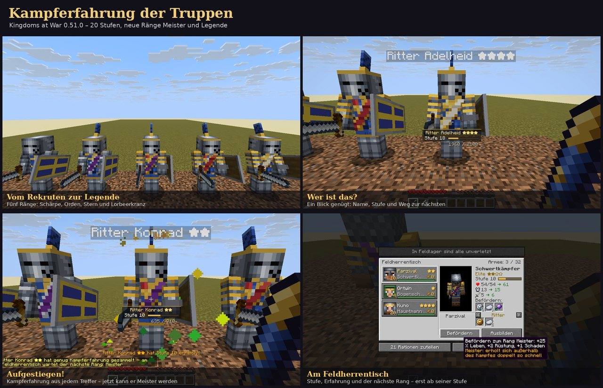

**Die neuen Truppen im Kampf:** Der **Lanzenreiter** reitet auf Abstand, senkt die Lanze, galoppiert durch den Gegner
hindurch und wendet für den nächsten Anritt; die Lanze trifft keine eigenen Leute. Wird er abgeworfen, geht er zu seinem
Ross zurück und sitzt wieder auf; fällt das Ross, kämpft er zu Fuß weiter. Fällt der Reiter, bleibt das **Schlachtross**
dir – du kannst es selbst reiten. Der **Schildträger** schlägt alle paar Sekunden mit dem Schwert auf den Schild: Gegner in
der Nähe, die einen deiner Leute angreifen, wenden sich ihm zu. Der **Belagerungsknecht** geht zu beschädigten eigenen
Belagerungswaffen in der Nähe und bessert sie mit Hammer und Holz aus; ruft der Kommandostab eine Mannschaft, kommt er
zuerst, wenn er nicht viel weiter weg ist als die anderen.

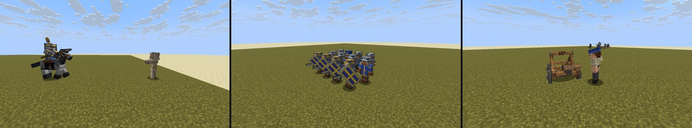

Jede **Kaserne** deiner Siedlung erlaubt acht Soldaten mehr.

**Garnison und Schlachtzug:** Hast du eine Siedlung, ziehen deine angeworbenen Soldaten in ihre **Garnison** (aus der
Ferne reisen sie sofort hin) und gehen vor dem Tor der Kaserne Streife – solange es keine gibt, am Stadtbanner. Am
Feldherrentisch nimmst du alle Soldaten der Garnison im Feldlager **auf einen Schlachtzug** mit: Sie folgen dir, bis du
sie am Tisch oder mit dem Kommandostab heimschickst. Ohne Siedlung folgen sie dir gleich.

**Proviant:** Jeder Soldat isst am Morgen eine Mahlzeit – in der Garnison aus dem Stadtlager, auf dem Schlachtzug (oder
wenn das Lager leer ist) eine Ration aus seinem Gepäck. Angeworben wird er mit Rationen für drei Tage, tragen kann er
sieben. **„Rationen zuteilen“** am Tisch füllt allen im Feldlager den Proviant auf: erst aus dem Lager der Siedlung (wenn
der Tisch darin steht), dann aus deinem Gepäck – die Hungrigen zuerst, dann reihum. Wer nichts mehr hat, **hungert**: Er
heilt nicht mehr von selbst und schlägt nur noch mit 70 % zu, bis er wieder etwas bekommt; aus der Hand gefüttert ist er
für heute satt. In der Liste am Tisch steht bei jedem, für wie viele Tage er Proviant hat (ein rotes „!“ heißt hungrig)
und ob er auf dem Schlachtzug ist (Schwert).

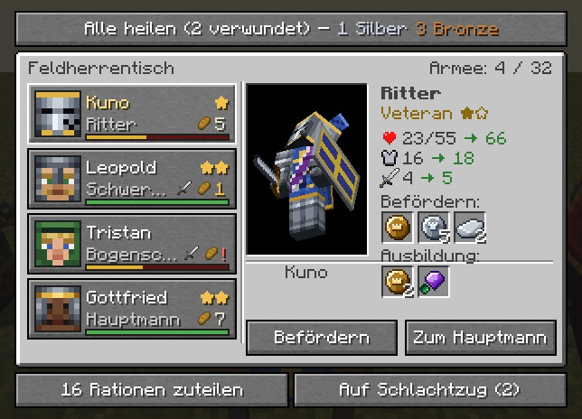

Mit dem **Kommandostab** gibst du Befehle: auf einen Feind zeigen = Angriff, auf den Boden zeigen = Stellung halten
(Schleichen: Patrouille), in den Himmel zeigen = alle folgen (Schleichen: alle heim in die Garnison), Schleichen +
eigenen Soldaten anklicken = entlassen.
Soldaten nehmen Waffen und Rüstung an, die du ihnen gibst, und verletzen weder dich noch deine Tiere und Drachen.
**Banditen** streifen nachts durch die Lande und hausen manchmal in Burgruinen.

### Krieg der Königreiche

In jeder Welt herrschen **vier fremde Reiche**, jedes mit Herrscher, Wappen und einer großen **Stammburg** in eigener
Bauweise (Plan und Stand: [docs/KRIEG.md](docs/KRIEG.md)):

| Reich | Herrscher | Wappen | Burg |
|---|---|---|---|
| Königreich Eisenmark | König Harald der Graue | weißer Turm auf Purpur | grauer Stein, Schieferdächer |
| Herzogtum Rabenstein | Herzogin Morwen | schwarzer Rabe auf Rot | dunkler Stein, rote Dächer |
| Fürstentum Dornfels | Fürst Kasimir | goldene Sonne auf Orange | Sandstein, Terrakotta |
| Grafschaft Silberau | Graf Ansgar | weißer Schwan auf Grün | heller Kalkstein, grüne Dächer |

- **Die Stammburg** (etwa 70 × 70 Blöcke): Ringmauer mit Wehrgang, vier Ecktürme, Torhaus mit Fallgitter, Kaserne,
  Stall, Schmiede, Kapelle, Vorratshaus und der Bergfried mit dem **Thronsaal** und dem **Reichsbanner**.
- **Die Besatzung:** 28 Krieger in den Farben ihres Reichs – Fußknechte, Wallschützen, Armbrustschützen, Burgritter, der
  Burghauptmann und der **Herrscher** mit Bossleiste. Wer die Mauern betritt, löst Alarm aus; gefallene Krieger rücken
  nach, solange niemand in der Nähe ist – der Herrscher nie.
- **Die Eroberung:** Ist der Herrscher gefallen und verteidigt niemand mehr das Reichsbanner, genügt ein Griff an das
  Banner (Rechtsklick – irgendwo auf das Tuch –, oder man will es abreißen): Alle Banner tragen dein Wappen, das alte
  Reichsbanner nimmst du als Trophäe mit, die übrigen Krieger ziehen ab, und jeden Tag liegt **Tribut** in der
  Schatztruhe des Herrschers. Ist der Herrscher gefallen, schimmert das Reichsbanner; stehen noch Wachen davor, leuchten
  sie beim Griff nach dem Banner zehn Sekunden lang auf (auch durch Wände). Bis zur Eroberung lässt sich das Banner
  nicht abreißen.
- **Finden:** Wer sich einer Stammburg nähert, erfährt, wessen Land er betritt; der Kartograf verkauft eine Karte zur
  nächsten noch freien Stammburg.
- **Heerhaufen:** Wer mit einem Reich im Krieg liegt (einen seiner Krieger erschlagen hat), bekommt alle paar Spieltage
  Besuch – sobald er in seiner Siedlung ist. Der Heerhaufen sammelt sich auf der Seite der Stammburg, stößt ins Horn
  (Titel und Leiste zeigen, wie viele noch stehen) und zieht zum Stadtbanner; er kämpft gegen dich und deine Soldaten,
  deine Bürger lässt er in Ruhe. Ist er geschlagen, liegt seine Kriegskasse (Silbermünzen, Eisen, Pfeile) in deinem
  Lager. Steht aber niemand mehr am Banner, plündert er ein Drittel deines Lagers und zieht ab. Der erste Heerhaufen
  zählt sechs Krieger, jeder weitere einen mehr (und eine große Siedlung lockt mehr an, höchstens 14); ab dem zweiten
  reiten Ritter mit. Wer die Stammburg erobert, hat vor diesem Reich Ruhe.

### Belagerungswaffen

Vier Belagerungswaffen, jede aus einem **Bausatz** von der Werkbank – mit Rechtsklick auf den Boden aufgestellt, sie
blickt dann in deine Richtung:

| Waffe | Munition | Reichweite | Wirkung | Nachladen |
|---|---|---|---|---|
| **Katapult** | Steinkugel | 18–68 Blöcke im Bogen | Wucht 14, schlägt Breschen in Mauern | 5 s |
| **Tribok** | zwei Steinkugeln je Wurf | 38–118 Blöcke im hohen Bogen | Wucht 24, große Breschen, auch in härterem Gestein | 11 s |
| **Balliste** | Ballistenbolzen | gerade Schüsse | 18 Schaden, durchschlägt bis zu drei Gegner und Glas | 3 s |
| **Rammbock** | – | vor dem Widderkopf | bricht Tore, Türen, Gitter, Zäune und Holz auf (1–4 Stöße) | 2 s |

- **Selbst bedienen:** Rechtsklick tritt an die Waffe (an Katapult und Tribok rechts an die Winde, hinter die Balliste,
  in den Rammbock). W/S fährt, die Waffe dreht sich in deine Blickrichtung. Wurfwaffen stellen die Weite selbst auf
  das anvisierte Ziel ein – eine **Leuchtspur** zeigt die Flugbahn und ein roter Kreis den Einschlag (nur du siehst
  sie); die Balliste neigt sich mit deinem Blick. **Leertaste** feuert, **Schleichen** tritt zurück. Über der
  Schnellleiste stehen Vorrat, Bereitschaft, Wurfweite und Zustand. Arm, Schlinge, Bogen und Widder holen sichtbar aus –
  das Geschoss fliegt genau in dem Moment los, in dem es Löffel, Schlinge oder Bahn verlässt.
- **Laden, reparieren, zerlegen:** Rechtsklick mit Munition lädt nach (Katapult und Tribok fassen 16 Steinkugeln, die
  Balliste 24 Bolzen); ist der Vorrat leer, nimmt die Waffe Munition aus deinem Gepäck. Jedes Brett repariert ein
  Zehntel. Schleichend mit leerer Hand zerlegst du sie wieder in ihren Bausatz (er merkt sich den Zustand), die übrige
  Munition bekommst du zurück. Steckengebliebene Bolzen lassen sich aufheben.
- **Bedienmannschaft:** Mit dem **Kommandostab** auf eine Waffe zeigen – der nächste freie Soldat läuft hin und bedient
  sie. Noch einmal auf die bediente Waffe zeigen wählt sie aus; dann auf einen Gegner (Angriff), auf eine Stelle
  (Beschuss, bis zu zwölf Würfe; der Rammbock fährt zum Tor) oder in den Himmel (freies Feuer auf Monster in
  Reichweite) zeigen. Schleichend auf die Waffe zeigen zieht die Mannschaft ab. Deine Soldaten, Tiere, Drachen und
  Waffen bleiben vom Beschuss verschont.
- **Schaden und Schutz:** Pfeile richten am Holz wenig aus, Äxte und Explosionen viel; schwer beschädigt qualmt die
  Waffe, bei null zerbricht sie in Bretter, Stöcke und Eisen. Siedlungen, der Siegelkreis, die Reichsbanner der
  Stammburgen und besondere Blöcke (Stadtbanner, Siegelsteine, Tore der Schattenwelt …) halten jedem Beschuss stand; die
  Einstellung `siegeBlockDamage` schaltet Blockschaden ganz ab.

| Rezept | |
|---|---|
| Steinkugel ×2 | vier Bruchsteine (2 × 2) |
| Ballistenbolzen ×4 | Eisenbarren, zwei Stöcke, zwei Federn |
| Katapult | Stamm, zwei Fäden, Eisenbarren, drei Bretter |
| Tribok | zwei Stämme, Eisenkette, zwei Fäden, Eisenblock, drei Bretter |
| Balliste | Armbrust, zwei Fäden, zwei Bretter, Eisenbarren, zwei Stämme |
| Rammbock | drei Bretter, zwei Eisenketten, drei Stämme, Eisenbarren |

### Fahrzeuge: Belagerungsturm und Planwagen

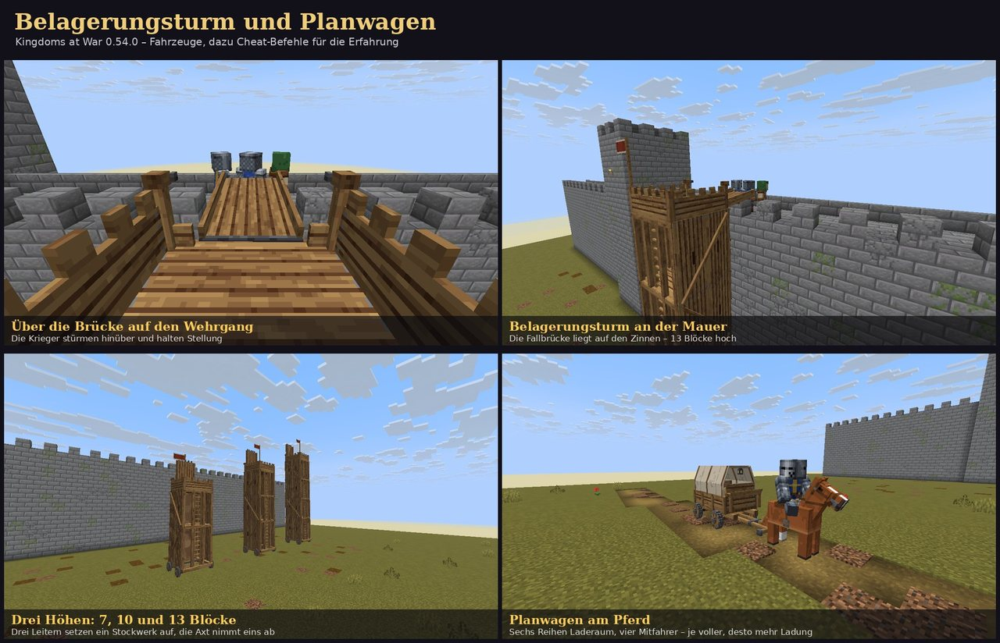

**Der Belagerungsturm** ist vorn mit nassen Häuten verkleidet und trägt oben eine Fallbrücke. Einer schiebt ihn (W/S,
der Turm dreht sich in die Blickrichtung), oben auf der Plattform stehen bis zu acht Krieger; ein Pferd zieht ihn an der
Leine schneller.

- **Drei Höhen:** Die Plattform ist 7, 10 oder 13 Blöcke hoch. Rechtsklick mit **drei Leitern** setzt ein Stockwerk
  auf, schleichend mit einer **Axt** nimmt man eins ab (die Leitern gibt es zurück) – nur mit hochgezogener Brücke und
  nur am eigenen Turm. So passt er zu jeder Mauer.
- **Die Brücke:** Die **Leertaste** lässt sie nach vorn fallen, bis sie aufliegt – auf den Zinnen oder dem Wehrgang
  einer Mauer, deren Krone nicht höher als die Plattform liegt. Ist die Mauer zu hoch, sagt der Turm es (dann mit
  Leitern aufstocken); steht keine Mauer davor, fällt nichts.
- **Der Sturm:** Liegt die Brücke auf, laufen die Soldaten oben einer nach dem anderen hinüber und halten auf dem
  Wehrgang Stellung; wer schiebt, bleibt unten. Spieler gehen mit **Schleichen** hinüber. Noch einmal die Leertaste
  zieht die Brücke hoch – erst dann rollt der Turm wieder.

**Der Planwagen** ist ein Kastenwagen unter einer Leinenplane: ein Platz auf dem Kutschbock, vier hinten im Wagen und
dazwischen **sechs Reihen Laderaum** (so viel wie eine große Truhe) für Baustoffe, Proviant und Munition.

- **Ziehen:** Selbst fährt er nicht – ein **Pferd** zieht ihn an der Leine (Leine an den Wagen, dann schleichend auf
  das Pferd klicken, oder das Pferd an der Leine führen und schleichend auf den Wagen klicken). Wer auf dem Pferd
  reitet, fährt den Wagen; das Pferd wird dabei nicht langsamer.
- **Laderaum:** schleichend mit leerer Hand öffnen – oder im Wagen sitzend mit der Inventartaste. Je voller er ist,
  desto mehr Ladung steht sichtbar auf dem Wagen: erst eine Kiste und zwei Fässer, dann Säcke und Stroh, voll bis unter
  die Plane.
- **Zerlegen:** schleichend mit einer Axt – die Ladung fällt dabei heraus. Beide Fahrzeuge lassen sich wie die
  Belagerungswaffen mit Brettern reparieren.

| Rezept | |
|---|---|
| Belagerungsturm | Stamm, Eisenkette, Stamm · Leder, Leiter, Leder · Brett, Eisenbarren, Brett |
| Planwagen | drei Wolle · Brett, Truhe, Brett · Stamm, Eisenbarren, Stamm |

### Regeln: allein, ohne Koordinaten, hart

- **Nur ohne andere Mods:** Ist neben Kingdoms at War noch eine andere Mod installiert, bricht das Spiel den Start mit
  einer Liste der fremden Mods ab (gelöscht wird nichts – die Mods einfach aus dem Mod-Ordner nehmen).
- **Keine Koordinaten:** Die Debug-Anzeige (F3) ist immer verkürzt – keine Koordinaten, kein Kopieren der Position;
  Meldungen nennen Entfernung und Himmelsrichtung statt Koordinaten.
- **Viel härter:** Schwierigkeit fest auf *Schwer*, Gegner mit 50 % mehr Leben und 30 % härteren Treffern (Bosse 25 und
  15 %), die natürliche Heilung halbiert, nach dem Tod zwei Minuten lang schwächere Schläge (kein Statuseffekt – der Tod
  steckt einem einfach noch in den Knochen; Milch hilft nicht).
- **Der Boden unter dem Erzmagier** lässt sich nicht abbauen oder wegsprengen.

### Verzauberungen

Acht eigene Verzauberungen – nur als Beute (kein Zaubertisch, kein Händler): in Schatzkammern und Waffenkammern der
Reiche, beim Herrscher, bei Erzmagiern und in ihren Türmen, bei den Drachen-Bossen und in der Schattenzitadelle. Ihr
Buch erklärt im Tooltip, was sie tun.

| Verzauberung | für | Wirkung |
|---|---|---|
| Drachentöter I–III | Waffen | +3 Schaden je Stufe gegen Drachen, Drachen-Bosse und Lindwürmer |
| Frostklinge I–II | Schwerter, Äxte | Treffer verlangsamen den Gegner (nicht mit Verbrennung) |
| Lebensraub I–III | Schwerter, Äxte | jeder Treffer heilt den Träger um ein Viertel Herz je Stufe |
| Rüstungsbrecher I–III | Äxte | Treffer durchschlagen 12 % der Rüstung je Stufe |
| Pfeilhagel | Bögen | drei Pfeile auf einmal |
| Drachenschuppe I–IV | Rüstung | Schutz vor allem, was Drachen anrichten |
| Windschritt I–II | Stiefel | 6 % schneller je Stufe |
| Fluch der Schwere | Rüstung | 5 % langsamer je Teil – ein Fluch auf erbeuteter Rüstung |

**Verzauberungen auf den Waffen der Mod (seit 0.79).** Schärfe, Bann und Nemesis der Gliederfüßer geben bei Minecraft einen
festen Betrag dazu – Schärfe V drei Punkte, gleich ob die Waffe 7 oder 22 Schaden macht. Auf den starken Waffen der Mod war
das kaum zu spüren, und ihre Fähigkeiten blieben davon ganz unberührt. Jetzt gilt:

- **Im Nahkampf** wirkt eine Verzauberung auf jeder Waffe der Mod, die stärker ist als ein Diamantschwert, im selben
  Verhältnis wie dort: Der Betrag wächst mit dem Schaden der Waffe (auf einer Waffe mit 14 Schaden gibt Schärfe V doppelt
  so viel wie auf dem Diamantschwert). Das gilt auch für **Drachentöter**.
- **Fähigkeiten** – der geworfene Lichtspeer, die Lichtwelle und die Lichtsäule des Zepters und des Speers des Schöpfers,
  die Sterne der Sternenlanze, die Weltenbrocken des Weltenspeers, der Bann des Bannhammers – treffen um denselben Anteil
  härter, den ein Diamantschwert durch die Verzauberung gewinnt: mit Schärfe V um 61 %, mit Bann V gegen Untote auf gut
  das Dreifache.
- Der Tooltip der Waffe zeigt, was die Verzauberung auf ihr wirklich bringt („+8,5 Schaden durch Schärfe … und ihre
  Fähigkeiten treffen 61 % härter“). Waffen von Minecraft und anderen Mods bekommen nur den Zuschlag unten.

**Sieben Verzauberungen am Zaubertisch (seit 0.87).** Diese gibt es am Zaubertisch, beim Bibliothekar und auf zufällig
verzauberter Beute; ihr Buch erklärt im Tooltip, was sie tun.

| Verzauberung | für | Wirkung |
|---|---|---|
| Donnerschlag I–II | Schwerter, Äxte | bei 15 % (II: 22 %) der Treffer fährt ein knisternder Funkenschlag von oben in den Getroffenen – 2,5 (II: 4) Schaden zusätzlich zum Hieb |
| Giftzahn I–II | Schwerter, Äxte | Treffer vergiften für zwei bis drei (II: drei bis viereinhalb) Sekunden |
| Standhaft I–III | Brustpanzer | 15 % weniger Rückstoß je Stufe |
| Lebenskraft I–III | Brustpanzer | ein Herz mehr je Stufe (nicht zusammen mit Standhaft) |
| Eulenauge | Helme | Nachtsicht, solange der Helm getragen wird – ruhig, ohne Partikel und ohne Flackern |
| Hasenfuß I–II | Stiefel | höher springen (mit II über Zäune), je Stufe ein Block mehr Fallhöhe ohne Schaden |
| Drillmeister I–III | Angeln | die Fangzone im Drill wird je Stufe um 10 % größer |

Feuer (Verbrennung), Frost (Frostklinge), Donner und Gift schließen einander aus – eine Klinge trägt nur ein Element.

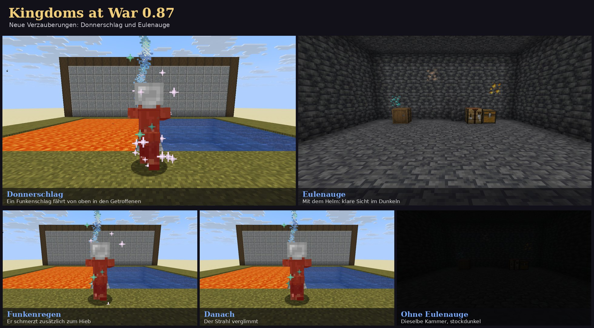

**Die Verzauberungen von Minecraft wirken etwas stärker (seit 0.87)** – spürbar, aber nicht übertrieben; ihre Bücher
sagen „In Kingdoms at War stärker als gewohnt“:

| Verzauberung | bei Minecraft | hier |
|---|---|---|
| Schärfe | +0,5 Schaden je Stufe und 0,5 (V: +3) | +0,75 je Stufe und 0,5 (V: +4,25) |
| Bann, Nemesis der Gliederfüßer, Harpune | +2,5 je Stufe gegen ihre Ziele (V: +12,5) | +3 je Stufe (V: +15) |
| Stärke | +0,5 je Stufe und 0,5 auf den Grundschaden des Pfeils | +0,65 je Stufe und 0,5 – ein voll gespannter Schuss mit Stärke V trifft um 15 % härter |
| Schutz, Feuerschutz, Explosionsschutz, Schusssicher, Federfall | – | wirken um 15 % stärker; mehr als 80 % hält Rüstung wie bei Minecraft nie ab |
| Effizienz | – | zusätzlich 6 % schneller abbauen je Stufe |
| Köder | – | zusätzlich beißt der Fisch je Stufe 6 % schneller |

Das gilt für Spieler wie für Ritter, Soldaten und Monster mit verzauberten Waffen und Rüstungen.

### Münzen, Siedlung und Krönung

Bezahlt wird mit **Bronze-, Silber- und Goldmünzen** (je **neun** sind eine der nächstgrößeren: 9 Bronze = 1 Silber,
9 Silber = 1 Gold). Am Werktisch legst du neun Münzen zu einer größeren zusammen oder wechselst eine in neun kleinere;
dasselbe geht mit Rechtsklick (Schleichen + Rechtsklick wechselt klein). Gestapelt sehen Münzen aus wie eine einzelne.
In den Truhen der Bauwerke liegen nur **Bronzemünzen** (und nicht viele), Monster lassen selten eine fallen, Banditen ab
und zu ein paar, die Drachen-Bosse hüten Gold – und deine Bürger kaufen dir Waren ab.

**Das Stadtbanner** (Banner, Goldbarren, Stock, 3 Steinziegel) gründet deine **Siedlung** – jeder Spieler hat eine,
mit einem Namen, den du ändern kannst. Rechtsklick auf das Banner öffnet das **Stadtfenster**: Übersicht (Stufe,
Betten, Gebiet, Ansehen, Baustellen), Anheuern, Bewohner, Bauen und Krone. Nur du kannst dein Banner abbauen; fällt es,
bleibt die Siedlung bestehen, bis es wieder steht.

**Bürger** heuerst du mit Münzen an. Jeder braucht ein Bett (die ersten zwei schlafen im Lager am Banner) und – außer
dem Baumeister – seine Werkstatt. Tagsüber arbeiten sie, nachts gehen sie ins Bett; Zombies, Plünderer und Banditen
haben es auf sie abgesehen.

**Essen:** Jeden Morgen nimmt sich jeder Bürger eine Mahlzeit aus dem **Lager** (6 Nährwert, etwas mehr als ein Brot) –
das Einfache zuerst. Alles Essbare zählt nach seinem Nährwert; **Weizen** (drei sind eine Mahlzeit), Kartoffeln und rohes
Fleisch oder roher Fisch zählen wie gebacken und gebraten, denn das bereiten die Bürger selbst zu – so ernährt die Ernte
der Bauern die Siedlung. Verdorbenes, Giftiges und Goldenes nimmt niemand. Ist nicht genug da, **hungern** sie: Sie
arbeiten und handeln nicht, bis wieder Essen kommt. Die Übersicht im Stadtfenster zeigt, für wie viele Tage das Essen
reicht.

| Beruf | Lohn | Werkstatt | Arbeit |
|---|---|---|---|
| Baumeister | 4 Silber | – (einer im Lager und im Weiler, je Stufe einer mehr, vier mehr für eine Großbaustelle) | baut die Baustellen nach Plan – Block für Block oder abschnittsweise |
| Bauer | 3 Silber | Feld | erntet, sät nach, pflegt die Pflanzen, bringt die Ernte in die Truhe |
| Holzfäller | 3 Silber | Holzfällerhütte | fällt die Bäume im Hain hinter der Hütte und wilde Bäume ringsum, pflanzt nach |
| Bergmann | 5 Silber | Mine | steigt in den Schacht und hackt an der Erzwand (Kohle, Eisen, Kupfer, selten Gold und Edelsteine) |
| Schmied | 8 Silber | Schmiede | handelt mit Stahlwaffen und -rüstungen |
| Händler | 8 Silber | Markt | kauft Ernte, Holz und Stein, verkauft Baustoffe und Nützliches |
| Wirt | 6 Silber | Taverne | verkauft Essen, Bier, Wein, Met und das Festmahl |
| Kartograf | 1 Gold | Kartenhaus | zeichnet Karten zum Siegelkreis und zu Drachennestern |

**Bauen:** Im Stadtfenster nimmst du einen **Bauplan** – er trägt einen der Entwürfe des Gebäudes, zufällig gewählt
(Tooltip: Name des Entwurfs und seine Baustoffe); mit ihm in der Hand zeigt ein goldener Rahmen den Umriss und ein
grüner Pfeil den Eingang, Rechtsklick auf den Boden richtet die Baustelle ein (Schleichen + Rechtsklick dreht den Plan). Der **Baumeister** räumt den Platz,
legt das Fundament und setzt dann Block für Block – mit Hammerschlag und Staub. Er arbeitet immer aus der Nähe (nie
dort, wo später noch etwas hinkommt, damit er sich nicht einmauert) und stellt sich an hohen Mauern ein **Baugerüst** auf,
das er nach dem Bau wieder abbaut.

**Lager und Baustoffe:** Jeder Bau kostet neben Münzen auch **Baustoffe** – eine Einheit je Block: **Holz** (ein Brett ist
eine Einheit, ein Stamm vier), **Stein** (Bruchstein, Stein, Sand, Kies oder Ton) und **Metall** (Eisen oder Kupfer, auch
roh; Stahl zählt doppelt). Erde, Pflanzen, Wasser und Speisen kosten nichts. Das **Lager** sind alle Truhen und Fässer bis
vier Blöcke um das Stadtbanner und in jedem **Lagerhaus** (das selbst keine Baustoffe kostet). Der Baumeister holt dort,
was die nächsten Blöcke brauchen; fehlt etwas, wartet er und sagt dir Bescheid. **Abends** (vor Feierabend) bringen
Bauern, Holzfäller und Bergleute alles, was sie gesammelt haben, aus ihrer Werkstatt ins Lager – der Bergmann bricht
neben Erz vor allem Stein, der Holzfäller liefert Stämme.

| Stufe (ab Bewohnern) | Gebäude |
|---|---|
| Lager (0) | Wohnhaus (2 Betten; 4 Entwürfe), Feld (2), Holzfällerhütte (2), Lagerhaus (2) |
| Weiler (4) | Brunnen (2), Schmiede (2) |
| Dorf (8) | Mine (2), Markt (2), Taverne (2) |
| Marktflecken (14) | Bürgerhaus (4 Betten; 3 Entwürfe), Kaserne (2), Kartenhaus (2) |
| Stadt (22) | Thronsaal |

**Ansehen** gewinnst du durch Anheuern, fertige Gebäude, Handel, besiegte Monster in deiner Siedlung und vor allem durch
besiegte Drachen. Es senkt die Preise deiner Bürger (bis 30 %). Jeder Laden macht nach 16 Handeln eine Pause von
drei Stunden – in **Echtzeit**, auch wenn das Spiel aus ist (beides einstellbar).

**Die Krönung:** Wer das Siegel gebrochen hat, eine Stadt regiert, legendäres Ansehen genießt und die **Königskrone**
trägt, setzt sich im eigenen **Thronsaal** auf den Thron: Glocken läuten, goldenes Licht steigt auf, die Bürger eilen
herbei, Feuerwerk erhellt den Himmel – und du wirst **König** oder **Königin**. Von da an geben dir deine Bürger alles
umsonst.

### Dragon Architect: eigene Baupläne

Bau ein Haus, wie es dir gefällt – und lass es deine Baumeister nachbauen, so oft du willst.

**Vermessen:** Mit dem **Vermessungsstab** (zwei Stöcke mit Kupferspitze, oder umsonst im Stadtfenster) tippst du zwei
gegenüberliegende Ecken des Gebäudes an – auch auf Türen und Truhen. Ein goldener Rahmen zeigt den Bereich mit seinen
Maßen, eine grüne Ebene die **Bodenlinie** (darunter liegt das Gelände; sie richtet sich nach dem Boden rings um das
Gebäude) und ein Pfeil die **Vorderseite** (die Seite mit der Haustür). Schleichen + Rechtsklick öffnet **„Bauplan
zeichnen“**: Ansicht und Grundriss auf Blaupausen-Papier, Name, Vorderseite und Bodenlinie zum Verstellen, was der Bau
kosten wird und was nicht übernommen wird. „Zeichnen“ braucht ein Blatt Papier und gibt dir den **Bauplan** – eine
Blaupause, deren Tooltip Ansicht, Grundriss, Größe und Baustoffe zeigt.

**Nachbauen:** Wie jeden Bauplan legst du ihn in deiner Siedlung auf den Boden (der goldene Rahmen zeigt, wo der Bau
stehen wird, der grüne Pfeil den Eingang; Schleichen + Rechtsklick dreht). Die Baumeister räumen den Platz, legen das
Fundament, heben einen Keller aus und bauen alles nach – Türen, Betten, Fenster, Möbel, Pflanzen, sogar die Schrift auf
den Schildern und die Muster der Banner. Betten in eigenen Häusern zählen für deine Bürger.

**Bauweise:** In der Übersicht des Stadtfensters schaltest du jede Baustelle um zwischen **Block für Block** (ein
Ziegel: eine echte Baustelle mit Gerüst) und **abschnittsweise** (eine Ziegelmauer: der Baumeister zieht bis zu zwölf
Blöcke einer Lage auf einmal hoch – ideal für Burgen und Mauern; große eigene Pläne beginnen gleich so).

**Kosten:** Münzen (9 Bronze und eine je acht Blöcke, mit Ansehen-Rabatt; als König umsonst) und Baustoffe wie immer –
eine Einheit Holz, Stein oder Metall je Block. **Kostbare Blöcke** (Erze, Edelstein- und Metallblöcke, Obsidian,
Amboss, Kessel, Leuchtfeuer, Braustand, Glocke, Köpfe, Drachenei …) macht der Baumeister nicht aus Einheiten: sie müssen
genau so im Lager liegen, sonst wartet er darauf und sagt dir Bescheid. **Nicht übernommen** werden Spawner, Portale,
Grundgestein, Befehlsblöcke, das Stadtbanner und Lava; Truhen bleiben leer, Felder werden frisch gesät, Laub bleibt
dauerhaft, Befehle in Schildern verschwinden.

**Eigene Pläne:** Im Reiter **Bauen** des Stadtfensters öffnet die blaue Karte **Eigene Pläne** deine Sammlung (bis zu
64 Pläne): Ansicht, Größe, Baustoffe und Preis; eine **Abschrift** nehmen (ein Blatt Papier) oder einen Plan löschen
(Gebäude, die nach ihm gebaut sind, bleiben stehen).

**Schematiken einlesen:** Gebäude aus anderen Welten oder aus dem Netz bringst du als Datei mit: **Litematica**
(.litematic, auch mit mehreren Bereichen), **WorldEdit** und andere Sponge-Schematiken (.schem, alle drei Fassungen)
und der **Strukturblock** (.nbt). Leg die Datei in den Ordner `schematics` des Spiels (bei WorldEdit liegt er unter
`config/worldedit/schematics`, Strukturen des Strukturblocks im Weltordner unter `generated`) und drück in **Eigene
Pläne** auf **„Schematik einlesen“**: eine Liste mit Art, Name, Ordner und Größe, ein Klick auf **Einlesen** – und der
Architekt zeichnet daraus einen eigenen Plan. Bodenlinie und Haustür findet er von selbst, Blöcke älterer
Minecraft-Fassungen übersetzt er (etwa aus 1.15), Schilder und Banner behält er. Blöcke, die er nicht kennt (etwa aus
anderen Mods), werden Luft – das sagt er dir; was er nie baut (Spawner, Grundgestein …), lässt er wie beim Vermessen
weg. Eingelesen werden Bauten bis 320 × 128 × 320 Blöcke; gelesen wird nur in diesen Ordnern.

**Schematiken ablegen:** Der Knopf **↓** neben jedem eigenen Plan schreibt ihn auf einmal als .litematic, .schem und
.nbt in den Ordner `schematics/kingdomsatwar` – zum Weitergeben, zum Weiterbauen mit Litematica oder WorldEdit oder
für den Strukturblock. Boden unter der Bodenlinie, den der Plan nicht anrührt, steht darin als Gras und Erde (so reißt
das Einfügen keine Löcher), und die Bodenlinie reist mit: wieder eingelesen, kommt der Plan Block für Block genau so
zurück.

**Großbaustellen:** Vermessen und einlesen lassen sich Bauten bis **320 × 128 × 320** Blöcke – eine ganze Burg samt
Hof. Große Bereiche vermisst der Architekt Lage für Lage, ohne dass das Spiel stockt (im Fenster läuft ein Balken mit).
Ab 40 Blöcken Breite wird ein Plan zur **Großbaustelle**: Sie ist in **Abschnitte** von je 16 × 16 Säulen geteilt, und
jeder Baumeister nimmt sich den nächsten freien – so arbeiten viele zugleich. In seinem Abschnitt räumt er den Platz,
legt das Fundament, hebt Keller aus und zieht dann den **Rohbau** Feld für Feld von unten nach oben hoch; seine Gerüste
baut er ab, wenn er fertig ist. Die **Einzelheiten** – Türen, Fackeln, Laternen, Teppiche, Pflanzen und Wasser – kommen,
sobald ringsum der Rohbau steht, damit alles Halt findet. Wer zur anderen Seite einer Mauer muss, steigt hinüber, statt
außen herumzulaufen, und mit dem Karren holt er auf einmal bis zu acht Stapel je Baustoff. Truhen und Fässer, die du bis
zu zehn Blöcke neben die Großbaustelle stellst, zählen als **Baustellenlager**. Solange es eine Großbaustelle gibt, darfst
du **vier Baumeister mehr** anheuern (sonst einer im Lager und im Weiler, dann je Stufe einer mehr). Eine Burg, die nie
ins Gebiet der Siedlung passen würde, stellst du **neben** die Siedlung: Sie muss das Gebiet berühren, darf aber weder
das Banner noch Häuser überbauen und kein fremdes Gebiet berühren. Im Stadtfenster zeigt die Karte der Großbaustelle
(beim Darüberfahren über die Baustelle), welche Abschnitte offen, im Rohbau, fertig oder gerade in Arbeit sind.

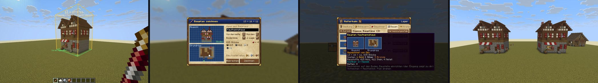

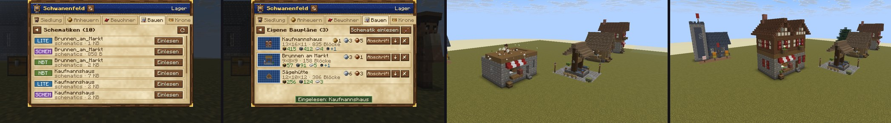

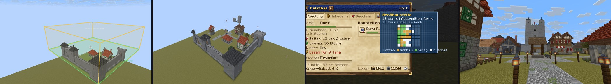

**Die Königsburg:** Eine fertige Burg mit **300 × 300 Blöcken**, vom Dragon Architect selbst entworfen. Im Stadtfenster
steht sie unter „Schematik einlesen“ mit einer Krone ganz oben; „Einlesen“ macht sie zu deinem eigenen Bauplan, den du
neben der Siedlung aufstellst und von deinen Baumeistern als Großbaustelle bauen lässt – aus Holz, Stein und Metall;
nur den **Thron** für den Palas musst du ins Lager legen. Mit „Ablegen“ bekommst du sie als .litematic, .schem und .nbt,
etwa für Litematica oder WorldEdit.

| Teil | Was dort steht |
|---|---|
| Äußerer Mauerring | zehn Blöcke hoch mit Wehrgang, Zinnen und Brustwehr, 26 Mauer- und Ecktürme, das Haupttor mit zwei Tortürmen, Fallgitter, Bannern und Treppen zum Wehrgang |
| Die Stadt | Hauptstraße vom Tor zur Kernburg, Querstraße, Gassen, ein Marktplatz mit Prunkbrunnen, Bürgerhäuser, Tavernen, Markthallen, Schmieden, Lager, Gärten, Bäume und Laternen |
| Graben | drei Blöcke tief zwischen gemauerter Futter- und Gegenmauer, mit Stampflehm am Grund; auf der Gegenmauer ein Geländer mit Laternen, außen die Ringstraße; eine Steinbrücke mit Bogen führt zum inneren Tor |
| Kernburg | eine höhere Mauer (vierzehn Blöcke) mit 13 Türmen – die Ecktürme mit spitzen Dächern und Fahnen, ihr Fuß reicht bis in den Graben – und ein eigenes Torhaus |
| Burghof | Platten in einem Raster, ein Prunkbrunnen, Alleebäume; der **Bergfried** mit Sockel, Gurtgesimsen, Fenstern, Portal, Bannern, vorgekragtem Wehrgang und vier Ecktürmchen; zu beiden Seiten der **Palas** mit Thronsaal und die **Kapelle** mit spitzem Turm, bunten Fenstern, Rosette, Bänken und Altar |
| Garten und Mauern | hinter dem Bergfried der **Königsgarten** mit Hecken, Wegkreuz, Blumenbeeten in Streifen und Brunnen; an den Mauern der **Marstall** mit Boxen, Heu und Laternen, dazu Kaserne, Sternwarte, Schmiede, Lager und Gesindehäuser |

Was in den Häusern der Siedlung sonst kostbar wäre (Ambosse, Kessel, Hochöfen, Braustände, Glocken, Goldblöcke), ist in
der Königsburg durch Ähnliches aus gewöhnlichen Baustoffen ersetzt. Die Burg ist jedes Mal genau dieselbe.

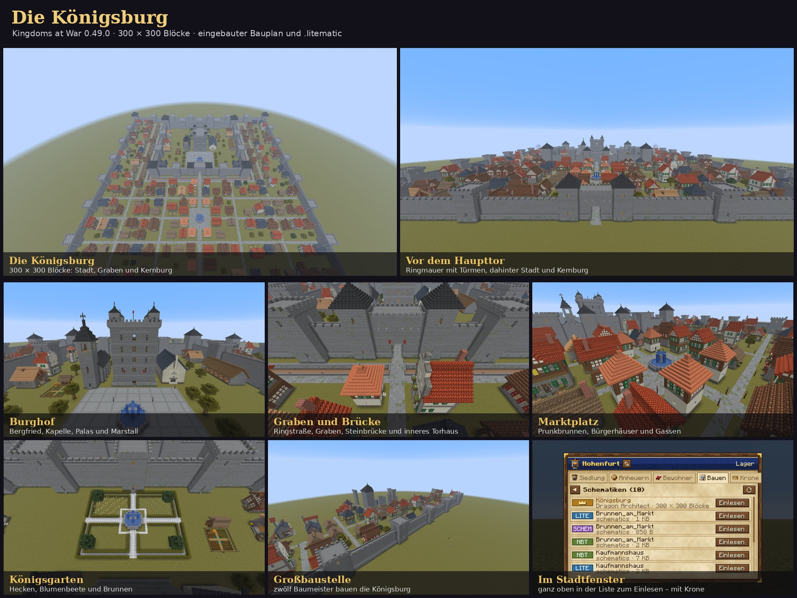

### Hof- und Weidetiere

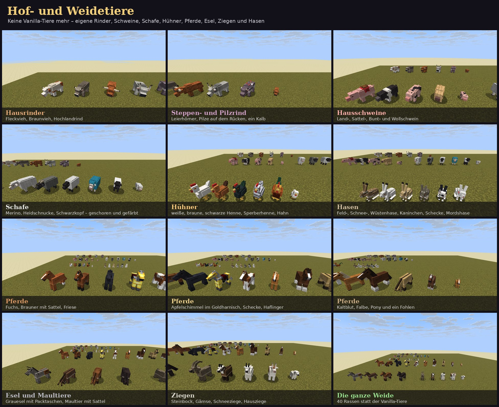

Die Tiere der Vanilla-Welt gibt es nicht mehr – an ihrer Stelle leben **eigene Hof- und Weidetiere** mit eigenen
Modellen, Fellbildern und Bewegungen, jedes in mehreren **Rassen**, die zum Land passen: zottelige Hochlandrinder und
Wollschweine im Norden, Steppenrinder mit Leierhörnern und Wüstenhasen im Süden, Schneeziegen an den Schneehängen.
Alles Gewohnte funktioniert wie bisher: Milch, Wolle (scheren, färben, nachwachsen), Eier, Reiten, Zähmen, Sattel,
Rossharnisch, Packtaschen, Ziegenhörner und die Beute beim Schlachten. Vanilla-Spawn-Eier, Befehle und geworfene Eier
bringen ebenfalls die neuen Tiere hervor; schon vorhandene Tiere einer alten Welt bleiben, wie sie sind.

| Tier | statt | Rassen | Besonderheiten |
|---|---|---|---|
| **Hausrind** | Kuh, Pilzkuh | Fleckvieh, Braunvieh, Hochlandrind, Steppenrind, Pilzrind | Hörner je Rasse, Stirnschopf beim Hochlandrind; das Pilzrind trägt Pilze auf dem Rücken und füllt Schüsseln mit Pilzsuppe |
| **Hausschwein** | Schwein | Landschwein, Sattelschwein, buntes Schwein, Wollschwein | Schlappohren, Ringelschwanz; mit Sattel und Karottenrute reitbar |
| **Schaf** | Schaf | Merinoschaf, Heidschnucke, Schwarzkopfschaf | Wolle in jeder Farbe, Heidschnucken mit Schneckenhörnern und natürlich grauer Wolle |
| **Huhn** | Huhn | weiße, braune, schwarze Henne, Sperberhenne, Hahn | Hennen legen weiße, braune oder (Sperberhenne) blaue Eier; der Hahn mit großem Kamm und Sichelfedern legt keine |
| **Pferd** | Pferd | Fuchs, Brauner, Friese, Apfelschimmel, Schecke, Haflinger, Kaltblut, Falbe, Pony | Abzeichen, lange Mähnen, Fesselbehang; das Kaltblut ist größer und kräftiger, das Pony klein; Herden meist einer Rasse |
| **Esel** | Esel | Grauesel, brauner Esel | lange Ohren, Schweifquaste, Packtaschen; mit einem Pferd gibt es Maultiere |
| **Maultier** | Maultier | Maultier, Rappmaultier | Eselsohren, Pferdeschweif, trägt Packtaschen |
| **Ziege** | Ziege | Steinbock, Gämse, Schneeziege, Hausziege | Hörner je Art (einzeln abbrechbar), Zottelfell der Schneeziege; rammt und springt wie bisher |
| **Hase** | Kaninchen | Feldhase, Schneehase, Wüstenhase, Wildkaninchen, Scheckenkaninchen, Mordshase | hoppelt mit gestreckten Läufen; der Mordshase mit glühenden Augen greift an (nur per Befehl) |

### Wildtiere


Auch die Wildtiere der Vanilla-Welt sind ersetzt: Überall, wo Vanilla ein Wildtier vorsieht, lebt mit dem gleichen
Gewicht ein **eigenes Gegenstück** – mit eigenem Modell und Fellbild, aber den vertrauten Bewegungen (Sitzen, Schlafen,
Lauern, Rollen, Einrollen, Aufrichten). Die Art richtet sich nach dem Land: Polarwolf und Polarfuchs im Schnee, Fennek
und Dromedar in der Wüste, Luchs in der Taiga. Zähmen, Halsbänder, Wolfspanzer, Teppiche, Packtaschen, Sattel,
Bienenstöcke, Honig, Gürteltier-Hornplatten und alle Beute bleiben, wie man sie kennt; Vanilla-Spawn-Eier, Bienen aus
Nestern, Dorfkatzen und die Lamas des fahrenden Händlers werden zu den neuen Tieren.

| Tier | statt | Arten und Rassen | Besonderheiten |
|---|---|---|---|
| **Wolf** | Wolf | Grauwolf, Polarwolf, Schwarzwolf, Timberwolf, Steppenwolf, Rotwolf | Rudel einer Art; wütend mit roten Augen; eigenes Halsband, Wolfspanzer; jagt auch die eigenen Schafe, Hasen und Füchse |
| **Fuchs** | Fuchs | Rotfuchs, Polarfuchs, Wüstenfuchs (Fennek), Silberfuchs | Riesenohren beim Fennek, schläft mit geschlossenen Augen, trägt Dinge im Maul, pflückt Beeren |
| **Bär** | Eisbär | Eisbär, Braunbär, Schwarzbär | neu in Taiga und Wäldern; Schulterbuckel beim Braunbären; richtet sich zum Angriff auf |
| **Panda** | Panda | ein Gesicht je Wesenszug | faul, besorgt, verspielt, schwach, aggressiv oder braun – man sieht es an den Augenflecken |
| **Hauskatze** | Katze | getigert, roter Kater, Siam, Kartäuser, Glückskatze, Perser, Smoking, Hexenkatze | eigenes Halsband; die schwarze Hexenkatze wohnt am Hexenbaum |
| **Wildkatze** | Ozelot | Ozelot, Luchs, Waldkatze | Luchs mit Ohrpinseln, Stummelschwanz und dichtem Fell in Taiga und Schnee, Waldkatze in den Wäldern |
| **Papagei** | Papagei | Hellroter Ara, Hyazinthara, Amazone, Gelbbrustara, Graupapagei | Krummschnabel, Federhaube; tanzt, ahmt Monster nach und sitzt auf der Schulter |
| **Biene** | Biene | Honigbiene, Hummel | pelzige Hummeln in kühlen Gegenden; Pollen an den Beinen, Zorn, Stich, Nester und Bienenstöcke |
| **Fledermaus** | Fledermaus | Abendsegler, Mausohr, Vampirfledermaus | Flughäute mit Fingerknochen; Vampire in Dschungel und Sumpf |
| **Gürteltier** | Gürteltier | Neunbinden-Gürteltier, Kugelgürteltier | Panzer mit Gürteln und Schilden, rollt sich zur Kugel ein, wirft Hornplatten ab |
| **Kamel** | Kamel | Dromedar, Trampeltier | Trampeltier mit zwei Höckern neu in Tafelbergen und auf den Savannen-Hochebenen; Sattel, zwei Reiter, Sprint |
| **Lama** | Lama, Händlerlama | creme, weiß, braun, grau | dichtes Vlies, Bananenohren; spuckt, zieht in Karawanen, trägt Teppiche und Packtaschen |

### Tiere der Biome (seit 0.85)


In den eigenen Biomen der Oberwelt – und seit 0.86 auch in einigen Biomen von Minecraft – leben eigene Tiere, jedes
mit eigenem Modell, eigenen Bewegungen und eigenen Klängen, alle mit Spawn-Ei.

| Tier | Biom | Arten | Verhalten |
|---|---|---|---|
| **Schneeleopard** | Frostgipfel, verschneite Hänge, Zackengipfel, Hain | rauchweiß, rauchgrau | scheu (weicht Spielern aus, außer man schleicht oder trägt Fleisch); pirscht geduckt an Ziegen und Hasen heran und **springt sie aus bis zu sieben Blöcken an**, frisst und ist dann lange satt; geht über Pulverschnee; **zähmbar** mit rohem Hammel-, Hasen- oder Hirschfleisch (gezähmt mehr Leben, folgt, kämpft mit, sitzt, ruht neben dir); Junge |
| **Urelch** | Urhain, alte Kiefern- und Fichtentaiga | Bulle, Kuh, Kalb | in kleinen Herden; die Bullen tragen **bemooste Schaufeln mit glühenden Leuchtbeeren** und röhren; zähmbar wie ein Pferd (Weizen, Äpfel, Beeren, Heu), mit **Sattel** reitbar und mit **Truhe** ein Packtier; ein angegriffener Bulle **stürmt mit gesenkten Schaufeln** und stößt fort, die Kühe fliehen; Hirschfleisch und Leder |
| **Sturmmöwe** | Sturmküste, steinige Ufer, Strände | Sturmmöwe (hell), Mantelmöwe (dunkel) | kleine Schwärme kreisen in Bögen über der Küste, landen auf Pfählen, Felsen und dem Wasser, schwimmen, picken und lachen; fliegen auf, wenn man ihnen zu nahe kommt (außer schleichend); **klauen einen gewöhnlichen Fisch aus der Hand** und fliegen damit fort – getroffen lassen sie ihn fallen, nach einer Weile ist er gefressen |
| **Greif** | Felsschluchten, zerklüftete Savanne | golden (weißer Kopf), Rostgreif | kreist hoch über den Schluchten, landet auf den **höchsten Felsnadeln** und sitzt dort aufrecht; jagt Hasen, Hühner und Gürteltiere im **Sturzflug** (Schwingen zurück, Fänge voran) und frisst nach der Landung; lässt Menschen in Ruhe, warnt mit einem Schrei, wer ihm beim Ruhen nahe kommt, und greift jeden, der ihn angreift, **immer wieder aus der Luft** an – am Boden mit den Krallen; kein Fallschaden; Federn und Leder |
| **Glutsalamander** (0.86) | Aschefelder | Glutsalamander (orangerot), Goldsalamander (gelb) | schwarz wie erkaltete Schlacke, Flecken und Risse **leuchten wie Glut** (auch im Dunkeln); feuerfest, **läuft über Lava** wie über festen Boden und sucht sie sogar auf; sonnt sich an Lava und Magma und glüht dann heller; scheu (huscht davon, außer man schleicht); wer ihn schlägt, **verbrennt sich an seiner Haut**; Wasser schadet ihm; mit **Magmacreme** zieht man Junge auf; Magmacreme |
| **Moorschnapper** (0.86) | Nebelmoor, Sümpfe | – | riesige Schnappschildkröte mit gezacktem, bemoostem Panzer und Hakenschnabel; **lauert reglos** im flachen Wasser und Schlamm, nur Panzer und Kopf ragen heraus; **schnappt blitzschnell** nach Spielern, Monstern, Fröschen, Hasen und Hühnern vor seiner Nase; **faucht** jeden an, der näher kommt; getroffen **zieht er sich in den Panzer zurück** (nimmt dann nur ein Drittel des Schadens) und schnappt danach nach dem Angreifer; atmet unter Wasser, an Land langsam; 30 Leben, starke Panzerung; Schildkrötenschuppen |
| **Flamingo** (0.86) | Korallenküste, Mangrovensümpfe | Rosaflamingo, Kubaflamingo (kräftig rot) | in **Scharen** von vier bis acht im flachen Wasser; watet mit nach hinten knickenden Fersen, **gründelt mit dem Kopf nach unten**, ruht **auf einem Bein** und steckt nachts den Kopf ins Gefieder; läuft davon, wenn man näher kommt, und **fliegt auf**, wenn man ihm dicht auf den Fersen ist – Hals vor, Beine zurück, rot-schwarze Schwingen –, landet bald wieder im Wasser; Federn |
| **Schmetterling** (0.86) | Königsauen, Blumenwald, Wiese, Sonnenblumenebene, Kirschhain | Tagpfauenauge, Zitronenfalter, Schwalbenschwanz, Bläuling, Admiral, Monarch | gaukelt in unruhigen Bögen über die Wiesen, **setzt sich auf Blumen und Gräser** und öffnet und schließt dort langsam die Flügel; flattert auf, wenn man ihm zu nahe kommt (außer schleichend); sitzt nachts und bei Regen still mit zusammengeklappten Flügeln; harmlos und lautlos |


### Wassertiere


In Meeren, Flüssen, Sümpfen und Höhlen leben keine Vanilla-Wassertiere mehr. Jede Art hat ein eigenes Modell mit den
Knochen ihres Vanilla-Gegenstücks – Schwimmen, Zappeln an Land, Aufblähen, Fangarme, Quaken und Totstellen sehen aus
wie gewohnt. Was Vanilla als Spielart speichert, bleibt erhalten: Axolotl-Farbe, Muster und Farben der Tropenfische,
Lachsgröße und Froschart. Eimer, Zucht, Eiablage und alle Beute funktionieren wie bei Vanilla; in kalten Meeren
schwimmen nur Dorsche, Schwertwale ziehen eher durch kalte Gewässer, Karettschildkröten durch warme.

| Tier | statt | Gestalten | Besonderheiten |
|---|---|---|---|
| **Dorsch** | Kabeljau | Dorsch, Seelachs | olivbraun gesprenkelt mit Bartel am Kinn, oder dunkelgrüner Rücken mit silbernen Flanken; Schwärme, Eimer |
| **Lachs** | Lachs | Lachs, Rotlachs | stahlblauer Rücken mit schwarzen Tupfen, oder leuchtend rot mit grünem Kopf, Buckel und Hakenkiefer; drei Größen |
| **Kugelfisch** | Kugelfisch | – | ockergelb mit braunen Sätteln; bläht sich in zwei Stufen zur Stachelkugel auf und vergiftet, wer ihn berührt |
| **Rifffisch** | Tropenfisch | zwei Körperformen, zwölf Muster | Querbinden, Augenbinde, Halbmond, Glitzerpunkte, Schrägstreifen … in allen Farben der Vanilla-Tropenfische |
| **Tintenfisch** | Tintenfisch | – | rotbraun gesprenkelter Mantel mit Pfeilflossen, goldene Augen, Saugnapf-Arme; Tintenbeutel |
| **Tiefseekrake** | Leuchttintenfisch | – | tiefblau mit leuchtenden Lichtflecken, Flossensaum, Augen und Armringen; nach einem Treffer kurz dunkel |
| **Delfin** | Delfin | Großer Tümmler, Schwertwal | eigene Finne je Art; spielt mit Gegenständen, führt zu Schätzen, schenkt die Gnade des Delfins |
| **Meeresschildkröte** | Schildkröte | Suppenschildkröte, Karettschildkröte | Panzer mit hellen Nähten oder in Schildpatt; Eiablage am Heimatstrand, Schildkrötenschuppen |
| **Molch** | Axolotl | Grottenolm, Wildmolch, Goldmolch, Eismolch, Blaumolch | gefiederte Kiemenäste; der seltene Blaumolch mit leuchtenden Kiemenspitzen; jagt mit dir, stellt sich tot |
| **Frosch** | Frosch | Teichfrosch, Feuerkröte, Grasfrosch | für gemäßigte, warme und kalte Gegenden; Schallblasen, Zungenschlag, Froschlichter |
| **Kaulquappe** | Kaulquappe | – | golden gesprenkelt mit durchscheinendem Flossensaum; wird zum Frosch ihrer Gegend |
| **Nautilus** | Nautilus | – | gestreiftes Perlboot mit Fangarmen; zähmbar, mit Sattel und Nautilus-Rüstung reitbar |
| **Geisternautilus** | Zombienautilus | – | bleiches, rissiges Gehäuse mit Seepocken und Tang, seegrün glimmende Augen; trägt Wasserleichen |

### Angeln (seit 0.79)


**Die Angeln (seit 0.87).** Neben der Angel von Minecraft gibt es sechs eigene – jede mit ihrer Stärke. Gebaut werden sie
wie die Angel von Minecraft (zweimal der Werkstoff schräg nach oben, unten links der Griff, rechts zwei Fäden), ausgebessert
am Amboss mit dem Werkstoff; Köder, Glück des Meeres, Drillmeister, Haltbarkeit und Reparatur wirken auf ihnen wie gewohnt,
und ihre Vorteile kommen zu Ködern und Verzauberungen hinzu.

| Angel | Werkstoff und Griff | Haltbarkeit | Stärke |
|---|---|---|---|
| **Eisenangel** | Eisenbarren, Stock | 192 (Minecraft: 64) | die Fangzone im Drill ist 10 % größer – leichter einzuholen |
| **Goldangel** | Goldbarren, Stock | 48 | +2 Glück: seltenere Fische, öfter ein Schatz, weniger Kram; sehr gut zu verzaubern |
| **Drachenangel** | Draconium, Drachenschuppe | 640, verbrennt nicht | von allem etwas: der Biss kommt 30 % schneller, die Fangzone ist 15 % größer, +1 Glück |
| **Schattenangel** | Nachtstahlbarren, Mondsilberbarren | 384 | im Dunkeln (nachts, unter Tage, in der Leere): Biss 40 % schneller, Fangzone 10 % größer, +2 Glück |
| **Glutangel** | Lohenruten, Glutwurmschuppe | 512, verbrennt nicht | in der Lava: der Fisch beißt doppelt so schnell, die Fangzone ist 25 % größer, +1 Glück |
| **Sternenangel** | Sternsplitter, Stock | 512 | im End und in der Leere: Biss doppelt so schnell, Fangzone 25 % größer; überall +1 Glück |
| **Krakenangel** (seit 0.91) | kein Rezept – Beute des Kraken; ausgebessert mit Prismarinkristallen | 960, verbrennt nicht | die stärkste im Wasser: Biss 35 % schneller, Fangzone 20 % größer, +2 Glück; unter Wasser und im Urmeer Biss doppelt so schnell, Fangzone 30 % größer, +3 Glück; anderswo ein wenig (Biss 20 %, Zone 10 %, +2 Glück) |


**In 3D (seit 0.90).** Alle Angeln – auch die von Minecraft – sind in der Hand echte Ruten: unten das Griffende mit Kappe
(bei Gold, Drache, Schatten und Sternen mit einem Stein), der Griff (Bindfaden, Leder, rotes Leder, Schuppenleder), der
Rollenhalter mit der **Rolle** darunter – eine runde Spule mit aufgewickelter Schnur und einer Kurbel mit Knauf –, darüber
die Rute aus vier sich verjüngenden Gliedern mit **Ringen** und farbigen **Wicklungen**. Ruhend hängt von der Spitze die
Schnur senkrecht herab, daran ein rot-weißer Schwimmer (Holz- und Eisenangel) oder der Köder der Angel – ein **Goldlöffel**
mit rotem Auge, eine glühende **Drachenschuppe**, ein leuchtender **Schattenkristall**, eine **Glutperle** mit Flämmchen, ein
**Stern** – und darunter der Haken mit Widerhaken. Ausgeworfen fehlt die Schnur am Modell (das Spiel zieht sie von der Spitze
bis zum Schwimmer), und die Spitze biegt sich unter dem Zug. Die Drachenangel trägt zwei Hörner am Griffende und Flossen am
Vordergriff, die Schattenangel leuchtende Wicklungen, die Glutangel ist ein **glühender Lohenstab**, die Sternenangel hat
einen leuchtenden Stern an der Spitze und eine Schnur aus Sternenlicht. Im Inventar, am Boden und im Rahmen bleibt das
gewohnte Bild; gehalten werden sie wie die Angel von Minecraft, damit die Schnur genau an der Spitze ansetzt.


Geangelt wird wie immer – auswerfen, warten, beim Biss anziehen. Aber seit 0.79 hebt man den Fisch nicht mehr einfach
heraus: Er wird **gedrillt**. Und es beißt überall etwas anderes: seit 0.99 **8369 Arten** in zehn Kapiteln (die meisten im
Urmeer) – in jedem Gewässer, jedem Biom und jeder Welt eigene. Wer viel angelt, trägt einen **Fischbeutel**.

**Der Drill.** Wer beim Biss anzieht, sieht neben der Angel eine Säule – Wasser, Lava oder Sternenhimmel, je nachdem,
worin der Schwimmer treibt. Darin zieht der Fisch auf und ab, und die grüne **Fangzone** gehört dir: Hältst du die
Maustaste, steigt sie; lässt du los, sinkt sie – und **jeder Klick** gibt ihr einen kleinen Schubs nach oben, so lässt sie
sich auch durch Antippen führen (gespielt wird seit 0.83 nur noch mit der Maus). Solange der Fisch in der Fangzone schwimmt und die
Schnur gespannt ist, füllt sich die Leiste daneben – ist sie voll, ist er gefangen. Schwimmt er hinaus, leert sie sich,
und ist sie leer, reißt er sich los: Der Haken bleibt dann draußen und wartet auf den nächsten Biss. Seit 0.99 gilt:
**Je seltener der Fisch, desto unruhiger** – ungewöhnliche, seltene, mystische und legendäre Fische überlegen kürzer,
schwimmen weitere Wege und schneller, und ab *selten* brechen sie ab und zu plötzlich aus. **Esc** gibt den
Fisch frei.

- **Wer nichts tut, fängt nichts**: Liegt die Fangzone ungehalten am Boden, hängt die Schnur durch, und die Leiste
  wächst nicht – auch wenn der Fisch gerade dort unten steht.
- **Jede Art kämpft anders**: Die einen ziehen ruhig ihre Bahn, andere drängen nach oben oder nach unten, zappeln oder
  stehen still und schießen dann in jähen Sprüngen davon – und die größten wechseln mitten im Kampf die Laune. Die Sterne
  einer Art (★ bis ★★★★★) sagen, wie schwer sie zu halten ist: Mit jedem Stern schrumpft die Fangzone, der Kampf
  dauert länger, und die Leiste leert sich schneller. Bei einem Kabeljau misst die Fangzone ein gutes Drittel der
  Säule, und knapp drei Sekunden darin genügen; bei einer Legende ist sie noch ein Fünftel der Säule, und es braucht
  viereinhalb Sekunden darin – und schon eine gute Sekunde draußen kann sie kosten.
- **Perfekter Fang**: Verlässt der Fisch die Fangzone kein einziges Mal, fällt er größer aus – das Spiel meldet es
  mit einem eigenen Band („Perfekter Fang!“), ebenso jede **neue Art** und jeden **neuen Rekord**.
- **Schatzkisten**: Bei etwa jedem zehnten Drill treibt eine Truhe mit in der Säule – möglichst weit weg vom Fisch.
  Hält man die Fangzone 1,7 Sekunden über ihr, ist sie gehoben; behalten darf sie nur, wer danach auch den Fisch
  landet. Im Wasser liegen darin die Schätze, die Minecraft sonst an die Angel hängt (verzauberte Bücher, Sättel,
  Namensschilder, Nautilusschalen … – wie dort nur über offenem Wasser), in Lava Goldklumpen und -barren, Netherquarz,
  Magmacreme, Lohenstaub, selten ein Goldener Apfel, Netheritplatten, Antiker Schrott oder die Schallplatte „Pigstep“,
  im Nichts Enderperlen, Chorusfrüchte, Amethystscherben, Endstäbe, Phantomhaut, selten Enderaugen, Diamanten,
  Echoscherben, Drachenatem oder eine Shulker-Schale.
- **Größe und Rekord**: Jeder Fang hat eine Größe in Zentimetern; das Fischbuch merkt sich den größten jeder Art.
- **Glück des Meeres** vergrößert die Fangzone (um 5 % je Stufe), lässt öfter eine Truhe mittreiben (5 Prozentpunkte
  je Stufe), lockt seltene Arten und bringt weniger Kram. Die Verzauberung **Köder** verkürzt wie bisher das Warten.
- **Kram** (alte Stiefel, Seerosen …) kommt im Wasser weiter ohne Drill an die Leine – etwa bei jedem zehnten Fang. Die
  Erfahrung bleibt, wie sie war: eine Kugel je Fang.

**Angeln in Lava.** Der Schwimmer treibt auch auf Lava – im Nether, im Abgrund und auf jedem Lavasee der Oberwelt. Er
verbrennt nicht, und statt Blasen ziehen Flämmchen auf ihn zu. Jedes Biom des Nethers hat seine eigenen Fische (je einen
Allerweltsfisch – Karmesinschnapper, Wirrflosse, Seelenaal, Basalthecht – und sieben weitere Arten), dazu überall
Magmakarpfen und Glutrochen und als Legende den Infernokönig; auch die Lava der Aschefelder, der Aschelande und des
Abgrunds hat eigene Arten. Lavafische sind **feuerfest**: Sie verbrennen weder in Lava noch im Feuer und fliegen dir aus der Glut
zu; der Schatz aus einer Truhe landet gleich vor deinen Füßen.

**Angeln im Nichts.** Im End, in der Leere und im Abgrund wirft man den Haken über den Rand einer Insel: Fällt er fünf
Blöcke unter deine Füße und ist unter ihm 24 Blöcke weit nichts als Luft, fängt ihn die Leere auf – er hängt dort wie
auf einer Wasseroberfläche, und violette Funken ziehen auf ihn zu; der Fang landet vor deinen Füßen. Über festem Grund
fällt der Haken einfach hinab, und von einer Klippe der Oberwelt lässt sich so nicht angeln: In allen anderen Welten
trägt die Leere ihn nur, wo bis zum Boden der Welt nichts mehr kommt.

**Angeln unter Wasser (seit 0.90).** Wer taucht – das Wasser steht ihm über den Augen – und auswirft, dessen Haken treibt
nicht zur Oberfläche: Er gleitet ein paar Blöcke weit durchs Wasser (es bremst ihn rasch) und bleibt dann **in der Tiefe
stehen**, mitten in seinem Block, und schwankt dort sacht. Es beißt dort wie oben, auch über tiefem Wasser ohne Abzug
(das Wasser selbst ist keine Decke); statt Spritzern und Wellen ziehen **Bläschen** auf den Haken zu, beim Biss blubbert es
dumpf, und im Drill zerrt der Fisch in einer Wolke aus Bläschen. Der Fang fliegt nicht heran (unter Wasser käme er nicht
weit), sondern **landet gleich beim Taucher**. Wer mit dem Kopf über Wasser auswirft, angelt wie gewohnt an der
Oberfläche. Gut zusammen mit einem Trank der Unterwasseratmung – oder mit den Fischen, die einen atmen lassen.

**Die 2053 Arten.** Es gibt zweierlei Fische. **84 Arten** sind nach **Lebensräumen** verteilt – die Allerweltsfische der
Flüsse, Meere, Höhlen und Welten, die vier Fische von Minecraft und die fünfzehn Legenden aller Welten; sie stehen in der
ersten Tabelle. **1969 Arten** gehören einem **Biom** und beißen nur dort: einundzwanzig in jedem der 39 eigenen Biome der
Mod, elf oder dreizehn in jedem der 66 Biome von Minecraft und **vierzig in jedem der acht Biome des Urmeers** (916 kamen mit
0.81, 628 mit 0.83, 80 mit dem Urmeer in 0.89, 185 mit 0.90: 72 fürs Urmeer und 113 Legenden, 160 mit den vier Landschaften
unter Wasser in 0.92). An einem Angelplatz beißt
also beides – in der Ebene etwa die Allerweltsfische der Flüsse und die dreizehn Arten der Ebene, wobei die eigenen Arten eines Bioms (wie die der
besonderen Orte: Sumpf, Dschungel, Höhle, Tiefsee …) fast doppelt so oft beißen und fast zwei Drittel des Fangs stellen.

„Wann“ heißt: Zur anderen Tageszeit beißt die Art nur selten (etwa ein Achtel so oft); „gern bei Regen“ heißt bei Regen
gut doppelt so oft, sonst halb so oft; „nur bei Regen“ und „nur im Gewitter“ gelten ohne Ausnahme. In Welten ohne Tag und
Nacht zählt die Tageszeit nicht. Seltenere Arten beißen entsprechend seltener. Eine **Legende** hängt an ihrem Ort und zu
ihrer Zeit etwa bei jedem hundertsten Biss am Haken – überall gleich selten, ob dort drei Arten leben oder dreißig. Glück
des Meeres III verdoppelt das, der Glühköder ebenso (bei allem, was im Dunkeln oder in Lava lebt), und die beiden
Wetterlegenden beißen in ihrem Wetter zweieinhalb- bis viermal so oft. Seit 0.90 hat **jedes Biom seine eigene Legende**
(das Urmeer in jedem Biom zwei): Sie steht im Fischbuch bei ihrem Biom, die fünfzehn Legenden aller Welten in ihrem eigenen
Kapitel.

**Die fünf Seltenheiten.** Gewöhnlich (weiß), Ungewöhnlich (grün), Selten (blau), **Mystisch** (violett; bis 0.89 hieß sie
„episch“) und **Legendär** (gold). In **jedem Biom gibt es jede Seltenheit** – Gewöhnliches, Ungewöhnliches, Seltenes,
mindestens zwei mystische Fänge und seit 0.90 die Legende des Bioms. Legenden tragen ihren Namen in Gold und **funkeln**
im Inventar wie verzauberte Dinge.

*Die Allerweltsfische und die Legenden (84):*

| Fisch | Seltenheit | Drill | Größe | Wo | Wann | Gegessen |
|---|---|---|---|---|---|---|
| **Flüsse & Seen** (18) | | | | | | |
| Lachs | gewöhnlich | ★★☆☆☆ | 40–110 cm | Flüsse und Seen, kalte Gewässer, kalte Meere | immer | wie bei Minecraft |
| Bachforelle | gewöhnlich | ★☆☆☆☆ | 20–45 cm | Flüsse und Seen | immer | Schnelligkeit (1:00) |
| Flussbarsch | gewöhnlich | ★★☆☆☆ | 15–40 cm | Flüsse und Seen | tagsüber | Eile (1:00) |
| Karpfen | gewöhnlich | ★★☆☆☆ | 30–80 cm | Flüsse und Seen, Sümpfe | immer | Regeneration (0:12) |
| Hecht | ungewöhnlich | ★★★☆☆ | 45–120 cm | Flüsse und Seen | tagsüber | Stärke (0:45) |
| Wels | ungewöhnlich | ★★★☆☆ | 60–200 cm | Flüsse und Seen, Sümpfe | nachts | Nachtsicht (2:00) |
| Aal | ungewöhnlich | ★★★☆☆ | 40–110 cm | Flüsse und Seen | nachts · gern bei Regen | Gunst des Delfins (0:45) |
| Stör | selten | ★★★☆☆ | 90–300 cm | Flüsse und Seen | immer | Absorption II (2:00) |
| Goldfisch | selten | ★★☆☆☆ | 8–25 cm | Flüsse und Seen | tagsüber | Glück (5:00) |
| Piranha | ungewöhnlich | ★★★☆☆ | 15–40 cm | Dschungelgewässer | immer | Stärke II (0:15), Hunger (0:15) |
| Arapaima | selten | ★★★★☆ | 120–300 cm | Dschungelgewässer | immer | Extraenergie II (3:00) |
| Schlammspringer | gewöhnlich | ★☆☆☆☆ | 8–20 cm | Sümpfe | immer | Sprungkraft II (1:00) |
| Seesaibling | ungewöhnlich | ★★☆☆☆ | 25–70 cm | kalte Gewässer | immer | Resistenz (1:00) |
| Regenbogenforelle | ungewöhnlich | ★★☆☆☆ | 25–70 cm | Bergbäche und Bergseen, Flüsse und Seen | tagsüber · gern bei Regen | Regeneration II (0:08) |
| Wüstenkärpfling | ungewöhnlich | ★★☆☆☆ | 3–8 cm | Wasserlöcher in Wüste, Savanne und Tafelbergen | immer | Feuerresistenz (0:45), Schnelligkeit (0:45) |
| Blütenkoi | selten | ★★★☆☆ | 30–70 cm | Kirschberghaine und Blumenwiesen | immer | Regeneration (0:30), Glück (1:00) |
| Düsterhecht | ungewöhnlich | ★★★☆☆ | 50–110 cm | Dunkler Wald und Blasser Garten | immer | Unsichtbarkeit (0:45) |
| Pilzbarsch | ungewöhnlich | ★★☆☆☆ | 15–35 cm | Pilzland | immer | Übelkeit (0:08) |
| **Das Meer** (16) | | | | | | |
| Kabeljau | gewöhnlich | ★☆☆☆☆ | 30–90 cm | Meer und Strand, kalte Meere | immer | wie bei Minecraft |
| Tropenfisch | ungewöhnlich | ★★☆☆☆ | 5–20 cm | warme Meere, Dschungelgewässer | immer | wie bei Minecraft |
| Kugelfisch | ungewöhnlich | ★★☆☆☆ | 10–40 cm | warme Meere, Meer und Strand | immer | wie bei Minecraft |
| Hering | gewöhnlich | ★☆☆☆☆ | 15–40 cm | Meer und Strand | immer | Unterwasseratmung (1:30) |
| Makrele | gewöhnlich | ★★☆☆☆ | 20–50 cm | Meer und Strand | tagsüber | Schnelligkeit II (0:20) |
| Rotbarsch | gewöhnlich | ★★☆☆☆ | 25–60 cm | Meer und Strand, kalte Meere | immer | Absorption (1:00) |
| Scholle | ungewöhnlich | ★★☆☆☆ | 25–70 cm | Meer und Strand | immer | Resistenz (1:30) |
| Thunfisch | ungewöhnlich | ★★★☆☆ | 80–250 cm | Meer und Strand | tagsüber | Stärke (1:30), Schnelligkeit (1:30) |
| Schwertfisch | selten | ★★★★☆ | 150–400 cm | Meer und Strand | immer | Stärke II (0:30) |
| Mondfisch | selten | ★★★☆☆ | 100–300 cm | Meer und Strand | tagsüber | Sanfter Fall (1:30) |
| Seepferdchen | ungewöhnlich | ★★☆☆☆ | 5–25 cm | warme Meere | immer | Gunst des Delfins (1:30) |
| Papageifisch | ungewöhnlich | ★★☆☆☆ | 25–90 cm | warme Meere | tagsüber | Sprungkraft (2:00), Schnelligkeit (2:00) |
| Rotfeuerfisch | selten | ★★★☆☆ | 20–45 cm | warme Meere | immer | Vergiftung II (0:06), Stärke II (1:00) |
| Oktopus | ungewöhnlich | ★★★☆☆ | 30–120 cm | Meer und Strand | nachts | Unsichtbarkeit (0:30), Unterwasseratmung (0:30) |
| Katzenhai | selten | ★★★★☆ | 50–160 cm | Meer und Strand, die Tiefsee | nachts | Stärke (1:00), Nachtsicht (1:00) |
| Heilbutt | selten | ★★★☆☆ | 80–250 cm | kalte Meere | immer | Resistenz II (0:30) |
| **Die Tiefsee** (10) | | | | | | |
| Laternenfisch | gewöhnlich | ★★☆☆☆ | 5–15 cm | die Tiefsee | immer | Leuchten (0:30), Nachtsicht (1:00) |
| Beilfisch | gewöhnlich | ★★☆☆☆ | 4–12 cm | die Tiefsee | immer | Schnelligkeit (0:30), Sanfter Fall (0:30) |
| Anglerfisch | ungewöhnlich | ★★★☆☆ | 20–100 cm | die Tiefsee | nachts | Nachtsicht (5:00) |
| Viperfisch | ungewöhnlich | ★★★☆☆ | 20–60 cm | die Tiefsee | immer | Stärke II (0:20), Verdorrung (0:04) |
| Leuchtkalmar | ungewöhnlich | ★★☆☆☆ | 5–12 cm | die Tiefsee | nachts | Leuchten (1:00), Schnelligkeit II (0:30) |
| Riesenassel | ungewöhnlich | ★★☆☆☆ | 15–50 cm | die Tiefsee | immer | Resistenz II (1:00), Langsamkeit (1:00) |
| Riemenfisch | selten | ★★★★☆ | 300–800 cm | die Tiefsee | immer | Meereskraft (1:00) |
| Geisterhai | selten | ★★★★☆ | 60–150 cm | die Tiefsee | immer | Unsichtbarkeit (1:30) |
| Quastenflosser | mystisch | ★★★★☆ | 100–200 cm | die Tiefsee | immer | Extraenergie III (5:00) |
| Vampirkalmar | mystisch | ★★★★☆ | 15–30 cm | die Tiefsee | nachts | Direktheilung II, Dunkelheit (0:06) |
| **Höhlen** (3) | | | | | | |
| Höhlensalmler | ungewöhnlich | ★★☆☆☆ | 6–12 cm | Höhlengewässer | immer | Nachtsicht (4:00), Eile (0:30) |
| Tropfsteinschmerle | gewöhnlich | ★★☆☆☆ | 8–18 cm | Höhlengewässer | immer | Eile II (0:30) |
| Sculk-Aal | selten | ★★★★☆ | 60–150 cm | das Tiefe Dunkel | immer | Dunkelheit (0:05), Unsichtbarkeit (1:00) |
| **Der Nether** (6) | | | | | | |
| Magmakarpfen | gewöhnlich | ★★☆☆☆ | 30–70 cm | Lava, überall | immer | Feuerresistenz (2:00) |
| Karmesinschnapper | ungewöhnlich | ★★★☆☆ | 25–60 cm | Lava im Karmesinwald | immer | Stärke (2:00), Feuerresistenz (0:30) |
| Wirrflosse | ungewöhnlich | ★★★☆☆ | 20–50 cm | Lava im Wirrwald | immer | versetzt ein paar Schritte, Feuerresistenz (0:30) |
| Seelenaal | selten | ★★★☆☆ | 60–160 cm | Lava im Seelensandtal | immer | Schnelligkeit III (0:15), Verdorrung (0:03) |
| Basalthecht | ungewöhnlich | ★★★☆☆ | 50–120 cm | Lava in den Basaltdeltas | immer | Resistenz (2:00), Feuerresistenz (1:00) |
| Glutrochen | selten | ★★★★☆ | 60–140 cm | Lava, überall | immer | Feuerresistenz (5:00), Regeneration (0:20) |
| **End & Leere** (5) | | | | | | |
| Endlachs | gewöhnlich | ★★☆☆☆ | 30–70 cm | das End | immer | versetzt wie eine Chorusfrucht |
| Chorusfisch | ungewöhnlich | ★★★☆☆ | 15–40 cm | das End | immer | Schwebekraft (0:04), Sanfter Fall (0:20) |
| Leerenrochen | selten | ★★★★☆ | 80–200 cm | das End, die Leere | immer | Sanfter Fall (3:00) |
| Sternstaub-Elritze | gewöhnlich | ★★☆☆☆ | 5–12 cm | die Leere | immer | Glück II (1:00) |
| Kristallflosse | ungewöhnlich | ★★★☆☆ | 20–50 cm | die Leere | immer | Absorption III (1:30) |
| **Das Feenreich** (4) | | | | | | |
| Glimmerfisch | gewöhnlich | ★★☆☆☆ | 8–20 cm | das Feenreich | immer | Leuchten (0:20), Glück (2:00) |
| Pilzschwimmer | ungewöhnlich | ★★☆☆☆ | 10–30 cm | das Feenreich | immer | Sprungkraft III (0:30) |
| Mondlilien-Koi | selten | ★★★☆☆ | 30–80 cm | das Feenreich | immer | Regeneration II (0:15), Nachtsicht (1:00) |
| Dornenhecht | selten | ★★★☆☆ | 40–100 cm | das Feenreich | immer | Stärke (2:00), Vergiftung (0:05) |
| **Die Schattenwelt** (4) | | | | | | |
| Nebelkarpfen | gewöhnlich | ★★☆☆☆ | 25–60 cm | die Schattenwelt | immer | Sanfter Fall (1:00), Unsichtbarkeit (0:20) |
| Blindhecht | ungewöhnlich | ★★★☆☆ | 40–100 cm | die Schattenwelt | immer | Blindheit (0:05), Stärke III (0:20) |
| Schattenaal | ungewöhnlich | ★★★☆☆ | 50–140 cm | die Schattenwelt | immer | Unsichtbarkeit (1:00), Schnelligkeit (1:00) |
| Seelenfisch | selten | ★★★☆☆ | 20–50 cm | die Schattenwelt | immer | nimmt alle Leiden, Regeneration (0:10) |
| **Der Abgrund** (3) | | | | | | |
| Glutwels | ungewöhnlich | ★★★☆☆ | 50–130 cm | der Abgrund | immer | Feuerresistenz (3:00), Stärke (1:00) |
| Chaosflosse | selten | ★★★★☆ | 30–90 cm | der Abgrund | immer | versetzt wie eine Chorusfrucht, Schnelligkeit II (0:20) |
| Rissaal | mystisch | ★★★★☆ | 80–220 cm | der Abgrund | immer | Schwebekraft (0:06), Sanfter Fall (0:30), Stärke II (1:00) |
| **Legenden** (15) | | | | | | |
| Der Alte vom See | **legendär** | ★★★★★ | 140–220 cm | Flüsse und Seen | nachts | Glück II (10:00), Regeneration (1:00), Extraenergie II (10:00) |
| Goldschuppe | **legendär** | ★★★★★ | 80–130 cm | Flüsse und Seen | tagsüber · nur bei Regen | Absorption IV (3:00), Glück III (5:00) |
| Sturmsegler | **legendär** | ★★★★★ | 250–450 cm | Meer und Strand | nur im Gewitter | Schnelligkeit III (2:00), Stärke II (2:00) |
| König der Tiefe | **legendär** | ★★★★★ | 120–200 cm | die Tiefsee | nachts | Nachtsicht (15:00), Stärke III (2:00), Resistenz II (2:00) |
| Infernokönig | **legendär** | ★★★★★ | 200–350 cm | Lava, überall | immer | Feuerresistenz (10:00), Stärke III (1:00), Absorption IV (2:00) |
| Drachenkoi | **legendär** | ★★★★★ | 90–160 cm | das End | immer | Stärke III (1:30), Resistenz II (1:30), Regeneration II (0:30) |
| Mondschein-Koi | **legendär** | ★★★★★ | 60–110 cm | das Feenreich | immer | Regeneration III (0:30), Extraenergie III (10:00) |
| Nachtfürst | **legendär** | ★★★★★ | 160–260 cm | die Schattenwelt | immer | Unsichtbarkeit (5:00), Stärke III (2:00), Schnelligkeit II (2:00) |
| Rissleviathan | **legendär** | ★★★★★ | 300–520 cm | der Abgrund | immer | Stärke III (1:30), Feuerresistenz (10:00), Sanfter Fall (5:00) |
| Sternenwal | **legendär** | ★★★★★ | 400–700 cm | die Leere | immer | Sanfter Fall (10:00), Glück III (5:00), Absorption IV (3:00) |
| Der Lichtlose | **legendär** | ★★★★★ | 90–160 cm | Höhlengewässer | immer | Nachtsicht (20:00), Eile III (3:00), Resistenz II (2:00) |
| Eiskaiser | **legendär** | ★★★★★ | 180–320 cm | kalte Gewässer, kalte Meere | immer | Resistenz II (3:00), Absorption III (4:00), Unterwasseratmung (10:00) |
| Riffkönigin | **legendär** | ★★★★★ | 60–120 cm | warme Meere | tagsüber | Unterwasseratmung (15:00), Gunst des Delfins (5:00), Regeneration II (0:30) |
| Moormutter | **legendär** | ★★★★★ | 150–260 cm | Sümpfe | nachts | nimmt alle Leiden, Extraenergie III (10:00), Resistenz (3:00) |
| Sonnenkönig | **legendär** | ★★★★★ | 80–150 cm | Wasserlöcher in Wüste, Savanne und Tafelbergen | tagsüber | Feuerresistenz (15:00), Schnelligkeit II (3:00), Eile II (3:00) |


**Die Fische der Biome (1969).** Jedes Biom färbt seine Fische: In den Aschefeldern sind sie grau wie Schlacke und glühen
orange, in den Frostgipfeln eisblau, im Schattenwald violett mit hellen Augen, in den Sternenstaubfeldern tragen sie
Sternenlicht. Was für Tiere dort leben, bestimmt das Gewässer – Forellen, Welse, Hechte und Krebse im Süßwasser, Thune,
Haie, Rochen, Krabben, Quallen und Seesterne im Meer, Anglerfische, Vipernfische und Asseln in der Tiefe, Molche,
Schnecken und Panzerfische in den Höhlen. Seit 0.83 kommen neue Gestalten hinzu: Dorsch, Hering und Alse, Schmerle und
Sonnenbarsch in Flüssen und Seen; Rotfeuerfisch, Doktorfisch, Lipp- und Drückerfisch, Anemonenfisch, Knurrhahn, Hammerhai
und Sägefisch im Meer; Sterngucker, Seegurken und Seeschlangen in der Tiefe; Seeigel und Muscheln (die selteneren mit
Perle), Fadenschnecken und der Fangkrebs, der so schnell zuschlägt, dass das Wasser kocht. Je Biom sind es **Gewöhnliche,
Ungewöhnliche, Seltene**, **zwei große Fänge** (mystisch) und seit 0.90 die **Legende**: bei einundzwanzig Arten sieben,
sechs, fünf, zwei und eine, bei dreizehn fünf, drei, zwei, zwei und eine, bei elf drei, drei, zwei, zwei und eine; im
Urmeer bei vierzig Arten dreizehn, elf, neun, fünf und zwei. Die großen Räuber sind die
seltenen, das Kleinzeug das gewöhnliche; je seltener, desto schwerer der Drill, desto größer das Tier und desto stärker
die Wirkung – und **keine zwei der 2053 Arten wirken gleich**: Gewöhnliche geben eine oder zwei schwache Wirkungen, die
großen Fänge drei starke (und manche haben ihren Preis). Die Wirkungen passen zum Biom: Feuerfische schützen vor Feuer und
machen stark, Eisfische härten ab, Fische der Schattenwelt machen unsichtbar, die der Leere lassen schweben, einzelne aus
dem End und der Naht **versetzen** wie eine Chorusfrucht, einige aus dem Feenreich **nehmen alle Leiden**.

Womit ein Biom-Fisch gefangen wird, sagt sein Biom: im Wasser – in den Biomen des Nethers in der **Lava**, im End und in
der Leere im **Nichts** unter den Inseln (dort auch in Wasser, falls welches da ist). Aschefelder und Aschelande haben
Arten fürs Wasser und andere für die Lava, die Schwebenden Inseln fürs Wasser und fürs Nichts, die fünf Biome des Abgrunds
für alle drei. Lavafische sind feuerfest. Am Gegenstand steht die **Heimat** jedes Biom-Fischs; alles Weitere (Größe,
Zeit, Wetter, Wirkung, eine Notiz) steht im Fischbuch – hier je Biom nur die beiden großen Fänge und eine Auswahl:

| Biom | Arten | Die großen Fänge (mystisch): Größe, Zeit – Wirkung | Außerdem |
|---|---|---|---|
| **Flüsse & Seen** (51 Biome, 682 Arten) | | | |
| Aschefelder (Lava, Wasser) | 20 | **Rauchhai** ★★★★☆, 66–273 cm, immer – Absorption III (1:50), Feuerresistenz (2:15), Stärke (1:00)<br>**Rauchhammerhai** ★★★★★, 198–593 cm, nachts – Eile III (1:10), Feuerresistenz (2:15), Schnelligkeit (1:00) | Rußwaller, Bimselritze, Rußseeschlange, Schlotsonnenbarsch, Kohlenmuschel … |
| Frostgipfel | 20 | **Gipfelsterlet** ★★★★☆, 130–454 cm, nachts – Unterwasseratmung (6:00), Nachtsicht (3:00), Sanfter Fall (1:00), Abbaulähmung (0:20)<br>**Hagelsterlet** ★★★★☆, 92–321 cm, immer – Extraenergie III (2:45), Sanfter Fall (1:30), Unterwasseratmung (1:30) | Hagelmolch, Firngarnele, Kristallschellfisch, Eismuschel, Gletscherschmerle … |
| Urhain | 20 | **Eichenstör** ★★★★☆, 107–373 cm, immer – Extraenergie II (3:45), Glück II (2:30), Nachtsicht (3:00)<br>**Rindenmuschel** ★★★★☆, 7–84 cm, immer – nimmt alle Leiden, Eile II (2:30), Sprungkraft II (1:15), Glück (3:00) | Uraal, Dickichtwaller, Harzschmerle, Laubsonnenbarsch, Farnalse … |
| Felsschluchten | 20 | **Schieferhausen** ★★★★☆, 95–333 cm, immer – Resistenz II (2:05), Extraenergie (4:00), Absorption (2:00), Abbaulähmung (0:20)<br>**Sturzbachwels** ★★★★☆, 75–270 cm, tagsüber – Resistenz II (1:35), Nachtsicht (3:00), Absorption (1:20) | Steinknochenhecht, Wildwasserelritze, Schieferdorsch, Schluchtauster, Schotteralse … |
| Königsauen | 20 | **Hofsterlet** ★★★★☆, 107–376 cm, tagsüber – Resistenz II (1:20), Extraenergie (3:00), Regeneration (0:10)<br>**Ritterkrebs** ★★★★☆, 20–60 cm, immer – Stärke III (1:15), Eile II (0:55), Resistenz (0:50) | Goldaal, Ritterbarsch, Purpurhecht, Zeptersonnenbarsch, Kronschmerle … |
| Nebelmoor | 20 | **Wollgrasarapaima** ★★★★☆, 143–430 cm, nachts – Stärke III (0:45), Nachtsicht (4:00), Sprungkraft (1:30)<br>**Schlicksonnenbarsch** ★★★★☆, 11–39 cm, immer – Glück II (3:45), Stärke (1:00), Resistenz (0:50) | Mooraal, Irrlichtmolch, Irrlichthornhecht, Nebelschlammpeitzger, Torfmuschel … |
| Aschelande (Lava, Wasser) | 20 | **Lavalungenfisch** ★★★★☆, 103–258 cm, immer – Feuerresistenz (6:00), Stärke (1:00), Schnelligkeit (1:30), Hunger (0:16)<br>**Vulkanlindwurm** ★★★★☆, 147–588 cm, immer – Resistenz II (2:05), Schnelligkeit (2:00), Eile (1:30), Schwäche (0:21) | Feuerbarrakuda, Kraterneunauge, Magmajakobsmuschel, Lohensteinbeißer, Aschlandsonnenbarsch … |
| Frostkessel | 20 | **Dauerfrosthornhecht** ★★★★★, 52–196 cm, nachts – Nachtsicht (6:00), Sanfter Fall (2:00), Absorption (1:20), Langsamkeit (0:23)<br>**Dauerfrostschellfisch** ★★★★☆, 33–122 cm, tagsüber – Resistenz II (2:05), Sanfter Fall (1:30), Absorption (1:20) | Nordlichtstör, Kältelanguste, Polarbrasse, Blaueisalse, Zapfenmuschel … |
| Zerklüftete Weiten | 20 | **Topaskrebs** ★★★★☆, 32–95 cm, immer – Nachtsicht (5:00), Absorption II (1:40), Resistenz (0:50)<br>**Geodenstör** ★★★★☆, 90–314 cm, immer – Absorption III (2:25), Extraenergie II (1:50), Nachtsicht (2:00) | Quarzhornhecht, Erzwaller, Quarzdorsch, Wildhering, Lehmmuschel … |
| Uralter Hain | 20 | **Grünlichtstör** ★★★★☆, 82–288 cm, immer – Eile III (1:20), Nachtsicht (4:00), Extraenergie (3:00)<br>**Nektarforelle** ★★★★☆, 24–71 cm, nachts – Glück II (3:10), Extraenergie (3:00), Schnelligkeit (1:00) | Jadeolm, Samenelritze, Grünlichtmuschel, Altholzschmerle, Hainalse … |
| Sturmklippen | 20 | **Leuchthornhecht** ★★★★★, 41–153 cm, nur im Gewitter – Stärke III (0:55), Sanfter Fall (2:00), Eile (1:00)<br>**Zackenstör** ★★★★☆, 121–424 cm, nur im Gewitter – Stärke II (1:40), Sanfter Fall (2:00), Gunst des Delfins (0:50) | Gewitterforelle, Windbruchbrasse, Leuchtschellfisch, Himmelsmuschel, Sturmhornhering … |
| Ebene | 12 | **Grasolm** ★★★★☆, 14–48 cm, nachts · nur bei Regen – Glück III (2:15), Schnelligkeit II (1:15), Eile (1:00)<br>**Grasneunauge** ★★★★☆, 42–127 cm, nachts – Extraenergie III (3:40), Glück II (2:30), Eile (1:00) | Brisenbarrakuda, Heuschleierschwanz, Feldforellenbarsch, Weidensteinbeißer, Halmalse … |
| Sonnenblumenebene | 12 | **Strahlenstör** ★★★★☆, 84–293 cm, immer – Stärke III (0:55), Glück (4:00), Sprungkraft (1:00)<br>**Bienenbarsch** ★★★★☆, 16–48 cm, immer – Schnelligkeit III (1:20), Glück II (1:50), Stärke (1:00) | Bienenkrebs, Kornelritze, Strahlenschmerle, Sonnenblumenmaifisch, Gelbmuschel … |
| Wald | 12 | **Reisigwels** ★★★★☆, 59–211 cm, immer – Regeneration II (0:20), Nachtsicht (3:00), Schnelligkeit (1:30)<br>**Eichelsterlet** ★★★★☆, 100–351 cm, immer – Sprungkraft III (1:20), Regeneration (0:20), Extraenergie (2:00) | Waldlurch, Buschforelle, Lichtungsschmerle, Reisigsonnenbarsch, Buschhering … |
| Blumenwald | 12 | **Mohnbarrakuda** ★★★★☆, 41–122 cm, immer – Extraenergie III (2:45), Schnelligkeit (1:30), Sprungkraft (1:30)<br>**Fliedersonnenbarsch** ★★★★☆, 13–46 cm, tagsüber – nimmt alle Leiden, Sprungkraft II (2:30), Sanfter Fall (2:00), Extraenergie (2:00) | Margeritenhornhecht, Blumenwaller, Duftjakobsmuschel, Bunthering, Pfingstrosenschmerle … |
| Birkenwald | 12 | **Lichtwaldhornhecht** ★★★★☆, 61–227 cm, immer – nimmt alle Leiden, Glück III (3:40), Extraenergie (4:00), Schnelligkeit (1:30)<br>**Lichtwaldaal** ★★★★☆, 63–190 cm, immer – Extraenergie III (2:45), Eile (2:00), Nachtsicht (3:00) | Birkenmeerbrasse, Kätzchenmolch, Papiersonnenbarsch, Birkenhering, Taglichtschmerle … |
| Birken-Urwald | 10 | **Hochstammschmerle** ★★★★☆, 41–123 cm, nachts · gern bei Regen – Glück III (3:40), Schnelligkeit II (1:15), Nachtsicht (2:00)<br>**Lichtdommuschel** ★★★★☆, 6–76 cm, immer – nimmt alle Leiden, Nachtsicht (5:00), Sprungkraft II (0:55), Regeneration (0:10) | Weißriesenforelle, Altbirkenkampffisch, Hochstammsonnenbarsch, Weißriesenschmerle, Altbirkenhering … |
| Rotlaubwald | 12 | **Laubfallschleierschwanz** ★★★★☆, 9–33 cm, immer – nimmt alle Leiden, Nachtsicht (5:00), Schnelligkeit II (0:55), Sprungkraft (1:30)<br>**Sprenkelhering** ★★★★☆, 21–55 cm, immer – Glück II (3:45), Nachtsicht (3:00), Extraenergie (2:00) | Ahornwaller, Flecklichtbarsch, Scheckschleie, Herbstsonnenbarsch, Flecklichtjakobsmuschel … |
| Dunkler Wald | 12 | **Düsterolm** ★★★★☆, 16–55 cm, immer – Nachtsicht (6:00), Stärke II (0:50), Resistenz (1:15), Blindheit (0:04)<br>**Schattenlaubauster** ★★★★☆, 5–61 cm, nachts – Resistenz II (1:35), Stärke II (0:50), Nachtsicht (3:00), Blindheit (0:06) | Rotpilzwels, Eulenkrebs, Hexenhering, Wolfsschmerle, Finsterwaldsonnenbarsch … |
| Blasser Garten | 12 | **Bleichmooswels** ★★★★☆, 52–186 cm, tagsüber – Resistenz II (1:20), Schnelligkeit II (0:55), Stärke (1:00), Blindheit (0:04)<br>**Welkmolch** ★★★★☆, 10–34 cm, nachts – Unsichtbarkeit (2:05), Stärke II (0:40), Sanfter Fall (1:30), Dunkelheit (0:06) | Knarznadelfisch, Augenblütennapfschnecke, Grauholzfinte, Knarzmuschel, Bleichmoossonnenbarsch … |
| Taiga | 12 | **Fuchssalamander** ★★★★☆, 11–38 cm, immer – Extraenergie III (2:45), Nachtsicht (4:00), Glück (2:00), Hunger (0:15)<br>**Beerenwels** ★★★★☆, 74–265 cm, immer – Extraenergie III (3:40), Schnelligkeit II (0:55), Glück (3:00) | Fichtenaal, Taigabrasse, Fichtenwittling, Moosbeerenschmerle, Taigamuschel … |
| Kiefern-Urtaiga | 12 | **Podsolkrebs** ★★★★☆, 32–96 cm, nachts – Eile II (2:30), Absorption II (1:40), Extraenergie (2:00)<br>**Korkdorsch** ★★★★☆, 47–173 cm, tagsüber – Stärke III (0:45), Nachtsicht (3:00), Extraenergie (2:00) | Bärenwaldbarsch, Nadelstreuforelle, Nadelstreualse, Kiefernmuschel, Findlingschlammpeitzger … |
| Fichten-Urtaiga | 10 | **Urtaigakrebs** ★★★★☆, 21–62 cm, nachts – nimmt alle Leiden, Glück III (3:40), Eile (1:30), Nachtsicht (3:00)<br>**Farnbodendorsch** ★★★★☆, 48–176 cm, nachts – Extraenergie II (3:45), Regeneration II (0:10), Sprungkraft (1:00) | Altfichtenaal, Riesenfichtenkarpfen, Dunkeltannschmerle, Moossteinhering, Urtaigamuschel … |
| Verschneite Taiga | 12 | **Eisnadelstör** ★★★★☆, 88–309 cm, tagsüber – Resistenz II (1:35), Absorption (2:00), Extraenergie (2:00)<br>**Weißtanndorsch** ★★★★☆, 42–155 cm, immer – Resistenz II (2:05), Extraenergie II (1:50), Unterwasseratmung (2:15) | Schlittennadelfisch, Weißtannhecht, Eisnadelmuschel, Schneefichtenschmerle, Kaltmoosalse … |
| Verschneite Ebene | 12 | **Schneewehenstör** ★★★★☆, 109–382 cm, tagsüber – Extraenergie III (3:40), Unterwasseratmung (3:00), Resistenz (1:15)<br>**Schneefelddorsch** ★★★★☆, 44–162 cm, tagsüber – Absorption III (1:30), Nachtsicht (4:00), Sanfter Fall (1:30) | Schneefeldhecht, Harschsaibling, Tundrabarsch, Eishasenmuschel, Pulverschneehering … |
| Eiszapfentundra | 12 | **Eisstachelforelle** ★★★★☆, 21–62 cm, immer – Absorption III (2:25), Glück II (1:50), Extraenergie (3:00)<br>**Eisturmschmerle** ★★★★☆, 9–33 cm, tagsüber – Stärke II (1:00), Glück II (1:50), Resistenz (1:15) | Blaufrostbrasse, Kristalleisolm, Eisstachelwittling, Packeishering, Eisdornmuschel … |
| Vereister Fluss | 12 | **Grundeisbarrakuda** ★★★★☆, 54–162 cm, tagsüber – Unterwasseratmung (6:00), Resistenz II (1:00), Nachtsicht (3:00), Abbaulähmung (0:20)<br>**Eislochstör** ★★★★☆, 133–465 cm, immer – Absorption III (1:50), Extraenergie (3:00), Resistenz (1:15), Abbaulähmung (0:18) | Eislochhornhecht, Eisrandbarsch, Treibeisdorsch, Eisdeckenschmerle, Eisflussauster … |
| Fluss | 12 | **Furtstör** ★★★★☆, 108–380 cm, nachts – Eile III (1:20), Extraenergie II (2:30), Glück (3:00), Hunger (0:15)<br>**Wehrhornhecht** ★★★★☆, 46–173 cm, nachts · nur bei Regen – Schnelligkeit III (1:10), Sprungkraft II (0:55), Eile (1:30) | Flusslanguste, Altarmaal, Altarmsonnenbarsch, Furthering, Strudeljakobsmuschel … |
| Sumpf | 12 | **Faulwasserarapaima** ★★★★☆, 140–421 cm, immer – Resistenz II (1:20), Nachtsicht (3:00), Regeneration (0:15), Hunger (0:18)<br>**Sumpfnadelfisch** ★★★★☆, 63–237 cm, nachts – Nachtsicht (6:00), Sprungkraft II (0:55), Unterwasseratmung (1:30) | Entengrützebarsch, Schilfmolch, Schilfhecht, Faulwasserschwarzbarsch, Schleimmuschel … |
| Mangrovensumpf | 12 | **Stelzwurzelarapaima** ★★★★☆, 117–352 cm, nachts – Stärke III (1:15), Glück (4:00), Unterwasseratmung (1:30)<br>**Propagelbrasse** ★★★★☆, 25–76 cm, immer – Sprungkraft II (1:35), Stärke II (0:40), Resistenz (1:15), Hunger (0:10) | Gezeitenwaldhornhecht, Wurzelbogenneunauge, Salzsumpfmuschel, Wurzelbogensonnenbarsch, Mangrovenalse … |
| Dschungel | 12 | **Tigeraal** ★★★★☆, 45–136 cm, immer – Schnelligkeit III (1:10), Nachtsicht (4:00), Sprungkraft (1:30)<br>**Dschungelarapaima** ★★★★☆, 105–315 cm, nachts – Glück III (2:45), Nachtsicht (4:00), Sprungkraft (1:30), Vergiftung (0:05) | Dschungelkarpfen, Orchideenpiranha, Regenwaldmuschel, Melonenalse, Orchideensonnenbarsch … |
| Lichter Dschungel | 10 | **Wildfruchtknochenhecht** ★★★★☆, 57–213 cm, immer – Schnelligkeit III (1:10), Extraenergie II (1:50), Regeneration (0:15), Vergiftung (0:06)<br>**Lichtlaubmuschel** ★★★★☆, 6–76 cm, immer – Sprungkraft II (1:35), Regeneration II (0:10), Glück (3:00) | Waldsaumwaller, Buschlandhummer, Ozelotsteinbeißer, Feuchthering, Buschlandsonnenbarsch … |
| Bambusdschungel | 12 | **Sprossenhummer** ★★★★☆, 28–83 cm, nachts – Schnelligkeit III (1:10), Stärke II (0:40), Nachtsicht (3:00)<br>**Pandabrasse** ★★★★☆, 31–93 cm, immer – Sprungkraft III (1:10), Stärke (1:00), Nachtsicht (3:00) | Halmwaldhornhecht, Pandaneunauge, Bambusforellenbarsch, Halmwaldalse, Schößlingschmerle … |
| Savanne | 12 | **Akazienhecht** ★★★★☆, 57–171 cm, immer – Stärke II (1:15), Glück II (2:30), Feuerresistenz (1:30)<br>**Savannenschwarzbarsch** ★★★★☆, 13–44 cm, immer – Glück II (3:45), Sprungkraft II (1:15), Stärke (1:00), Hunger (0:11) | Savannenhummer, Löwenbrasse, Wasserlochhornhecht, Trockengrasmuschel, Steppensteinbeißer … |
| Savannenhochebene | 10 | **Weitblickhummer** ★★★★☆, 21–64 cm, nachts – Eile II (2:30), Feuerresistenz (2:15), Glück (2:00), Hunger (0:20)<br>**Plateauwels** ★★★★☆, 84–303 cm, immer – Feuerresistenz (3:45), Glück (3:00), Schnelligkeit (1:00), Hunger (0:15) | Rotgraskarpfen, Fernblickkletterfisch, Weitblicksonnenbarsch, Geierschlammpeitzger, Rotgrasjakobsmuschel … |
| Zerzauste Savanne | 10 | **Schiefwuchsneunauge** ★★★★☆, 47–141 cm, nur im Gewitter – Gunst des Delfins (2:30), Sanfter Fall (2:00), Eile (1:00)<br>**Sturmgrasauster** ★★★★☆, 7–89 cm, nur im Gewitter – Sprungkraft III (1:10), Schnelligkeit (1:30), Stärke (0:40) | Wehwindhornhecht, Fallbachgoldfisch, Kliffgrassonnenbarsch, Schiefwuchssteinbeißer, Überhanghüpfer … |
| Wüste | 12 | **Truggoldfisch** ★★★★☆, 8–32 cm, nachts – Stärke II (1:40), Sprungkraft (2:00), Eile (1:30)<br>**Karawanenhecht** ★★★★★, 61–184 cm, tagsüber – Feuerresistenz (4:30), Sprungkraft II (1:15), Stärke (0:40) | Karawanenpacu, Zisternennapfschnecke, Dünenmolch, Zisternenschwarzbarsch, Wüstensteinbeißer … |
| Tafelberge | 12 | **Rotsandhornhecht** ★★★★☆, 49–186 cm, tagsüber – Stärke III (1:15), Eile II (0:55), Absorption (2:00)<br>**Tonauster** ★★★★☆, 6–68 cm, immer – Nachtsicht (6:00), Resistenz II (0:45), Eile (1:30), Langsamkeit (0:22) | Rostbarrakuda, Tafelbergpiranha, Ockerschleierschwanz, Goldgräberschmerle, Tafelbergsonnenbarsch … |
| Abgetragene Tafelberge | 10 | **Felsnadelkrebs** ★★★★☆, 28–85 cm, nachts – Resistenz II (1:20), Eile (1:30), Stärke (1:00)<br>**Hoodoomuschel** ★★★★☆, 5–65 cm, immer – Absorption III (1:30), Nachtsicht (4:00), Extraenergie (3:00), Langsamkeit (0:18) | Säulensteinneunauge, Erosionsschnecke, Erosionsschleierschwanz, Windschliffschmerle, Säulensteinsonnenbarsch … |
| Bewaldete Tafelberge | 10 | **Tafelwaldolm** ★★★★☆, 14–47 cm, immer – Nachtsicht (5:00), Sprungkraft II (0:55), Eile (1:00)<br>**Lehmwaldforellenbarsch** ★★★★☆, 15–51 cm, immer – Regeneration II (0:20), Extraenergie (4:00), Eile (1:00), Hunger (0:16) | Wurzeltonpacu, Lehmwaldaal, Eichentonspringer, Kammwaldsteinbeißer, Wurzeltonmuschel … |
| Alm | 12 | **Edelweißsterlet** ★★★★☆, 115–404 cm, tagsüber – Extraenergie III (2:15), Regeneration (0:20), Glück (3:00)<br>**Almwels** ★★★★☆, 49–178 cm, immer – Regeneration II (0:15), Extraenergie II (2:30), Glück (3:00) | Enziannadelfisch, Almrauschschleimaal, Glockendorsch, Kräuterhering, Senndornauge … |
| Kirschberghain | 12 | **Rosastör** ★★★★☆, 131–457 cm, immer – Sanfter Fall (2:30), Schnelligkeit II (0:55), Eile (1:00)<br>**Hanamimolch** ★★★★☆, 11–40 cm, nachts – Sprungkraft III (1:10), Schnelligkeit II (0:55), Eile (1:00) | Hanamikrebs, Zartrosaschwebgarnele, Sakuradorsch, Zartrosahering, Blütenschneeschmerle … |
| Berghain | 12 | **Waldgrenzsterlet** ★★★★☆, 91–317 cm, tagsüber – Sprungkraft II (1:35), Stärke (1:00), Eile (1:00), Hunger (0:17)<br>**Schneewaldschmerle** ★★★★☆, 11–43 cm, immer – Stärke III (0:55), Sanfter Fall (1:30), Sprungkraft (1:00) | Bergfichtenkrebs, Stiebnapfschnecke, Bergfichtenschellfisch, Stiebalse, Kaltluftauster … |
| Verschneite Hänge | 12 | **Ziegenbarrakuda** ★★★★☆, 51–152 cm, immer – Eile II (2:30), Sanfter Fall (1:30), Schnelligkeit (1:30)<br>**Pistendorsch** ★★★★☆, 37–134 cm, nachts – Schnelligkeit III (1:10), Stärke (1:00), Regeneration (0:10) | Wechtennadelfisch, Firnfeldschnecke, Wechtenauster, Schneehangalse, Hangschmerle … |
| Vereiste Gipfel | 12 | **Eisgipfelsterlet** ★★★★☆, 108–379 cm, immer – Extraenergie II (3:10), Nachtsicht (4:00), Absorption (2:00)<br>**Hocheisgarnele** ★★★★☆, 5–34 cm, tagsüber – Absorption II (3:20), Resistenz (1:40), Nachtsicht (3:00), Abbaulähmung (0:20) | Nordwandbarsch, Hocheisstichling, Frostkronedorsch, Eiswandschmerle, Nordwandhering … |
| Zerklüftete Gipfel | 12 | **Felszahnsterlet** ★★★★☆, 115–402 cm, immer – Regeneration II (0:20), Eile (2:00), Sprungkraft (1:00)<br>**Schroffenschellfisch** ★★★★☆, 30–110 cm, tagsüber – Resistenz II (2:05), Stärke II (0:50), Regeneration (0:10) | Hochgratolm, Steinbockschleie, Nadelgratkaulbarsch, Scharfgratschmerle, Steinbockhering … |
| Steinige Gipfel | 12 | **Trockenfelsstör** ★★★★☆, 118–413 cm, tagsüber – Eile II (2:30), Stärke II (0:40), Nachtsicht (3:00)<br>**Kargdorsch** ★★★★☆, 36–133 cm, nachts – Stärke II (1:15), Absorption (2:00), Extraenergie (2:00) | Kahlfelsbrasse, Steingipfelforelle, Kalzitschmerle, Kalkgipfelmuschel, Kahlfelshering … |
| Zerzauste Hügel | 12 | **Wetterseitenquappe** ★★★★☆, 56–200 cm, immer – Resistenz II (1:35), Schnelligkeit II (1:15), Sanfter Fall (1:30)<br>**Hügeldorsch** ★★★★☆, 36–134 cm, nachts – Resistenz II (2:05), Regeneration II (0:10), Eile (1:30) | Heidesterlet, Kuppenkrebs, Rauwindschmerle, Kuppenmuschel, Zugwindalse … |
| Zerzauste Geröllhügel | 10 | **Splittpfeilhecht** ★★★★☆, 40–119 cm, immer – Eile III (1:10), Nachtsicht (4:00), Stärke (1:00), Abbaulähmung (0:17)<br>**Kieshaldendorsch** ★★★★☆, 47–172 cm, immer – Stärke III (0:55), Nachtsicht (4:00), Resistenz (0:50) | Flintmeerbrasse, Steinschlagkaulbarsch, Flintschmerle, Splittauster, Kieshügelalse … |
| Zerzauster Wald | 10 | **Hangwaldsterlet** ★★★★☆, 111–388 cm, immer – Schnelligkeit II (2:30), Regeneration (0:20), Nachtsicht (2:00), Hunger (0:12)<br>**Krummholzdorsch** ★★★★☆, 33–122 cm, tagsüber – nimmt alle Leiden, Eile III (1:10), Regeneration II (0:10), Nachtsicht (3:00) | Krummholzwels, Sturmholzkrebs, Bergwaldsteinbeißer, Zerrholzmuschel, Hangwaldhering … |
| Pilzland | 12 | **Rotkappenstör** ★★★★☆, 102–357 cm, immer – Regeneration II (0:25), Resistenz (1:15), Sprungkraft (1:00), Übelkeit (0:10)<br>**Riesenpilzjakobsmuschel** ★★★★☆, 8–96 cm, immer – Nachtsicht (6:00), Glück (3:00), Sprungkraft (1:30), Vergiftung (0:05) | Hutlandknochenhecht, Sporenwindschleie, Rotkappenforelle, Hutlandhering, Sporenwindschmerle … |
| **Das Meer** (10 Biome, 134 Arten) | | | |
| Sturmküste | 20 | **Wettersterlet** ★★★★☆, 103–361 cm, nur im Gewitter – Eile III (1:10), Sanfter Fall (1:30), Stärke (1:00)<br>**Sturmseegurke** ★★★★☆, 12–60 cm, nur im Gewitter – Sanfter Fall (4:00), Schnelligkeit (1:30), Stärke (0:40), Leuchten (0:46) | Blitzrochen, Klippenseestern, Böensterngucker, Orkanschellfisch, Wetterhering … |
| Korallenküste | 20 | **Sonnenfahnenfisch** ★★★★☆, 209–474 cm, immer – Stärke III (1:15), Meereskraft (2:00), Glück (3:00)<br>**Tropenfangkrebs** ★★★★☆, 10–43 cm, immer – Glück III (2:15), Gunst des Delfins (1:15), Meereskraft (1:30) | Türkismuräne, Korallenschlangenstern, Perlmuttjunker, Korallenfadenschnecke, Fächerdoktorfisch … |
| Ozean | 12 | **Dünungkrake** ★★★★☆, 37–183 cm, nachts – Meereskraft (3:00), Schnelligkeit (1:30), Unterwasseratmung (2:15)<br>**Hochseeknurrhahn** ★★★★☆, 31–92 cm, tagsüber – Glück III (3:40), Regeneration (0:20), Schnelligkeit (1:00), Übelkeit (0:08) | Wellendornhai, Meeresgarnele, Seemannssterngucker, Küstenanemonenfisch, Seegrasschellfisch … |
| Kalter Ozean | 12 | **Grauwasserscheibenfisch** ★★★★☆, 82–288 cm, nachts – Absorption III (2:25), Nachtsicht (4:00), Resistenz (1:15)<br>**Schärensterngucker** ★★★★☆, 24–97 cm, nachts – Absorption III (1:50), Resistenz II (1:00), Nachtsicht (2:00) | Nordmeerbandfisch, Fjordhai, Grauwasserseeapfel, Fjordmuschel, Kaltmeerlanzenigel … |
| Vereister Ozean | 12 | **Polarmeermanta** ★★★★☆, 59–294 cm, tagsüber – Resistenz II (2:05), Unterwasseratmung (3:00), Extraenergie (2:00)<br>**Eisbergseeschwein** ★★★★☆, 10–52 cm, immer – Extraenergie III (2:15), Unterwasseratmung (2:15), Absorption (1:20) | Frostseelungenfisch, Eismeerkrabbe, Eisbärenflughahn, Eiskantensterngucker, Eismeerseeigel … |
| Lauwarmer Ozean | 12 | **Sandbankbandfisch** ★★★★☆, 140–584 cm, tagsüber – Meereskraft (2:30), Glück II (1:50), Stärke (0:40)<br>**Blaugrünsterngucker** ★★★★☆, 17–67 cm, nachts – Schnelligkeit II (2:30), Stärke II (0:50), Regeneration (0:10) | Seichtwasserthun, Delfinbrasse, Seichtwasserfeilenfisch, Sommerseepapageifisch, Tangwaldanemonenfisch … |
| Warmer Ozean | 12 | **Sonnenriffglatthai** ★★★★★, 97–403 cm, nachts – Meereskraft (4:00), Gunst des Delfins (1:40), Stärke (0:40)<br>**Muschelbanksägehai** ★★★★☆, 142–590 cm, tagsüber – Glück II (3:45), Meereskraft (1:30), Stärke (0:40), Übelkeit (0:09) | Palmenmondfisch, Blaulagunenkugelfisch, Südseehammerhai, Schildkrötenseehase, Palmenrotfeuerfisch … |
| Strand | 12 | **Strandqualle** ★★★★☆, 16–195 cm, tagsüber – Stärke II (1:40), Unterwasseratmung (2:15), Glück (3:00)<br>**Prielfangkrebs** ★★★★☆, 12–54 cm, nachts – Schnelligkeit II (1:35), Stärke II (0:50), Meereskraft (1:30) | Sandburgflunder, Strandhaferschnecke, Ebbeknurrhahn, Strandauster, Strandhaferseeigel … |
| Verschneiter Strand | 10 | **Eisstrandrochen** ★★★★☆, 78–389 cm, immer – Sanfter Fall (2:30), Resistenz II (0:45), Extraenergie (2:00), Abbaulähmung (0:13)<br>**Eisstrandsterngucker** ★★★★☆, 22–87 cm, nachts – Unterwasseratmung (4:30), Sanfter Fall (2:00), Resistenz (0:50), Langsamkeit (0:11) | Frostküstenkrebs, Eisschaumschnecke, Schneedünenpreußenfisch, Frostküstenseehase, Kaltbrandunghering … |
| Steinige Küste | 12 | **Seepockenseenadel** ★★★★☆, 7–42 cm, immer – Extraenergie II (3:45), Stärke II (0:50), Eile (1:30)<br>**Tangfelsfangkrebs** ★★★★☆, 9–38 cm, nur bei Regen – Resistenz II (2:05), Stärke II (0:50), Extraenergie (2:00), Abbaulähmung (0:19) | Felsküstenmanta, Steinküstenkrebs, Steinküstenseehahn, Gezeitentümpelseehase, Klippenfußseeigel … |
| **Die Tiefsee** (4 Biome, 46 Arten) | | | |
| Tiefsee | 12 | **Grabendornhai** ★★★★☆, 72–300 cm, immer – Unterwasseratmung (4:30), Stärke (1:00), Resistenz (1:15)<br>**Wächterhammerhai** ★★★★★, 232–695 cm, nachts – Meereskraft (2:30), Resistenz II (0:45), Unterwasseratmung (2:15), Dunkelheit (0:06) | Tiefenstromsäbelzahn, Dunkelseescholle, Drucksägefisch, Bathylanzenigel, Lotsterngucker … |
| Kalte Tiefsee | 12 | **Eistiefenhai** ★★★★★, 97–402 cm, tagsüber – Unterwasseratmung (6:00), Resistenz II (1:00), Stärke (0:40), Dunkelheit (0:08)<br>**Nordtiefensägefisch** ★★★★☆, 140–582 cm, immer – Unsichtbarkeit (3:20), Meereskraft (1:30), Resistenz (1:15) | Dunkelfjordpfeilschwanz, Kaltgrundscholle, Eistiefenlindwurm, Walgrundseegurke, Dunkelfjordsterngucker … |
| Vereiste Tiefsee | 10 | **Polartiefenlungenfisch** ★★★★☆, 125–313 cm, immer – Sanfter Fall (2:30), Absorption II (1:40), Resistenz (0:50)<br>**Untereisseeschlange** ★★★★☆, 130–520 cm, immer – Sanfter Fall (2:30), Extraenergie II (2:30), Absorption (1:20), Abbaulähmung (0:18) | Dunkelschollenbandfisch, Schelfeiskalmar, Tiefeishimmelsgucker, Schelfeisseeigel, Ewigeisdorsch … |
| Lauwarme Tiefsee | 12 | **Dämmerzonenflösselhecht** ★★★★☆, 116–289 cm, nachts – Unterwasseratmung (6:00), Meereskraft (1:30), Glück (3:00)<br>**Tiefenlichtsägehai** ★★★★☆, 171–711 cm, tagsüber – Unterwasseratmung (6:00), Regeneration II (0:10), Stärke (1:00), Übelkeit (0:06) | Blautiefenassel, Warmtiefenviperfisch, Tiefriffhammerhai, Steilabfallschellfisch, Tiefstromseeschlange … |
| **Höhlen** (5 Biome, 68 Arten) | | | |
| Abgrundgrotte | 20 | **Dämmerpanzerassel** ★★★★☆, 9–48 cm, nachts – Nachtsicht (5:00), Unsichtbarkeit (1:15), Resistenz (1:15)<br>**Nixenpfeilschwanz** ★★★★☆, 8–46 cm, nachts – Unsichtbarkeit (3:20), Resistenz (1:15), Unterwasseratmung (2:15) | Schleierwaller, Grottenschnecke, Gezeitenkrebs, Sirenenschmerle, Dämmermuschel … |
| Tropfsteinhöhlen | 12 | **Stalaktitenpfeilschwanz** ★★★★☆, 7–45 cm, immer – Absorption III (1:30), Eile (2:00), Resistenz (0:50)<br>**Höhlenlehmharnischwels** ★★★★☆, 38–192 cm, nachts – Eile III (1:20), Nachtsicht (3:00), Stärke (0:40) | Stalagmitenhornhecht, Spitzsteinbarrakuda, Tropfsteinmuschel, Stalaktitenschmerle, Kupferadergarnele … |
| Üppige Höhlen | 12 | **Höhlenrankenschildfisch** ★★★★☆, 49–246 cm, immer – Eile III (1:10), Extraenergie (4:00), Sprungkraft (1:30)<br>**Azaleenaal** ★★★★☆, 51–152 cm, tagsüber – nimmt alle Leiden, Schnelligkeit II (1:50), Eile II (1:15), Sprungkraft (1:30) | Wuchertrilobit, Azaleenhornhecht, Leuchtbeerenkrebs, Axolotljakobsmuschel, Sporenblütenschmerle … |
| Tiefes Dunkel | 12 | **Lauschhecht** ★★★★★, 63–189 cm, immer – Resistenz II (1:35), Schnelligkeit II (0:55), Unsichtbarkeit (1:15)<br>**Sensoraal** ★★★★☆, 58–175 cm, immer – Resistenz II (1:35), Sanfter Fall (1:30), Unsichtbarkeit (0:50) | Sensorzwergwels, Tiefdunkelmolch, Echokrebs, Tiefdunkelschmerle, Kreischerauster … |
| Schwefelhöhlen | 12 | **Geysirhecht** ★★★★☆, 66–199 cm, immer – Resistenz II (2:05), Eile II (1:15), Schnelligkeit (1:00), Vergiftung (0:04)<br>**Fumarolenassel** ★★★★☆, 12–67 cm, immer – Schnelligkeit III (1:20), Feuerresistenz (2:15), Resistenz (0:50) | Fumarolenpanzerfisch, Brodelmolch, Geysirknochenhecht, Säuremuschel, Brodelschmerle … |
| **Der Nether** (5 Biome, 60 Arten) | | | |
| Nether-Ödland (Lava) | 12 | **Netherdornhai** ★★★★☆, 67–281 cm, immer – Eile II (1:50), Absorption II (1:15), Feuerresistenz (2:15)<br>**Ödlandhammerhai** ★★★★★, 249–746 cm, immer – Stärke II (1:00), Eile (2:00), Schnelligkeit (1:30), Feuerresistenz (0:50) | Rotnebelmeeraal, Lavaseebrasse, Leuchtsteinwyrm, Netherquarzseeigel, Feuermeerskorpionfisch … |
| Karmesinwald (Lava) | 12 | **Blutrotstör** ★★★★☆, 122–428 cm, immer – Extraenergie II (3:45), Schnelligkeit (1:30), Feuerresistenz (1:30), Hunger (0:12)<br>**Hoglinhammerhai** ★★★★☆, 170–509 cm, immer – Regeneration II (0:20), Stärke (1:00), Schnelligkeit (1:00) | Netherwarzenpanzerfisch, Karmesinwels, Blutrotdrückerfisch, Karmesinauster, Trauerrankenseeigel … |
| Wirrwald (Lava) | 12 | **Zwirbelangler** ★★★★☆, 29–145 cm, immer – versetzt ein paar Schritte, Sanfter Fall (4:00), Sprungkraft II (1:15), Schnelligkeit (1:00), Feuerresistenz (0:50)<br>**Blaunebelschaufelhai** ★★★★☆, 216–648 cm, immer – versetzt ein paar Schritte, Feuerresistenz (3:45), Sanfter Fall (2:00), Unsichtbarkeit (0:50), Übelkeit (0:08) | Wirrwarzenpanzerfisch, Türkisstielkrabbe, Wirrpilzseeschlange, Wirrseeigel, Wirrwarzenauster … |
| Seelensandtal (Lava) | 12 | **Gebeintalzahnfisch** ★★★★☆, 20–81 cm, immer – Schnelligkeit II (2:30), Nachtsicht (4:00), Unsichtbarkeit (0:50), Verdorrung (0:04)<br>**Klagetalschaufelhai** ★★★★☆, 206–618 cm, immer – Schnelligkeit II (2:30), Regeneration II (0:10), Feuerresistenz (2:15), Verdorrung (0:03) | Klagetalhecht, Fossilkaulbarsch, Gebeintalskorpionfisch, Seelensandknurrhahn, Geistertalseeigel … |
| Basaltdeltas (Lava) | 12 | **Grausteindornhai** ★★★★★, 88–365 cm, immer – Feuerresistenz (6:00), Resistenz II (1:00), Eile (1:00), Langsamkeit (0:10)<br>**Deltaskorpionfisch** ★★★★☆, 21–64 cm, immer – Stärke III (0:55), Extraenergie II (1:50), Absorption (2:00) | Deltaquastenflosser, Magmawürfelsterlet, Magmawürfelknurrhahn, Glutdeltaseeigel, Ascheregenfeilenfisch … |
| **End & Leere** (11 Biome, 174 Arten) | | | |
| Sternennichts (Leere) | 20 | **Vakuumsegelfisch** ★★★★☆, 166–376 cm, immer – versetzt wie eine Chorusfrucht, Unsichtbarkeit (3:20), Absorption II (1:40), Glück (2:00)<br>**Leerenseeschlange** ★★★★☆, 106–423 cm, immer – Unsichtbarkeit (3:20), Glück II (1:50), Nachtsicht (3:00) | Außenmanta, Horizontkofferfisch, Finsternisseeapfel, Schwarzraumhering, Niemandsriffbarsch … |
| Kristallwald (Leere) | 20 | **Saphirsegelfisch** ★★★★★, 207–468 cm, immer – Stärke II (1:40), Glück (4:00), Extraenergie (3:00)<br>**Klirrseeschlange** ★★★★☆, 143–572 cm, immer – Resistenz II (1:20), Nachtsicht (4:00), Eile (1:00) | Opalmondfisch, Lichtbruchrochen, Quarzlichtalse, Reinlichtseeapfel, Glaslaubdoktorfisch … |
| Schwerelose Ruinen (Leere) | 20 | **Reliktlungenfisch** ★★★★☆, 85–213 cm, immer – Sanfter Fall (3:00), Nachtsicht (4:00), Glück (2:00)<br>**Ruinenlindwurm** ★★★★☆, 122–490 cm, immer – Sanfter Fall (4:00), Nachtsicht (3:00), Sprungkraft (1:30) | Säulenfahnenfisch, Vorzeitstichling, Reliktfeilenfisch, Bogenprachtschnecke, Leichtsteinhering … |
| Sternenstaubfelder (Leere) | 20 | **Sternenstaubfächerfisch** ★★★★☆, 236–535 cm, immer – versetzt ein paar Schritte, Nachtsicht (5:00), Glück II (2:30), Regeneration (0:10), Leuchten (0:56)<br>**Glitzerwyrm** ★★★★☆, 136–542 cm, immer – Absorption III (1:50), Glück II (1:50), Eile (1:30) | Glitzermondfisch, Novakalmar, Funkelstaubseeigel, Nebulaseeschwein, Milchstraßenfeilenfisch … |
| Splitterklippen (Leere) | 20 | **Schartenflösselhecht** ★★★★☆, 82–204 cm, immer – Sprungkraft II (1:50), Schnelligkeit (2:00), Stärke (0:40)<br>**Schartenseeschlange** ★★★★☆, 135–542 cm, immer – Stärke II (1:40), Schnelligkeit II (1:15), Unsichtbarkeit (0:50) | Scherbengoldmakrele, Stachelflugfisch, Bruchglasseegurke, Spaltfeilenfisch, Sichelseeigel … |
| Weltenreste (Leere) | 20 | **Erinnerungslungenfisch** ★★★★☆, 128–320 cm, immer – nimmt alle Leiden, Nachtsicht (5:00), Schnelligkeit (2:00), Regeneration (0:15)<br>**Erinnerungsseeschlange** ★★★★☆, 155–621 cm, immer – Schnelligkeit II (1:50), Glück II (2:30), Eile (1:00), Hunger (0:14) | Weltenmondfisch, Überresttintenfisch, Eilanddiademigel, Erdschollendoktorfisch, Treibalse … |
| Das Ende (Leere) | 12 | **Kristallturmdorade** ★★★★☆, 83–250 cm, immer – Schnelligkeit III (1:50), Stärke (1:00), Unsichtbarkeit (0:50)<br>**Obsidiansäulenwyrm** ★★★★☆, 104–416 cm, immer – versetzt wie eine Chorusfrucht, Glück III (2:45), Unsichtbarkeit (1:15), Schnelligkeit (1:30), Schwebekraft (0:02) | Obsidiansäulensegler, Drachentintenfisch, Enderseeapfel, Portalanemonenfisch, Hauptinselhering … |
| End-Hochland (Leere) | 12 | **Chorusblütenbandfisch** ★★★★☆, 138–573 cm, immer – Sanfter Fall (2:30), Stärke II (0:50), Sprungkraft (1:30)<br>**Chorusblütenlindwurm** ★★★★☆, 121–483 cm, immer – Schnelligkeit II (1:35), Sanfter Fall (2:00), Unsichtbarkeit (0:50) | Endstadtkalmar, Hochinseltrilobit, Endschiffdrückerfisch, Chorusseeigel, Hochinselseegurke … |
| End-Mittelland (Leere) | 10 | **Gelbsteinkofferfisch** ★★★★☆, 15–58 cm, immer – Absorption III (1:50), Unsichtbarkeit (1:15), Sprungkraft (1:00)<br>**Leerblickfadenschnecke** ★★★★☆, 3–20 cm, immer – Sanfter Fall (2:30), Sprungkraft (1:30), Glück (2:00) | Randlandriemenfisch, Endhangseenadel, Zwischenlandseeigel, Endkantenhering, Endhangpreußenfisch … |
| Kleine Endinseln (Leere) | 10 | **Streuriemenfisch** ★★★★☆, 153–639 cm, immer – Glück III (2:45), Absorption II (1:40), Sprungkraft (1:30), Übelkeit (0:07)<br>**Streufadenschnecke** ★★★★☆, 4–30 cm, immer – Glück III (2:45), Absorption II (1:40), Sprungkraft (1:00) | Endkrümelqualle, Inselchenelritze, Splitterinselseegurke, Endbrockendrückerfisch, Endkrümelriffbarsch … |
| End-Kargland (Leere) | 10 | **Ödsteinsegelfisch** ★★★★★, 249–564 cm, immer – Sprungkraft III (1:50), Glück II (2:30), Absorption (2:00), Schwebekraft (0:05)<br>**Randödlindwurm** ★★★★☆, 155–618 cm, immer – Sanfter Fall (2:30), Glück II (2:30), Nachtsicht (3:00) | Endödmondfisch, Endrandflatterfisch, Endödseeschwein, Kahlsteinhalfterfisch, Letztlandfadenschnecke … |
| **Das Feenreich** (5 Biome, 100 Arten) | | | |
| Blütenwiesen | 20 | **Sommersegelfisch** ★★★★☆, 220–499 cm, immer – Schnelligkeit II (2:30), Eile II (1:15), Glück (3:00)<br>**Falterseeschlange** ★★★★☆, 103–410 cm, immer – Glück III (2:15), Schnelligkeit II (0:55), Regeneration (0:15), Übelkeit (0:10) | Zuckerdorade, Pollenzander, Kleeschlammpeitzger, Sommersonnenbarsch, Rosenanemonenfisch … |
| Glimmerwald | 20 | **Leuchtmoossegelfisch** ★★★★★, 176–400 cm, immer – nimmt alle Leiden, Eile III (1:10), Extraenergie II (2:30), Sprungkraft (1:30)<br>**Sagenlindwurm** ★★★★☆, 102–408 cm, immer – nimmt alle Leiden, Eile III (1:20), Glück (3:00), Regeneration (0:10) | Scheinseepferdchen, Traumschleie, Zauberhalfterfisch, Waldgeiststernschnecke, Märchenmuschel … |
| Pilzhain | 20 | **Hexenringsegelfisch** ★★★★☆, 241–545 cm, immer – Extraenergie III (2:45), Nachtsicht (4:00), Resistenz (0:50)<br>**Fliegenpilzseeschlange** ★★★★☆, 166–662 cm, immer – Glück III (2:15), Sprungkraft (1:30), Resistenz (0:50), Übelkeit (0:08) | Myzelflugfisch, Fliegenpilznapfschnecke, Hexenringriffbarsch, Myzelsonnenbarsch, Lamellenalse … |
| Mondseen | 20 | **Lotussegelfisch** ★★★★☆, 243–550 cm, immer – Sanfter Fall (3:00), Nachtsicht (3:00), Extraenergie (3:00), Leuchten (0:24)<br>**Mondstaubseeschlange** ★★★★☆, 154–617 cm, immer – nimmt alle Leiden, Glück III (2:45), Nachtsicht (4:00), Regeneration (0:10) | Perlmondkofferfisch, Seerosenelritze, Stillwassersonnenbarsch, Seerosenfadenschnecke, Lunamuschel … |
| Dornenwildnis | 20 | **Kratzarowana** ★★★★☆, 142–426 cm, immer – Resistenz II (1:20), Schnelligkeit II (1:15), Stärke (1:00)<br>**Giftarowana** ★★★★☆, 109–326 cm, immer – Stärke II (1:15), Regeneration II (0:10), Schnelligkeit (1:00) | Brombeerschmerle, Distelelritze, Heckenbarsch, Hagebuttenauster, Gestrüppschwarzbarsch … |
| **Die Schattenwelt** (9 Biome, 180 Arten) | | | |
| Schattenwald | 20 | **Trauerbandfisch** ★★★★☆, 154–641 cm, immer – Unsichtbarkeit (3:20), Schnelligkeit II (1:15), Nachtsicht (2:00)<br>**Schemenseeschlange** ★★★★☆, 165–662 cm, immer – Schnelligkeit II (1:50), Resistenz II (0:45), Sanfter Fall (1:00), Dunkelheit (0:06) | Zwielichtquastenflosser, Schattenmolch, Rabenhammerhai, Tintenskorpionfisch, Zwielichtseeigel … |
| Bleiche Öde | 20 | **Knochenbandfisch** ★★★★☆, 150–623 cm, immer – Unsichtbarkeit (2:05), Stärke II (0:50), Resistenz (0:50)<br>**Fahlseeschlange** ★★★★☆, 105–419 cm, immer – Unsichtbarkeit (2:30), Resistenz II (0:45), Schnelligkeit (1:00) | Salzrochen, Kalkkarpfen, Kalksägefisch, Staubwittling, Gebeinseegurke … |
| Kristallschluchten | 20 | **Glanzquastenflosser** ★★★★☆, 130–326 cm, immer – Extraenergie II (5:00), Eile II (1:15), Nachtsicht (2:00), Leuchten (0:28)<br>**Juwelenhammerhai** ★★★★☆, 220–660 cm, immer – Absorption II (2:05), Glück II (1:50), Resistenz (0:50) | Schliffmuräne, Nachtkristallbarsch, Glanzsägefisch, Funkelschellfisch, Nachtkristalldiademigel … |
| Seelensumpf | 20 | **Grabarowana** ★★★★☆, 144–431 cm, immer – Unsichtbarkeit (3:20), Regeneration (0:20), Absorption (2:00)<br>**Totenarapaima** ★★★★☆, 145–436 cm, immer – Absorption III (2:25), Nachtsicht (3:00), Schnelligkeit (1:00) | Wiedergängerhummer, Leichentuchkarpfen, Flüstersteinbeißer, Tränenmuschel, Wiedergängerblaubarsch … |
| Schattengipfel | 20 | **Mondsteinhornhecht** ★★★★★, 43–162 cm, immer – Resistenz II (1:20), Nachtsicht (3:00), Unsichtbarkeit (0:50)<br>**Nachtfroststerlet** ★★★★☆, 121–422 cm, immer – Stärke II (1:15), Schnelligkeit II (1:15), Resistenz (1:15) | Dunkelfirnmolch, Abhangneunauge, Schattengratdorsch, Zinnenschmerle, Abhangmuschel … |
| Glimmerweiten | 20 | **Sanftlichtdorade** ★★★★☆, 73–220 cm, immer – Sprungkraft II (1:50), Eile (2:00), Extraenergie (2:00)<br>**Phosphorseeschlange** ★★★★☆, 160–642 cm, immer – nimmt alle Leiden, Regeneration II (0:25), Sprungkraft (1:30), Eile (1:00) | Glühseenadel, Nachtblütengoldfisch, Nachtblütenriffbarsch, Flimmerfadenschnecke, Sanftlichtdoktorfisch … |
| Abgrundmeer | 20 | **Untiefenpanzerfisch** ★★★★☆, 36–182 cm, immer – Nachtsicht (5:00), Stärke II (0:40), Unterwasseratmung (1:30), Langsamkeit (0:11)<br>**Tiefenlotsägefisch** ★★★★★, 141–587 cm, immer – Stärke III (0:45), Unsichtbarkeit (1:40), Meereskraft (1:30) | Schweigeviperfisch, Malstromtintenfisch, Schwarzwasserwyrm, Tiefnachtlanzenigel, Tintenmeersterngucker … |
| Schwebende Inseln (Leere, Wasser) | 20 | **Saumlungenfisch** ★★★★☆, 95–237 cm, immer – Absorption II (3:20), Nachtsicht (3:00), Schnelligkeit (1:30), Übelkeit (0:09)<br>**Saumseeigel** ★★★★☆, 7–28 cm, immer – Sanfter Fall (2:30), Sprungkraft II (1:15), Unsichtbarkeit (1:15), Schwebekraft (0:02) | Federballonfisch, Ätherkarpfen, Inselanemonenfisch, Himmelsriffhalfterfisch, Schwebefadenschnecke … |
| Schattentiefen | 20 | **Blindpfeilschwanz** ★★★★☆, 5–30 cm, immer – Unsichtbarkeit (2:05), Absorption II (1:40), Resistenz (0:50), Blindheit (0:05)<br>**Stummtrilobit** ★★★★☆, 8–47 cm, immer – Stärke II (1:40), Resistenz II (0:45), Eile (1:30) | Gruftpanzerfisch, Schachtpanzerassel, Unterweltpanzerfisch, Adermuschel, Gruftschmerle … |
| **Der Abgrund** (5 Biome, 100 Arten) | | | |
| Bruchlande (Lava, Leere, Wasser) | 20 | **Bruchlungenfisch** ★★★★☆, 132–331 cm, immer – Sanfter Fall (2:30), Absorption II (1:15), Feuerresistenz (1:30), Verdorrung (0:04)<br>**Malmhammerhai** ★★★★☆, 182–545 cm, immer – Sanfter Fall (3:00), Schnelligkeit II (1:15), Absorption (1:20), Hunger (0:19) | Verwerfungsbandfisch, Kippbeilfisch, Grenzsägefisch, Bruchhimmelsgucker, Verwerfungslanzenigel … |
| Glutsturz (Lava, Leere, Wasser) | 20 | **Schmelzflussrochen** ★★★★☆, 78–389 cm, immer – Eile II (1:35), Schnelligkeit II (0:55), Feuerresistenz (1:30), Hunger (0:17)<br>**Glutsturzsägefisch** ★★★★☆, 142–593 cm, immer – Absorption III (1:50), Resistenz II (1:00), Stärke (1:00) | Tropfglutpanzerfisch, Lavafallkarausche, Kaskadenhammerhai, Rotglutseeschlange, Gießdiademigel … |
| Sternentrümmer (Lava, Leere, Wasser) | 20 | **Sternwrackperlboot** ★★★★☆, 17–33 cm, immer – versetzt ein paar Schritte, Glück III (2:15), Eile II (1:15), Nachtsicht (2:00), Leuchten (0:47)<br>**Trabantenhammerhai** ★★★★★, 226–679 cm, immer – Schnelligkeit III (1:50), Glück (4:00), Eile (1:30) | Fallsternkalmar, Sternenerztaschenkrebs, Sternkernfangkrebs, Sternenerzhimmelsgucker, Schweifflughahn … |
| Schattenschlund (Lava, Leere, Wasser) | 20 | **Schwärzehummer** ★★★★☆, 22–66 cm, immer – Stärke II (1:15), Resistenz II (1:00), Schnelligkeit (1:00)<br>**Dunkelsogsägefisch** ★★★★★, 151–628 cm, immer – Nachtsicht (8:00), Resistenz (1:40), Stärke (0:40), Blindheit (0:06) | Dunkelsoghai, Abgrundbeilfisch, Abgrundhammerhai, Lichtfraßskorpionfisch, Sogknurrhahn … |
| Die Naht (Lava, Leere, Wasser) | 20 | **Fadenquastenflosser** ★★★★☆, 97–243 cm, immer – Eile III (1:50), Glück II (1:50), Schnelligkeit (1:30), Feuerresistenz (0:50)<br>**Stichsägefisch** ★★★★☆, 147–611 cm, immer – Sprungkraft III (1:50), Schnelligkeit II (1:15), Absorption (1:20) | Stichtrilobit, Nahthornhecht, Nahthammerhai, Zwischendiademigel, Fadenfeilenfisch … |

(Die Zahl der Arten je Biom in dieser Tabelle zählt ohne die Legende; seit 0.90 kommt in jedem Biom eine dazu.)

**Die Legenden der Biome (seit 0.90).** In jedem Biom lebt eine Legende, im Urmeer in jedem Biom zwei – 121 zusammen. Sie
heißen nach ihrem Biom und einem Titel (König, Kaiserin, Hüter, Titan, Koloss, Urahn …), sind anderthalbmal so groß wie
ihresgleichen, im Drill fast so schwer wie die fünfzehn Legenden aller Welten (★★★★☆ bis ★★★★★), beißen wie diese etwa bei
jedem hundertsten Biss und geben drei oder vier starke, lange Wirkungen – **ohne Nebenwirkung**; manche nehmen dazu alle
Leiden oder versetzen. Ihre Bilder tragen goldene Flossensäume, leuchtende Punkte und einen funkelnden Stern.

| Legende | Wo | Drill | Größe | Wann | Gegessen |
|---|---|---|---|---|---|
| **Flüsse & Seen** (51) | | | | | |
| Kohlentitan | in den Lavaadern der Aschefelder | ★★★★★ | 111–389 cm | immer | Absorption III (3:00), Resistenz II (2:05), Eile (2:00), Feuerresistenz (1:00) |
| Kristallriese | in den Schmelzwasserseen der Frostgipfel | ★★★★★ | 55–207 cm | nachts · gern bei Regen | Extraenergie III (4:35), Resistenz II (1:35), Nachtsicht (4:00), Unterwasseratmung (3:00) |
| Lianenwächter | in den Waldseen des Urhains | ★★★★★ | 61–184 cm | immer | nimmt alle Leiden, Sprungkraft III (2:15), Glück II (3:45), Regeneration II (0:20), Extraenergie (4:00) |
| Schottertitan | in den Wildbächen der Felsschluchten | ★★★★★ | 135–472 cm | tagsüber | Absorption III (2:25), Stärke II (1:40), Resistenz II (1:00) |
| Purpurpatriarch | in den klaren Teichen der Königsauen | ★★★★☆ | 139–486 cm | nachts | nimmt alle Leiden, Eile III (2:45), Regeneration II (0:20), Resistenz II (1:35) |
| Schlickherrin | in den Moorlöchern des Nebelmoors | ★★★★★ | 76–273 cm | nachts | Glück III (3:40), Unterwasseratmung (4:30), Sprungkraft (3:00) |
| Obsidianfürst | in den Lavaseen der Aschelande | ★★★★☆ | 129–322 cm | nachts | Stärke III (1:50), Resistenz II (2:05), Absorption (4:00), Feuerresistenz (1:00) |
| Polarpatriarch | unter dem Eis des Frostkessels | ★★★★★ | 60–179 cm | immer | Absorption III (2:25), Resistenz II (2:05), Extraenergie (6:00) |
| Lehmkaiser | in den Spaltenseen der Zerklüfteten Weiten | ★★★★★ | 136–476 cm | gern bei Regen | Nachtsicht (12:00), Resistenz II (1:35), Eile II (1:15), Stärke (1:00) |
| Haintitan | in den Quellteichen des Uralten Hains | ★★★★★ | 118–414 cm | immer | Eile III (2:45), Schnelligkeit II (2:30), Regeneration II (0:10) |
| Leuchtherrin | in den Regenbecken der Sturmklippen | ★★★★★ | 120–420 cm | nur im Gewitter | Stärke III (1:30), Eile II (1:50), Sanfter Fall (3:00), Sprungkraft (1:30) |
| Brisenkoloss | in den Bächen der Ebene | ★★★★★ | 32–95 cm | tagsüber | Sprungkraft III (1:50), Glück III (3:40), Extraenergie (4:00) |
| Kernherrin | zwischen den Sonnenblumenfeldern | ★★★★★ | 80–289 cm | tagsüber · gern bei Regen | Sprungkraft III (1:50), Glück II (5:00), Stärke II (1:15) |
| Lichtungspatriarch | in den Waldbächen | ★★★★★ | 74–267 cm | nachts | Nachtsicht (8:00), Schnelligkeit II (1:50), Glück II (2:30), Regeneration (0:15) |
| Mohnkönig | in den Teichen des Blumenwalds | ★★★★★ | 122–427 cm | nachts | Sanfter Fall (4:00), Regeneration II (0:20), Extraenergie II (2:30), Sprungkraft (1:30) |
| Weißrindenregent | in den Bächen des Birkenwalds | ★★★★★ | 68–256 cm | gern bei Regen | nimmt alle Leiden, Nachtsicht (10:00), Extraenergie II (5:00), Eile (3:00), Glück (3:00) |
| Altbirkenkaiserin | in den stillen Weihern des Birken-Urwalds | ★★★★★ | 32–95 cm | nachts · nur bei Regen | Sprungkraft III (2:15), Glück II (5:00), Nachtsicht (6:00) |
| Sprenkelkoloss | in den Bächen des Rotlaubwalds | ★★★★★ | 65–245 cm | immer | Eile III (2:15), Nachtsicht (8:00), Extraenergie (6:00), Schnelligkeit (2:00) |
| Unheilmonarch | in den Tümpeln des Dunklen Walds | ★★★★★ | 52–157 cm | nachts | Nachtsicht (10:00), Eile III (1:20), Absorption (4:00), Resistenz (1:40) |
| Welkfürst | in den reglosen Teichen des Blassen Gartens | ★★★★★ | 52–196 cm | gern bei Regen | Sanfter Fall (4:00), Resistenz II (1:35), Stärke II (1:15) |
| Nadelwaldherrin | in den Bächen der Taiga | ★★★★★ | 57–170 cm | nachts | nimmt alle Leiden, Schnelligkeit III (2:15), Sprungkraft II (1:50), Nachtsicht (4:00), Glück (3:00) |
| Riesenkieferkoloss | zwischen den Findlingen der Kiefern-Urtaiga | ★★★★★ | 54–203 cm | immer | Resistenz II (2:05), Absorption II (3:20), Nachtsicht (6:00) |
| Hochtannurahn | in den dunklen Weihern der Fichten-Urtaiga | ★★★★★ | 81–293 cm | tagsüber | nimmt alle Leiden, Schnelligkeit III (1:50), Regeneration II (0:25), Sprungkraft (3:00), Eile (1:30) |
| Kaltmooswächter | in den Eislöchern der Verschneiten Taiga | ★★★★★ | 66–246 cm | tagsüber | Sanfter Fall (4:00), Resistenz II (2:05), Extraenergie II (2:30), Absorption (2:40) |
| Schneewehenurahn | unter dem Eis der Verschneiten Ebene | ★★★★★ | 41–149 cm | immer | Unterwasseratmung (7:30), Extraenergie II (5:00), Sanfter Fall (2:00), Absorption (2:40) |
| Kristalleisriese | zwischen den Eisnadeln der Eiszapfentundra | ★★★★★ | 130–454 cm | tagsüber | Extraenergie III (4:35), Nachtsicht (8:00), Resistenz II (1:35), Stärke (1:00) |
| Grundeiskoloss | unter dem Eis des Vereisten Flusses | ★★★★★ | 54–202 cm | immer | Extraenergie III (5:25), Nachtsicht (8:00), Absorption (4:00), Sanfter Fall (2:00) |
| Wehrfürstin | in der Strömung der Flüsse | ★★★★★ | 30–90 cm | immer | Sprungkraft III (1:50), Extraenergie II (5:00), Regeneration II (0:10) |
| Schlammhüter | im trüben Wasser des Sumpfs | ★★★★★ | 63–188 cm | nachts | Unterwasseratmung (6:00), Stärke III (0:55), Glück II (3:45), Regeneration (0:15) |
| Wurzelbogenahn | zwischen den Stelzwurzeln des Mangrovensumpfs | ★★★★☆ | 21–63 cm | nachts | Sprungkraft III (2:45), Stärke III (1:15), Regeneration II (0:20) |
| Tigerurahn | in den Flüssen des Dschungels | ★★★★★ | 63–238 cm | tagsüber | Extraenergie III (4:35), Regeneration II (0:25), Sprungkraft II (1:15) |
| Dschungelrandmonarch | in den Wasserläufen des Lichten Dschungels | ★★★★★ | 31–94 cm | nachts | Glück III (4:35), Nachtsicht (8:00), Sprungkraft II (1:50), Regeneration (0:15) |
| Zenurahn | zwischen den Halmen des Bambusdschungels | ★★★★★ | 31–94 cm | immer | Stärke III (1:15), Nachtsicht (8:00), Regeneration II (0:10), Sprungkraft (1:30) |
| Trockengraskoloss | in den Wasserlöchern der Savanne | ★★★★★ | 24–71 cm | immer | Sprungkraft III (2:45), Eile II (1:50), Feuerresistenz (3:00), Schnelligkeit (2:00) |
| Trockenkammfürstin | in den Wasserstellen der Savannenhochebene | ★★★★★ | 69–258 cm | nachts | Feuerresistenz (9:00), Glück II (3:45), Eile II (1:50) |
| Fallbachhüter | in den Sturzbächen der Zerzausten Savanne | ★★★★★ | 27–81 cm | nur im Gewitter | Eile III (2:15), Sprungkraft III (1:50), Gunst des Delfins (1:40) |
| Trugherrscher | in den Oasen der Wüste | ★★★★★ | 31–93 cm | tagsüber · gern bei Regen | Feuerresistenz (7:30), Sprungkraft III (1:50), Stärke (1:20), Eile (2:00) |
| Rotsandfürst | in den Wasserlöchern der Tafelberge | ★★★★★ | 66–199 cm | nachts · gern bei Regen | Absorption III (3:00), Extraenergie II (3:45), Stärke II (0:50) |
| Hoodoourahn | zwischen den Felsnadeln der Abgetragenen Tafelberge | ★★★★★ | 22–67 cm | immer | Eile III (2:15), Nachtsicht (6:00), Resistenz II (1:35), Stärke (1:20) |
| Wurzeltonhüter | in den Tümpeln der Bewaldeten Tafelberge | ★★★★★ | 86–311 cm | nachts | Schnelligkeit III (2:15), Eile III (1:20), Glück II (3:45) |
| Almhüter | in den Bergbächen der Alm | ★★★★★ | 125–439 cm | immer | Schnelligkeit III (2:45), Eile III (1:50), Regeneration (0:20), Glück (3:00) |
| Rosaherrin | unter den Blüten des Kirschberghains | ★★★★★ | 57–171 cm | gern bei Regen | nimmt alle Leiden, Eile III (1:50), Sanfter Fall (3:00), Glück (4:00), Regeneration (0:15) |
| Waldgrenzfürst | in den Quellen des Berghains | ★★★★★ | 62–231 cm | tagsüber | Stärke III (1:50), Eile II (1:50), Resistenz (2:30), Schnelligkeit (2:00) |
| Ziegenhüter | in den Schmelzwasserrinnen der Verschneiten Hänge | ★★★★★ | 116–408 cm | immer | Stärke III (1:15), Resistenz II (1:35), Eile (2:00), Sprungkraft (1:30) |
| Frostkronepatriarch | in den Gletscherseen der Vereisten Gipfel | ★★★★☆ | 81–291 cm | immer | Sanfter Fall (6:00), Extraenergie III (2:45), Absorption (2:40) |
| Steinbockkaiserin | in den Karseen der Zerklüfteten Gipfel | ★★★★★ | 52–157 cm | immer | Sprungkraft III (1:50), Eile II (1:50), Schnelligkeit (2:00) |
| Kargkönigin | in den Felsbecken der Steinigen Gipfel | ★★★★★ | 58–218 cm | immer | Resistenz II (2:05), Eile III (1:20), Absorption (2:40) |
| Rauwindfürstin | in den Bächen der Zerzausten Hügel | ★★★★★ | 52–195 cm | tagsüber | Resistenz II (3:10), Eile II (1:50), Sprungkraft II (1:50), Regeneration (0:20) |
| Flintkönigin | in den Rinnsalen der Zerzausten Geröllhügel | ★★★★★ | 68–256 cm | immer | Absorption III (2:25), Nachtsicht (6:00), Eile (2:00), Extraenergie (4:00) |
| Windwaldahn | in den Bächen des Zerzausten Walds | ★★★★★ | 106–369 cm | immer | Schnelligkeit III (2:15), Eile III (1:20), Extraenergie (4:00), Sprungkraft (1:30) |
| Pilzlandkaiser | in den Tümpeln des Pilzlands | ★★★★★ | 65–195 cm | immer | Resistenz II (2:35), Extraenergie III (3:40), Sprungkraft (2:00) |
| **Das Meer** (26) | | | | | |
| Donnergebieter | in der Brandung der Sturmküste | ★★★★★ | 135–472 cm | nur im Gewitter | Sprungkraft III (2:45), Schnelligkeit II (2:30), Gunst des Delfins (2:30), Sanfter Fall (1:30) |
| Muscheltitan | zwischen den Riffen der Korallenküste | ★★★★★ | 207–862 cm | immer | Schnelligkeit III (1:50), Meereskraft (3:00), Regeneration II (0:20) |
| Küstenhüter | im offenen Ozean | ★★★★★ | 262–664 cm | immer | Glück III (5:25), Unterwasseratmung (4:30), Stärke II (1:15), Regeneration (0:15) |
| Nebelbankfürst | im Kalten Ozean | ★★★★★ | 180–751 cm | tagsüber | Resistenz II (2:35), Sanfter Fall (4:00), Extraenergie (6:00), Unterwasseratmung (3:00) |
| Eiskantenpatriarch | zwischen den Eisbergen des Vereisten Ozeans | ★★★★★ | 81–337 cm | immer | Resistenz II (3:10), Absorption II (2:30), Extraenergie (4:00) |
| Sandbankkoloss | im Lauwarmen Ozean | ★★★★★ | 211–534 cm | nachts | Stärke III (1:30), Meereskraft (4:00), Regeneration II (0:20), Glück (4:00) |
| Blaulagunenmonarch | über den Korallen des Warmen Ozeans | ★★★★★ | 136–476 cm | immer | Stärke III (1:30), Regeneration II (0:25), Schnelligkeit (3:00) |
| Strandhaferkönig | in der Brandung am Strand | ★★★★☆ | 13–58 cm | immer | Gunst des Delfins (4:10), Stärke III (1:15), Unterwasseratmung (4:30), Meereskraft (1:30) |
| Kaltbrandunggebieter | vor dem Verschneiten Strand | ★★★★★ | 25–75 cm | immer | Unterwasseratmung (9:00), Extraenergie II (5:00), Nachtsicht (6:00) |
| Klippenfußhüter | zwischen den Felsen der Steinigen Küste | ★★★★☆ | 11–48 cm | gern bei Regen | Resistenz II (2:05), Extraenergie II (5:00), Eile II (1:50), Absorption (2:40) |
| Schwarmhüter | in den Weiten des Urmeers | ★★★★★ | 169–675 cm | gern bei Regen | Gunst des Delfins (3:20), Meereskraft (3:00), Glück (6:00), Regeneration (0:15) |
| Hochseeherrin | in den Weiten des Urmeers | ★★★★★ | 175–731 cm | immer | Schnelligkeit III (2:45), Unterwasseratmung (6:00), Meereskraft (3:00), Stärke (1:00) |
| Türkishüter | über den Korallenbänken des Urmeers | ★★★★★ | 250–566 cm | immer | Stärke III (1:15), Meereskraft (4:00), Unterwasseratmung (4:30), Schnelligkeit (2:00) |
| Sonnenriffkaiserin | über den Korallenbänken des Urmeers | ★★★★★ | 231–692 cm | immer | Meereskraft (5:00), Schnelligkeit II (1:50), Regeneration (0:20) |
| Schlundregent | in der Finsternis des Tiefseegrabens | ★★★★★ | 246–737 cm | immer | Stärke III (1:15), Unsichtbarkeit (2:30), Unterwasseratmung (3:00), Resistenz (1:40) |
| Kluftkönigin | in der Finsternis des Tiefseegrabens | ★★★★★ | 119–297 cm | tagsüber | Meereskraft (6:00), Nachtsicht (8:00), Resistenz II (1:00), Stärke (1:00) |
| Palmenherrin | an den Sturminseln des Urmeers | ★★★★★ | 25–100 cm | nur im Gewitter | Schnelligkeit III (1:50), Gunst des Delfins (2:30), Sanfter Fall (3:00), Stärke (1:00) |
| Inselpatriarch | an den Sturminseln des Urmeers | ★★★★★ | 12–51 cm | nur im Gewitter | Schnelligkeit III (1:50), Stärke II (1:15), Eile II (1:15) |
| Dämmergrünkaiser | im Tangwald des Urmeers | ★★★★☆ | 191–794 cm | nachts | nimmt alle Leiden, Glück III (3:40), Nachtsicht (8:00), Sprungkraft II (1:50), Eile (2:00) |
| Algenwächter | im Tangwald des Urmeers | ★★★★★ | 210–475 cm | immer | Regeneration II (0:25), Eile II (1:50), Sprungkraft (2:00), Extraenergie (4:00) |
| Hirnkorallenkaiserin | im Korallengarten des Urmeers | ★★★★★ | 206–617 cm | nachts | Regeneration II (0:30), Unterwasseratmung (6:00), Schnelligkeit (3:00) |
| Hirnkorallenherrscher | im Korallengarten des Urmeers | ★★★★★ | 169–703 cm | tagsüber | Regeneration II (0:25), Gunst des Delfins (3:20), Schnelligkeit II (1:15) |
| Kleinodkaiserin | über den Perlmuttgründen des Urmeers | ★★★★★ | 219–657 cm | immer | Nachtsicht (8:00), Resistenz II (1:35), Stärke II (1:15) |
| Schimmerriese | über den Perlmuttgründen des Urmeers | ★★★★★ | 167–697 cm | nachts | Stärke III (1:15), Nachtsicht (8:00), Absorption II (1:40) |
| Blaulichtmonarch | in der Leuchtenden Tiefe des Urmeers | ★★★★★ | 193–805 cm | nachts | Unterwasseratmung (9:00), Nachtsicht (6:00), Meereskraft (3:00), Resistenz (1:15) |
| Scheinkaiserin | in der Leuchtenden Tiefe des Urmeers | ★★★★★ | 174–694 cm | immer | Unterwasseratmung (6:00), Resistenz II (2:05), Unsichtbarkeit (1:40), Meereskraft (2:00) |
| **Die Tiefsee** (4) | | | | | |
| Tiefseekönig | in der Tiefsee | ★★★★★ | 224–673 cm | nachts | Unterwasseratmung (9:00), Unsichtbarkeit (3:20), Meereskraft (2:00), Nachtsicht (4:00) |
| Walgrundkaiser | in der Kalten Tiefsee | ★★★★★ | 114–286 cm | immer | Nachtsicht (8:00), Unsichtbarkeit (2:30), Meereskraft (2:00), Resistenz (1:40) |
| Polartiefenfürstin | unter dem Eis der Vereisten Tiefsee | ★★★★★ | 114–285 cm | immer | Extraenergie III (5:25), Absorption III (2:25), Unterwasseratmung (3:00) |
| Tiefrifftitan | in der Lauwarmen Tiefsee | ★★★★★ | 208–625 cm | immer | Schnelligkeit III (2:45), Gunst des Delfins (3:20), Meereskraft (3:00) |
| **Die Höhlen** (5) | | | | | |
| Tropfkoloss | in den stillen Wassern der Abgrundgrotte | ★★★★★ | 40–199 cm | nachts | Meereskraft (5:00), Nachtsicht (6:00), Unsichtbarkeit (2:30), Stärke (1:00) |
| Kupferaderhüter | in den Sinterbecken der Tropfsteinhöhlen | ★★★★★ | 46–229 cm | immer | Nachtsicht (12:00), Unsichtbarkeit (2:30), Absorption (2:40), Resistenz (1:40) |
| Leuchtbeerenkoloss | in den Lehmteichen der Üppigen Höhlen | ★★★★★ | 57–215 cm | immer | nimmt alle Leiden, Eile III (2:45), Nachtsicht (6:00), Schnelligkeit II (1:50), Regeneration (0:15) |
| Sculkfürst | in den schwarzen Wassern des Tiefen Dunkels | ★★★★★ | 54–161 cm | immer | Schnelligkeit III (2:45), Unsichtbarkeit (2:30), Stärke (2:00), Resistenz (1:15) |
| Gelbdunstherrscher | in den dampfenden Tümpeln der Schwefelhöhlen | ★★★★★ | 56–169 cm | immer | Resistenz II (2:05), Schnelligkeit II (2:30), Nachtsicht (4:00) |
| **Der Nether** (5) | | | | | |
| Ödlandwächter | in den Lavaseen des Nether-Ödlands | ★★★★★ | 133–465 cm | immer | Absorption III (3:40), Eile III (1:50), Stärke II (0:50), Feuerresistenz (1:00) |
| Trauerrankenwächter | in der Lava des Karmesinwalds | ★★★★★ | 221–663 cm | immer | Feuerresistenz (7:30), Schnelligkeit II (1:50), Regeneration II (0:20) |
| Wirrwarzenhüter | in der Lava des Wirrwalds | ★★★★★ | 256–767 cm | immer | Sprungkraft III (2:45), Unsichtbarkeit (2:30), Sanfter Fall (2:00), Feuerresistenz (3:00) |
| Seelenerdriese | in der Lava des Seelensandtals | ★★★★★ | 200–599 cm | immer | Nachtsicht (10:00), Schnelligkeit II (1:50), Regeneration II (0:20) |
| Rauchsäulenahn | in der Lava der Basaltdeltas | ★★★★★ | 134–334 cm | immer | Absorption III (3:40), Extraenergie II (5:00), Stärke II (0:50), Feuerresistenz (1:00) |
| **End und Leere** (11) | | | | | |
| Weitenriese | im Sternennichts, weit unter den letzten Inseln | ★★★★★ | 204–848 cm | immer | Absorption III (3:40), Schnelligkeit II (2:30), Unsichtbarkeit (2:30), Glück (4:00) |
| Opaltitan | zwischen den Stämmen des Kristallwalds | ★★★★★ | 125–438 cm | immer | Absorption III (3:40), Extraenergie II (3:45), Resistenz II (1:00), Eile (2:00) |
| Ewigkeitsherrin | zwischen den treibenden Mauern der Schwerelosen Ruinen | ★★★★★ | 168–673 cm | immer | Schnelligkeit III (2:45), Sanfter Fall (4:00), Absorption II (2:30), Nachtsicht (4:00) |
| Plejadenkaiserin | im Glitzern der Sternenstaubfelder | ★★★★☆ | 115–289 cm | immer | versetzt ein Stück, Schnelligkeit III (1:50), Nachtsicht (6:00), Regeneration (0:30), Absorption (2:00) |
| Spitzkaiser | in den Rissen der Splitterklippen | ★★★★★ | 158–631 cm | immer | Unsichtbarkeit (3:20), Schnelligkeit III (1:50), Eile II (1:50), Stärke (1:00) |
| Eilandherrscher | zwischen den treibenden Brocken der Weltenreste | ★★★★☆ | 132–463 cm | immer | nimmt alle Leiden, Schnelligkeit III (1:50), Eile II (2:30), Nachtsicht (6:00), Regeneration (0:20) |
| Enderregent | in der Leere um die Hauptinsel des Endes | ★★★★★ | 172–690 cm | immer | Sprungkraft III (2:45), Unsichtbarkeit (3:20), Absorption II (2:30) |
| Hochinselfürst | in der Leere unter dem End-Hochland | ★★★★☆ | 137–343 cm | immer | versetzt weit, Stärke III (1:50), Absorption II (2:30), Glück II (2:30) |
| Endhangmatriarchin | in der Leere unter dem End-Mittelland | ★★★★★ | 242–548 cm | immer | Stärke III (1:30), Sprungkraft II (2:30), Glück II (2:30) |
| Endkrümelmatriarchin | in der Leere zwischen den Kleinen Endinseln | ★★★★★ | 138–345 cm | immer | Absorption III (3:00), Schnelligkeit III (1:20), Unsichtbarkeit (2:30), Glück (4:00) |
| Letztlandpatriarch | in der Leere am Rand des End-Karglands | ★★★★★ | 248–562 cm | immer | versetzt weit, Absorption III (3:40), Schnelligkeit III (1:20), Sprungkraft (3:00), Sanfter Fall (2:00) |
| **Das Feenreich** (5) | | | | | |
| Tulpenwächter | in den Bächen der Blütenwiesen | ★★★★★ | 14–58 cm | immer | Sanfter Fall (5:00), Extraenergie III (3:40), Glück (6:00) |
| Koboldherrscher | in den Weihern des Glimmerwalds | ★★★★★ | 213–483 cm | immer | Schnelligkeit III (1:50), Sprungkraft II (2:30), Extraenergie (6:00), Glück (4:00) |
| Lamellenhüter | im Schatten der Riesenpilze des Pilzhains | ★★★★★ | 85–254 cm | immer | Sprungkraft III (2:45), Glück III (3:40), Resistenz (2:30), Regeneration (0:20) |
| Silberwächter | im Silberwasser der Mondseen | ★★★★★ | 172–686 cm | immer | Glück III (5:25), Sanfter Fall (3:00), Unsichtbarkeit (2:30) |
| Giftgebieter | in den Tümpeln der Dornenwildnis | ★★★★★ | 159–477 cm | immer | Resistenz II (2:35), Schnelligkeit II (2:30), Absorption II (1:40), Stärke (1:00) |
| **Die Schattenwelt** (9) | | | | | |
| Schwarzholzkaiserin | in den schwarzen Weihern des Schattenwalds | ★★★★★ | 132–329 cm | immer | Stärke III (1:30), Nachtsicht (8:00), Schnelligkeit (2:00), Unsichtbarkeit (1:40) |
| Elfenbeinkönigin | in den Salztümpeln der Bleichen Öde | ★★★★★ | 166–692 cm | immer | Schnelligkeit III (2:45), Nachtsicht (6:00), Sanfter Fall (2:00), Resistenz (1:15) |
| Schliffkönigin | in den spiegelnden Becken der Kristallschluchten | ★★★★★ | 207–621 cm | immer | Resistenz II (2:35), Glück III (3:40), Eile (3:00) |
| Leichentuchkönig | im trüben Wasser des Seelensumpfs | ★★★★☆ | 151–452 cm | immer | Unsichtbarkeit (3:20), Nachtsicht (8:00), Sanfter Fall (3:00) |
| Kaltwindfürstin | in den kalten Karseen der Schattengipfel | ★★★★☆ | 41–150 cm | immer | Sanfter Fall (4:00), Unsichtbarkeit (2:30), Stärke II (1:15), Nachtsicht (3:00) |
| Glanzlichtkaiserin | in den leuchtenden Bächen der Glimmerweiten | ★★★★★ | 14–56 cm | immer | nimmt alle Leiden, Eile III (2:45), Extraenergie III (2:45), Sanfter Fall (3:00) |
| Tintenmeertitan | in den lichtlosen Wassern des Abgrundmeers | ★★★★★ | 183–763 cm | immer | Meereskraft (6:00), Nachtsicht (6:00), Stärke II (1:15) |
| Schwebefürst | im Nichts unter den Schwebenden Inseln | ★★★★★ | 167–694 cm | immer | versetzt weit, Absorption III (3:40), Nachtsicht (6:00), Unsichtbarkeit (2:30) |
| Stummherrscher | in den Höhlenseen der Schattentiefen | ★★★★★ | 53–158 cm | immer | Resistenz II (2:05), Nachtsicht (8:00), Absorption II (2:30), Stärke (1:20) |
| **Der Abgrund** (5) | | | | | |
| Bebenmonarch | im Nichts zwischen den Schollen der Bruchlande | ★★★★★ | 143–570 cm | immer | Schnelligkeit III (2:45), Absorption II (2:30), Feuerresistenz (4:30) |
| Hitzeherrscher | in den dampfenden Becken des Glutsturzes | ★★★★☆ | 168–673 cm | immer | Eile III (1:50), Resistenz II (1:35), Stärke (1:20), Absorption (2:40) |
| Weltraumkaiser | in den Kraterseen der Sternentrümmer | ★★★★★ | 199–829 cm | immer | Schnelligkeit III (1:50), Glück III (3:40), Nachtsicht (6:00) |
| Schwärzekönigin | in den schwarzen Lachen des Schattenschlunds | ★★★★☆ | 150–602 cm | immer | Unsichtbarkeit (3:20), Stärke II (1:40), Schnelligkeit II (1:15), Sanfter Fall (1:30) |
| Wandelhüter | in den schillernden Lachen an der Naht | ★★★★★ | 209–871 cm | immer | versetzt weit, Schnelligkeit III (2:45), Unsichtbarkeit (3:20), Absorption (2:40), Stärke (1:20) |

Die Arten der Biome berechnet `tools/fish_gen.py` aus Tabellen (Farbwelt, Gewässer, Wesen und Namensteile je Biom) – immer
gleich, mit eigenem Zufallsgenerator; es schreibt die Bilder, die Namen und Notizen in beiden Sprachen und die Tabelle
`data/kingdomsatwar/fishing/species.tsv`, die das Spiel beim Start liest. Neue Wellen werden hinten angehängt, die älteren
Arten bleiben Zeichen für Zeichen, wie sie waren. Ein Test prüft, dass keine zwei der 2053 Arten gleich heißen, gleich
aussehen oder gleich wirken und dass jedes Biom seine Arten hat – von jeder Seltenheit mindestens eine.

**Essen.** Jeder Fisch lässt sich roh essen – auch mit vollem Magen – und wirkt dann wie in der Tabelle (der Tooltip
zeigt es, im Fischbuch aber erst nach dem ersten Fang). Manche haben ihren Preis: Der Piranha macht stark und hungrig,
der Rotfeuerfisch vergiftet erst und stärkt dann, der Viperfisch lässt verdorren. Im Ofen, im Räucherofen oder am
Lagerfeuer wird aus jedem Fisch der Mod ein **Gebratenes Fischfilet** (sättigt wie gebratener Lachs, ohne Wirkung). Die
vier Fische von Minecraft bleiben, wie sie sind.

**Köder.** Ein Köder in der Hand, die nicht die Angel hält, lässt alles um ein Viertel schneller beißen, halbiert den
Kram und lockt bestimmte Arten; bei jedem Biss wird einer verbraucht.

| Köder | Rezept (formlos) | lockt |
|---|---|---|
| **Köderwurm** (6 Stück) | Verrottetes Fleisch + Erde + Weizenkörner | die gewöhnlichen und ungewöhnlichen Fische der Flüsse und Seen (beißen 1,6-mal so oft) |
| **Glühköder** (4 Stück) | 4 Köderwürmer + Leuchttintenbeutel + Leuchtbeeren – oder 4 Köderwürmer + Leuchtsteinstaub + Spinnenauge | alles, was im Dunkeln lebt: Nachtfische, Tiefsee, Höhlen, das Tiefe Dunkel, Lava (beißen 2,2-mal so oft) |

**Das Fischbuch (Taste H).** Jeder hat es immer bei sich. Links stecken zehn Lesezeichen – Flüsse & Seen, Das Meer, Die
Tiefsee, Höhlen, Der Nether, End & Leere, Das Feenreich, Die Schattenwelt, Der Abgrund, Legenden –; hält man die Maus
darauf, steht dort, wo und wie man in diesem Kapitel angelt. Die linke Seite zeigt die **Gewässer** des Kapitels: zuoberst
„Überall“ (die Allerweltsfische), darunter jedes Biom mit seinem Stand – etwa „Korallenküste 7/12“ –, vollständige in
Gold mit einem Stern; mit dem Mausrad blättert man durch die Liste. Ein Klick schlägt ein Gewässer auf und zeigt seine
Arten in Fächern (der Punkt in der Ecke verrät die Seltenheit), der Pfeil oben, ein Rechtsklick oder die Rücktaste führt
zurück. Rechts steht die gewählte Art: Seltenheit, Sterne, wie oft gefangen, Lebensraum oder Biom, Tageszeit, Wetter,
Größe, der eigene **Rekord**, die Wirkung beim Essen und ein paar Zeilen über den Fisch. Was noch nie am Haken hing, ist
ein **Schattenriss** ohne Namen – Biom, Zeit und Größe verrät das Buch trotzdem, damit man weiß, wo man suchen muss. Oben
steht, wie viele der 2053 Arten man schon hat, unten, wie viele Fische und Schätze man gelandet hat. Der Fortschritt
gehört zum Spieler und bleibt nach dem Tod erhalten.

**Der Fischbeutel (seit 0.81).** Auf der Werkbank: oben links und rechts je ein **Faden**, in der Mitte eine **Truhe**,
links und rechts von ihr und in der ganzen unteren Reihe **Leder** (fünf Stück). Wer einen Fischbeutel bei sich trägt –
in der Hand oder irgendwo im Inventar –, dem **wandert jeder geangelte Fisch gleich hinein** (der Drill meldet „→ Beutel“);
ist der Beutel voll, fliegt der Fisch wie bisher heran, und das Spiel sagt es. Ein **Rechtsklick** mit dem Beutel in der
Hand öffnet ihn: je Art ein Fach mit der Zahl, darüber Stufe und Füllung. Ein Klick nimmt **einen Stapel** heraus,
Umschalt-Klick **alle** dieser Art, ein Rechtsklick **einen einzelnen**, der Knopf „Alles entnehmen“ leert den Beutel –
immer nur so weit, wie im Inventar Platz ist; nichts fällt zu Boden. Im Inventar lassen sich Fische auch von Hand
hineinlegen (Fisch auf den Beutel klicken oder mit dem Beutel auf den Fisch). Der Beutel merkt sich Art und Zahl; ein
Fisch mit eigenem Namen vom Amboss bleibt deshalb draußen. Ein Beutel fasst **64 Fische**, gleich wie viele Arten, und
jede **Stufe 32 mehr** – ohne Obergrenze. In der Hand ist er prall und plastisch wie die Totems.

**Beim Fischer.** Die Erweiterung gibt es bei den **Fischern in den Dörfern**: Das Angebot gilt dem Beutel, den man bei
sich trägt (dem in der Hand, sonst dem ersten im Inventar), sein Inhalt bleibt. **Jede Stufe kostet mehr als die vorige**
– die erste 12 Bronze, jede weitere rund ein Sechstel mehr:

| Stufe | 2 | 3 | 6 | 11 | 16 | 21 | 31 | 41 | 51 |
|---|---|---|---|---|---|---|---|---|---|
| fasst | 96 | 128 | 224 | 384 | 544 | 704 | 1024 | 1344 | 1664 |
| kostet (Bronze) | 12 | 14 | 25 | 53 | 111 | 234 | 1030 | 4545 | 20 048 |

(9 Bronze sind ein Silber, 81 ein Gold; wer im Dorf angesehen ist, zahlt wie überall weniger.) Der Fischer verkauft auch
den Beutel selbst (24 Bronze) und **kauft den Fang auf**: 8 beliebige gewöhnliche Fische für 5 Bronze, 5 ungewöhnliche für
7, 2 seltene für 8, einen mystischen für 10 und seit 0.90 auch eine Legende für 40 – lose aus dem Inventar oder gleich
aus dem Beutel, von den Arten, von denen man am meisten hat. Die Erweiterung zählt nicht zur Handelsgrenze des Ladens – man kann so viele
Stufen auf einmal kaufen, wie die Börse hergibt.

Für andere Mods: Jeder Fang löst wie bei Minecraft das Angel-Ereignis und die Fortschritte aus; die Fische stehen in
`#minecraft:fishes`, `#c:foods/raw_fish` und `#kingdomsatwar:fish`. Im Kreativmodus liegen Fischbeutel, Fische und Köder im Tab
**Kingdoms at War: Angeln**.

### Das lebendige Meer


Seit 0.61 leben fünf ganz neue Wesen in den Meeren und an den Küsten – keine Vanilla-Gegenstücke, sondern eigene Arten
mit eigenem Modell, eigenem Verhalten und eigenen Klängen:

| Wesen | Wo | Was es tut |
|---|---|---|
| **Mantarochen** | warme, laue und tiefe Meere, einzeln oder zu zweit | gleitet mit langsamen Flügelschlägen und neigt sich in die Kurven; ab und zu nimmt er Anlauf und springt in hohem Bogen aus dem Wasser, dreht sich in der Luft und klatscht zurück. Wer neben ihm schwimmt, bekommt die **Gnade des Delfins**. Friedlich (30 Lebenspunkte); flieht, wenn man ihn angreift |
| **Leuchtqualle** | in Schwärmen von drei bis sechs in fast allen Meeren – meist blau, in warmen Meeren oft rosa oder golden; ein Schwarm hat eine Farbe | treibt langsam, sinkt und **pumpt** sich leuchtend wieder empor; ihre Glocke schimmert, ein weicher Schein liegt um sie. Wer sie berührt, wird **genesselt** (kurz vergiftet). Mit dem Wassereimer fängst du sie, ihre Farbe bleibt |
| **Hai** | warme und tiefe Meere | zieht nah unter der Oberfläche seine Bahnen und jagt Fische; Schwimmer greift er an, wenn sie ihm zu nahe kommen – oder weiter weg, wenn sie verwundet sind: er **umkreist** die Beute, **stößt zu** und dreht wieder ab (36 Lebenspunkte, Biss 6) |
| **Anglerfisch** | nur tief unten in den tiefen Meeren, wo es dunkel ist | treibt langsam durch die Finsternis; sein **Köder** leuchtet in der Finsternis – oft siehst du nur das Licht. Kommst du nah heran, **schnappt** er blitzschnell zu (24 Lebenspunkte, Biss 7). An Land erstickt er |
| **Riesenkrabbe** | Strände, Steinküsten, Mangroven, Korallen- und Sturmküste, im flachen Wasser | läuft seitwärts, klappert mit den Scheren und kneift zurück – mit ihr die ganze Gruppe (18 Lebenspunkte, Panzer 6). Mit **Seetang** oder Seegras lässt sie sich anlocken und züchten |

**Beute und Neues:**

| Gegenstand | Woher | Wozu |
|---|---|---|
| **Leuchtgelee** | Leuchtqualle | im Seltsamen Trank (auch als Wurf- oder Verweiltrank) wird es zum **Trank der Nachtsicht** |
| **Haizahn** | Hai (1 bis 3) | ein Zahn, ein Stock und eine Feder ergeben **sechs Pfeile** |
| **Leuchtköder** | Anglerfisch (selten) | mit Prismarinscherben und Eisennuggets zur **Tiefsee-Laterne** – sie leuchtet so hell wie Leuchtstein und hängt oder steht wie eine Laterne |
| **Krabbenfleisch** | Riesenkrabbe | roh ein Happen, gegart (Ofen, Räucherofen, Lagerfeuer) eine gute Mahlzeit |
| **Krabbenschere** | Riesenkrabbe (selten) | in der Nebenhand: **+1,5 Blöcke Reichweite** beim Bauen und +1 beim Zuschlagen |
| **Eimer mit Leuchtqualle** | Wassereimer an einer Qualle | setzt sie in deinem Aquarium wieder aus |

Alle fünf haben ein **Spawn-Ei** im neuen Kreativ-Reiter **„Das Meer“**.

### Die Tiefe des Meeres


Seit 0.62 ist auch der **Meeresgrund** lebendig. In den Meeren der Oberwelt findest du sechs neue Landschaften:

| Landschaft | Wo | Was dort ist |
|---|---|---|
| **Tangwald** | gemäßigte und kalte Meere (in kalten vor allem Riesentang) | dichte Säulen aus Tang und **Riesentang**, der mit breiten, wogenden Blättern bis knapp unter die Oberfläche wächst; dazwischen hohes Seegras |
| **Felsnadeln** | gemäßigte, kalte, laue und warme Meere | Türme aus geschichtetem Fels (in lauen und warmen Meeren aus hellem Kalk und Sandstein), die aus dem Wasser ragen, manchmal durch einen Felsbogen verbunden |
| **Anemonengarten** | warme und laue Meere | Felder aus **Seeanemonen** in vier Farben um flache Felsbrocken; ihre Fangarme wiegen sich, ihre Spitzen leuchten nachts |
| **Muschelbank** | Strände und seichtes Wasser | **Herzmuscheln, Jakobsmuscheln und Wellhornschnecken** (eine bis drei Schalen; mit derselben Muschel in der Hand kommt eine dazu) |
| **Heiße Quellen** | tiefe Meere, ab 14 Blöcken Tiefe | Felder aus Schlotgestein und Schwefelkruste, darauf rauchende Schlote mit glühender Öffnung; **heiße Quellen** treiben Blasensäulen nach oben (wer darauf tritt, verbrennt sich), dazwischen **Röhrenwürmer** |
| **Leuchtfeld** | tiefe Meere, ab 12 Blöcken Tiefe | Teppiche aus **Leuchtalgen**, die den Grund in der Tiefe türkis erhellen |

Nachts **leuchtet das Meer**, wo es bewegt wird: Wer schwimmt, rudert oder taucht, zieht eine Spur winziger türkiser
Lichter hinter sich her – Fische, Delfine und Boote ebenso –, und wo Wellen brechen, glimmt die Oberfläche.

**Das Versunkene Atoll** liegt genau einmal in jeder Welt, 450 bis 1.300 Blöcke vom Ursprung entfernt in einem warmen
oder gemäßigten Meer: ein Ring aus flachen Sandinseln mit Kokospalmen (die Kokosnüsse sind Kakaofrüchte), Büschen,
Bambus, Muscheln und Gelegen der Meeresschildkröten, zwei, drei Nadeln aus hellem Korallenkalk und einer Riffkante aus
lebenden Korallen. Durch drei Durchlässe strömt das Meer in die türkise Lagune mit Korallenköpfen, Seegras und
Anemonen. In ihrer Mitte liegt der Tempelplatz des Meeresvolks aus Prismarin – sechs Säulen, manche zerbrochen,
Seelaternen und eine Truhe. Auf dem Platz ein **Sandhügel, aus dem der leuchtende Gezeiten-Speer ragt**. Wer ihm zu nahe
kommt, weckt, was darunter schläft. Das **Gezeitenhorn** (zwei Wellhornschnecken, ein Goldbarren und ein
Prismarinkristall) verrät, aus welcher Richtung und wie weit entfernt das Meer antwortet (mit Cheats findet man es mit
`/kaw structure atoll`, Karkinos mit `/kaw boss karkinos`).

**Karkinos, der Riffkoloss** – eine Krabbe, groß wie ein Haus, auf deren Rücken ein ganzes Riff wächst, mit leuchtenden
Stielaugen, einer Brecherschere und einer Greifschere. In seiner Kuppel steckt der Speer des letzten Gezeitenkönigs. Er ist
der **erste Boss** der Mod (320 Lebenspunkte, Rüstung 10) und gut zu schaffen, bevor man sich an die Erzmagier und Drachen
wagt. Er hat eine eigene Bossleiste mit Korallenriff und Lagunenlicht und eigene Klänge:

| Angriff | Was geschieht |
|---|---|
| **Scherenschlag** | die Brecherschere steigt, ein Blasenring warnt, sie schmettert herab – danach steckt sie kurz fest (dann trifft man ihn härter) |
| **Zangengriff** | er stürmt vor, packt zu, kneift zweimal und schleudert die Beute weit fort |
| **Blasenstrahl** | aus seinem Maul schießt ein Wasserstrahl, der seinem Ziel langsam folgt, zurückdrängt und verlangsamt |
| **Panzerwirbel** | er zieht sich in die Kuppel zurück und rollt dreimal quer über den Platz – Pfeile prallen ab; danach ist er benommen |
| **Eingraben** | er versinkt im Sand (vergraben ist er unverwundbar), wühlt sich unter sein Ziel – der Boden bebt – und bricht hervor |
| **Ruf der Brut** | er klappert mit beiden Scheren, und Riesenkrabben brechen aus dem Sand (bei zwei Dritteln und einem Drittel) |
| **Gezeitenzorn** | unter 40 % erwacht der Speer in seiner Kuppel: Er greift schneller an, jeder Scherenschlag schickt Brandungswellen über den Platz |
| **Flutlanzen** | im Zorn: Blasenringe zeigen, wo gleich Wassersäulen auf seine Feinde herabstürzen |
| **Mahlstrom** (seit 0.68) | er stemmt sich in den Sand und dreht sich immer schneller: Ein Strudel zieht alle im weiten Kreis in einer Spirale zu ihm (wer ihm zu nahe kommt, wird herumgewirbelt) – dann bricht eine Wassersäule los und schleudert alle ringsum fort |
| **Blasenfalle** (seit 0.68) | er bläst schillernde Blasen, die zu bis zu drei Gegnern schweben und sie einschließen: Gefangene schweben hilflos empor, kommen kaum vom Fleck und verlieren Luft – bis die Blase platzt |

Wer die Lagune verlässt, den lässt er ziehen und gräbt sich nach einer Weile wieder ein. Besiegt bricht der
**Gezeiten-Speer** aus seiner Kuppel und fällt leuchtend in den Sand (in etwa einem von fünf Kämpfen, auch beim ersten –
sonst zerspringt er in der Kuppel); beim ersten eigenen Sieg ein Herzkristall, manchmal das Herz des Meeres oder ein
Gezeitenhorn (das man auch bauen kann), jedes Mal etwas Prismarin, Krabbenfleisch und ein wenig Gold. Mit dem Gezeitenhorn und einem Herz des Meeres in der anderen Hand rufst du ihn in
der Lagune zurück, um noch einmal gegen ihn zu kämpfen.

**Der Gezeiten-Speer** ist die erste eigene **3D-Waffe** der Mod: ein Speer wie die Speere von Minecraft (Stoß und
Ansturm), mit einem Schaft aus Treibholz, goldenen Ringen, einer Perle und einer Klinge aus leuchtendem Aquamarin.
In der Hand siehst du ihn als echtes 3D-Modell, im Inventar als Bild.

| Eigenschaft | Wirkung |
|---|---|
| **Gezeitenkraft** | im Wasser oder im Regen trifft er um ein Drittel härter |
| **Brandungsstoß** | jeder Treffer im Wasser oder im Regen lässt eine Welle aufschäumen, die Gegner ringsum zurückwirft |
| **Gnade der Gezeiten** | wer ihn im Wasser in der Hand hält, schwimmt wie ein Delfin |
| Haltbarkeit | 2.031 (wie Diamant), feuerfest, mit Prismarinkristallen zu reparieren, episch |

Alle neuen Blöcke (Anemonen, Muscheln, Röhrenwürmer, Schlotgestein, Schwefelkruste, heiße Quelle, Leuchtalgen,
Riesentang) und das Spawn-Ei von Karkinos liegen im Kreativ-Reiter **„Das Meer“**. Muscheln werden in der Werkbank zu
Knochenmehl.

### Das Urmeer


Seit 0.89 gibt es eine weitere Dimension: das **Urmeer** – ein Meer ohne Küsten, so alt wie die Welt. Der Meeresspiegel
liegt hoch, der Grund gut vierzig Blöcke darunter; Tag und Nacht wechseln wie in der Oberwelt. Acht Landschaften – vier seit
0.89 und seit 0.92 vier weitere, in denen Wälder unter Wasser wachsen:

- **Urmeer-Weiten** – das offene, tiefe Meer: Wälder aus Riesentang, Seegraswiesen und Felsnadeln, die vom Grund fast bis
  ans Licht ragen; Haie, Mantarochen, Delfine, Kalmare und Schwärme von Leuchtquallen.
- **Korallenbänke** – flache, warme Riffe knapp unter der Oberfläche, voller Korallen, Anemonen und Muscheln; bunte
  Fische, Kugelfische, Schildkröten und Riesenkrabben.
- **Tiefseegraben** – Schluchten im Grund aus Abgrundstein und Abgrundsand, bis fast hinab zum Grundgestein, mit
  Leuchtfeldern und heißen Schloten; Anglerfische und Leuchtkalmare.
- **Sturminseln** – Felsinseln über dem Meer mit Stränden, Palmen und Klippen; Riesenkrabben am Strand, Möwen und Brandung.
- **Tangwald** (seit 0.92) – ein Wald unter Wasser: Tangbäume, die sich bis zu zwanzig Blöcke hoch in der Strömung wiegen,
  dazwischen Riesentang, Seegras und Felsnadeln; Lachse, Kabeljau, Kalmare, Mantarochen, Delfine und ab und zu ein Hai.
- **Korallengarten** (seit 0.92) – ein Gürtel um die Korallenbänke, etwas tiefer: Korallenbäume mit Fächern zwischen
  Korallen, Anemonen, Seegras und Meeresgurken; bunte Fische, Kugelfische und Schildkröten.
- **Perlmuttgründe** (seit 0.92) – heller Grund aus Sand, Kalzit und glattem Sandstein mit Perlmuttfelsen und
  Muschelbänken, darüber die schimmernden Schirme der Perlbäume; Mantarochen, Leuchtquallen, Delfine und Riesenkrabben.
- **Leuchtende Tiefe** (seit 0.92) – ein Teil der Tiefseegräben, in dem Tiefseebäume ihre leuchtenden Wedel wie Vorhänge
  herabhängen lassen, mit Leuchtfeldern und heißen Schloten; Anglerfische, Leuchtkalmare und Leuchtquallen.

Der Fels des Urmeers ist **Gezeitenstein** – grünblau, mit welligen Schichten und Muschelsplittern. Auf dem Grund liegen
wie in der Oberwelt die Gebeine von **Seedrachen**, **Muschelfelder** und **Korallenpaläste**, und seit 0.93 stehen dort
die **Meeresdörfer** des Meervolks (siehe unten). Beim Angeln beißen die
Fische des Salzwassers – über den Weiten und Gräben die der Tiefsee, an Riffen und Inseln die warmen – und in jeder der
acht Landschaften eigene Arten – **vierzig je Landschaft** (seit 0.90, in den neuen seit 0.92), mehr als irgendwo sonst,
darunter je zwei Legenden (etwa Urmeerkalmar, Weitenhai, Perlmuttkrabbe, Sonnenriffkuhfisch, Nachtquastenflosser,
Laternenkrake, Leuchtgrabenqualle, Palmenbarsch, Klippenflughahn, der Türkishüter, der Dämmergrünkaiser im Tangwald, die
Hirnkorallenkaiserin im Korallengarten, der Schimmerriese über den Perlmuttgründen und der Blaulichtmonarch in der
Leuchtenden Tiefe). Unter Wasser angeln geht hier besonders gut. Jede Landschaft
hat ihre eigene Klangwelt (Wale und Delfine über den Weiten, Schildkröten über den Riffen, ein fernes Stöhnen über den
Gräben, Brandung und Möwen an den Inseln).

**Der Weg hinein: der Versunkene Tempel.** Auf dem Grund der tiefen Ozeane der Oberwelt steht das Heiligtum eines
Meervolks, das vor langer Zeit ins Urmeer gezogen ist: ein runder Tempel auf einem gestuften Sockel, ringsum zwölf Säulen
(einige gebrochen und umgestürzt), darüber eine halb eingestürzte Kuppel mit dunklen Rippen. In der Mitte steht auf einem
Podest das **Gezeitentor** – ein Ring aus Gezeitensteinziegeln, elf Blöcke hoch, mit leuchtenden Schlusssteinen, in dem
das Wasser türkis wirbelt. Schwimm hinein und bleib einen Moment darin: Du tauchst im Urmeer auf einer Plattform über dem
Wasser auf, vor einem gleichen Tor, das dich zurückbringt. Neben dem Tor stehen zwei Truhen mit den Gaben des Meervolks
(Perlmutt, Gold, Gezeitenstein, Tiefseelaternen, verzauberte Bücher, selten ein Herz des Meeres); Wächter bewachen die
Ruine. **Delfine** führen auch zum Tempel.

**Eigene Tore:** Ein Rahmen aus **Gezeitensteinziegeln** wie ein Netherportal (innen 2 bis 21 Blöcke breit und 3 bis 21
hoch, die Ecken dürfen fehlen – auch unter Wasser) wird zum Tor, wenn du ihn mit einem **Herz des Meeres** berührst; das
Herz bleibt dabei ganz. Die Reise führt an dieselbe Stelle der anderen Welt: Steht dort in der Nähe schon ein Tor, kommst
du dort an, sonst entsteht ein rundes Tor auf einer Plattform. Bricht der Rahmen, erlischt das Tor.

| Gegenstand | Rezept |
|---|---|
| **Gezeitenstein** (4) | vier Steine um eine Prismarinscherbe |
| **Gezeitensteinziegel** (4) | vier Gezeitenstein im Quadrat (oder Steinsäge) |
| **Gemeißelter Gezeitenstein** | zwei Gezeitensteinziegel-Stufen übereinander (oder Steinsäge) – eine leuchtende Welle, die sich zur Spirale einrollt |

Treppen, Stufen und Mauern gibt es aus beiden Steinen.

### Der Kraken


Seit 0.91 lauert im Urmeer **der Kraken**, der Herr des Urmeers – nach Anni dem Troll der stärkste Boss der Mod
(1.400 Lebenspunkte, Rüstung 15; Anni hat 1.500 und Rüstung 16). Er schläft im **Krakenschlund**, einer Stelle im offenen
Urmeer, 350 bis 900 Blöcke vom Ursprung entfernt:

- In der Mitte der **Schlund**: ein Trichter aus Abgrundstein, gut siebzig Blöcke unter dem Meeresspiegel; an seinen Wänden
  glimmen Meereslaternen wie Augen im Dunkeln, ganz unten liegt auf einem Ring aus dunklem Prismarin zwischen Knochen das
  **Herz des Schlunds**.
- Ringsum das **Becken**: Abgrundsand, Kies und Gezeitenstein, zum Schlund hin tiefer; darin das **Gerippe eines
  Seedrachens**, das **Wrack eines Schiffs** mit einer Truhe, Röhrenwürmer und heiße Schlote am Rand des Schlunds,
  Leuchtalgen, Anemonen, Muscheln und hoher Riesentang.
- Darum der **Felsenring**: zwölf schiefe Brandungsfelsen aus Gezeitenstein, die aus der Tiefe bis hoch über das Wasser
  ragen (manche abgebrochen, knapp unter der Oberfläche), zwischen einigen ein Felsbogen.

Wer sich dem Schlund nähert, merkt, wie unheimlich still das Wasser wird. Wer den Felsenring betritt, weckt den Kraken: Er
steigt aus der Tiefe empor (solange er tief unten ist, kann man ihm nichts anhaben), bricht brüllend durch die Oberfläche,
und seine Bossleiste erscheint. Er hat einen mächtigen Mantel mit Flossen, leuchtende Augen, einen Schnabel, acht Arme und
zwei lange Fangarme mit Keulen voller Saugnäpfe:

| Angriff | Was geschieht |
|---|---|
| **Tentakelschlag** | ein Fangarm steigt hoch – ein Kreis aus Blasen zeigt, wo er niederfährt (er zielt bis kurz vorher nach) |
| **Armfeger** | die vier Arme einer Seite fegen von hinten nach vorn über das Wasser und schleudern alle fort |
| **Würgegriff** | ein Fangarm schnellt vor, packt zu und zieht die Beute zum Schnabel; wer ihn in der Zeit hart genug trifft, befreit sie – sonst beißt er zu und schleudert sie fort |
| **Tintenwolke** | er spuckt eine Wolke aus Tinte, die blendet und lähmt |
| **Strudel** | er dreht sich, das Wasser kreist und zieht alles zum Schlund – zuletzt schießt in der Mitte eine Wassersäule empor (unter zwei Dritteln) |
| **Ruf der Tiefe** | bei zwei Dritteln und bei einem Drittel brüllt er, und Haie kommen aus der Tiefe |
| **Flutwelle** | im Zorn (unter einem Drittel greift er schneller an): alle Arme schlagen aufs Wasser, und eine Welle läuft als Ring nach außen |
| **Rammstoß** (seit 1.0) | er bäumt sich auf und saugt Wasser in den Mantel, Warnkreise zeigen die Bahn – dann schießt er mit einem Wasserstrahl 16 Blöcke weit durchs Becken; wen er streift, den überrollt er und schleudert ihn zur Seite |
| **Ausbruch aus der Tiefe** (seit 1.0) | er taucht ab (dann ist er unverwundbar) und schwimmt unter Wasser zu seinem Ziel – nur Blasen und ein dunkler Schatten verraten ihn; ein Ring aus Blasen steigt auf, dann bricht er hoch aus dem Wasser und schleudert alles im Umkreis empor |
| **Geysirfeld** (seit 1.0) | er klatscht mit den vorderen Armen aufs Wasser; rings um seine Feinde brodelt es eine Sekunde lang, dann schießen Geysire empor und werfen hoch, wer darauf steht (unter zwei Dritteln gleich ein zweites Feld) |
| **Tentakelkäfig** (seit 1.0, unter zwei Dritteln) | seine Fangarme stoßen tief ins Wasser, und rings um sein Ziel brechen sieben Arme aus dem Wasser – einer fehlt: die Lücke. Sie kreisen und ziehen sich zusammen, wer sie berührt, wird zurückgestoßen; zuletzt schlagen sie in der Mitte zusammen. Ein harter Schlag (8 Schaden) trennt einen Arm ab, er versinkt, und der Kraken spürt die Hälfte davon – je weniger Arme, desto schwächer das Zermalmen |

**Er schwimmt** (seit 1.0): Zwischen seinen Angriffen bleibt er nicht mehr in der Mitte, sondern zieht schwer und träge
Kreise um sein Ziel – gut in Reichweite seiner Arme, mal links-, mal rechtsherum, nie weiter als 18 Blöcke von der Mitte
(der Felsenring bleibt frei). Er neigt den Kopf in die Fahrt, der Mantel weht zurück, die Arme strömen nach hinten und
rudern im Takt, vor ihm schäumt eine Bugwelle, hinter ihm zieht Kielwasser; im Zorn schwimmt er schneller. Auch aus der
Bewegung heraus greift er an.


Wer den Felsenring verlässt, den lässt er ziehen und sinkt nach einer Weile zurück in den Schlund. Besiegt erschlafft er,
die Haie ziehen ab, und er versinkt; er lässt manchmal die **Krakenangel** fallen (in etwa einem von fünf Kämpfen, auch
beim ersten), beim ersten eigenen Sieg einen Herzkristall, manchmal ein Herz des Meeres, jedes Mal Tintenbeutel und
Leuchttintenbeutel, ein paar Prismarinkristalle und Goldmünzen, selten eine Nautilusschale, einen Edelstein oder einen
Diamanten. Mit dem
**Gezeitenhorn** und einem Herz des Meeres in der anderen Hand rufst du ihn über dem Schlund zurück; im übrigen Urmeer zeigt
das Horn den Weg zum Schlund (mit Cheats findet man ihn mit `/kaw structure krakenschlund` oder `/kaw boss kraken`).

**Die Krakenangel** ist die stärkste Angel im Wasser: Der Biss kommt 35 % schneller, die Fangzone ist 20 % größer, +2 Glück –
und unter Wasser und im Urmeer kommt der Biss doppelt so schnell, die Fangzone ist 30 % größer, +3 Glück. Sie hält 960
Würfe, verbrennt nicht und wird mit Prismarinkristallen ausgebessert. In der Hand ist sie eine Rute aus rotbrauner
Krakenhaut mit Saugnäpfen, Bronzebeschlägen und türkisen Wicklungen, die leuchten; als Köder hängt ein leuchtendes Auge.

### Unter Wasser: Meereshölzer und Meeresbäume


Seit 0.92 wachsen im Urmeer Wälder unter Wasser. Ihre Bäume brauchen weder Luft noch Licht: Die Setzlinge stehen geflutet
im Wasser und wachsen auf Sand, Kies, Ton, Schlamm, Erde oder Abgrundsand – auch tief unten im Dunkeln (mit Knochenmehl
schneller). Ein Meeresbaum bleibt immer ein paar Blöcke unter der Oberfläche, und sein Laub hält das Wasser. Setzlinge
fallen aus dem Laub, wie bei jedem Baum.

| Holz | Baum | Wo | Laub |
|---|---|---|---|
| **Tangholz** – olivbraun und faserig wie Bambus | **Tangbaum**: ein hoher, schlanker Stamm (12 bis 20 Blöcke), der sich in der Strömung wiegt; ringsum, schraubig versetzt, Tangwedel, die aufwärts treiben, oben ein Fächer | Tangwald | **Tangwedel** mit goldenen Schwimmblasen; feine Schwebeteilchen treiben davon |
| **Korallenholz** – rosarot, porös und hart wie ein Korallenstock | **Korallenbaum**: ein kurzer Stamm, der sich wie ein Hirschhorn in Äste und Zweige teilt; an jedem Zweigende ein Büschel Fächer | Korallengarten | **Korallenfächer**, die wie Korallen klingen |
| **Perlholz** – hell und glatt wie Perlmutt | **Perlbaum**: ein heller, geschwungener Stamm mit einer flachen Schirmkrone und einer kleineren darüber; vom Rand hängen Perlschnüre | Perlmuttgründe | **Perlblätter**, die schimmern und ein wenig leuchten |
| **Tiefseeholz** – fast schwarz mit leuchtenden Adern | **Tiefseebaum**: ein gedrehter Stamm mit Wurzeln, oben bogenförmige Äste, von denen leuchtende Wedel wie Vorhänge hängen | Leuchtende Tiefe | **Leuchtwedel**, hell wie Laternen; um sie glimmen Funken |

Aus jedem Meeresholz gibt es Stamm und Holz, beides auch entrindet (mit der Axt), Bretter, Treppen,
Stufen, Tür (mit einem Bullauge), Falltür, Zaun und Zauntor; die Setzlinge passen in Blumentöpfe. Die Rezepte sind die
gewohnten (vier Bretter aus einem Stamm, drei Holz aus vier Stämmen …), und alles brennt wie Holz.

### Das Meervolk und die Meeresdörfer


Seit 0.93 lebt im Urmeer das **Meervolk**. Seine **Meeresdörfer** stehen auf dem Grund der Tangwälder, Korallengärten,
Perlmuttgründe und Weiten – wo der Grund eben genug und das Wasser mindestens fünfzehn Blöcke tief ist, nie in der Nähe
des Krakenschlunds (`/locate structure kingdomsatwar:sea_village` findet das nächste):

- In der Mitte der **Dorfplatz** aus Prismarin mit Speichen aus Perlmutt, darauf die **Dreizacksäule**, deren drei Zinken
  leuchten; in ihrem Becken glimmen Meeresgurken, am Rand stehen Laternenpfähle mit Tiefseelaternen.
- Ringsum sieben oder acht **Muschelhäuser**: runde Kuppeln aus dem Holz der Landschaft (Tangholz im Tangwald,
  Korallenholz im Korallengarten, Perlholz über den Perlmuttgründen) mit einem Band aus Perlholz, Bullaugen, einem
  offenen Bogen zum Platz und einer leuchtenden Perle obenauf; innen je nach Beruf eingerichtet, immer mit einer Truhe
  (Perlen, Perlmutt, Setzlinge der Meeresbäume, Fisch, selten eine Nautilusschale, ein Herz des Meeres oder ein
  verzaubertes Buch).
- Der **Gesangsturm** der Gezeitensängerin: ein gewundenes Muschelhorn aus Perlmutt, bis zu siebzehn Blöcke hoch.
- **Tanggärten** und **Korallenbeete** hinter Zäunen, **Marktstände** und Wege aus Sandstein mit eingelassenen
  Meereslaternen.

**Die Meerjungfrauen** treten Wasser, wenn sie stehen – das Haar treibt, die Arme rudern, der Schwanz schlägt ruhig –,
und schwimmen sie schnell, liegen sie waagrecht im Wasser wie ein Delfin. Es gibt sie in sechs Gestalten: Koralle, Tang,
Perle, Lagune, Gold und Tiefsee (mit leuchtenden Augen, Flecken und Flossenrändern); welche häufiger sind, hängt davon ab,
wo das Dorf liegt. Jede trägt ein Oberteil aus zwei Muscheln, eine Perlenkette, Armreifen und das Zeichen ihres Berufs, und
sie summen und singen kleine Melodien. Seit 0.99 handeln die Meerjungfrauen **wie alle anderen Händler**: im selben
**Handelsfenster** (mit ihrem Gesicht in der Kopfzeile), gegen **Münzen**, mit Rabatt durch Ansehen und einer Pause nach
einigen Handeln – danach haben sie neue Waren (andere Korallen, Anemonen, ein anderes Holz, andere Bücher). **Perlen** sind
jetzt eine Ware: Die Perlentaucherin kauft und verkauft sie; man findet sie in den Truhen der Dörfer und in mancher Muschel
(etwa in jeder achten).

| Beruf | Zeichen | Kauft (für Münzen) | Verkauft (gegen Münzen) |
|---|---|---|---|
| **Perlentaucherin** | Stirnband mit Perle, Netzbeutel voller Perlen | Kabeljau, Tropenfische, Haizähne, Perlen | Perlen, Perlmutt, Nautilusschalen, einen Schildkrötenpanzer, ein Herz des Meeres (240 Bronze) |
| **Korallengärtnerin** | Krone aus Korallenzweigen, Seeanemone im Haar | Knochenmehl, Seetang, Seegras | die Setzlinge aller vier Meereshölzer, Korallenblöcke, Meeresgurken, Riesentang, Seeanemonen |
| **Muschelbauerin** | Kamm aus einer Jakobsmuschel, Gürtel mit Muschelhammer | Prismarinscherben, Ton | Meereshölzer, Bretter, Türen mit Bullauge, Meeres- und Tiefseelaternen, Prismarin, Gezeitensteinziegel |
| **Gezeitensängerin** | Seestern im Haar, Muschelhorn an der Hüfte | Tintenbeutel, Leuchttintenbeutel, Leuchtgelee, Prismarinkristalle | Tränke (Unterwasseratmung, Nachtsicht, Heilung), Bücher mit den Verzauberungen des Wassers, einen Aquisitor (180 Bronze) |

**Die Tritonwachen** tragen einen Bronzehelm mit Flossenkamm, einen Schuppenpanzer und einen Dreizack. Sie halten Haie,
Anglerfische, Ertrunkene und Wächter vom Dorf fern – aus der Nähe mit Stößen, auf Abstand werfen sie den Dreizack – und
eilen herbei, wenn jemand eine Meerjungfrau angreift. Mit Spielern tauschen sie nicht; sie grüßen nur. Beide gibt es als
Spawn-Ei.

### Die Meerhexe und die Hexengrotte (seit 0.97)


Seit 0.97 liegen am Grund des Urmeers **Hexengrotten** – in den Weiten, im Tangwald, in der Leuchtenden Tiefe und auf den
Perlmuttgründen, wo der Grund eben genug ist und noch gut zwanzig Blöcke Wasser darüber stehen. Rings um eine Grotte ist das
Meer **tot**: Bäume und Tang sind verschwunden, auf dem Grund liegen Kies, tote Korallen, Knochen, getrockneter Tang und hier
und da ein Schädel – so steht die Kuppel frei, auch mitten im dichtesten Tangwald. Die Grotte selbst ist eine buckelige
**Kuppel aus Gezeitenstein**, gut dreißig Blöcke breit und vierzehn hoch, mit Resten alter Mauern, toten Korallen und hier und
da **Aquamarin** in der Schale; innen steht das Wasser. Man betritt sie durch die **Rippen eines Wals**: drei Spitzbögen aus
Knochen, auf dem ersten ein Schädel, am zweiten zwei Schädel und eine Seelenlaterne; davor führt ein Pfad aus Kies und Knochen
zwischen zwei Laternenpfosten hindurch.

Innen ist der Boden aus Sand und Kies, mit Seegras, Leuchtalgen und Knochen. In der Mitte steht auf einem **Podest** aus
Gezeitensteinziegeln mit leuchtenden Runen der **Hexenkessel** – schwarze Bronze mit Grünspan und Nieten, überwuchert von
schwarzer Koralle mit leuchtenden Polypen; darin brodelt ein meergrüner Trank, Blasen steigen auf. Rings um das Podest stehen
vier **Knochensäulen** mit Seelenlaternen, dahinter zwei **Blasensäulen** über Seelensand (wer hineinschwimmt, bekommt Luft),
an den Wänden **Nischen** mit Braustand, Kerzen, Schädeln, Töpfen und Seegurken; von der Decke hängen Laternen an Ketten, und
Leuchtflechten überziehen sie. Hinten liegt das **Wrack** eines Bootes (Rumpf und Mast) mit einer Truhe, eine zweite Truhe
steht hinter dem Kessel (Aquamarin, Perlen, Tinte, Prismarin, Flaschen, Gold, Münzen – mit etwas Glück ein Taucherhelm, Flossen,
ein Herz des Meeres oder ein verzaubertes Buch). Höchstens eine Grotte je Gebiet von knapp 500 × 500 Blöcken, nie zu nahe am
Schlund des Kraken (Finden: `/kaw structure hexengrotte`, die Meerhexe: `/kaw boss meerhexe` mit `tp`, `awaken` und `reset`).

Über dem Kessel schwebt in Trance **die Meerhexe** – eine verstoßene Meerjungfrau, die dort unten ihre Zauber braut: oben eine
hagere Frau mit fahler, graugrüner Haut, schmalem Gesicht, leuchtenden Augen und dunklen Lippen, einer **Krone aus schwarzer
Koralle** mit einem leuchtenden Aquamarin und wildem **Haar aus Tang**, dessen Strähnen im Wasser nach oben treiben und an den
Spitzen leuchten; dazu ein zerschlissener Umhang aus Tang, eine Kette aus Haizähnen, Armreife aus Knochen und lange Krallen.
Unten ein langer **Aalschwanz** in fünf Gliedern, gebändert wie ein Feuerfisch, mit leuchtenden Punkten, giftigen Stacheln
auf dem Rücken, zwei gefächerten Flossen an den Hüften und einer zerrissenen Schwanzflosse. In der rechten Hand hält sie ihren
**Hexenstab** aus Treibholz: Drei Korallenzinken halten eine leuchtende Kugel, darunter hängen Muscheln und Zähne an Schnüren.
In Trance wiegt sie sich langsam, ihr Leuchten ist gedämpft, und ihr Haar treibt um sie her. Wer sich der Grotte nähert, hört ein Flüstern
(„Ein Flüstern treibt durchs Wasser … hier unten braut jemand etwas.“). Wer ihr näher als zehn Blöcke kommt (oder sie schlägt),
weckt sie: Ihre Augen leuchten auf, ihr Haar hebt sich, die Kugel auf ihrem Stab glüht auf – und sie lacht, und ein Ring aus
Tinte läuft von ihr fort. In Trance und beim Erwachen ist sie unverwundbar.

Sie steht in der Reihe der Bosse **zwischen Malleus und den Drachen** (680 Lebenspunkte, Rüstung 8, Zähigkeit 3, lässt sich
kaum wegstoßen; Stürze, Wände und Wasser schaden ihr nicht). Sie schwimmt im Kreis um ihre Gegner, auf und ab wogend, bleibt
dabei unter ihrer Kuppel und greift abwechselnd an. Wer sie weit fortlockt, dem entkommt sie in einer Tintenwolke zurück über
ihren Kessel. Eigene Bossleiste (geschwärzte Bronze mit Grünspan, hinter dem Medaillon fächert schwarze Koralle mit
leuchtenden Polypen, auf dem Rahmen sprießen kleine Korallen und liegen Perlen, unten treibt Tang, als Spitze eine
Korallengabel mit einer leuchtenden Kugel; die Füllung wirbelt meergrün wie ihr Trank, mit Blasen), eigene Klänge.

| Angriff | Was geschieht |
|---|---|
| **Tintengeschosse** | sie hebt den Stab, und aus der Kugel jagen drei Kugeln aus Hexentinte (im Zorn fünf), die ihrem Ziel ein wenig folgen – Schaden und kurz Blindheit |
| **Strudel** | ein leuchtender Kreis warnt, dann dreht sich das Wasser um ihr Ziel: Wer darin ist, wird herumgerissen, zur Mitte gezogen und verletzt – wer schnell hinausschwimmt, entkommt (im Zorn ist der Strudel größer) |
| **Sirenengesang** | sie singt, ein Hexenkreis glüht um sie auf: Wer sie dabei ansieht, den zieht ihr Lied zu ihr hin, ihm wird übel – und am Ende packt sie zu. Also wegsehen! |
| **Blasengefängnis** | eine Blase schließt ihr Ziel ein (im Zorn auch ein zweites), hält es fest, presst ihm die Luft ab – und platzt |
| **Haie** | sie hebt die Arme, und die Tiefe antwortet: zwei Haie (im Zorn drei) schießen aus dem Dunkel – höchstens drei zugleich; sie verschwinden mit ihr |
| **Korallenspieße** | sie stößt den Stab hinab, und Korallen brechen in einer Spur (im Zorn in dreien) aus dem Grund auf ihr Ziel zu – wer getroffen wird, fliegt |
| **Schwanzhieb** | wer ihr zu nahe kommt, den fegt ihr Schwanz in einer Drehung fort |
| **Fluch der Tiefe** | nur im Zorn: ein Hexenkreis um sie, dann legt sich der Fluch auf alle in der Nähe – Schwäche, Abbaulähmung, Hunger – und sie zehrt davon |

Unter halber Kraft schreit sie **vor Zorn**: Drei Ringe aus Tinte laufen als **Woge** von ihr fort, stoßen alle weg und
verdunkeln das Wasser – danach ist sie schneller und wütender, und eine Spur aus Tinte zieht hinter ihr her. Findet sie
niemanden mehr, kehrt sie über ihren Kessel zurück und versinkt nach einer Weile wieder in Trance – geheilt und ohne Zorn.
Besiegt sinkt sie, das Licht in ihr erlischt, und sie **zerfließt zu Tinte**. Sie hinterlässt manchmal den **Hexenstab**
(in etwa einem von fünf Kämpfen, auch beim ersten), beim ersten eigenen Sieg einen **Herzkristall** und Aquamarin für etwa ein
Teil der Aquamarinrüstung, manchmal eine Perle. Der Kessel **erkaltet** – eine **Perle**
darauf (Rechtsklick) ruft sie zurück, und sie erwacht sofort.

**Der Hexenstab** – Treibholz, oben drei Zinken aus schwarzer Koralle um eine leuchtende Kugel (in der Hand in 3D):

| Eigenschaft | Wirkung |
|---|---|
| Schlag | wie ein Schwert: 7 Schaden, 1,4 Schläge je Sekunde |
| **Tintengeschosse** | Rechtsklick: **drei Kugeln aus Hexentinte**, die dem anvisierten Ziel ein wenig folgen (6 Schaden, mit Schärfe mehr, dazu kurz Blindheit); danach ruht er zweieinhalb Sekunden – **unter Wasser** nur anderthalb |
| Haltbarkeit | 640, mit **Aquamarin** zu reparieren, sehr gut verzauberbar, episch |

**Aquamarin:** **Aquamarinerz** – lange, meerblaue Kristallsäulen im Gezeitenstein, die ein wenig leuchten – steckt in Adern
im Gezeitenstein des ganzen Urmeers und liegt offen in **Findlingen** am Meeresgrund (und in der Schale der Hexengrotten). Mit
einer **Eisenspitzhacke** abgebaut gibt es **Aquamarin** (Glück bringt mehr, das Erz lässt sich auch schmelzen): einen klaren
Stein in der Farbe des Meeres. Neun ergeben einen **Aquamarinblock** (im Treppenschliff, er klingt wie Glocken).

**Die Taucherrüstung** aus Aquamarin – Schutz wie Eisen, etwas zäher, gut verzauberbar, und jeder Teil hilft unter Wasser:

| Teil | Rezept | Unter Wasser |
|---|---|---|
| **Taucherhelm** | fünf Aquamarin um eine Glasscheibe | länger atmen und schneller abbauen |
| **Harnisch** mit Luftflaschen | acht Aquamarin und eine Perle | noch länger atmen (mit dem Helm mehr als Atmung II) |
| **Beinschutz** | sieben Aquamarin | schneller schwimmen |
| **Flossen** | vier Aquamarin und zweimal getrockneter Seetang | noch schneller schwimmen (mit dem Beinschutz wie Wasserläufer II) |

Mit dem **vollen Satz** sieht man unter Wasser **klar** (Nachtsicht, solange der Kopf unter Wasser ist, und noch ein paar
Sekunden danach). In 3D trägt sie einen runden **Taucherhelm** mit Sichtfenster im Messingrahmen, Bullaugen an den Seiten,
Ventil und Messingkragen, zwei **Luftflaschen** auf dem Rücken mit Schlauch zum Helm, eine Druckanzeige auf der Brust,
Armreife mit Aquamarin, einen **Bleigürtel**, Knieplatten mit Messingsaum und breite **Flossen** an den Füßen.

Aquamarinerz, Aquamarin, Aquamarinblock, die Rüstung, der Hexenkessel, der Hexenstab und das Spawn-Ei der Meerhexe liegen im
Kreativ-Reiter **„Das Meer“**.

### Das Feenreich


Seit 0.63 gibt es eine neue Dimension, die du **schon vor den Drachen** betreten kannst: das **Feenreich**. Dort geht
die Sonne nie unter – sie steht für immer am Horizont, der Himmel glüht in Orange und Rosa, auf der anderen Seite hängt
der volle Mond über dem Land. Es gibt keine Nacht, Monster erscheinen nur in der Dornenwildnis.

**Der Weg hinein:** Baue einen Rahmen aus **Mondsteinziegeln** wie ein Netherportal (mindestens 4 breit und 5 hoch) und
streue **Feenstaub** darauf (Rechtsklick auf den Rahmen) – der Rahmen füllt sich mit einem wogenden Schleier in Violett,
Rosa und Gold. Auf der anderen Seite entsteht ein Gegenstück auf einer kleinen Plattform; durch dasselbe Portal geht es
zurück.

| Gegenstand | Rezept |
|---|---|
| **Feenstaub** (2) | ein Amethystsplitter, Leuchtbeeren und eine kleine Blume (formlos) |
| **Mondsteinziegel** (4) | vier Steinziegel um einen Amethystsplitter |
| **Gemeißelter Mondstein** | zwei Mondsteinziegel-Stufen übereinander (oder Steinsäge) – eine leuchtende Mondsichel |

| Biom | Was dort ist |
|---|---|
| **Blütenwiesen** | sanfte Hügel voller Feenhalme, Mondglocken, Feenrosen und Sternspitzen, einzelne Glimmerbäume, Feenringe |
| **Glimmerwald** | ein Wald aus schlanken Glimmerbäumen und gewaltigen **Glimmerriesen** (zwei Stämme dick, mit Brettwurzeln und Leuchtranken), deren Laub rosa oder türkis leuchtet |
| **Pilzhain** | **Riesenpilze** in Rosa, Himmelblau und Violett (Schirm, Kuppel oder Glocke), dazwischen Laternenpilze und Moos mit leuchtenden Sporen; hier leben die Pilzlinge |
| **Mondseen** | stille Seen mit **Mondlilien**, deren Blüten leuchten, an den Ufern Trauerglimmer mit hängenden Zweigen und helle Findlinge |
| **Dornenwildnis** | dunkle, verdrehte Dornenbäume, Hecken aus **Dornen** (sie stechen) und Dornenranken – die Heimat der Dornwichte |

Überall stehen **Ruinen** eines Volkes, das hier lange vor den Feen Mondstein brach: Steinkreise mit Altar, Pavillons mit
Brunnenbecken, frei stehende Feentore und Turmstümpfe mit Resten einer Wendeltreppe. In vielen liegt eine Truhe mit
Feenstaub, Mondstein, Amethyst, Leuchtbeeren, Gold, Smaragden und Erfahrungsfläschchen. **Feenringe** aus
Laternenpilzen wachsen auf den Wiesen. Alle Blöcke – **Feenstein** und **Feensteinziegel**, Mondstein, Feenerde,
**Feengras** (nimmt die Farbe seines Bioms an), **Feenmoos**, **Glimmerholz** (vier Setzlinge im Quadrat werden zu einem
Glimmerriesen), Riesenpilze und die Pflanzen – liegen im Kreativ-Reiter **„Das Feenreich“**.

| Wesen | Wie es sich verhält |
|---|---|
| **Fee** | schwirrt in vier Farben über die Wiesen; mit einer kleinen Blume in der Hand folgt sie dir – schenkst du sie ihr, tanzt sie vor Freude und lässt **Feenstaub** fallen (alle zwei, drei Minuten einmal); wer keine Blume trägt, vor dem flieht sie |
| **Feen-Irrlicht** | ein goldenes Licht, das dich zu einem verborgenen Schatz führt: Es fliegt voraus zur nächsten Ruinentruhe, wartet, wenn du zurückfällst, und verglimmt in einem Funkenregen, wenn ihr angekommen seid |
| **Pilzling** | ein knapp kniehohes Pilzwesen; kommst du zu nah (ohne zu schleichen), duckt es sich unter seinen Hut und sieht aus wie ein gewöhnlicher Pilz. Wer es schlägt, bekommt eine Wolke Sporen ins Gesicht (Übelkeit und Langsamkeit) |
| **Dornwicht** | nur in der Dornenwildnis: ein mannshoher Geist aus Dornenranken (40 Lebenspunkte); sein Hieb vergiftet und verlangsamt, aus der Ferne schießt er Salven aus drei giftigen Dornen |

**Der Mondhain:** Etwa alle 300 Blöcke liegt im Feenreich eine runde Lichtung, umgeben von Glimmerbäumen, behängt mit
**Mottenseide** und langen **Seidenfäden**. Ein Kreis aus fünf Trilithen aus Mondstein (einer ist eingestürzt) umgibt
einen Pfadring, vier Wege führen zum Altar in der Mitte – und auf ihm liegt ein mannshoher **Kokon**, in dem es leise
pulsiert. Streust du **Feenstaub** darauf, reißt er auf, und **Noctua, die Mottenkönigin** steigt empor (Operatoren
finden den nächsten Mondhain mit `/kaw structure mondhain`, Noctua mit `/kaw boss noctua`).

**Noctua, die Mottenkönigin** – ein riesiger Mondfalter mit mondgrünen und fliederfarbenen Flügeln, leuchtenden
Augenflecken, gefiederten Fühlern und einer goldenen Mondsichel-Krone. Sie ist wie Karkinos ein **früher Boss**
(360 Lebenspunkte, Rüstung 6), eigene Bossleiste mit Mottenflügeln und Flügelstaub, eigene Klänge. Sie umkreist ihre
Gegner hoch in der Luft:

| Angriff | Was geschieht |
|---|---|
| **Flügelsturm** | sie hält inne und schlägt dreimal gewaltig mit den Flügeln – alles vor ihr wird zurückgeworfen |
| **Schuppenwolke** | über ihrem Ziel rieselt glitzernder Schuppenstaub: Schwäche, Langsamkeit und Schaden, solange man darin steht |
| **Mottenschwarm** | ein schriller Ruf, und Mondfalter stürzen sich auf ihre Feinde (sie verglimmen nach einer halben Minute) |
| **Mondstrahl** | leuchtende Kreise am Boden zeigen, wo gleich Strahlen aus Mondlicht einschlagen – raus aus dem Kreis! |
| **Sturzflug** | sie steigt und stößt pfeilschnell herab. Weichst du aus, prallt sie auf den Boden und liegt drei Sekunden **benommen** da – dann trifft man sie härter |
| **Schlaflied** | sie singt: Wer sie dabei ansieht, wird schwer, langsam und schläfrig – also wegsehen |
| **Mondfinsternis** (seit 0.68) | der Mond verfinstert sich („achte auf die leuchtenden Kreise!“), Dunkelheit legt sich über die Lichtung – reihum leuchten Kreise unter ihren Feinden auf, und kurz darauf stürzt ein Strahl aus Mondlicht hinein; wer getroffen wird, leuchtet |
| **Seidenkokon** (seit 0.68) | sie schießt einen Seidenfaden auf ihr Ziel und spinnt es in einen **Kokon**: Gefangene kommen kaum vom Fleck, sind geschwächt und verlieren Leben – bis der Kokon nach gut drei Sekunden reißt |
| **Raserei** | unter halber Kraft wird sie schneller, ruft mehr Falter und schickt mehr Strahlen |

Wer ihre Lichtung verlässt, den lässt sie ziehen; ohne Gegner heilt sie sich langsam. Besiegt hinterlässt sie die
**Feen-Elytren** (in etwa einem von fünf Kämpfen, auch beim ersten), beim ersten eigenen Sieg einen **Herzkristall**, dazu
Feenstaub, Mottenseide, ein wenig Gold und selten einen Edelstein.
Auf dem Altar spinnt sich danach ein neuer Kokon – du (oder deine Freunde) könnt sie noch einmal herausfordern.

**Die Feen-Elytren** sind die Flügel der Mottenkönigin – und am Rücken siehst du sie als echte Mottenflügel mit
Augenflecken und langen Schwänzen:

| Eigenschaft | Wirkung |
|---|---|
| **Gleiten** | wie Elytren (auch mit Feuerwerk) |
| **Flügelschlag** | im Gleitflug **Springen** drücken: ein kräftiger Schlag trägt dich nach vorn und nach oben, mit einem Wirbel aus Funken (alle zwei Sekunden, kostet einen Punkt Haltbarkeit) |
| **Feenleicht** | wer sie trägt, nimmt beim Aufprall an Wänden im Flug keinen Schaden |
| **Funkenspur** | hinter den Flügelspitzen zieht eine Spur aus Feenfunken her |
| Haltbarkeit | 540 (mehr als Elytren), mit **Feenstaub** zu reparieren, verzauberbar wie Elytren, episch |

### Malleus, der Glutschmied


Seit 0.64 hat jede **Aschenesse** im Nether einen Meister: Auf ihrem Dach, vor dem Schlot mit der Glutkrone, steht der
**Glutamboss** – ein massiger Amboss aus geschwärztem Eisen mit glühenden Nähten, und auf ihm liegt rotglühend ein
Speer. Steigst du die Wendeltreppe hinauf, hallen dir schon von Weitem Hammerschläge entgegen („Vom Dach der Aschenesse
hallen Hammerschläge …“): **Malleus, der Glutschmied**, kniet am Amboss und schmiedet. Solange er arbeitet, bemerkt er
dich nicht und ist unverwundbar. Trittst du näher als sieben Blöcke heran (oder greifst ihn an), hält er inne, richtet
sich auf, nimmt den Glutspeer vom Amboss, reckt Hammer und Speer empor und brüllt (Finden: `/locate structure
kingdomsatwar:ash_forge`).

Malleus ist ein knapp **vier Blöcke großes**, verkohltes Gerippe: ein Widderschädel mit glühenden Augen und Flammen,
Schulterplatten aus Eisen, ein Brustkorb, in dem eine **Herzesse** glüht, Ketten um die Unterarme, eine angesengte
Lederschürze. Links schwingt er den Schmiedehammer, rechts führt er den **Glutspeer**. Er steht in der Reihe der Bosse
**zwischen den Erzmagiern und den Drachen** (560 Lebenspunkte, Rüstung 12, Zähigkeit 4, lässt sich nicht wegstoßen);
Feuer, Lava und Wände schaden ihm nicht. Eigene Bossleiste mit gekreuztem Hammer und Speer und fließender Glut, eigene
Klänge.

| Angriff | Was geschieht |
|---|---|
| **Speerstoß** | drei schnelle Stöße mit dem Glutspeer, gut fünf Blöcke weit – jeder setzt in Brand |
| **Hammerschlag** | er holt über den Kopf aus und schmettert den Hammer auf das Dach: eine **Schockwelle** läuft als Ring nach außen – wer im richtigen Moment springt, entgeht ihr |
| **Funkenflug** | Hammer auf Klinge: ein Kegel glühender Funken, gut acht Blöcke weit |
| **Glutwurf** | mit dem Hammer schleudert er **Glutklumpen** im hohen Bogen dorthin, wo du gleich sein wirst; sie zerplatzen und setzen in Brand |
| **Ruf der Gesellen** | er reckt den Speer empor und stößt ihn auf das Dach – zwei **Brandgebeine** treten aus den Flammen (höchstens dreimal) |
| **Glutkette** (seit 0.68) | er schleudert eine glühende **Kette** nach dir (hinter einer Deckung bist du sicher) – trifft sie, brennst du und wirst zu ihm herangerissen, dann schmettert er den Hammer auf dich nieder |
| **Glutfächer** (seit 0.68) | er schmettert den Hammer auf das Dach, und **Feuersäulen** jagen in einem Fächer über das Dach davon – fünf Bahnen, weißglühend sieben; zwischen ihnen ist Platz |
| **Esse anfachen** | unter halber Kraft stößt er den Speer ins Dach, Flammen brechen ringsum hervor, und er wird **weißglühend**: schneller, härter, und wer ihm zu nahe kommt, verbrennt |

Er bleibt auf seinem Dach (stürzt er hinunter, kehrt er in einer Flammensäule zurück). Findet er niemanden mehr, kehrt
er an den Amboss zurück, legt den Speer darauf und schmiedet weiter – geheilt. Im Tod sinkt er auf die Knie, Glut und
Rauch steigen aus ihm auf, bis die Esse in seiner Brust erlischt. Er hinterlässt den **Glutspeer** (in etwa einem von
fünf Kämpfen, auch beim ersten), beim ersten eigenen Sieg einen **Herzkristall**, dazu **Glutklumpen** (Brennstoff wie eine
Lohenrute), ein wenig Gold und Münzen und selten Netheritschrott. Der
Amboss **erkaltet** – legst du einen **Netheritbarren** darauf (Rechtsklick), facht sich die Esse neu an, und Malleus
kehrt zurück.

**Der Glutspeer** – das Meisterstück des Glutschmieds: ein Schaft aus geschwärztem Eisenholz mit Goldringen und
Lederwicklung, ein Parierstück mit Widderhörnern und Glutstein und eine breite, blattförmige Klinge, die nie erkaltet. In
der Hand ein echtes 3D-Modell; ein Speer wie die von Minecraft (Stoß und Ansturm), verzauberbar wie sie.

| Eigenschaft | Wirkung |
|---|---|
| **Glutkraft** | im Nether – oder wenn du selbst brennst – trifft er um ein Drittel härter |
| **Glutstoß** | jeder Treffer setzt in Brand; im Nether (oder brennend) lodert zudem ein **Flammenring** um das Ziel auf und entzündet die Gegner ringsum |
| **Hitzeschutz** | in der Hand, im Nether: **Feuerresistenz** (Feuer und Lava tun dir nichts) |
| Werkstoff | so hart wie Netherit, ein wenig schärfer; 2.431 Haltbarkeit, mit **Netheritschrott** zu reparieren, feuerfest, episch |

Glutamboss, Glutspeer, Glutklumpen und das Spawn-Ei liegen im neuen Kreativ-Reiter **„Legenden“**.

### Asteria, die Sternenreiterin


Seit 0.65 hat jede **Sternwarte** im End eine Wächterin. Die Sternwarten gehörten einem Orden von Sternenreitern – in
ihren Reliquienkammern hängen noch die Schwingen eines gefallenen Reiters. Die letzte von ihnen lebt noch: In der Mitte
des Sternenhofs leuchtet der **Sternstein**, ein hoher Kristall auf einem Quarzpfeiler. Schon von Weitem zieht über der
Warte ein Stern gegen den Himmel („Über der Sternwarte zieht ein Stern gegen den Himmel …“); trittst du näher als neun
Blöcke an den Stein heran, stößt **Asteria, die Sternenreiterin**, in einer Säule aus Sternenlicht in weiter Spirale vom
Himmel herab, reckt die Lanze und ruft ihren Namen (Finden: `/locate structure kingdomsatwar:starwatch`).

Asteria trägt eine silberne Plattenrüstung mit Goldsaum und einem leuchtenden Stern auf der Brust, einen nachtblauen
Wappenrock, einen geschlossenen Helm mit glimmenden Augen und einer Krone aus fünf goldenen Zacken, dahinter weht ein
Schweif aus Sternenlicht und ein Umhang wie der Nachthimmel. Sie reitet einen gewaltigen, gepanzerten **Sternenrochen**
(gut acht Blöcke Spannweite, Schwingen voller Sterne und Sternbilder, Stirnplatte und Satteldecke) und führt die
**Sternenlanze** mit einem Wimpel des Ordens und einen runden Schild. Sie steht in der Reihe der Bosse **zwischen den
Drachen und dem Zerbrochenen König** (700 Lebenspunkte, Rüstung 14, Zähigkeit 6, lässt sich nicht wegstoßen) und kämpft
aus der Luft: Sie kreist hoch über ihren Gegnern und stößt zum Angriff herab. Eigene Bossleiste (Silber, Nachthimmel,
die Schwingen des Rochens und die Lanze), eigene Klänge.

| Angriff | Was geschieht |
|---|---|
| **Tjost** | sie fliegt an den Anfang einer Bahn quer durch dich und senkt die Lanze – **Sternfunken** zeigen die Bahn –, dann reitet sie im Sturm dicht über dem Boden hindurch: wer in der Bahn steht, wird niedergeritten; danach wendet sie tief (die Gelegenheit für Nahkämpfer) |
| **Sternenregen** | sie reckt die Lanze zum Himmel, **leuchtende Ringe** erscheinen am Boden (unter dir und jedem anderen in der Nähe) – dann stürzen Sterne hinein |
| **Sternbild** | fünf Sterne um dich, **Linien aus Licht** verbinden sie Zug um Zug zum Pentagramm; wer drinnen bleibt, wenn es zerspringt, wird verletzt und **schwebt hilflos empor** |
| **Komet** | sie holt aus und schleudert die Lanze: Als **Komet** zerplatzt sie in Sternenlicht (wer getroffen wird, leuchtet) und fliegt zurück in ihre Hand – bis dahin schwebt sie tief |
| **Schwingenschlag** | der Rochen bäumt sich auf und schlägt die Schwingen: eine **Druckwelle** wirft alle fort und bläst Pfeile aus der Luft |
| **Schwarzes Loch** (seit 0.68) | sie richtet die Lanze auf dich, ein Kreis am Boden warnt – darüber öffnet sich ein **Schwarzes Loch**: ein Wirbel aus Sternenstaub um einen schwarzen Kern mit gleißendem Lichtring. Es saugt alles an, immer stärker – Wesen, Pfeile, Licht; wer dem Kern zu nahe kommt, wird zerrieben, und wer noch im Kreis steht, wenn es **in sich zusammenstürzt**, wird von der Lichtwelle getroffen und fortgeschleudert |
| **Mondsicheln** (seit 0.68) | sie sinkt tiefer und schwingt die Lanze in weiten Bögen hin und her: Jeder Hieb sendet eine **Sichel aus Mondlicht** dicht über den Boden auf dich zu – zur Seite treten oder im rechten Augenblick darüber springen; strahlend sind es drei Sicheln je Hieb |
| **Supernova** | unter halber Kraft steigt sie über den Hof und sammelt das Licht der Sterne („geh in Deckung!“) – dann bricht es los: Wer sie sehen kann, wird **geblendet und schwer getroffen**; wer hinter einer Mauer, einem Pfeiler oder dem Turm steht, ist geschützt. Danach **strahlt** sie: schneller, mehr Sterne |

Findet sie niemanden mehr, steigt sie nach einer halben Minute in einer Lichtsäule in den Himmel zurück (und kommt
geheilt wieder). Im Tod sinkt sie in einer langsamen Spirale hinab und vergeht in Sternenlicht. Sie hinterlässt die
**Sternenlanze** und die **Sternenschwingen** (jede in etwa einem von fünf Kämpfen, auch beim ersten), beim ersten eigenen
Sieg einen **Herzkristall**, dazu ein paar **Sternsplitter** und Münzen, ein wenig Gold, manchmal eine Enderperle,
Chorusfrüchte oder einen Edelstein. Der Sternstein **erlischt** – hältst du einen **Endkristall** daran (Rechtsklick), entzündet er
sich neu, und Asteria kehrt zurück.

**Die Sternenlanze** – Asterias Lanze: ein silberner Schaft mit goldener Wendel, violette Griffwicklung, Brechscheibe,
ein Wimpel mit dem Stern des Ordens und eine Spitze aus einem leuchtenden, vierzackigen Sternkristall. In der Hand ein
echtes 3D-Modell; ein Speer wie die von Minecraft (Stoß und Ansturm), verzauberbar wie sie – der stärkste Speer der Mod.

| Eigenschaft | Wirkung |
|---|---|
| **Sternenkraft** | im End – oder nachts unter freiem Himmel – trifft sie um ein Drittel härter |
| **Sternenmal** | wen sie trifft, der **leuchtet**; jeder **dritte Treffer** ruft einen kleinen Stern herab, der auf das Ziel stürzt |
| **Sternenfall** | in der Hand sinkst du sanft wie eine Sternschnuppe (kein Fallschaden) |
| Werkstoff | härter und schärfer als Netherit; 2.800 Haltbarkeit, Verzauberbarkeit 18, mit **Sternsplittern** zu reparieren, feuerfest, episch |

**Die Sternenschwingen** – die Schwingen ihres Rochens, Elytren aus Nachthimmel mit Sternen und violetter Vorderkante:

| Eigenschaft | Wirkung |
|---|---|
| **Gleiten** | wie Elytren |
| **Sternenschub** | im Gleitflug **Springen**: ein kräftiger Stoß in Blickrichtung wie von einer Feuerwerksrakete (alle drei Sekunden, kostet einen Punkt Haltbarkeit) |
| **Sternenspur** | hinter den Schwingen zieht eine Spur aus Sternenlicht |
| Haltbarkeit | 640, mit **Phantomhaut** oder **Sternsplittern** zu reparieren, verzauberbar wie Elytren, feuerfest, episch |

Sternstein, Sternenlanze, Sternenschwingen, Sternsplitter und das Spawn-Ei liegen im Kreativ-Reiter **„Legenden“**.

### MissMystik, die Feen-Zauberkünstlerin


Seit 0.66 gibt es im Feenreich verlassene **Zauberbühnen**. Auf einer großen Lichtung steht eine Bühne aus Glimmerholz und
Mondstein: Säulen mit einem Giebel und einem Stern, schwere **Samtvorhänge** in Violett mit goldenen Fransen, an der
Vorderkante Rampenlichter aus gemeißeltem Mondstein, zu beiden Seiten ein Riesenpilz, Leuchtranken am Gerüst. Davor liegt
ein **Zuschauerrund**: drei Reihen Bänke im Halbkreis, jede eine Stufe höher als die vor ihr, in einen Hügel voller
Feenrosen und Mondglocken gebaut, mit Laternen und einem Weg durch die Mitte. Einst unterhielt hier **MissMystik** den
Feenhof mit ihren Tricks; seit das Siegel zerbrach, ist ihr Publikum fort – und ihre Illusionen sind gefährlich geworden.
Schon von Weitem weht Musik über die Lichtung („Musik weht über die Lichtung … irgendwo wartet eine Bühne auf ihr
Publikum.“). Mitten auf der Bühne steht der **Große Zauberzylinder**, und in ihm raschelt es. Trittst du näher als zehn
Blöcke heran, ertönt ein Trommelwirbel, Funken kreisen um den Hut – dann ein Knall, Konfetti, und sie springt heraus,
wirbelt empor, verbeugt sich und lacht (Finden: `/kaw structure zauberbuehne` oder `/kaw boss missmystik`).

MissMystik trägt einen Zylinder mit Feder und Feenrose, eine Maske, einen violetten Frack mit goldenen Knöpfen und
Schößen, eine Fliege, weiße Handschuhe, einen Rock und hohe Stiefel; in der rechten Hand den Zauberstab, in der linken
einen Fächer aus Karten. Ihre Feenflügel sind durchscheinend, und auf ihnen leuchten **Herz, Pik, Karo und Kreuz**. Sie
steht in der Reihe der Bosse **zwischen den Erzmagiern und Malleus** (520 Lebenspunkte, Rüstung 10, Zähigkeit 4, lässt
sich nicht wegstoßen) und schwebt in weiten Kreisen um ihr Publikum. Pfeile und andere Geschosse fängt sie dann und wann
mit einer Karte ab. Eigene Bossleiste (ein Harlekin-Muster mit Kartenzeichen, ihr Bildnis mit Zylinder und ein Fächer aus
Karten), eigene Klänge und Melodien.

| Trick | Was geschieht |
|---|---|
| **Kartenfächer** | sie fächert die Karten auf, holt aus – und fünf leuchtende Karten fliegen im Bogen auf dich zu (in der Zugabe sieben, dann noch drei) |
| **Lichttauben** | ein Fingerschnippen, und **Tauben aus Licht** flattern auf, kreisen – und stürzen sich nacheinander auf dich; wer getroffen wird, leuchtet |
| **Verschwindetrick** | sie wirbelt herum, eine Rauchwolke, sie ist fort … Funken zeigen, wo sie wiederkommt: **hinter dir**. Dann sticht sie mit dem Zauberstab zu und verlangsamt dich |
| **Spiegelkabinett** | sie dreht sich mit ausgebreiteten Armen – dann schweben **vier MissMystiks** um dich herum (in der Zugabe fünf), nur eine ist echt, und die Spiegelbilder werfen Karten. Ein Spiegelbild zerspringt beim ersten Treffer (mit einem Knall, der dich zurückwirft); triffst du die echte MissMystik, zerspringen alle |
| **Hut-Trick** | sie wirft ihren Zylinder: Er landet kopfüber, **wächst** und dreht sich immer schneller, ein Zauberkreis zeigt den **Sog**, der alle zu ihm zieht – dann ein Knall, der alle in die Luft wirft, und acht Karten fliegen im Kreis heraus. Danach fliegt der Hut zurück auf ihren Kopf |
| **Schwerterkiste** | um dich bildet sich eine **Kiste aus Licht**, ringsum erscheinen acht Schwerter – wer dann noch drin steht, wenn sie zustoßen, wird schwer getroffen (in der Zugabe zwei Kisten) |
| **„Zieh eine Karte!“** | eine **riesige Karte** schwebt über dir und dreht sich um: **Herz** heilt sie, **Pik** fällt wie ein Fallbeil auf dich herab, **Karo** lässt Splitter auf neun leuchtende Ringe regnen, **Kreuz** verflucht alle ringsum (Langsamkeit, Schwäche, Leuchten) |
| **Rampenlicht** | nur in der Zugabe: drei **Lichtkegel** jagen ihre Zuschauer (etwas langsamer, als man rennt) – ein Ring warnt, dann brennen sie zu und blenden |
| **Großes Finale** | einmal, wenn sie fast besiegt ist: „Und nun … das große Finale!“ – sie steigt über den Bühnenrand, Raketen steigen auf und regnen auf leuchtende Ringe herab, Licht sammelt sich in ihr, und dann trifft ein letzter Knall **jeden, der sie sehen kann** – wer hinter einer Säule, einem Pilz oder einer Bank in Deckung geht, ist geschützt |

Unter 60 % ihrer Kraft gibt sie eine **Zugabe** („Zugabe! Zugabe!“): Sie schimmert rosa, wird schneller, wirft mehr
Karten, ruft mehr Tauben und zeigt das Rampenlicht. Findet sie niemanden mehr, verbeugt sie sich nach einer halben Minute
und verschwindet in ihrem Zylinder (und kommt geheilt wieder). Besiegt verbeugt sie sich ein letztes Mal, das Publikum
applaudiert, und sie vergeht in einem Regen aus Konfetti. Sie hinterlässt das **Kartendeck der Mystik** und den **Zylinder der
Mystik** (jedes in etwa einem von fünf Kämpfen, auch beim ersten), beim ersten eigenen Sieg einen **Herzkristall**, dazu
etwas Feenstaub und Amethyst, ein wenig Gold und Münzen, selten einen Edelstein. Der Zylinder ist dann **leer** – streust
du eine Prise **Feenstaub** hinein (Rechtsklick), kehrt sie zurück.

**Das Kartendeck der Mystik** – MissMystiks eigene Zauberkarten; in der Hand ein Fächer aus fünf Karten:

| Eigenschaft | Wirkung |
|---|---|
| **Kartenfächer** | Rechtsklick wirft einen Fächer aus **drei leuchtenden Karten**, die wirbelnd geradeaus fliegen (je 6 Schaden) |
| **Ass im Ärmel** | jeder **fünfte Wurf** ist ein Ass im Ärmel: fünf Karten, jede härter (je 9 Schaden), mit Konfetti |
| Haltbarkeit | 750 (jeder Wurf kostet einen Punkt), mit **Feenstaub** zu reparieren, verzauberbar, episch |

**Der Zylinder der Mystik** – ihr Zylinder, auf dem Kopf ein echtes 3D-Modell mit Satinband, goldener Schnalle,
Feenrose, Feder und einem Herz-Ass im Band:

| Eigenschaft | Wirkung |
|---|---|
| Schutz | wie ein guter Helm (Rüstung 3, Zähigkeit 2) und **+1 Glück** |
| **Verschwindetrick** | sinkt dein Leben unter ein Drittel, verschwindest du in einer Rauchwolke: **vier Sekunden unsichtbar und schnell**, und Monster verlieren dich aus den Augen (alle 90 Sekunden) |
| Haltbarkeit | 520, mit **Feenstaub** zu reparieren, verzauberbar wie ein Helm, episch |

Zauberzylinder, Kartendeck, Zylinder der Mystik und das Spawn-Ei liegen im Kreativ-Reiter **„Legenden“**, die
**Samtvorhänge** (auch mit Fransen) zum Bauen eigener Bühnen im Reiter des Feenreichs.

### Der Steinhüter und der alte Mondsteinbruch (seit 0.96)


Seit 0.96 liegen im Feenreich **alte Mondsteinbrüche** – verlassene Gruben des alten Volks, das hier einst den Mondstein für
die Feenportale brach. Eine runde Grube, **zwölf Blöcke tief**, in drei Stufen abgebaut: der Grund und zwei Terrassen,
darüber der Rand – Gras und Feenerde über dem Fels. In den Wänden aus Feenstein liegen offene **Adern aus Mondsteinerz** und
leuchten gemeißelte **Mondsteinlampen**; an den Kanten ragen Grasnarbe und Moos über, kurze Leuchtranken hängen herab.
**Rampen** aus Feensteinziegeln führen an den Wänden entlang von Stufe zu Stufe hinab. An zwei Wänden stehen **Gerüste** aus
Glimmerholz (ein Laufsteg mit Geländer, eine Leiter, oben ein Balken mit Leuchtranken und ein liegengebliebenes Werkstück),
am Nordrand ein **Kran**: ein Mast auf einem Fuß aus Ziegeln, ein Ausleger über die Grube und ein Gegengewicht, eine Winde –
und an seiner Kette hängt noch ein behauener Block. Im Südwesten steht die **Hütte des Vorarbeiters** mit Satteldach,
Steinsäge, Werkbank und einer **Truhe** (Mondstein, Ziegel, Werkzeug, Proviant – mit etwas Glück ein Teil der
Mondsteinrüstung); überall gestapelte Quader, Geröll, lose Brocken Mondsteinerz und Lampenpilze im Moos. Höchstens ein
Bruch je Gebiet von gut 500 × 500 Blöcken, nie zu nahe an einem Mondhain oder einer Zauberbühne; Bäume und Felsen lassen
ihn frei (Finden: `/kaw structure mondsteinbruch`, den Steinhüter: `/kaw boss steinhueter` mit `tp`, `awaken` und `reset`).

Am Grund steht auf einem Sockel aus Mondsteinziegeln der **Hüterstein** – ein gemeißeltes Auge über einer Mondsichel,
unzerstörbar, bläulich leuchtend –, und vor ihm **kniet der Steinhüter** und schläft: ein Riese aus behauenen Quadern
Feenstein, gut dreieinhalb Blöcke hoch, mit Lavendelmoos und leuchtenden Sporen auf Schultern und Kopf, Mondsteinkristallen
auf den Schultern und einem Kristallkamm auf dem Rücken, Bändern aus Mondstein um die Unterarme, einer Runenplatte auf der
Brust mit dem pulsierenden **Hüterherz** und Leuchtranken, die von ihm herabhängen. Wer sich dem Bruch nähert, hört es
knirschen („Tief unten knirscht Stein … etwas bewacht diesen Bruch.“). Wer an den Grund hinabsteigt, weckt ihn: Er hebt den
Kopf, seine Augen glimmen auf, er stemmt sich hoch, Moos und Steine rieseln – und er brüllt. Schlafend und beim Erwachen
ist er unverwundbar (wer ihn im Schlaf schlägt, weckt ihn).

Er steht in der Reihe der Bosse **zwischen Noctua und den Erzmagiern** (440 Lebenspunkte, Rüstung 10, Zähigkeit 3, lässt
sich nicht wegstoßen, nimmt keinen Fallschaden). Lockt man ihn zu weit fort oder stürzt er hinab, zerfällt er zu Geröll und
setzt sich an seinem Platz neu zusammen – mit seinem **Felssprung** folgt er dir aber auch auf die Terrassen. Eigene
Bossleiste (Quader aus Feenstein mit leuchtenden Fugen, Lavendelmoos, Mondsteinkristalle und Leuchtranken mit Blüten, eine
Füllung aus milchigem Mondstein mit wanderndem Schimmer, im Medaillon sein Bildnis), eigene Klänge.

| Angriff | Was geschieht |
|---|---|
| **Faustschlag** | beide Fäuste hoch – und vor sich in den Boden: Der Grund reißt auf, wer davor steht, wird schwer getroffen und fliegt |
| **Stampfer** | er stampft auf, und eine Erschütterung läuft als Ring über den Grund – wer darin steht, fliegt (wer springt, nicht) |
| **Felswurf** | er reißt einen Felsbrocken aus dem Boden, stemmt ihn über den Kopf und schleudert ihn im Bogen dorthin, wo du gleich sein wirst – er zerschellt (im Zorn in Mondsteinkristalle) |
| **Kristallspur** | er rammt die Fäuste in den Boden: Mondsteinkristalle brechen in einer Spur auf dich zu hervor, schleudern hoch und verlangsamen (im Zorn drei Spuren im Fächer) |
| **Felssprung** | tief in die Knie – und er springt dir nach, auch auf die Stufen des Bruchs; bei der Landung bebt der Boden |
| **Mondstrahl** | nur im Zorn: Das Hüterherz sammelt Licht, dann bricht ein Strahl daraus hervor und folgt dir – langsamer, als du laufen kannst; Wände halten ihn auf. Wer getroffen wird, leuchtet und wird langsamer |
| **Kristallpanzer** | unter halber Kraft ballt er die Fäuste und brüllt: Kristalle wachsen über Brust, Arme, Beine und Kopf (wer zu nah steht, wird weggestoßen). Der Panzer lässt nur zwei Fünftel des Schadens durch, bis er nach 70 Schaden **zerspringt** – dann ist er eine Weile **benommen**, und jeder Treffer zählt anderthalbfach |

Unter halber Kraft ist er **zornig**: schneller, kürzere Pausen, härtere Schläge. Findet er niemanden mehr, kehrt er an seinen
Platz zurück und kniet nach einer Weile wieder nieder – geheilt und ohne Panzer. Besiegt sinkt er auf die Knie, das Licht in
ihm erlischt, und er zerfällt zu Geröll. Er hinterlässt manchmal den **Hüterhammer** (in etwa einem von fünf
Kämpfen, auch beim ersten), beim ersten eigenen Sieg einen **Herzkristall** und Mondstein für etwa ein Teil der Mondsteinrüstung, dazu
etwas Feenstaub. Der Hüterstein **erlischt** – ein **Mondstein**
darauf (Rechtsklick) ruft einen neuen Hüter, der sich sofort aus dem Geröll erhebt.

**Der Hüterhammer** – die Waffe des Steinhüters: ein Kopf aus Feenstein, mit Mondstein gebunden, an einem Stiel aus
versteinertem Glimmerholz, Kristalle obenauf (in der Hand in 3D):

| Eigenschaft | Wirkung |
|---|---|
| Schlag | schwer und langsam: 10 Schaden, 0,8 Schläge je Sekunde |
| **Kristallspur** | Rechtsklick auf festem Boden: **sieben Mondsteinkristalle** brechen nacheinander vor dir aus dem Boden, schleudern Gegner hoch und verlangsamen sie (7 Schaden, mit Schärfe mehr) – dich selbst, deine Tiere und Rüstungsständer verschonen sie; danach ruht er sechs Sekunden |
| Haltbarkeit | 1.600, mit **Mondstein** zu reparieren, verzauberbar, episch |

**Mondstein:** **Mondsteinerz** steckt in Adern im Feenstein des ganzen Feenreichs – nach unten häufiger, an Hängen und in den
Wänden der Mondsteinbrüche offen. Mit einer **Eisenspitzhacke** abgebaut gibt es **Mondstein** (das Erz selbst lässt sich
auch schmelzen): einen milchig-weißen, bläulich schimmernden Edelstein. Neun ergeben einen **Mondsteinblock** (facettiert, ein Schimmer wandert
darüber), ein Mondstein macht aus acht Feensteinziegeln acht **Mondsteinziegel** (für Feenportale und zum Bauen).

**Die Mondsteinrüstung** – die Rüstung der Zauberer, aus Mondstein und Feenstaub: Schutz wie Eisen (Zähigkeit 1), aber so
gut verzauberbar wie kaum eine andere Rüstung – und jeder Teil **speichert Mondlicht**: 15 Mana mehr und eine um ein Zehntel
schnellere Erholung, der volle Satz noch einmal 20 Mana und ein Zehntel dazu – zusammen **80 Mana mehr** und eine um die
**Hälfte schnellere Erholung**. In 3D trägt sie einen **Stirnreif** aus Mondsilber mit Mondstein und Mondsichel, einen
**Sternenmantel** an zwei Mondsteinen, einen großen Mondstein auf der Brust, **Schulterstücke mit Mondsicheln**, Armreife mit
Mondstein, einen Gürtel mit Sichelschnalle, Robenschöße und **spitze, aufgebogene Zauberschuhe**.

Mondsteinerz, Mondstein, Mondsteinblock, die Rüstung, der Hüterhammer und das Spawn-Ei des Steinhüters liegen im
Kreativ-Reiter des Feenreichs.

### Anni der Troll


Seit 0.67 gibt es in der Oberwelt seltene **Fehlerzonen** – Stellen, an denen die Welt kaputtgegangen ist. In der Mitte
liegt eine runde, eingeebnete Arena, deren Boden aus den **falschen Biomen** zusammengewürfelt ist: Gras neben Schnee,
Sand neben Myzel und Moos, hier und da Netherrack, Endstein und Wirr-Nezel, dazwischen **fehlende Textur** (Magenta und
Schwarz) und **Bildrauschen**; manche Felder sind um einen Block verrutscht. Ringsum schweben herausgerissene
**Chunkfetzen** (Erde, Stein und Erz, manche mit einem Baum, der kopfüber nach unten wächst), in den Boden sind
**Schächte** gestanzt, wo Chunks nicht geladen wurden, einzelne Blöcke sind zu dünnen Säulen **in die Höhe gestreckt**,
**lose Pixel** aus Beton hängen in der Luft, Bäume tragen Laub aus fehlender Textur, zwei Zeilen Bildrauschen ziehen sich
über den Boden – und auf einer Seite steht in großen Lettern **„404“**. Nach außen hin verliert sich der Fehler. Am Rand
der Arena liegt eine Truhe mit Fundstücken (Fehlersplitter, Fehlerblöcke, Redstone, Smaragde, mit Glück ein Diamant).
Nachts leuchten fehlende Textur und Bildrauschen. Wer sich nähert, merkt es schon von Weitem („Die Welt flimmert … hier
ist etwas kaputt.“). Fehlerzonen liegen auf eher flachem Land – Wiesen, Wälder, Savannen, Schnee, Wüste und Tafelberge
(Finden: `/kaw structure fehlerzone` oder `/kaw boss anni`).

Mitten in der Arena flimmert auf einem Sockel aus fehlender Textur der **Fehlerkern**. Trittst du näher als zwölf Blöcke
heran, erscheint „Lade Anni …“, Pixel strömen von allen Seiten herbei und kreisen – dann setzt er sich mit einem Ruck
zusammen, reckt den Hammer und lacht: **Anni der Troll** („Fehler 404: Gnade nicht gefunden“). Ein riesiger, buckliger
Troll (gut vier Blöcke bis zur Haarspitze) mit moosgrauer, warziger Haut und Bartstoppeln, Hauern, Knollennase und
Segelohren mit goldenen Ringen; sein Haarschopf wechselt genau in der Mitte die Farbe – links Magenta, rechts Cyan –,
darüber kreist eine Krone aus drei Pixeln. Sein rechtes Auge ist ein flimmernder Bildschirm, sein linker Unterarm ist in
drei schwebende Brocken zerfallen, sein rechter Unterschenkel ist nur noch fehlende Textur. Er schleift den
**Bannhammer** hinter sich her: einen Steinklotz mit Eisenbändern an einem Baumstamm-Stiel, dessen vordere Hälfte fehlt.
Er steht in der Reihe der Bosse **zwischen Asteria und dem Zerbrochenen König** (1.500 Lebenspunkte – mehr, als die
Lebensleiste von Minecraft fasst –, Rüstung 16, Zähigkeit 6, lässt sich nicht wegstoßen).

Anni **glitcht wie ein Spielfehler**: Zwei farbverschobene Abbilder (rot und cyan) laufen neben ihm her, für einzelne
Ticks springt ein Glied in eine falsche Haltung oder er zeigt nur fehlende Textur. Alle paar Sekunden **hängt er beim
Gehen fest** (über ihm dreht sich ein Ladekreis) und springt dann ein Stück vorwärts; kommt er nicht weiter, **läuft er
durch Wände**. Pfeile und andere Geschosse gehen manchmal einfach durch ihn hindurch („Treffer nicht registriert“), und
ein Hieb lässt ihn manchmal zur Seite springen. Eigene Bossleiste (dunkles Metall mit Farbsäumen, der Bannhammer, ein
kaputtes Bild als Füllung, sein Bildnis), eigene Klänge – eine raue, tiefe Trollstimme, die beim Lachen hängen bleibt,
Ruckler, Bitrauschen und Spieltöne.

| Angriff | Was geschieht |
|---|---|
| **Lag-Hieb** | er holt aus und **hängt fest** – über seinem Kopf dreht sich ein Ladekreis, mal kurz, mal lang. Verschwindet er, kracht der Hammer herab: Wer vor ihm steht, wird schwer getroffen, und eine **Schockwelle** läuft über den Boden (springen!) |
| **Gummiband** | er flackert und ist fort – und steht woanders, drei-, viermal um dich herum (Nachbilder bleiben stehen); dann taucht er direkt neben dir auf und schlägt zu |
| **Fehler-Klone** | die Farben laufen auseinander, und plötzlich sind da drei **Kopien** von ihm in Rot, Grün und Blau – sie rennen los und „stürzen ab“, wenn sie dich erreichen; ein Treffer lässt eine Kopie zerplatzen |
| **Fehlende Textur** | er rammt den Hammer in den Boden – unter dir wird der Boden zu **Magenta und Schwarz**: Eine halbe Sekunde blinkt nur der Rand, dann hält er dich fest (stark verlangsamt) und schadet dir |
| **Pixelregen** | er reckt den Hammer zum Himmel – leuchtende **Pixelblöcke** stürzen auf Ringe am Boden, meist dorthin, wo du gleich sein wirst |
| **Rückruck** | sein Bildschirmauge flackert: Er merkt sich, **wo alle stehen** (ein flimmerndes Abbild bleibt dort). Drei Sekunden später reißt es alle dorthin zurück – kurz schwindlig –, und er stürmt auf den Nächsten los |
| **Zeilenfehler** | er stampft auf: Eine leuchtende **Zeile** kreist um ihn – die rote dicht über dem Boden (**springen!**), dann die blaue in Kopfhöhe (**ducken!**) |
| **Absturz** | einmal, unter halber Kraft: „Anni.exe reagiert nicht.“ – er erstarrt verdreht und ist nicht zu treffen. „Anni wird neu gestartet …“, dann rollt eine **Welle aus Pixeln** über den Boden (springen!). Danach kämpft er im **Fehlermodus**: mehr Klone und Felder, dichterer Pixelregen, schneller, härter |
| **Wiederherstellung** | einmal, statt zu sterben: „Schwerer Ausnahmefehler – Anni.exe wurde beendet.“ Er sackt zusammen und zerfällt in Pixel. „Suche nach einer Sicherung …“ – „Sicherung gefunden“: Die Pixel strömen zurück, seine Leiste füllt sich Stück für Stück, und er setzt sich als **Anni 2.0** wieder zusammen, schlägt den Hammer in den Boden (eine Welle rollt los) und lacht |
| **Speedhack** | nur Anni 2.0: Er zielt (Ladekreis, eine Spur aus Farbpunkten zeigt die Bahn) und **rast dreimal geradeaus** los, schneller als jedes Pferd – wen er erwischt, den schleudert er zur Seite; auf seiner Bahn bleiben Nachbilder und kleine Felder fehlender Textur |

**Anni 2.0** („Jetzt mit noch mehr Fehlern!“) hat ein rot glühendes Auge, einen roten Bildschirm und eine eigene, rote
Bossleiste. Die Sicherung ist nicht ganz vollständig – seine neue Leiste ist voll, fasst aber nur 60 % (900
Lebenspunkte). Dafür ist er noch schneller, trifft noch härter, hält mehr aus und glitcht noch öfter: Er hängt beim
Lag-Hieb kürzer (kaum vorherzusehen) und seine Schockwelle reicht weiter, beim Gummiband springt er fünfmal, er ruft
sechs Klone, legt drei Felder fehlender Textur, lässt dichteren Pixelregen fallen, beim Zeilenfehler kreist mit der
blauen zugleich eine zweite rote Zeile (gegenläufig) – und er beherrscht den **Speedhack**.

Findet Anni niemanden mehr, zerfällt er nach einer halben Minute in Pixel („Anni hat die Verbindung verloren.“) und
kehrt in den Kern zurück. Besiegt (ein zweites Mal) erstarrt er, flackert und zerfällt in Pixel – **GAME OVER**. Er
hinterlässt den **Bannhammer** und die **Fehlerflügel** (jedes in etwa einem von fünf Kämpfen, auch beim ersten), beim
ersten eigenen Sieg einen **Herzkristall**, dazu ein paar Fehlersplitter, Redstone und Münzen, manchmal einen Fehlerblock,
einen Edelstein oder einen Diamanten. Der Kern ist dann **abgestürzt** – ein **Redstoneblock** (Rechtsklick auf den Kern)
startet ihn neu, und Anni wird sofort wieder geladen.

**Der Bannhammer** – Annis Hammer; in der Hand ein echtes 3D-Modell mit Lappen am Stiel, Eisenbändern und schwebenden
Pixeln:

| Eigenschaft | Wirkung |
|---|---|
| Schaden | 14, sehr langsam (0,8 Hiebe je Sekunde), starker Rückstoß, **zerschmettert Schilde** |
| **Ruckler** | jeder **dritte Treffer**: Das Ziel hängt einen Augenblick fest (stark verlangsamt) und wird an die Stelle zurückgerissen, an der es vor einer Sekunde stand |
| **Bann!** | jeder **fünfte Treffer**: Ein Knall aus Pixeln trifft alle Gegner in dreieinhalb Blöcken (10 Schaden) und wirft sie empor |
| Haltbarkeit | 2.600, mit **Fehlersplittern** zu reparieren, verzauberbar wie ein Schwert, episch, verbrennt nicht |

**Die Fehlerflügel** – Flügel aus fehlender Textur mit Löchern und leuchtenden Kanten (vorn Magenta, hinten Cyan):

| Eigenschaft | Wirkung |
|---|---|
| Gleiten | wie Elytren; hinter den Flügeln ziehen Farbsäume her |
| **Blinzeln** | im Gleitflug **Springen** drücken: Du springst acht Blöcke in Blickrichtung (nicht durch Wände) und fliegst mit deinem Schwung weiter – alle zwei Sekunden, kostet einen Punkt Haltbarkeit |
| Haltbarkeit | 600, mit **Fehlersplittern** zu reparieren, mit Büchern verzauberbar, episch, verbrennt nicht |

Fehlerkern, Fehlerblock, Bildrauschen, Fehlersplitter, Bannhammer, Fehlerflügel und das Spawn-Ei liegen im Kreativ-Reiter
**„Legenden“**; Fehlerblock und Bildrauschen (beide leuchten schwach) lassen sich auch zum Bauen verwenden.

### Neue Angriffe der Bosse


Seit 0.68 haben **Karkinos**, **Noctua**, **Malleus**, **Asteria** und der **Zerbrochene König** je zwei neue Angriffe
gelernt (in ihren Tabellen mit „seit 0.68“ markiert). Dafür gibt es vier neue Effekte: **Mondsicheln** – nach vorn
gewölbte Klingen aus Licht, die dicht über den Boden gleiten (Stufen hinauf, über Kanten hinab) –, ein **Schwarzes Loch**
mit wirbelnder Scheibe aus Sternenstaub, schwarzem Kern und gleißendem Lichtring, in das Teilchen spiralförmig
hineinstürzen, **Bebenringe**, die sich als leuchtende Wand über den Boden ausbreiten, und **Risse im Boden** – dunkle,
gezackte Spalten, die Stück um Stück aufreißen und in denen violettes Licht glüht. Jeder neue Angriff hat eine
eigene Haltung (Asterias Lanze fegt hin und her, die Klauen des Königs fahren in den Boden und reißen ihn auf, seine
Fäuste steigen über sein Haupt) und eigene Klänge: ein saugender, immer schneller wirbelnder Sog über tiefem Grollen, ein
Zusammensturz mit gewaltigem Schlag, das helle Zischen der Sicheln, Klauen, die über Stein schrammen, das Knistern der
Risse, der Ausbruch der Leere und das Donnern des Bebens.

### Die Bossleisten (seit 0.94)


Jeder Boss hat seine eigene Leiste: einen verzierten Rahmen in seinen Farben (Flammen, Eiskristalle, ein Korallenriff,
Mottenflügel, Zauberkarten, Stücke verschlungener Welten, die Arme des Kraken …), links ein Medaillon mit seinem
Bildnis, über der Leiste je Kampfphase einen Edelstein und darüber sein Name auf einem **Namensband** – mit Borte,
zwei Ziersteinen und Schwalbenschwänzen in den Farben des Bosses. Seit 0.94 leben die Leisten:

- **Erscheinen:** Die Leiste senkt sich herab, das Namensband entrollt sich von der Mitte aus, dann **lädt sich die
  Füllung auf** – mit einer hellen Kante, und jeder Phasen-Edelstein leuchtet auf, sobald die Füllung ihn erreicht.
- **Phasen:** Die Edelsteine sitzen genau dort, wo der Boss seine nächste Phase beginnt, dazu eine Kerbe in der Leiste.
  Ist eine Phase erreicht, **zerspringt ihr Edelstein** klirrend in Splitter, ein Funkenring breitet sich aus, Rahmen,
  Namensband und Name blitzen auf. Ist der nächste Edelstein nah, pulsiert er.
- **Treffer und Heilung:** Ein Treffer lässt den Rahmen beben (je härter, desto stärker), das verlorene Stück blitzt
  weiß auf und bleibt als helle Spur kurz stehen, ehe es nachschmilzt; das Bildnis blitzt rot. Heilung schimmert hell,
  Funken steigen auf.
- **Bewegung:** Die Füllung strömt, ein Glanz läuft über sie, alle paar Sekunden zieht ein schräger **Glanz über den
  Rahmen**, die Edelsteine funkeln. Um jede Leiste schweben **Teilchen ihres Bosses** – mit jeder Phase mehr.
- **Letzte Phase:** Die Füllung strömt doppelt so schnell und pulsiert hell, der Rahmen glüht im Takt, das Bildnis färbt
  sich vor Wut rot, die Teilchen werden zum Sturm.
- Bosse mit **Namensschild** zeigen ihren Namen, behalten aber ihre eigene Leiste.

| Boss | Phasen (Edelsteine) | Teilchen |
|---|---|---|
| Die sechs Drachen, Nyxar | 60 %, 30 % | Glut, Schneeflocken und Sternchen, Funken, Blätter und Pollen, Staub und Steinchen, Luftblasen; bei Nyxar Schattenrauch |
| Die sechs Erzmagier | 66 %, 33 % | wie der Drache ihres Elements |
| Karkinos, der Riffkoloss | 66 %, 40 % | Luftblasen |
| Der Kraken | 67 %, 34 % | Luftblasen, Tintentropfen |
| Noctua, Malleus, Asteria | 50 % | Flügelstaub; Funkenbögen und Glut; Sterne |
| MissMystik | 60 %, 30 % | Konfetti und Funkeln |
| Anni der Troll (auch 2.0) | 50 % | Störpixel |
| Der Zerbrochene König | 50 %, 25 % | Sterne und Kristallsplitter |
| Der Weltenfresser | 66 %, 50 %, 33 % | Glut und violette Splitter |
| Der Stundenwächter | 50 % | Goldglitzer und Bernsteinstaub |
| Schrolli der Schöpfer | 70 %, 40 % | goldenes Licht |
| Schrolli – Wahre Gestalt | 60 %, 45 %, 25 % | Sterne |
| Schrolli der Allmächtige | 66 %, 25 % | Sonnenglut und Funken |

**Die Leiste des Kraken** (neu in 0.94; bisher zeigte er nur die Leiste von Minecraft): Bronze mit grüner Patina und
Seepocken, zwei purpurrote Arme mit Saugnäpfen und türkis leuchtenden Punkten liegen in Wellen auf dem Rahmen und
klammern sich mit den Spitzen daran fest, als Spitze ein eingerollter Arm, unter der Leiste Tangfäden und Tropfen seiner
Tinte, darüber Luftblasen; im Medaillon sein Bildnis von schräg unten mit den goldenen Augen; die Füllung ist seine
Tinte – wirbelnde Schlieren in Purpurrot mit dunklen Flecken und leuchtenden Punkten.

### Die Himmelswacht der Bosse (seit 0.82)


Mit Elytren – und erst recht mit den Schwingen, die man den Bossen abnimmt – ließ sich bisher über jedem Boss kreisen,
ohne dass er etwas dagegen tun konnte. Seit 0.82 **wacht jeder Boss im Kampf über den Himmel**:

1. **Flugzeit.** Wer im Umkreis von 64 Blöcken um einen kämpfenden Boss gleitet, sammelt Flugzeit. Ein kurzer Satz durch
   die Luft bleibt folgenlos; die Flugzeit baut sich doppelt so schnell wieder ab, wie sie wächst. Ein Boss, der noch
   schläft oder gerade erst erwacht, lässt jeden über sich hinwegziehen.
2. **Im Visier.** Nach **zwei Sekunden** (ist der Boss unter halber Lebenskraft: nach gut einer) nimmt er den Flieger
   ins Visier: Über seinem Kopf wächst ein **Runensiegel** mit einer durchgestrichenen Schwinge, eine **Lichtlinie**,
   über die Pulse laufen, zeigt vom Siegel auf den Flieger, und der hört den Warnton. Auf seinem Bildschirm ziehen sich
   vier Winkel um das Fadenkreuz zusammen – so lange lädt das Siegel (anderthalb Sekunden, unter halber Lebenskraft gut
   eine) –, darunter steht **„IM VISIER – Jetzt landen!“**, und vom Bildrand glimmt die Farbe des Bosses.
   **Wer jetzt landet, dem geschieht nichts:** Das Siegel erlischt, und der Boss braucht einen Moment, bis er ein neues
   laden kann.
3. **Der Bannpfeil.** Sonst löst sich aus dem Siegel ein Pfeil aus Licht und jagt dem Flieger nach. Er **hält vor** –
   wer geradeaus weiterfliegt, wird beim ersten Anflug getroffen –, **wendet aber nur begrenzt scharf**: Ein Haken im
   letzten Moment lässt ihn vorbeischießen, und er braucht eine weite Kehre für den nächsten Anflug. Die Anzeige weist
   mit einem Pfeil um das Fadenkreuz die Richtung, aus der er kommt, darunter steht die Entfernung, und ein Ton schlägt
   umso schneller an, je näher er ist. **Landet der Flieger, verliert ihn der Pfeil** und verpufft; an Blöcken zerschellt
   er, und nach sechs Sekunden Flug erlischt er von selbst. Danach braucht der Boss vier Sekunden bis zum nächsten Siegel.
4. **Der Treffer.** Der Pfeil richtet Schaden an (Schusssicher hilft), das Gleiten endet, der Schwung bricht – und der
   Getroffene trägt den **Flugbann**.

**Flugbann** ist eine eigene Wirkung (ein Paar Schwingen, rot durchgestrichen): Solange sie anhält, **tragen weder
Elytren noch Schwingen** – man kann nicht losgleiten. Damit der Sturz nicht gleich das Ende ist, **tut er um 60 % weniger
weh**. Milch und Totems heben den Bann nicht auf; er läuft ab, und ein heller Ton meldet, dass die Schwingen wieder
tragen. Gute Schwingen verkürzen ihn (es steht an den Schwingen):

| Schwingen | Elytren | Feen-Elytren | Sternenschwingen | Fehlerflügel | Schwingen des Schöpfers |
|---|---|---|---|---|---|
| Flugbann endet | – | 15 % früher | 30 % früher | 40 % früher | 60 % früher |

Je später ein Boss in der Geschichte steht, desto stärker ist sein Pfeil:

| Stufe | Schaden | Flugbann | Tempo des Pfeils | wendet je Tick |
|---|---|---|---|---|
| 1 – Drachen, Erzmagier, Karkinos, Noctua, Aschenkönig | 8 | 8 Sekunden | 38 Blöcke je Sekunde | 5,5° |
| 2 – MissMystik, Malleus, Asteria, Sternenfresser, Anni, Zerbrochener König, Stundenwächter | 10 | 10 Sekunden | 42 Blöcke je Sekunde | 6,5° |
| 3 – Weltenfresser, Schrolli | 12 | 12 Sekunden | 46 Blöcke je Sekunde | 7,5° |

(Zum Vergleich: Mit Feuerwerk fliegt man etwa 34 Blöcke je Sekunde. Wer davonfliegt, entkommt also knapp – verlässt damit
aber auch den Kampf.)

Jeder Boss hat seine Farbe, seine Funken und seine **Zugabe**, wenn der Pfeil trifft:

| Boss | Siegel und Pfeil | Der Treffer bringt außerdem |
|---|---|---|
| Pyrrhon, Feuermagier | orange, Flammen | Brand (5 s) |
| Glaciara, Eismagier | eisblau, Frost | Erstarren und Langsamkeit II (5 s) |
| Voltarion, Blitzmagier | gelb, Funken | Schwäche und Leuchten (6 s) |
| Verdantis, Naturmagier | grün, Sporen | Vergiftung II (5 s) |
| Terragon, Erdmagier | sandbraun, Staub | Langsamkeit III (4 s), und es geht steiler abwärts |
| Thalassa, Wassermagier | türkis, Tropfen | löscht Feuer, Langsamkeit (6 s) |
| Nyxar | violett, Schatten | Dunkelheit (5 s) |
| Karkinos | seegrün, Meeresleuchten | Langsamkeit II (5 s) |
| Noctua | silberviolett, Feenfunken | Seide: Langsamkeit IV (3 s) |
| Aschenkönig | seelenblau, Seelenfeuer | Verdorren (6 s) |
| MissMystik | pink, Konfetti | ein Knall, Rauch: Blindheit (2,5 s) |
| Malleus | glutorange, Flammen | Brand (4 s) und ein Ruck zu ihm hin – die Kette |
| Asteria, Sternenfresser | sternweiß, Lichtfunken | Leuchten (8 s) und ein Ruck zu ihr hin |
| Anni der Troll | cyan und magenta, Pixel | der Rückruck: Der Flieger steht wieder auf dem Boden – „Fliegen ist auf diesem Server nicht erlaubt.“ |
| Zerbrochener König | leerenviolett, Leerenfunken | Verdorren II (5 s) |
| Stundenwächter | bernsteinfarben, Funken | die Zeit stockt: Langsamkeit IV (3 s), Abbaulähmung (4 s) und ein Ruck zu ihm hin |
| Weltenfresser | rot, Schatten | ein starker Sog zum Schlund |
| Schrolli | gold, Lichtfunken | Fesseln aus Licht: Schwäche II und Leuchten (8 s) |

Im Kreativ- und im Zuschauermodus beachtet einen kein Boss. Fällt jemand durch einen Bannpfeil, heißt es in der
Todesmeldung, der Boss habe ihn **„vom Himmel geholt“**.

### Golems und Wichtel


Keine Vanilla-Golems und keine Hilfsgeister mehr: Wer einen Golem baut (wie gewohnt aus Eisen-, Schnee- oder
Kupferblock und einem geschnitzten Kürbis), bekommt das eigene Wesen. Jedes hat ein eigenes Modell mit den Knochen
seines Vanilla-Gegenstücks – Schlag, Blumen-Reichen, Werfen, Truhen-Öffnen, Schweben und Tanzen sehen aus wie gewohnt.

| Wesen | statt | Gestalten | Besonderheiten |
|---|---|---|---|
| **Eisenwächter** | Eisengolem | Schmiedeeisen, Mooswächter, Frostwächter, Rostwächter | Plattenrüstung mit Topfhelm, Schmiedefeuer in der Brust (glüht und flackert, Rauch aus dem Abzug); Gestalt nach dem Land; in jedem Dorf einer am Platz, der die Bewohner beschützt; flicken mit Eisenbarren, Risse bei Schaden; Eisen und Mohn |
| **Schneemann** | Schneegolem | Schal und Mütze in Rot, Grün, Blau oder Gelb | drei Schneekugeln, Astarme, Kohleknöpfe; geschoren Kohlegesicht, Möhrennase und Strickmütze; Schneespur, Schneebälle |
| **Kupferknecht** | Kupfergolem | blank, angelaufen, verwittert, oxidiert | Kesselkopf mit Glasaugen, Zeigerwerk, Aufziehschlüssel; sortiert Kupfertruhen, Wachs und Axt wie gewohnt; erstarrt irgendwann zur Statue in vier Haltungen |
| **Wichtel** | Hilfsgeist | Mooswichtel, Pilzwichtel, Laubwichtel, Sternwichtel | Hausgeist mit Libellenflügeln und Zipfelmütze oder Fliegenpilz-Hut; sammelt, bringt zum Notenblock, tanzt, verdoppelt sich (mit derselben Mütze) |

### Seltene Wesen und der fahrende Händler


Auch die letzten Vanilla-Dorfwesen sind ersetzt. Urwühler und Wolkenqualle haben die Knochen ihrer Vorbilder, damit
Schnuppern, Graben, Aufstehen, Freudentanz und das Wehen der Fangarme wie gewohnt aussehen und Geschirr, Schutzbrille
und Seile der Wolkenqualle genau sitzen. Aus Schnüffler-Eiern schlüpfen junge Urwühler, aus eingeweichten
Ghastling-Blöcken Wölkchen.

| Wesen | statt | Gestalten | Besonderheiten |
|---|---|---|---|
| **Urwühler** | Schnüffler | Zottelwühler, Steppenwühler (warm und trocken), Frostwühler (kalt) | Fell in drei Lagen bis über die Knie, Moosmatte mit Farnen und Blumen, Rüsselplatte (bläht sich beim Schnuppern), Hauer; gräbt Fackellilien- und Kannenpflanzen-Samen aus, legt Eier; Junge als flauschige Knäuel mit großen Augen |
| **Wolkenqualle** | Glücklicher Ghast | Schönwetterwolke, Abendwolke, Regenwölkchen | Haufenwolke mit doppelter Texturauflösung, Ballenkranz, Dunstfäden (bei Regen mit Tropfen), großen Augen und Lächeln; trägt mit Geschirr bis zu vier Reiter; Wölkchen aus dem Ghastling-Block |
| **Dorfbewohner** | Dorfbewohner | 17 Berufe | Vanilla-Dorfbewohner werden eigene Bewohner: Bibliothekar → Schreiber, Geistlicher → Kräuterkundige, Lederer → Gerber, ohne Beruf → Tagelöhner …; ein Namensschild bleibt |
| **Fahrender Händler** | Fahrender Händler | drei Gesichter | Filzhut mit Feder, Reisemantel mit Flicken, Kiepe mit Deckenrolle, Kupferkessel und Laterne; kommt mit seinen Lamas, handelt gegen Münzen (mit Ansehen-Rabatt und Ladenpause), trinkt nachts seinen Unsichtbarkeitstrank |

### Das Nether-Volk


Keine Piglins mehr: Im Nether lebt ein stolzes Keilervolk. Die Modelle haben die Knochen der Vanilla-Piglins, damit
Ohrenwackeln, Gold-Bewundern, Tanzen, Armbrust und Rüstungen wie gewohnt aussehen. Tauschhandel mit Gold, Jagd auf
Hoglins, Zorn auf Spieler ohne Gold und die Verwandlung in der Oberwelt bleiben, wie man sie kennt.

| Wesen | statt | Gestalten | Besonderheiten |
|---|---|---|---|
| **Borstling** | Piglin | Karmesinborstling (Karmesinwald), Aschenborstling (Ödland, Seelensandtal, Basaltdeltas), Goldborstling (selten) | Keilerkopf mit Knopfaugen, Rüssel und Nasenring, Hauern, Borstenkamm und Zopf; Waffenrock, Fellumhang, Goldschnalle, Armreifen, bemalte Arme; Kinder mit Kulleraugen; weicht auch den eigenen Untoten aus |
| **Borstenhüne** | Piglin-Barbar | – | gehörnter Eisenhelm mit Goldnieten, Brustpanzer mit Keilerwappen, Schulterstücke und Kettenärmel; bewacht die Bastionen |
| **Moderborstling** | Zombie-Piglin | Moderborstling, Dörrborstling | fauliges, fleckiges Fleisch, offener Schädel, Rippen unter dem zerrissenen Waffenrock, angelaufenes Gold, ein glimmendes Auge; behält beim Verwesen die Farbe des Borstlings |


| Wesen | statt | Gestalten | Besonderheiten |
|---|---|---|---|
| **Glutkeiler** | Hoglin | Karmesinkeiler (Karmesinwald), Aschenkeiler, Schlackenkeiler (selten) | Schulterbuckel mit Fellumhang, Borstenmähne aus drei Fächern, glühende Augen, lange geschwungene Hauer; Karmesinpilze auf dem Rücken, glimmende Borstenspitzen oder glühende Magmakruste; Frischlinge mit Streifen; Kopfstoß, Paarung mit Karmesinpilzen, Flucht vor Wirrpilzen und Portalen, Jagd durch die Borstlinge wie gewohnt |
| **Moderkeiler** | Zoglin | Moderkeiler, Dörrkeiler | verwest mit offenen Stellen, freiliegenden Rippen und Stirnknochen, räudiger Mähne, abgebrochenem Hauer und einem glimmenden Auge; greift alles an außer Moderkeilern und Kriechern |
| **Lavastelzer** | Schreiter | Glutstelzer, Seelenstelzer (Seelensandtal) | warzige Lavahaut mit glimmenden Poren, große glühende Augen, breites Maul, sechs Lappen aus feurigem Haar, Stelzbeine mit glühenden Füßen; friert an Land (fahl, zitternd, langsam); Sattel, Wirrpilzrute, Paarung und Jockeys wie gewohnt |


| Wesen | statt | Gestalten | Besonderheiten |
|---|---|---|---|
| **Rauchqualle** | Ghast | Aschenqualle, Glutqualle (Basaltdeltas, selten im Ödland), Seelenqualle (Seelensandtal) | Ballen aus Qualm mit Haube und Kranz, angeglüht von unten, Funken und Glutnester; Rauchfäden mit glimmenden Spitzen; schwere Lider mit glühenden Tränen – beim Feuerspeien aufgerissene Augen und ein Maul voller Feuer; Feuerbälle lassen sich zurückschlagen; Tränen und Schwarzpulver |
| **Glutgeist** | Lohe | Glutgeist, Seelengeist (Festungen im Seelensandtal) | Maske aus geschwärztem Erz mit Augenschlitzen, Mundgitter, Stirnreif mit Runen, Flammenkrone und Glutbart; glühender Kern mit Flammenzunge; zwölf kreisende Glutklingen mit Runen und Flammen; Feuerkugeln, Schneebälle und Wasser schaden ihm; Lohenruten |
| **Glutschleim** | Magmawürfel | Glutschleim, Basaltschleim (Basaltdeltas) | Kruste aus Schollen mit glühenden Fugen, Glutgesicht, weißglühendes Herz, Lavatropfen; beim Springen leuchten die Schichten dazwischen auf; zerfällt in kleinere Schleime gleicher Art; Magmacreme |


| Wesen | statt | Gestalten | Besonderheiten |
|---|---|---|---|
| **Brandgebein** | Witherskelett | Brandgebein, Seelengebein (Festungen im Seelensandtal) | 1,2-mal so groß wie die anderen Gebeine; verkohlte Knochen mit Asche obenauf, Glut in Rissen, Schädelnähten und Gelenken; flackernde Flammen auf dem Schädel; angesengter Wappenrock in Netherrot mit Goldborte und Dreizackkrone, glimmende Brandlöcher; Kragen aus geschwärzten Kettengliedern; Steinschwert, Verdorren, Jagd auf Borstlinge; Kohle, Knochen und selten sein Schädel |
| **Aschenkönig** | Wither | – | erwacht aus vier Seelensand und drei Brandgebein-Schädeln; drei Häupter (Goldkrone mit Seelenstein und Seelenfeuer, gehörnte Seitenköpfe, glühende Augen und Rachen, mahlende Kiefer), Joch mit Knochendornen, Brustkorb mit schlagendem Seelenherz, Krallenarme, Schwanz mit Knochenklinge, Königsmantel mit Dreizackkrone; beim Erwachen ganz im Seelenfeuer, bei halber Kraft im Seelenschild (Pfeile prallen ab); Seelenschädel und weißblaue Zornschädel mit Flammenschweif; Netherstern |


| Wesen | statt | Gestalten | Besonderheiten |
|---|---|---|---|
| **Leerwandler** | Enderman | Leerwandler (Oberwelt und End), Wirrwandler (Nether) | Leib wie Nachthimmel mit leuchtenden Sternen und einem Hauch Nebel, Riss über der Brust, langer Kopf mit schmalen schrägen Augen, drei kreisende Splitter aus Purpurkristall (im Zorn rasen sie), Schattenschleier, glimmende Gelenkringe, lange Finger; im Zorn ein Schlund voller Zähne; trägt Blöcke, springt fort, scheut Wasser; Enderperlen |
| **Leermilbe** | Endermite | – | Panzerplatten aus Purpurkristall mit glimmenden Fugen, vier Punktaugen, Fühler, Beißzangen, drei Beinpaare, Kristalldornen und leuchtender Stachel; kriecht aus Enderperlen, wird von Leerwandlern gejagt |


| Wesen | statt | Gestalten | Besonderheiten |
|---|---|---|---|
| **Schreinling** | Shulker | Purpur und die sechzehn Färbungen | Reliquienschrein aus Stein mit Bogennischen und glimmenden Runen, Rautenfries, Pilastern, achtzackigem Stern mit Medaillon und Seelenstein, Bronzebeschlägen mit Grünspan, Zähnen unter dem Deckelrand und Fuß mit Runenpunkten; darin ein bleiches, von innen leuchtendes Wesen mit einem großen Auge und zwei Fühlern; klammert sich an jede Seite, späht, feuert Schreinfunken (Sterne aus Kristallnadeln, sie lassen schweben), springt fort; Shulkerschalen |


| Wesen | statt | Besonderheiten |
|---|---|---|
| **Sternenfresser** | Enderdrache | Schuppen wie Nachthimmel mit leuchtenden Sternen, helle Bauchplatten, Riss in die Leere über Kehle und Brust; Kopf mit Nüstern, Brauenwülsten, Wangendornen, Zähnen und violett gleißenden Augen, zwei geschwungene Hörner aus Purpurkristall; Kristallkamm über Kopf, Hals, Rücken und Schwanz; Flughäute wie ein Nebel im All mit leuchtenden Adern und ausgebuchtetem Hinterrand, Daumenkrallen; Kristallklinge am Schwanzende; stirbt in violetten Strahlen. Er ist der Vanilla-Drache mit eigenem Aussehen und Namen – Kampf, Kristalle, Portal, Ei und Endtore bleiben, wie sie sind |

### Köpfe und Schädel


Die Köpfe von Vanilla tragen das Gesicht der eigenen Wesen – gebaut aus deren eigenem Kopf (dieselbe Form, dieselbe
Textur), als Block auf dem Boden und an der Wand, als Gegenstand im Inventar und im Rahmen und auf dem Kopf getragen:

| Kopf | statt | Aussehen |
|---|---|---|
| **Gerippeschädel** | Skelettschädel | der bleiche Schädel eines Gerippes mit Unterkiefer |
| **Brandgebeinschädel** | Witherskelettschädel | verkohlt, mit glühenden Augen und Flammen auf dem Scheitel |
| **Wiedergängerkopf** | Zombiekopf | grünlich, mit wirrem Haar und roten Augen |
| **Kriecherkopf** | Creeperkopf | aus Laub, mit einer Blüte obenauf |
| **Borstlingskopf** | Piglinkopf | Keilerkopf mit Rüssel, Hauern und Ohren, die wackeln, wenn der Kopf Strom bekommt |
| **Sternenfresserkopf** | Drachenkopf | Schuppen wie Nachthimmel, Hörner aus Purpurkristall; der Kiefer klappt bei Strom |

Die Blöcke selbst bleiben die von Vanilla: Sie fallen, wenn ein geladener Kriecher ein Gerippe, einen Wiedergänger,
einen Kriecher oder einen Borstling sprengt, Brandgebeine lassen ihre Schädel fallen, drei Brandgebeinschädel auf
Seelensand rufen den Wither, ein getragener Kopf tarnt vor seinesgleichen, und auf Notenblöcken klingen sie wie
gewohnt. Den **Sternenfresserkopf** gibt es als Trophäe in der Reliquienkammer jeder Sternwarte.

### Monster


Auch die Untoten und Nachtwesen der Vanilla-Welt sind ersetzt: Wo Vanilla nachts oder in Höhlen ein Monster erscheinen
lässt, kommt mit dem gleichen Gewicht ein **eigenes Gegenstück** – mit eigenem Modell und Bild, aber denselben Angriffen,
Schwächen und derselben Beute. Die Gestalt richtet sich nach dem Land: Mönche und Söldner unter den Wiedergängern,
Fischer in den Flüssen, Wüstenkriecher mit Kakteenstacheln, Schneespinnen mit weißem Pelz, Höhlenkriecher mit
Leuchtpilzen. Die Augen der Untoten glimmen in der Nacht. Spinnenreiter, Hühnerreiter, Mumien auf Dörrkamelen,
Skelettfallen im Gewitter, Hexen bei Überfällen und die Monster der Prüfkammern kommen ebenfalls als eigene Wesen;
Vanilla-Spawn-Eier und Befehle bringen die neuen Monster hervor.

| Monster | statt | Gestalten | Besonderheiten |
|---|---|---|---|
| **Wiedergänger** | Zombie | Bauer, Söldner, Mönch | zerrissener Kittel, rostiges Kettenhemd mit Eisenhut oder Kutte mit Kapuze; Kinder und Hühnerreiter; steckt Dorfbewohner an |
| **Mumie** | Wüstenzombie | Mumie, Wüstenleiche | Leinenbinden oder Turban; Schlag mit Hunger; reitet manchmal ein Dörrkamel |
| **Wasserleiche** | Ertrunkener | Matrose, Fischer | Seetang im Haar oder Strickmütze und Ölzeug; schwimmt, wirft Dreizacke; Fischer meist in Flüssen |
| **Untoter Dorfbewohner** | Zombie-Dorfbewohner | 17 Berufe mit je drei Gesichtern | verweste Tracht des Berufs; mit Trank der Schwäche und goldenem Apfel heilbar – er wird wieder genau der Dorfbewohner, der er war, mit Namen, Beruf, Dorf und Bett |
| **Gerippe** | Skelett | Knochen, Knochenritter, Knochenjäger | Rippen mit Lücken, Unterkiefer, Knöchel; Ritter mit rostigem Nasalhelm und zerfetztem Wappenrock, Jäger mit Kapuze und Köcher |
| **Frostgebein** | Eiswanderer | – | Pelzumhang und Raureif; Pfeile der Langsamkeit |
| **Moorgebein** | Sumpfskelett | – | Moos und Pilze (abscherbar); Giftpfeile |
| **Dörrgebein** | Parched | – | Wüstenbinden; Pfeile der Schwäche; reitet mit der Mumie auf dem Dörrkamel |
| **Kriecher** | Creeper | Wald, Wüste, Schnee, Höhle, Dschungel | Moos, Kakteenstacheln, Eiszapfen, Leuchtpilze oder Blüten; bei Blitz aufgeladen |
| **Spinne** | Spinne | Wald, Wüste, Dschungel, Schnee | gegliederte Beine, leuchtende Augen; trägt manchmal ein Gerippe |
| **Höhlenspinne** | Höhlenspinne | – | giftgrün gezeichnet und glimmend; giftig |
| **Schleim** | Schleim | Sumpfschleim, Höhlenschleim | durchscheinende Hülle mit Gesicht; teilt sich in kleinere Schleime gleicher Art |
| **Schwefelwürfel** | Sulfur Cube | – | durchscheinend mit Kern; verschluckt Blöcke und trägt sie sichtbar in sich |
| **Hexe** | Hexe | Moor-, Nacht-, Kräuterhexe | Spitzhut mit Krempe, Warze, Kräuterbeutel und leuchtende Fläschchen; wirft Tränke; wohnt am Hexenbaum |
| **Nachtmahr** | Phantom | dunkel, bleich | zerfranste Flughäute und glühende Augen; kommt zu dem, der lange nicht schläft |
| **Silberfischchen** | Silberfischchen | silbern, aus der Tiefe | wohnt in befallenen Steinen und ruft Artgenossen |
| **Zombiepferd** | Zombiepferd | grau, verwester Rappe | nachts auf den Ebenen, oft mit einem Wiedergänger samt Speer im Sattel; zähmbar und reitbar |
| **Skelettpferd** | Skelettpferd | bleich, uralt | Skelettfalle im Gewitter mit vier Reitern |
| **Dörrkamel** | Camel Husk | Dörrkamel, Mumienkamel | vertrocknet oder bandagiert, mit Satteldecke; trägt Mumie und Dörrgebein |

#### Gesetzlose und andere Ungeheuer


Statt der Illager ziehen Menschen durchs Land, die das Gesetz hinter sich gelassen haben – mit eigenem Gesicht, eigener
Tracht und denselben Waffen, Zaubern und Überfällen wie die Illager. Ihr Hauptmann trägt das unheilvolle Banner und
lässt wie bei Vanilla die unheilvolle Flasche fallen. Auch die übrigen Ungeheuer der Oberwelt haben ihre eigene Gestalt.

| Monster | statt | Gestalten | Besonderheiten |
|---|---|---|---|
| **Wegelagerer** | Plünderer | Wald, Steppe, Nord | grüne Gugel mit Zipfel und Lederwams, Indigo-Turban mit Schleier und Gambeson oder Fellmütze mit geflochtenem Bart; Armbrust; Patrouillen, Räuberlager, Hauptmann mit Banner |
| **Schlächter** | Diener | Henker, Berserker | schwarze Spitzhaube und blutige Lederschürze, oder wilde rote Mähne mit Waidbemalung und Bärenfell; verschränkte Arme, im Kampf die Axt |
| **Beschwörer** | Magier | Schattenbeschwörer, Runenpriester | tiefe Kapuze mit leuchtenden Augen oder kahler Kopf mit leuchtenden Runen; Fangzähne, Plagegeister, Totem der Unsterblichkeit |
| **Gaukler** | Illusionist | – | Narrenkappe mit Schellen, weiße Halbmaske, Harlekin-Rauten; Bogen, Trugbilder, Blindheit |
| **Plagegeist** | Plagegeist | violett, türkis | Kapuzengeist mit Schädelgesicht und Fetzenflügeln, in der Farbe seines Beschwörers |
| **Verwüster** | Verwüster | Kriegsauerochse, Steppenungetüm | lange Hörner, Stirnplatte, Nasenring und beschlagenes Kampfgeschirr; trägt die Reiter der Überfälle |
| **Riffwächter** | Wächter | – | gepanzerter Rifffisch mit gebänderten Stacheln und Bernsteinauge; bewacht den Korallenpalast |
| **Uralter Riffwächter** | Großer Wächter | – | riesig, elfenbeinbleich, mit Seepocken und Tang und türkisem Auge; Abbaulähmung, nasse Schwämme |
| **Windgeist** | Brise | – | Steinmaske in einer Kapuze aus Wind, drei Runensteine, darunter ein Wirbel; Windkugeln, Windruten |
| **Knorz** | Knarz | – | knorrige Rinde mit Moos, Astgeweih und glühende Augen; an sein Knarzherz gebunden |
| **Tiefenhüter** | Wärter | – | schiefergraue Steinhaut, gebogene Hörner, leuchtendes Herz im Rippenkäfig; taucht aus dem Boden auf, Schallschlag |

#### Neue Monster (seit 0.69)


Vier Monster, die es in Vanilla nicht gibt – jedes mit eigenem Modell, eigenen Animationen, eigenen Angriffen und
eigenen Klängen. Sie erscheinen nie in Rudeln: Werwölfe einzeln, Moorschlurfer und Glutwürmer höchstens zu zweit,
Aschengeister zu dritt.

| Monster | Lebensraum | Angriffe und Eigenheiten | Beute |
|---|---|---|---|
| **Werwolf** | Wälder, Taiga, Bleicher Garten, Urhain – nachts unter freiem Himmel (bei Vollmond jede Nacht, sonst seltener) | erblickt er ein Opfer, bleibt er stehen und **heult** – danach ist er schneller und stärker; jagt auf allen vieren und **springt** sein Opfer aus vier bis neun Blöcken an; Prankenhieb; im Tageslicht wird er matt, brennend flieht er; die **Mondsilberklinge** trifft ihn besonders hart | Leder, Knochen, selten Edelstein |
| **Moorschlurfer** | Sümpfe, Mangrovensümpfe, Nebelmoor – nachts oder im Regen | **lauert halb versunken** im Schlamm (nur der bemooste Buckel schaut heraus) und **steigt auf**, wenn man herankommt oder ihn trifft; schleudert **Schlammklumpen** im Bogen (verlangsamen und blenden); **Wurzelgriff**: hält fest, zieht heran und schadet – wer kräftig zuschlägt, kommt frei; heilt in Wasser und Regen; allein versinkt er wieder | Lehmklumpen, Schlamm, Schleimball, selten Seerose |
| **Glutwurm** | große Lavaseen in Netherödnis, Basaltdeltas und Karmesinwald | schwimmt dicht unter der Lava (nur der glühende Kamm schaut heraus), **taucht auf** und richtet sich wie eine Kobra auf: Wer nah ist, den **beißt** er (bis 6,5 Blöcke weit, setzt in Brand), nach dem Fernen **spuckt** er drei Magmabatzen (entzünden, wo sie aufschlagen); an Land erkaltet er und sucht die Lava | Magmacreme, selten Lohenstaub oder Feuerdrachen-Schuppen |
| **Aschengeist** | Seelensandtal, Basaltdeltas | schwebt und umkreist sein Ziel; **Seelenfeuer** (fliegt gerade, setzt in Brand, verlangsamt, schwächt), **Aschewolke** um sein Opfer (blendet, verlangsamt), Krallen mit Verdorrung; getroffen **verweht** er zu Asche – unsichtbar und unverwundbar – und setzt sich hinter seinem Gegner wieder zusammen; Wasser schadet ihm, Feuer und Stürze nicht | Schwarzpulver, Knochen, selten Ghastträne |

#### Waffen und Rüstungen aus Monsterteilen (seit 0.70)


Aus den Teilen der neuen Monster entstehen vier Waffen und zwei Rüstungen. Im Inventar sind sie Bilder, in der Hand und am
Körper echte 3D-Modelle – gekrümmte Klauen, Klingen und Hörner aus vielen gedrehten Gliedern; was glüht, leuchtet auch im
Dunkeln.

| Teil | von | Beute |
|---|---|---|
| **Werwolfspelz** | Werwolf | 60 % (+10 % je Stufe Plünderung) |
| **Werwolfsklaue** | Werwolf | 0–2 |
| **Moorwurzel** | Moorschlurfer | 1–2 |
| **Moorherz** | Moorschlurfer | 30 % (+6 % je Stufe) |
| **Glutwurmschuppe** | Glutwurm | 1–3 |
| **Glutzahn** | Glutwurm | 40 % (+8 % je Stufe) |
| **Seelenasche** | Aschengeist | 1–2 |
| **Aschenschleier** | Aschengeist | 30 % (+6 % je Stufe) |

| Waffe | Rezept | Schaden / Tempo | Haltbarkeit | Kräfte |
|---|---|---|---|---|
| **Krallenklinge** | 3 Werwolfsklauen, Werwolfspelz, Eisenbarren | 6,5 / 2,1 | 900 | nachts +2 Schaden; nach jedem Sieg 8 Sekunden **Blutrausch** (Schnelligkeit und Stärke) |
| **Moorkeule** | Moorherz, 4 Moorwurzeln | 8,5 / 0,9 | 1.100 | bei etwa jedem dritten Treffer packen **Wurzeln** zu (Langsamkeit V, 1,5 Sekunden); repariert sich in Wasser und Regen |
| **Glutzahn-Klinge** | 2 Glutzähne, 2 Glutwurmschuppen, Lohenrute | 7,5 / 1,6 | 1.600 | setzt 5 Sekunden in Brand; gegen Brennende +4 Schaden; verbrennt nicht in Lava |
| **Seelensense** | 3 Seelenasche, Aschenschleier, 2 Knochen | 9 / 1,1 | 1.400 | schwächt und setzt in Brand (3 Sekunden); **Rechtsklick: Verwehen** – bis zu 7 Blöcke nach vorn, kurz unsichtbar und unverwundbar (7 Sekunden Abklingzeit) |

| Rüstung | Rezept | Schutz | voller Satz | Aussehen |
|---|---|---|---|---|
| **Werwolfspelz** (Wolfskopf-Haube, Pelzmantel, Pelzbeinlinge, Pelzstiefel) | Werwolfspelz und Leder | 15 wie Eisen; je Teil +2 % Tempo; schützt vor der Kälte im Pulverschnee | nachts Schnelligkeit und Nachtsicht | Wolfskopf mit Schnauze, Fängen, spitzen Ohren und glühenden Bernsteinaugen; Pelzkragen, Schulterpelz, Umhang bis zur Hüfte, Wolfsschwanz, Pelzstulpen |
| **Glutwurm-Panzer** (Hörnerhelm, Schuppenpanzer, Beinschienen, Stiefel) | Glutwurmschuppen | 20 und Härte 2 wie Diamant; etwas Rückstoßresistenz; verbrennt nicht in Lava | feuerfest; wer den Träger im Nahkampf trifft, brennt 4 Sekunden | große, nach hinten geschwungene Hörner mit glühenden Spitzen, Flossenkamm, Stirnplatte mit Glutnaht, vier Rückenstacheln, Schulterplatten mit Dornen |

#### Monster der Schattenwelt und des Ends (seit 0.71)


Vier Monster für die Schattenwelt und die äußeren End-Inseln – jedes mit eigenem Modell, eigenen Animationen, eigenen
Angriffen und eigenen Klängen.

| Monster | Lebensraum | Angriffe und Eigenheiten | Beute |
|---|---|---|---|
| **Seelenreiher** (34 Leben) | Seelensumpf der Schattenwelt, nahe am Wasser; höchstens einer auf zwanzig Blöcke | ein Revierwächter: wer ihm näher als zwölf Blöcke kommt, wird angepirscht. **Schnabelstoß** aus 3,6 Blöcken (er zieht den Hals zurück und stößt zu; verlangsamt); **Schwingenschlag** gegen alle vor ihm (treibt zurück, blendet); aus sieben bis zwanzig Blöcken **steigt er auf**, fliegt über sein Opfer und stürzt sich mit vorgestrecktem Schnabel herab; kein Fallschaden | Federn, Knochen, selten Seelenkristall |
| **Nachtwidder** (50 Leben, Rüstung 6) | Schattengipfel und Bleiche Öde, im Dunkeln, einzeln oder zu zweit | **scharrt** zweimal mit dem Huf und **stürmt** dann geradeaus los (bis 16 Blöcke, schleudert davon); wer ausweicht, lässt ihn gegen die Wand rennen – dann ist er **benommen** und nimmt anderthalbfachen Schaden; aus nächster Nähe bäumt er sich auf und **stampft** einen Ring aus Kristallsplittern aus dem Boden (Schaden und Langsamkeit ringsum); Hornstoß | Hammelfleisch, schwarze Wolle, Nachtkristallsplitter |
| **Rissjäger** (28 Leben) | äußere End-Inseln (Hochland, Mittelland, Ödland, kleine Inseln), zu zweit | **Phasensprung:** versinkt in einem Riss im Boden (dabei trifft ihn nichts) und taucht hinter seinem Opfer wieder auf, um sofort zuzubeißen (verlangsamt); weicht Geschossen oft durch die Leere aus; sein **Heulen** hüllt Spieler in Dunkelheit und macht das ganze Rudel schneller | Amethystsplitter, selten Enderperle oder Schattenessenz |
| **Chorusschlund** (40 Leben, Rüstung 4) | zwischen den Chorusbäumen im End-Hochland und End-Mittelland, auf Endstein | wurzelt: lässt sich weder schieben noch zurückstoßen. Geschlossen eine Chorusknospe wie jede andere – kommt man näher als 14 Blöcke, **blüht** er auf (vier Blütenblätter mit Zähnen, innen glühend): **Rankenhieb** bis 4,8 Blöcke (zieht heran), **Biss** aus nächster Nähe, nach dem Fernen spuckt er **Chorussamen** – wen sie treffen, der wird wie von einer Chorusfrucht davonversetzt, und ihm wird übel; schwer verwundet **verpflanzt** er sich ein Stück weiter | Chorusfrucht, geplatzte Chorusfrucht, selten Chorusblüte |

### Wilde Kreaturen


| Kreatur | Lebensraum | Besonderheit | Beute |
|---|---|---|---|
| Wildschwein | Wälder, Taiga | greift an, wenn man es reizt | Schweinefleisch, Leder |
| Rothirsch | Wälder, Wiesen | scheu, Hirsche mit Geweih | Wildbret, Leder |
| Gans | Flüsse, Sümpfe, Ebenen | grau oder weiß, legt Federn, faucht | Federn, Geflügel |
| Irrlicht | Sümpfe, dunkle Wälder (nachts) | leuchtet, weicht aus, verblasst am Morgen | Irrlichtstaub |
| Höhlentroll | tief unter der Erde | riesig und stark, versteinert im Sonnenlicht | Leder, Eisenklumpen, selten Edelstein oder Trollkeule |
| Lindwurm | Berge, Tafelländer | flügelloser Drache, Biss und Schwanzhieb | Erddrachen-Schuppen, selten Draconium |

### Erze und Rohstoffe

| Erz | Fundort | Werkzeug | Verwendung |
|---|---|---|---|
| Kohlenstofferz | überall, Höhe 0 bis 192 | jede Spitzhacke | Brennstoff, **Stahl** |
| Edelstein-Erz | tief, Höhe −64 bis 16 | Eisenspitzhacke | Drachenkompass, Königskrone, Hauptleute |
| Konteriterz | Berge, um Höhe 150 | Eisenspitzhacke | leichte **Konteritrüstung** |
| Aetheriterz (leuchtet) | Höhe −48 bis 48 | Eisenspitzhacke | **Magie**: Aetherit-Stab, Runen, Aetheritlaterne |
| Draconiumerz (leuchtet) | ganz tief, sehr selten | Diamantspitzhacke | **Draconium-Waffen** (setzen in Brand), Drachenpanzer |
| Wyverniterz | hohe Berge, ab Höhe 100 | Eisenspitzhacke | **Wyvernit-Gleiter** |

**Stahl:** 1 Eisenbarren + 2 Kohlenstoff → Stahlmischung → im Hochofen → Stahlbarren (auch Kohlenstoff aus Holzkohle).
Aus 9 Rohstoffen wird jeweils ein Speicherblock.

**Gestein und Bruchstein:** Jedes eigene Gestein gibt beim Abbau seinen Bruchstein (mit Behutsamkeit sich selbst) –
wie Stein und Bruchstein. Bruchstein taugt für Steinwerkzeuge, Ofen und Braustand, lässt sich zu Treppe, Stufe und
Mauer verarbeiten und wird im Ofen wieder zum Gestein.

| Gestein | Bruchstein | Fundort |
|---|---|---|
| Sturmstein | Sturmbruchstein | Sturmklippen um Voltarions Sturmgipfel |
| Vulkangestein | Vulkanbruchstein | Aschelande um Pyrrhons Vulkankrater |
| Raureifstein | Raureifbruchstein | Frostkessel um Glaciaras Gletscherkessel |
| Schiefer | Schieferbruchstein | Zerklüftete Weiten um Terragons Felsschlucht |
| Abgrundstein | Abgrundbruchstein | Abgrundgrotte um Thalassas Versunkene Grotte |
| Schattenstein | Schattenbruchstein | Schattenwelt |
| Tiefschattenstein | Tiefschattenbruchstein | tief in der Schattenwelt |

### Herz- und Manakristalle


Tief in den Höhlen wachsen selten leuchtende Kristalle auf dem Gestein: ein geschliffenes Herz aus rotem Kristall oder
ein Grüppchen blauer Kristallspitzen. Sie funkeln (rote Funken und ab und zu ein kleines Herz, blaue Funken und
aufsteigende Zeichen) und tauchen ihre Höhle in Licht – so sieht man sie schon von Weitem.

| | Herzkristall | Manakristall |
|---|---|---|
| Wirkung | ein Herz mehr, gleich gefüllt | 20 Mana mehr, gleich gefüllt |
| Höchstens (seit 0.77) | 25 – also 35 Herzen | 25 – also 500 Mana mehr (mit dem Stab eines Lehrlings 600) |
| In Höhlen | auf Gestein, von tief unten bis Höhe 48 | auf Gestein, eher in der Tiefe (bis Höhe 24) |
| In Truhen | Schatzkammern der Stammburgen, Raubritterburg, Kathedrale, Schattenzitadelle, Ruinen … | Magiertürme (im Allerheiligsten fast jede zweite Truhe), Mondtempel, Sternwarte … |
| Von Bossen | jeder Drachenboss einen, Nyxar zwei | jeder Erzmagier einen, Nyxar einen |

- **Aufnehmen:** Rechtsklick mit dem Kristall in der Hand – ein heller Klang, ein Kranz aus Funken um dich herum, und
  über der Leiste steht, wie viele Herzen bzw. wie viel Mana du jetzt hast. Der Tooltip zeigt, wie viele du schon
  aufgenommen hast; sind es alle 25, bleibt der Kristall in der Hand (bis 0.76 waren es höchstens zehn).

**Heldenherzen (seit 0.77):** Mit Herzkristallen, Heldenkraft und Lebenskraft hat ein Held bald mehr als zwanzig Herzen –
bis über siebzig. Statt sie zu einer Wand aus sieben, acht Herzreihen zu stapeln, zeigt die Lebensleiste ab 21 Herzen
**eine einzige Reihe in Schichten**: Die ersten zehn Herzen sind rot wie gewohnt, jede weitere Schicht von zehn hat ihre
Farbe (Orange, Rosa, Violett, Blau, Türkis, Smaragd, Silber), die oberste gefüllte liegt über der darunter, und links
daneben steht die Zahl der Herzen. Die Absorption liegt als goldene Reihe darüber; Gift, Verdorren und Frost färben die
Herzen wie gewohnt, nach einem Treffer blinken sie, mit Regeneration läuft die Welle über die Reihe. Wer die Reihen von
Minecraft lieber mag, schaltet *Herzen in Schichten* unter *Mods → Kingdoms at War → Konfiguration* ab.
- **Abbauen:** mit der Spitzhacke; der Kristall fällt auch heraus, wenn man ihm den Boden wegschlägt.
- **Für immer:** Aufgenommene Kristalle bleiben, auch nach dem Tod – man kehrt mit allen Herzen zurück. In kargen
  Truhen gehen Kristalle nie verloren.

### Heldenstufe und Talente


Dein Held hat ein **eigenes Levelsystem** – ganz getrennt von der Erfahrung von Minecraft: Erfahrungskugeln, Stufen und
Verzaubern bleiben genau, wie sie sind. Stattdessen sammelst du **Heldenerfahrung**:

| Wofür | Heldenerfahrung |
|---|---|
| ein besiegtes Monster | die Hälfte seiner Lebenspunkte (ein Zombie 10), Bosse doppelt so viel (höchstens 500) |
| ein Sieg deiner Soldaten oder gezähmten Drachen | ein Viertel davon |
| Erz abbauen (nicht mit Behutsamkeit) | Kohle 1, Eisen und Kupfer 2, die meisten Erze 3, Edelstein, Aetherit und Wyvernit 5, Diamant, Smaragd, Antiker Schutt und Draconium 8 |
| ein Fortschritt | Aufgabe 25, Ziel 60, Herausforderung 150 |
| ein Biom zum ersten Mal betreten | 20 |
| eine Stammburg erobern | 500 |

Damit steigst du seit 0.77 bis **Heldenstufe 200** auf – ein weiter Weg: Bis zur Legende braucht Stufe *L*
60 · (*L* − 1)^2,15 Heldenerfahrung, also Stufe 10 6.757, Stufe 20 33.688, Stufe 50 258.269 und **Stufe 100 1.171.566**;
der hundertste Schritt allein kostet 25.295. Dahinter kostet jede Stufe so viel wie die hundertste und 120 mehr je Stufe
über 100 – Stufe 150 braucht 2.589.316, **Stufe 200 4.307.066**. (Bis 0.60 waren es 40 · (*L* − 1)², für Stufe 100 also
392.040; bis 0.76 endete der Weg bei 100. Spielstände von damals behalten ihre Stufe und den Fortschritt zur nächsten,
die Erfahrung für Monster, Erz und Fortschritte ist immer gleich geblieben.) Jede Stufe bringt einen **Talentpunkt**,
und unterwegs steigst du im **Rang** auf – jeder neue Rang bringt ein eigenes Abzeichen und **zwei Talentpunkte extra**:

| Rang | ab Stufe | Abzeichen |
|---|---|---|
| Knappe | 1 | Bronze |
| Recke | 20 | Silber mit Lorbeer |
| Ritter | 40 | Gold mit Krone und Rubin |
| Held | 60 | Gold mit Smaragden |
| Kriegsherr | 80 | Platin mit Schwingen und Diamant |
| Legende | 100 | Feuergold mit Strahlenkranz – und die Belohnung: **Streicheln** |
| Mythos | 120 | Violettes Silber mit Amethyst, zwölf Strahlen und Sternen |
| Halbgott | 140 | Weißgold mit Diamant, 24 Strahlen und Heiligenschein |
| Titan | 160 | Bronze und Glut mit Feuerrubin, Krone mit sieben Zacken |
| Sternenwanderer | 180 | Sternenstahl mit Saphir und acht Sternenstrahlen |
| Unsterblicher | 200 | Weißgold, das in allen Farben des Lichts schillert, mit Heiligenschein – und die Belohnung: das **Licht der Unsterblichkeit** |

**Die Heldenkraft** (seit 0.77): Jede Stufe macht dich auch **von selbst** stärker, ohne Talentpunkte – alle zehn Stufen
ein Herz (das erste auf Stufe 11), je Stufe +0,04 Schaden, +2 Mana und ein halbes Prozent schnellere Erholung des Manas,
alle 25 Stufen ein Punkt Rüstungshärte. Auf Stufe 100 sind das 9 Herzen, fast 4 Schaden, 198 Mana und 3 Härte mehr, auf
**Stufe 200 19 Herzen, fast 8 Schaden, 398 Mana, doppelt so schnelle Erholung und 7 Härte**. Das neue Herz ist beim
Aufstieg gleich gefüllt; die Aufstiegs-Szene zeigt, was die Stufe an Heldenkraft bringt, und im Charakterfenster verrät
ein Hinweis über dem Abzeichen (und über deinen Werten) deine ganze Heldenkraft und wann das nächste Herz kommt.

**Das Licht der Unsterblichkeit – die Belohnung des Unsterblichen.** Wer Stufe 200 erreicht, den bewahrt das Licht einmal
alle **20 Minuten** vor dem Tod: Wie bei einem Totem (es wirkt erst, wenn kein Totem mehr hilft) stehst du mit der Hälfte
deiner Herzen wieder auf, mit Regeneration, Absorption und Feuerschutz – ein goldener Lichtring, Licht steigt an dir auf.
Auf deinem Bildschirm wird es weiß-golden, aus dem Licht tritt das Abzeichen des Unsterblichen mit schillernden
Strahlen, Lichtfunken steigen auf. Danach ruht es; im Charakterfenster steht, wie lange noch. Gegen /kill und die Leere
hilft es nicht. Und seit 0.78 bewahrt es auch dein **Hab und Gut**: Fällt ein Unsterblicher doch einmal in einer
Kampfdimension (wo sonst alles verloren ist), liegt beim Wiedererscheinen alles wieder an seinem Platz – Inventar, Rüstung
und Zweithand.

**Der Aufstieg:** Eine Lichtwelle läuft über den Bildschirm, das Rangabzeichen springt herein, die Stufe zählt hoch,
Strahlen drehen sich dahinter, Funken sprühen, darunter erscheinen Stufe, Rang und die neuen Talentpunkte; bei einem
neuen Rang mit Fanfare, zweiter Welle und Feuerwerk. Wer dabeisteht, sieht einen Lichtring über den Boden laufen und
eine Spirale in der Farbe des Rangs am Helden aufsteigen. Was du an Heldenerfahrung bekommst, zeigt links über der
Schnellleiste dein Abzeichen mit einer Leiste, die sich fließend füllt.

**Der Heldenweg (Taste K):** Die Heldenstufe ist ein Pfad – ein Weg aus Steinen schlängelt sich über eine
nächtliche Landschaft mit Sternenhimmel, Mond, fernen Bergen und Tannenhügeln, die beim Fahren verschieden schnell
vorbeiziehen. Jede Stufe ist ein Stein, jede zehnte ein großer, jeder Rang sein Abzeichen mit Band und Belohnung; über
jedem Rang steht sein Wahrzeichen am Horizont (Dorf, Wachturm, Burg, Schrein im Wald, Festung, Gipfel mit Kronenburg –
seit 0.77 dahinter ein Tempel mit schwebendem Kristall, ein Wolkenpalast, ein Koloss mit glühenden Augen, eine Sternwarte
mit Sternenstrahl und die Himmelszitadelle mit ihrem Lichtring) und färbt seinen Abschnitt. Der gegangene Weg glüht
golden, Licht fließt auf ihm zu dir, erreichte Ränge tragen eine Lichtsäule; voraus liegt der Weg im Nebel, ganz am Ende
leuchtet ein Polarlicht über dem Unsterblichen. Dein Kopf schwebt im
Goldrahmen über deiner Stufe, das Stück bis zur nächsten leuchtet so weit, wie du gekommen bist. Beim Öffnen fliegt die
Ansicht von Stufe 1 bis zu dir, die Steine leuchten nacheinander auf, dann sprühen Funken. Mausrad, Ziehen oder die
Pfeiltasten fahren den Weg ab, unten zeigt eine Übersicht den ganzen Weg (anklicken springt dorthin); jeder Stein sagt,
wie viel Heldenerfahrung er braucht.

**Talente & Werte** (Knopf auf dem Weg) – dunkel und gold: links dein Held, sein Rang, seine Werte, Kristalle und
Biome; rechts das Abzeichen mit der Stufe, die Leiste bis zur nächsten (sie füllt sich beim Öffnen), die elf Ränge auf
einer Linie und die sechs Talente als Karten mit je zwanzig Kästchen und einem goldenen Plus-Knopf, der pulsiert,
solange Punkte frei sind. Seit 0.77 fasst jedes Talent **40 Punkte**: Die zweiten zwanzig sind die **Meisterschaft** –
die Kästchen werden nacheinander golden, ein Schimmer wandert über sie:

| Talent | je Punkt (1–20) | in der Meisterschaft (21–40) | mit 40 Punkten |
|---|---|---|---|
| Stärke | +0,3 Schaden | +0,3 Schaden | +12 Schaden |
| Lebenskraft | +1 Leben | +1 Leben | zwanzig Herzen mehr |
| Gewandtheit | +1,25 % Lauftempo | +0,5 % | +35 % |
| Zähigkeit | +0,4 Rüstung | +0,4 Rüstung und +0,25 Rüstungshärte | +16 Rüstung, +5 Härte |
| Zauberkunst | +8 Mana und 4 % schnellere Erholung | ebenso | +320 Mana, +160 % |
| Glück | +0,2 Glück – bessere Beute in Truhen | ebenso | +8 Glück |

Bis Stufe 100 kommen 109 Punkte zusammen, bis Stufe 200 219, alle Talente fassen 240 – du entscheidest, was für ein Held
du bist.
**Neu verteilen** kostet eine Silbermünze je verteiltem Punkt. Heldenerfahrung und Talente bleiben auch nach dem Tod.
Wer aus 0.52 kommt, steht mit derselben Heldenerfahrung auf einer neuen Stufe und bekommt seine Punkte kostenlos
zurück, falls er mehr verteilt hatte, als die neue Stufe hergibt.

**Streicheln – die Belohnung der Legende.** Genau wie in der Mod [PatPat](https://modrinth.com/mod/patpat): Schleiche
und klicke ein Lebewesen mit leerer Hand rechts an (oder drücke **G**) – eine Hand tätschelt ihm den Kopf, es wird
dabei kurz niedriger, sein Name verschwindet so lange, und es macht den PatPat-Tätschelton. Gedrückt halten streichelt
weiter; wer selbst gestreichelt wird, dem wackelt kurz das Bild. Alle in der Nähe sehen und hören es. Eigene Soldaten,
gezähmte Tiere und Drachen bekommen dabei ein halbes Herz zurück (höchstens alle drei Sekunden). Unter Stufe 100
benutzt Schleichen + Rechtsklick die Wesen wie immer.

### Totems und Äpfel der Macht (seit 0.80)


Neun **Totems** und vier **Äpfel der Macht** – alle sehr teuer, alle aus der Beute der Drachen und der fremden Welten.

**Die Totems.** Jedes tut zweierlei. **In der Zweithand** wirkt es dauernd, solange man es dort hält (in der Haupthand
nicht). Und **wenn der Tod kommt**, hält es ihn auf wie das Totem der Unsterblichkeit – in jeder Hand, mit demselben Bild
und Klang –, nur steht man **mit mehr Herzen** wieder auf (8 bis 12 statt eines halben, mit dem Totem des Schöpfers mit
allen) und entfesselt die Kraft seines Elements gegen alle Feinde ringsum: gegen Monster und alles, was einen gerade
angreift – eigene Tiere und Truppen trifft sie nie. Gegen `/kill` hilft kein Totem, und aus dem Nichts unter der Welt
rettet nur das Totem der Leere.

Hergestellt werden sie auf der Werkbank um ein **Totem der Unsterblichkeit** in der Mitte: die erste Zutat an die vier
Kanten, die zweite in die vier Ecken.

| Totem | Kanten · Ecken | In der Zweithand | Wenn der Tod kommt |
|---|---|---|---|
| **Totem der Glut** | 4 Feuerdrachen-Schuppen · 4 Lohenruten | Feuerresistenz; wer dich im Nahkampf trifft, brennt | 8 Herzen, Regeneration II, Absorption II, 2 Minuten feuerfest – **Feuernova**: 10 Schaden im Umkreis von 6 Blöcken, Feinde brennen 8 Sekunden |
| **Totem des Frosts** | 4 Eisdrachen-Schuppen · 4 Frostkristalle | +2 Rüstung, kein Erfrieren; wer dich trifft, wird langsam | 8 Herzen, Regeneration II, Resistenz II, Absorption II – **Frostnova**: 6 Schaden, Feinde erstarren 6 Sekunden |
| **Totem des Sturms** | 4 Blitzdrachen-Schuppen · 4 Sturmkristalle | +15 % Lauftempo, +10 % Angriffstempo | 8 Herzen, Regeneration II, Schnelligkeit II, Eile II – **Blitze** fahren in bis zu sechs Feinde im Umkreis von 8 Blöcken (je 12 Schaden) |
| **Totem des Felsens** | 4 Erddrachen-Schuppen · 4 Edelsteine | +3 Rüstung, +2 Härte, 40 % weniger Rückstoß | 10 Herzen und zehn Extraherzen (Absorption V, 1 Minute), Resistenz III – **Erdstoß**: 6 Schaden, Feinde werden emporgeschleudert |
| **Totem des Hains** | 4 Naturdrachen-Schuppen · 4 Bernsteinkristalle | heilt alle 5 Sekunden ein halbes Herz; Gift haftet nicht | 12 Herzen, Regeneration III, satt – deine Tiere und Truppen im Umkreis von 10 Blöcken werden um 10 Herzen geheilt |
| **Totem der Gezeiten** | 4 Wasserdrachen-Schuppen · 4 Nautilusschalen | Meereskraft (atmen, sehen, graben unter Wasser), schnelleres Schwimmen | 8 Herzen, Regeneration II, 3 Minuten Meereskraft und Wasseratmung, Gunst des Delfins – **Flutwelle**: Feuer erlischt, Feinde im Umkreis von 7 Blöcken werden fortgespült |
| **Totem der Schatten** | 4 Schattenessenz · 4 Nachtkristallsplitter | Nachtsicht; Feinde bemerken dich erst aus halber Entfernung | 8 Herzen, Regeneration II, 20 Sekunden unsichtbar und schnell – Feinde im Umkreis von 10 Blöcken verlieren dich aus den Augen und erlahmen |
| **Totem der Leere** | 4 Leerensplitter · 4 Enderperlen | kein Fallschaden | 8 Herzen, Regeneration II, Sanfter Fall, ein Stück fort von der Gefahr – und es **rettet aus dem Nichts**: Wer unter die Welt stürzt, steht wieder auf dem festen Boden, auf dem er zuletzt stand |
| **Totem des Schöpfers** | die sechs Totems der Drachen, 1 Schöpferfunke, 2 Herzkristalle | +5 Herzen | **alle Herzen**, Regeneration III, Absorption V, Resistenz II, feuerfest – **Lichtnova**: 16 Schaden im Umkreis von 8 Blöcken – und es kehrt mit einer Ladung weniger in die Hand zurück, bis es **dreimal** gehalten hat |

**Die Äpfel der Macht.** Weit stärker als der verzauberte goldene Apfel – und jeder braucht einen solchen (den es nur
als Beute gibt) oder die drei anderen Äpfel. Was ein Apfel gibt, steht an ihm.

| Apfel | Zutaten | Wirkung |
|---|---|---|
| **Drachenapfel** | verzauberter goldener Apfel, je eine Schuppe aller sechs Drachen, 2 Goldblöcke | Regeneration III (0:40), Absorption VI – zwölf Extraherzen –, Resistenz II und Stärke II (5:00), Feuerresistenz (10:00) |
| **Sternenapfel** | verzauberter goldener Apfel, 4 Sternsplitter, 4 Leerensplitter | Schnelligkeit III, Eile III, Sprungkraft II und Absorption IV (5:00), Nachtsicht und Glück II (10:00), Regeneration II (0:20) |
| **Schattenapfel** | verzauberter goldener Apfel, 4 Schattenessenz, 4 Seelenkristalle | Unsichtbarkeit und Absorption IV (5:00), Stärke III und Resistenz II (3:00), Nachtsicht (10:00), Regeneration II (0:20) |
| **Apfel der Unsterblichkeit** | Drachenapfel, Sternenapfel, Schattenapfel, Schöpferfunke, Netherstern, 2 Herzkristalle, 2 Manakristalle | Regeneration IV (1:00), Absorption X – zwanzig Extraherzen – und Extraenergie V – zehn Herzen mehr – (10:00), Resistenz III und Stärke III (5:00), Schnelligkeit II und Feuerresistenz (10:00) und das **Zweite Leben** (10:00) |

**Das Zweite Leben.** Solange es wirkt, kann einen einmal nichts töten – kein Schlag, kein Sturz, kein Feuer: Man steht
mit allen Herzen wieder auf, was schadete, fällt ab, und das Zweite Leben ist verbraucht. Es greift erst, wenn kein Totem
mehr hilft (ein Totem nimmt zwar alle anderen Zustände, das Zweite Leben aber nicht) und vor dem Licht der
Unsterblichkeit. Gegen `/kill` und das Nichts unter der Welt hilft es nicht.

**Plastisch in der Hand.** Totems und Äpfel sind die ersten Gegenstände, die nicht mehr wie ein Stück Papier in der Hand
liegen: Aus ihrem Bild entsteht ein Körper mit Tiefe (`tools/relief_models.py`) – am Rand ein Pixel stark, zur Mitte hin
gewölbt. Man hält sie aufrecht vor sich wie ein Götzenbild (Minecraft hält flache Gegenstände waagerecht), im Rahmen und
am Boden sind sie ebenso plastisch, im Inventar bleibt das gewohnte Bild. Nach und nach bekommen alle Gegenstände der Mod
solche Modelle.

### Ausrüstung


- **Stahl:** Werkzeuge, Schwert und Rüstung – stärker als Eisen.
- **Konteritrüstung:** leicht, je Teil +4 % Tempo und sanftere Stürze.
- **Draconiumschwert und -axt:** mit Lohenruten als Griff, setzen Gegner in Brand.
- **Drachenschuppen-Rüstung** (6 Arten) mit Set-Bonus: Feuerresistenz (Feuer), Tempo und Frostschutz (Eis),
  doppeltes Tempo (Blitz), Regeneration (Natur), Resistenz (Erde), Wasseratmung und Delfinsgunst (Wasser).
- **Wyvernit-Gleiter:** gleitet wie Elytren. **Königskrone:** Glück +2. **Trollkeule:** schwer, schleudert Gegner weg.
- **Aus Monsterteilen** (seit 0.70): Krallenklinge, Moorkeule, Glutzahn-Klinge und Seelensense, Werwolfspelz und
  Glutwurm-Panzer – als 3D-Modelle, mit eigenen Kräften und Satzboni (siehe
  [Waffen und Rüstungen aus Monsterteilen](#waffen-und-rüstungen-aus-monsterteilen-seit-070)).
- **Die Waffenkammer** (seit 0.84): fünf Waffen, vier Spitzhacken und vier Schilde mit eigenen Fähigkeiten, alle in 3D
  (siehe [Die Waffenkammer](#die-waffenkammer-seit-084)).
- **In 3D** (seit 0.88): auch die Werkzeuge und Waffen aus Stahl, Nachtstahl, Abyssit und Draconium, die
  Mondsilberklinge, die Trollkeule, der Kommandostab und der Vermessungsstab (siehe
  [Waffen und Werkzeuge in 3D](#waffen-und-werkzeuge-in-3d-seit-088)).

### Waffen und Werkzeuge in 3D (seit 0.88)


Seit 0.88 ist keine Waffe und kein Werkzeug der Mod mehr flach: Die Sätze aus **Stahl**, **Nachtstahl** und **Abyssit**
(Schwert, Axt, Spitzhacke, Schaufel, Hacke), **Draconiumschwert** und **-axt**, die **Mondsilberklinge**, die **Trollkeule**,
der **Kommandostab** und der **Vermessungsstab** sind echte 3D-Modelle – gebaut wie die Waffenkammer, aus Klinge, Parierstange,
Griff und Knauf, aus Stiel, Auge und Blatt. Die Schwerter haben eine Hohlkehle und eine echte Spitze, die Äxte ein
halbmondförmiges Blatt mit heller Schneide, die Spitzhacken gebogene Arme. Was leuchtet, leuchtet auch im Dunkeln: die
glühenden Adern von Abyssit und Draconium, die Steine im Knauf und am Auge, die Hohlkehle der Mondsilberklinge. Die
Trollkeule ist ein knorriger Prügel mit Eisenbändern und Nägeln, der Kommandostab blau mit goldenen Bändern und einem Stein
im Knauf, der Vermessungsstab rot-weiß gestreift mit Messingspitze. In der Hand liegen sie richtig, aus eigener Sicht und
mit F5 von vorn und hinten; im Inventar zeigen sie ihr gewohntes Bild.

**Plastische Gegenstände.** Neunundachtzig weitere Gegenstände haben außerhalb des Inventars Dicke statt wie Papier zu wirken –
in der Hand, im Rahmen und am Boden: Barren und Erze, Edelsteine, Kristalle und Splitter, die Drachenschuppen, Runen,
Zaubertafeln und Siegelsplitter, die Münzen, Monsterteile wie Glutzahn, Werwolfskralle und Haifischzahn, Drachenhorn,
Gezeitenhorn und die Kronen, die Chronik, Speisen und Getränke. Jedes Pixel wird ein kleiner Quader, der Rand bleibt dünn
wie bei Minecraft, die Mitte wölbt sich; in der eigenen Hand sitzen sie etwas kleiner, damit sie nicht klobig wirken.

### Rüstungen in 3D (seit 0.95)


Seit 0.95 sind getragene Rüstungen nicht mehr nur eine bemalte Hülle: Über der gewohnten Rüstung sitzen **3D-Teile passend
zum Material** – am Spieler (auch mit F5 von vorn und hinten) und auf Rüstungsständern. Jedes Teil hängt am Kopf, Körper,
an den Armen oder Beinen und bewegt sich mit; was leuchtet, leuchtet auch im Dunkeln, und verzauberte Rüstungen schimmern
auch an ihren 3D-Teilen.

| Rüstung | Helm | Brustpanzer | Beinschienen | Stiefel |
|---|---|---|---|---|
| **Stahl** | Kamm und roter Helmbusch, der nach hinten fällt | Schulterstücke aus drei Platten mit Goldsaum und Nieten, Ellbogenkacheln | Beintaschen mit Goldsaum, Kniebuckel | Schuhspitzen, goldene Sporen mit Rädchen |
| **Konterit** | Flügel an den Schläfen, ein Stirnstein | sichelförmige Schulterstücke mit Stein, ein kurzer Umhang | Kniesteine | Flügel an den Knöcheln |
| **Nachtstahl** | eine Krone aus fünf Nachtkristallen | Stacheln auf den Schultern und den Rücken hinab | ein Stachel am Knie | Fersenstachel |
| **Abyssit** | zwei große Hörner mit leuchtenden Adern, ein Stirnkristall | schwere Schulterstücke mit Kristallen, Kristalle auf dem Rücken | Schenkelplatten mit Kristall | Fersenkristalle |
| **Drachenschuppen** | Hörner des Elements (Feuer geschwungen mit Glut, Eis aus Kristall, Blitz gezackt, Natur ein Geweih mit Blättern, Erde Widderhörner, Wasser Flossen) und ein Kamm | Rückenstacheln (Natur Blätter, Wasser ein Flossensaum, Erde Steinplatten), Schulterschuppen mit Kralle | ein **Drachenschwanz** mit der Spitze des Elements (Flamme, Eiskristall, Blitzklinge, Blatt, Steinkeule mit Bernstein, Flosse) | Krallen |
| **Edelsteinkrone** | Zacken mit Perlen über dem Reif, Rubin, Saphire, Smaragd, Amethyste | – | – | – |
| **Leder** | eine Feder am Band | ein Pelzkragen | Gürtel mit Tasche | Pelzstulpen |
| **Kettenhemd** | Kettenkragen über Nacken und Schultern, Nasenschutz | Kettenschultern | ein Kettenschurz | – |
| **Kupfer** | eine Helmspitze | Schulterplatten mit Grünspan und Nieten | Knieplatten | Schuhkappen |
| **Eisen** | Nasenschutz und Grat | Schulterstücke aus zwei Platten | Kniebuckel | Schuhkappen |
| **Gold** | ein Kamm aus drei Strahlen, ein Rubin | Schulterstücke mit Rubin, eine Sonnenscheibe auf der Brust | Beintaschen und Kniebuckel | Schuhkappen |
| **Diamant** | ein Kamm aus Diamantsplittern | Schultern mit Diamantsplittern, ein Diamant auf der Brust | Diamanten an den Knien | Fersensplitter |
| **Netherit** | kurze, nach vorn gebogene Hörner | schwere Schulterstücke mit Nieten, Goldsaum und Dornen | Schenkelplatten, Kniebuckel | Schuhkappen mit Dorn |
| **Schildkrötenpanzer** | ein gewölbter Panzer aus Schilden | – | – | – |

Die Wolfskopf-Haube und der Pelzmantel des Werwolfs, die Glutwurm-Rüstung, die Krone des Zerbrochenen Königs und die
Ausrüstung des Schöpfers hatten schon eigene 3D-Teile – damit trägt jetzt jede Rüstung ihre eigenen.

### Die Waffenkammer (seit 0.84)


Dreizehn neue Stücke, alle als **3D-Modelle** gebaut: In der Hand liegen sie richtig – aus eigener Sicht und mit F5 von vorn
und hinten –, im Inventar zeigen Waffen und Spitzhacken ihr Bild, die Schilde sich selbst. Jedes kann etwas, das kein anderes
kann; geschmiedet werden sie an der Werkbank aus Stahl, Draconium, Nachtstahl und Abyssit.

**Waffen** (Schaden je Schlag, Schläge je Sekunde):

| Waffe | Werte | Fähigkeit | Rezept |
|---|---|---|---|
| **Stahl-Hellebarde** | 7,5 · 1,0 | reicht **4,5 Blöcke** weit (ein Schwert 3); ein voller Schlag **durchbohrt** bis zu zwei Gegner hinter dem Ziel (60 % Schaden) | 3 Stahlbarren, 2 Stöcke |
| **Draconium-Kriegshammer** | 11 · 0,7 | Benutzen halten (0,8 s) und loslassen: der **Erdstoß** – 8 Schaden für alle Gegner im Umkreis von 4,5 Blöcken, sie fliegen fort und brennen 4 s; danach 8 s Ruhe | 4 Draconium, Goldbarren, 2 Lohenruten |
| **Nachtstahl-Dolch** | 5,5 · 2,6 | sehr schnell; **von hinten** (das Ziel schaut weg) doppelter Schaden | Nachtstahlbarren, Leder |
| **Abyssit-Großschwert** | 12 · 0,8 | ein voller Schlag **spaltet**: alles im Halbkreis vor dir (3,5 Blöcke) bekommt 75 % des Schadens | 2 Abyssitbarren, 2 Nachtstahlbarren, Stock |
| **Stahl-Doppelaxt** | 10,5 · 0,8 | ein geblockter Hieb legt den Schild **zehn Sekunden** lahm (eine Axt fünf); fällt Bäume wie eine Axt | 4 Stahlbarren, 3 Stöcke |

Hellebarde, Großschwert, Kriegshammer und Dolch schwingen nicht seitlich wie ein Schwert – ihre Fähigkeit ersetzt den Schwung.

**Spitzhacken:**

| Spitzhacke | Fähigkeit | Rezept |
|---|---|---|
| **Bergmannshammer** (Stahl) | baut **drei mal drei** Blöcke ab – die Fläche quer zur Seite, auf die du schlägst (Stollen, Böden, Decken); nur, was eine Spitzhacke abbauen darf und nicht viel härter ist als die Mitte; schleichend nur einen Block | 2 Stahlbarren, Stahlblock, 2 Stöcke |
| **Glutspitzhacke** (Draconium) | Erze und Rohstoffe kommen **geschmolzen** heraus (Roheisen wird zu Eisenbarren, mit Glück entsprechend mehr); Stein bleibt Bruchstein | 3 Draconium, 2 Lohenruten |
| **Adernbrecher** (Nachtstahl) | trifft er ein Erz, bricht die **ganze Ader** – alle zusammenhängenden Blöcke derselben Erzsorte, auch über Ecken (bis 48); schleichend nur einen Block | 3 Nachtstahlbarren, 2 Amethystscherben, 2 Stöcke |
| **Erzspürer** (Abyssit) | Benutzen: alle Erze im Umkreis von **zwölf Blöcken** leuchten acht Sekunden **durch die Wände**, jedes in seiner Farbe – nur für dich; danach 10 s Ruhe | 2 Abyssitbarren, Enderauge, 2 Stöcke |

Jeder abgebaute Block kostet die Spitzhacke wie gewohnt einen Punkt Haltbarkeit; Verzauberungen (Glück, Behutsamkeit) wirken
auf jeden Block.

**Schilde** (in der Zweithand, blocken wie der Schild von Minecraft):

| Schild | Fähigkeit | Rezept |
|---|---|---|
| **Stahl-Rundschild** | klein und schnell oben (0,1 s statt 0,25 s); wer einen Hieb in den ersten 0,35 s nach dem Heben fängt, **pariert**: Der Angreifer wird zurückgestoßen, drei Sekunden geschwächt und kurz verlangsamt | 4 Stahlbarren, Bretter |
| **Drachenschild** | Draconium mit goldener Drachenmaske und glühenden Augen; wer gegen ihn schlägt, **brennt** vier Sekunden; feuerfest | Schild, 5 Draconium, Goldbarren |
| **Turmschild** | groß und gewölbt; deckt **135°** nach jeder Seite (auch die Flanken), nutzt sich halb so schnell ab und gibt dir halbe Standfestigkeit gegen Rückstoß – in der Hand aber 10 % langsamer; hebt sich träger (0,4 s) | Schild, 6 Nachtstahlbarren |
| **Spiegelschild** | Geschosse, die von vorn treffen – Pfeile, Feuerbälle, Dreizacke –, **prallen zurück**, dorthin, wohin du schaust, und gehören nun dir; feuerfest | Schild, 5 Abyssitbarren, getöntes Glas |


### Magie


Der **Aetherit-Stab** ist **unzerstörbar** – er nutzt sich nicht ab, verbrennt nicht, zerbirst nicht und vergeht nicht –,
dafür lässt er sich **nur herstellen**, und das ist aufwendig: Erst entsteht der **Aetherkern** (vier Aetherit und vier
Irrlichtstaub um ein Draconium, die Essenz eines besiegten Drachen), dann der Stab aus dem Kern, zwei Stahlbarren und
zwei beschlagenen Griffen. In Truhen liegt er nicht mehr. Er beherrscht von Anfang an den **Aether-Blitz**. Weitere Zauber
lernt er am **Magietisch** aus **Zaubertafeln**: Stab, Tafel und Aetherit einlegen, „Einschreiben“ – unter kreisenden
Runen schreibt sich der Zauber in den Stab. Jede weitere Tafel desselben Zaubers hebt ihn eine Stufe höher (bis III);
der Aether-Blitz wird mit Aetherit allein stärker.

| Zauber | Tafel | Stufe I | Stufe II | Stufe III |
|---|---|---|---|---|
| Aether-Blitz | – | Strahl reiner Magie | mehr Schaden, größere Reichweite | springt auf einen zweiten Feind über |
| Feuerblitz | Ignatius | Glutball, setzt Feinde in Brand (nie Blöcke) | drei Feuerblitze im Fächer | in der Mitte ein Phönix, Feuerwolken |
| Frosthauch | Isolde | verlangsamt, unterkühlt, friert Wasser | kälter und weiter | friert Feinde fest |
| Blitzschlag | Fulgor | Blitz an die anvisierte Stelle | springt auf zwei weitere Feinde | Kettenblitz: bis zu vier Feinde |
| Heilende Blüte | Sylvana | heilt dich und Verbündete sofort und eine Weile weiter | dazu ein Schild | Wurzeln packen Feinde |
| Erdstoß | Gorvan | schleudert Feinde fort | stärker und weiter | Felsdornen lassen taumeln |
| Woge | Marena | drängt zurück, löscht Feuer, Wasseratmung | heilt dich dabei | Wasserschild: weniger Schaden |

- **Einschreiben** kostet Erfahrung und Aetherit: Stufe I 3 Stufen + 1 Aetherit, II 6 + 2, III 9 + 3
  (Aether-Blitz: II 4 + 3, III 8 + 6). Der **Magietisch** entsteht aus Aetherit, Buch, Gold, Obsidian und poliertem
  Tiefenschiefer.
- **Zauberkreis:** Taste **V** halten, mit der Maus einen Zauber wählen (oder mit 1–7). Über der Schnellleiste zeigt
  ein Zeichen den gewählten Zauber und seine Abklingzeit; jeder Zauber kühlt für sich ab.
- **Zaubertafeln** lassen die Erzmagier fallen (je die Tafel ihres Elements); selten liegt eine in den Truhen ihrer
  Türme, in der Sturmwarte oder am Thron der Tiefe. Alte **Runen** aus früheren Versionen lehren wie eine Tafel.
- **Aufladen:** Kurz tippen wirkt den Zauber sofort; **Rechtsklick halten** lädt ihn auf – unter dir erscheint ein
  Zauberkreis in der Farbe des Zaubers, der mit der Ladung wächst, voll geladen klingt er hell auf: **bis zu 50 % mehr
  Kraft**.
- **Mana:** Hältst du den Stab, zeigt eine **Mana-Leiste** über der Hungerleiste, wie viel Mana du hast. Jeder Zauber
  kostet Mana (Aether-Blitz 10, Feuerblitz 14, Frosthauch 16, Woge 18, Erdstoß 22, Blitzschlag 24, Heilende Blüte 30; auf
  Stufe II ein Fünftel, auf Stufe III zwei Fünftel mehr, voll geladen die Hälfte mehr) – was der gewählte Zauber kosten
  würde, leuchtet am Ende der Füllung auf; reicht es nicht, glüht die Leiste rot. Kurz nach einem Zauber füllt sich das
  Mana wieder auf (4 je Sekunde, 1 mehr je Stufe des Stabs). Man fasst 100 Mana, 20 mehr je Stufe des besten Stabs im
  Gepäck. Im Kreativmodus kostet Zaubern nichts.
- **Meisterschaft:** Ein neuer Stab ist schwach. Jeder Zauber bringt ihm Erfahrung (1, voll geladen 2), jeder Gegner,
  den er bezwingt, 3, ein Boss 40. Mit jeder Stufe wird er stärker, kühlt schneller ab, lädt schneller auf, fasst mehr
  Mana – und sieht prächtiger aus; sein Kristall leuchtet immer in der Farbe des gewählten Zaubers.

| Stufe | ab Erfahrung | Kraft | Abklingzeit | Aufladen | Mana | Aussehen |
|---|---|---|---|---|---|---|
| 0 – Lehrling | 0 | 60 % | 125 % | 1,2 s | 100 | krummer Ast, kleiner Splitter mit Bastschnur |
| 1 – Adept | 1.000 | 75 % | 115 % | 1,1 s | 120 | Dämmerholz mit Silberbändern, Kristall in einer Silberklaue |
| 2 – Magier | 2.000 | 90 % | 105 % | 0,95 s | 140 | Mondholz mit Silberspirale, Kristall in einer silbernen Mondsichel |
| 3 – Magister | 5.000 | 105 % | 100 % | 0,8 s | 160 | Goldbänder, großer Kristall in einer goldenen Sichel (funkelt) |
| 4 – Erzmagier | 10.000 | 120 % | 90 % | 0,65 s | 180 | Ebenholz mit leuchtenden Aetherit-Einlagen, Kristall im Silberring (funkelt) |
| 5 – Aetherfürst | 100.000 | **150 %** | 80 % | 0,5 s | 200 | elfenbeinweißer Schaft, großer Kristall im goldenen Strahlenkranz, silberne Schwingen (funkelt) |

- **Zaubereffekte:** Unter dir blitzt bei jedem Zauber ein Runenkreis in seiner Farbe auf. Der Aether-Blitz ist ein Strahl
  reinen Aethers; der Feuerblitz III schickt einen Phönix in die Mitte; entlang des Frosthauchs schießen Eiskristalle aus
  dem Boden, auf Stufe III erstarren Feinde in Eis; der Blitzschlag zuckt als Lichtbogen vom Stab, Kettenblitze springen
  von Feind zu Feind; über allen, die die Heilende Blüte heilt, steigt grünes Licht auf, Blütenblätter fallen, auf Stufe
  III brechen Ranken aus dem Boden; um den Erdstoß bricht ein Ring aus Felsspitzen hervor; die Woge rollt als Welle vor
  dir her, auf Stufe III umhüllt dich kurz eine Wasserblase.

### Die Erzmagier und ihre Türme


Sechs Erzmagier hüten die Zaubertafeln der Elemente – jeder in seinem eigenen **Magierturm**, im Land seines Elements:

| Erzmagier | Turm | Land |
|---|---|---|
| **Ignatius**, Erzmagier der Flammen | schwarzer Basalt, ziegelrotes Dach, eine Flamme auf der Spitze | Wüste, Tafelberge, Aschefelder |
| **Isolde**, Erzmagierin des Frosts | Reifstein und Packeis, Schieferdach, Frostkristall | Schneeebene, Eisdornen, Schneetaiga, Hain |
| **Fulgor**, Erzmagier der Stürme | Tiefenschiefer und Kupfer, grünes Kupferdach, Blitzableiter | Bergwiese, windige Hügel, Sturmküste |
| **Sylvana**, Erzmagierin der Wildnis | bemoostes Mauerwerk, Holzschindeln, eine blühende Krone | Wälder, Dschungel, Kirschhain, Urhain |
| **Gorvan**, Erzmagier des Gesteins | Tuff und Lehmziegel, braune Ziegel, Bernstein | Savanne, Ebene, Taiga, Felsschluchten |
| **Marena**, Erzmagierin der Gezeiten | Prismarin und Perlmutt, dunkles Prismarindach | Strand, Sumpf, Mangrovensumpf, Korallenküste, Nebelmoor |

- Über eine Wendeltreppe an der Wand geht es durch **Eingangshalle**, **Bibliothek** (mit den Aufzeichnungen des
  Magiers auf dem Lesepult – darin Hinweise für den Kampf), **Laboratorium** (mit Magietisch und Braustand) und
  **Kammer** (mit Zaubertisch) hinauf ins **Sanktum**. In jedem Geschoss steht eine Truhe.
- Im Sanktum meditiert der Erzmagier über seinem Ritualkreis. Betrittst du den Saal, **erwacht** er: Er wirft
  Geschosse, die dir folgen (ein beherzter Schlag wirft sie zurück), wirkt den Zauber seines Elements, blinzelt
  durch den Saal, ruft **Spiegelbilder** (zerplatzen beim ersten Treffer) und hüllt sich in einen **Runenschild**
  (bricht nach vier Schlägen). Bei zwei und einem Drittel seiner Kraft folgt eine neue **Phase**, und mit ihr sein
  **großer Zauber**: Meteorregen, Blizzard, Gewittersturm, Wildwuchs, Felsbeben oder Mahlstrom – jeder Einschlag
  kündigt sich am Boden an.
- **Meisterzauber und Fähigkeiten:** Jeder Erzmagier hat zwei eigene Meisterzauber mit eigener Gestalt – einen
  **Schlag** und eine **Falle** – und eine **besondere Fähigkeit**. Was am Boden einschlägt, kündigt sich mit einem
  leuchtenden Runenkreis an, der sich bis zum Einschlag füllt: Wer ihn verlässt, entgeht dem Zauber.

| Erzmagier | Schlag | Falle | Fähigkeit |
|---|---|---|---|
| Ignatius | **Phönixflug:** Feuervögel steigen auf und stürzen sich auf ihre Ziele | **Flammensäulen** brechen aus glühenden Kreisen (zuletzt zwei Wellen) | **Glutaura:** wer ihm nahe kommt, fängt Feuer |
| Isolde | **Frostlanzen** im Fächer (zuletzt sieben) | **Kristallkerker:** wer im Kreis bleibt, erstarrt im Eis und wird beim Zerspringen getroffen | **Frostpanzer:** ein Kranz aus Eisklingen fängt Schaden ab und wächst nach; wer zuschlägt, erstarrt |
| Fulgor | **Kugelblitze** kreisen um ihn, dann jagen sie los | **Blitzstrahl**, solange er dich sieht – springt auf einen zweiten Feind über | **Statische Ladung:** Nahkämpfer bekommen einen Schlag; er blinzelt doppelt so oft |
| Sylvana | **Dornenranken** peitschen aus dem Boden und halten fest | **Giftblüte:** wächst beim Ziel, stößt Sporen aus und nährt Sylvana | **Lebenssaft:** heilt sich, wenn man sie eine Weile in Ruhe lässt |
| Gorvan | **Felsspitzen** brechen in einer Linie zu dir aus dem Boden (zuletzt drei Linien) | **Steinfaust** schleudert in die Luft | **Steinhaut:** nimmt ein Viertel weniger Schaden |
| Marena | **Flutwelle** rollt durch den Saal und reißt mit (zuletzt drei Wellen) | **Blasenkerker:** hebt empor, man ringt nach Luft | **Gezeitenschild:** Pfeile und Geschosse gleiten oft ab |

- **Stärker:** 420 statt 300 Lebenspunkte, mehr Rüstung, kürzere Pausen zwischen den Zaubern, mehr Schaden in jeder
  Phase (+10 %, +35 %, +60 %) und ein magisches Geschoss mehr je Salve. Die Aufzeichnungen in der Bibliothek verraten
  auf zwei neuen Seiten die Meisterzauber und Fähigkeiten ihres Verfassers.
- **Erneuerung:** Unter 70 % seiner Kraft kann jeder Erzmagier (höchstens zweimal je Kampf) ein **Heilritual** wirken:
  ein Runenkreis leuchtet auf, eine Lichtsäule umhüllt ihn, und vier Sekunden lang strömt Lebenskraft in ihn (bis gut
  15 %). Wer ihm in dieser Zeit genug Schaden zufügt (ein Zwanzigstel seiner Kraft), **bricht das Ritual** – dann taumelt
  er zweieinhalb Sekunden lang erschöpft und nimmt ein Viertel mehr Schaden.
- **Weitere Fähigkeiten:**

| Erzmagier | Fähigkeit |
|---|---|
| Ignatius | **Phönixwiedergeburt:** Der erste tödliche Schlag verbrennt ihn nur – in einer Feuersäule steigt er mit einem Drittel seiner Kraft wieder auf, zwei Phönixe fliegen aus den Flammen |
| Isolde | **Eiskokon:** Fast besiegt (unter 25 %), hüllt sie sich in Eis und heilt darin; die Kälte lähmt, wer nahe steht. Zerschlägt man den Kokon rechtzeitig, taumelt sie schutzlos – sonst bricht sie mit einer Frostwelle hervor |
| Fulgor | **Blitzableiter:** Ab der zweiten Phase ruft er einen Blitz auf sich selbst herab, der ihn stärkt; die Ladung entlädt sich in Blitzbögen auf alle in der Nähe |
| Sylvana | **Dornenhaut:** Wer sie im Nahkampf trifft, sticht sich an Dornen und wird vergiftet |
| Gorvan | **Erdwacht:** Wer ihn aus der Ferne beschießt, den packt kurz darauf eine Steinfaust aus dem Boden |
| Marena | **Gegenwelle:** Bedrängt man sie im Nahkampf, stößt eine Welle alle von ihr fort |

- Gegen sein eigenes Element ist er gefeit. **Fliehen gilt nicht:** Sobald er erwacht, versiegelt er das Treppenloch mit
  einem schimmernden **Bannsiegel** in der Farbe seines Elements; solange der Kampf dauert, hält seine Magie Boden,
  Mauern und Fenster zusammen (nichts lässt sich abbauen, setzen oder sprengen), und keine Enderperle trägt hinaus.
  Erst sein Sieg löst das Siegel – fällst du, kehrt er geheilt an seinen Platz zurück und das Siegel erlischt.
- Auch mitten im Getümmel bleibt die Sicht frei: Einschläge werfen ihre Funken, Splitter und Wolken nicht direkt vor
  die Augen dessen, den sie treffen, und Schwächungen durch Bosse (wie auch die Wirkungen eigener Zauber) zeigen sich
  als Zeichen in der Anzeige statt als Wirbel vor den Augen – das gilt ebenso im Kampf gegen die Drachen.
- Besiegt lässt er manchmal seine **Zaubertafel** fallen (in etwa einem von fünf Kämpfen, auch beim ersten), beim ersten
  eigenen Sieg über diesen Magier einen Manakristall, dazu ein wenig Gold und Aetherit und manchmal ein verzaubertes Buch; die Truhe im
  Sanktum hält weiteren Schatz bereit.


### Die Arkane Sphäre

Betritt jemand das Sanktum eines Erzmagiers, kämpft der Magier nicht mehr in seinem Turm: Er zieht alle Spieler im
Sanktum und ihre Soldaten in der Nähe in die **Arkane Sphäre** – eine eigene Dimension, ein violetter Abgrund unter
kalten Sternen mit einem Wolkenmeer tief unten. In der Mitte schwebt seine **Arena** aus den Steinen seines Turms: das
Ritualmuster des Sanktums im Boden, eine Brüstung mit acht Säulen und Feuerschalen, darunter ein Felszapfen mit
leuchtender Spitze, ringsum Felsinseln mit Kristallschreinen und Ruinen und schwebende Runenobelisken.

- **Nichts bauen, nichts abbauen:** In der Sphäre lassen sich keine Blöcke setzen oder abbauen (auch kein Wasser,
  kein Feuer, keine Wesen aus Eiern), Explosionen reißen nichts heraus.
- **Alles verloren:** Wer in der Sphäre stirbt, verliert alles, was er bei sich trägt – Inventar, Rüstung, Zweithand
  (auch mit `keepInventory`). Man erwacht an seinem Wiedereinstiegspunkt.
- **Kein Ausweg nach unten:** Wer vom Rand stürzt, schleudert die Sphäre verletzt in die Arena zurück.
- **Sieg:** Fällt der Magier, kehren alle an ihren Platz im Sanktum zurück – die Beute und die Erfahrung kommen mit.
- **Niederlage:** Steht niemand mehr in der Arena, kehrt der Magier geheilt in seinen Turm zurück und meditiert wieder –
  auch wenn das Spiel mitten im Kampf neu startet. Ein Magier merkt sich seinen Turm: Steht er je ohne Kampf in der
  Sphäre, findet er von selbst heim.
- Wer den Magier von draußen angreift (etwa mit Pfeilen durch ein Fenster), ohne im Sanktum zu stehen, kämpft wie
  früher gegen ihn in seinem Turm.

### Die Kampfdimensionen der großen Bosse


Wie die Erzmagier kämpfen auch die sechs großen Bosse nach ihnen nicht mehr in ihrem Hort, sondern in ihrer eigenen
Welt. Betritt jemand den Hort – tritt an den Zauberzylinder, den Glutamboss, den Sternstein oder den Fehlerkern, betritt
den Thronplatz oder den Ring um den Schlund –, zieht der Boss ihn, alle Spieler am Hort und ihre Soldaten in der Nähe in
seine **Kampfdimension**. Dort schwebt ein Abbild seines Horts: Der Schlund der Welten und der Thron der Alten entstehen
neu aus ihren Bauplänen; die übrigen Horte werden samt ihrem Boden aus der Welt gerissen – genau so, wie sie gerade
aussehen, nur ohne Beute (die Truhen bleiben leer) und ohne Wesen – und schweben als Insel unter einem fremden Himmel:

- **Die Mondbühne** (MissMystik): die Zauberbühne mit Zuschauerrund und Glimmerbäumen als Feeninsel; violette Nacht,
  der Vollmond hoch über der Bühne, ein rosa Nachglühen am Horizont und ein Meer aus fliederfarbenen Wolken tief unten,
  Feenfunken in der Luft – und die Spieluhr. Man landet im Zuschauerrund, mit Blick auf die Bühne.
- **Die Glutesse** (Malleus): die Aschenesse im Glutdom, oben aufgerissen – ein Vulkan mit Lavasee, aus dem der Turm
  aufragt; ein Himmel wie glimmende Kohle, am Horizont brennt es, Rauchwolken ziehen darüber, Asche rieselt.
- **Das Sternenzelt** (Asteria): die Sternwarte auf ihrer Endinsel; tiefblaue Nacht voller Sterne, eine schmale
  Mondsichel und ein silbern leuchtendes Wolkenmeer – dazu die Musik des Drachenkampfs.
- **Der Fehlerraum** (Anni der Troll): die Fehlerzone als herausgerissener Chunk Oberwelt; fast schwarz, Dunst in
  Magenta, der Mond steht senkrecht oben, türkise Pixelwolken und Bildrauschen in der Luft.
- **Die Thronwelt** (der Zerbrochene König): der Thron der Alten unter einem violetten Himmel voller kalter Sterne.
- **Der Weltenschlund** (der Weltenfresser): der Schlund der Welten unter den flammenden Rissen des Abgrunds,
  Glutasche in der Luft.
- **Die Schöpfung** (Schrolli der Schöpfer, seit 0.75): sein Hof – keine Kopie, sondern immer derselbe, eigens gebaute Ort,
  die größte aller Kampfdimensionen (siehe „Schrolli der Schöpfer“).

Es gelten die Regeln der Arkanen Sphäre:

- **Nichts bauen, nichts abbauen:** keine Blöcke, kein Wasser, kein Feuer, keine Wesen aus Eiern; Explosionen reißen
  nichts heraus.
- **Alles verloren:** Wer in einer Kampfdimension stirbt, verliert alles, was er bei sich trägt (auch mit
  `keepInventory`), und erwacht an seinem Wiedereinstiegspunkt.
- **Kein Ausweg nach unten:** Wer von der Insel stürzt, wird verletzt zurückgeworfen.
- **Nachzügler:** Wer an den Hort kommt, während drüben gekämpft wird, folgt den anderen in die Kampfdimension – auch
  wer gefallen ist und zurückkehrt.
- **Sieg:** Fällt der Boss, kehren alle an ihren Platz zurück; Beute und Erfahrung landen am Hort. Der Hort gilt als
  besiegt – mit allem, was dazugehört: Der Sternstein erlischt, der Amboss erkaltet, der Kern stürzt ab, der Zylinder ist
  leer, und hinter dem Thron reißt der Weg in den Abgrund auf.
- **Niederlage:** Steht niemand mehr in der Arena, ist der Kampf verloren: Der Boss vergeht, der Hort ruht wieder – und
  wer wiederkommt, trifft auf einen Boss **mit voller Kraft und in seiner ursprünglichen Gestalt**. Ein Kampf übersteht
  auch einen Neustart; wer abgemeldet war, als sein Kampf endete, kehrt beim Anmelden an seinen Platz zurück.
- Wer den Boss von draußen angreift, ohne am Hort zu stehen (etwa Malleus mit Pfeilen), kämpft wie früher am Hort.
  Fällt dort der letzte Gegner, vergeht der Boss ebenso und erwacht beim nächsten Mal unversehrt.
- Sternenlanze, Glutspeer und Weltenspeer sind in den Kampfdimensionen so stark wie in ihrer Heimat (im End, im Nether,
  im Abgrund und in der Leere).

### Schrolli der Schöpfer


Seit 0.75 wartet jenseits aller Geschichten der **stärkste Gegner der Mod**: der, der die Welt erschaffen hat.

**Der Schöpferfunke und der Altar.** Ein **Schöpferfunke** – ein Splitter des ersten Lichts – fällt bei jedem Sieg über
den Weltenfresser. Wer ihn anders erlangen will, schmiedet ihn aus den Trophäen aller großen Gegner: zwei Herzkristalle,
ein Sternsplitter, ein Fehlersplitter, ein Netherstern, ein Leerensplitter, Feenstaub, eine Weltennaht und ein
Glutklumpen. Den **Altar des Schöpfers** baut man selbst (zwei Goldblöcke, ein Totem der Unsterblichkeit, ein
Diamantblock und gemeißelter Quarz) und stellt ihn auf, wo man will. Ein Rechtsklick mit dem Funken legt ihn hinein – über
dem Altar schwebt dann ein gleißender Kristall (schleichend nimmt man den Funken wieder heraus). **Berührt** man den
Altar, erwacht er: Eine Säule aus Licht steigt in den Himmel, ein goldener Kreis (16 Blöcke) leuchtet am Boden auf, und nach
fünf Sekunden wird jeder, der im Kreis steht, samt seinen Soldaten **in die Schöpfung gehoben**. Rufen können ihn nur
Überlebende (nicht im Kreativmodus).

**Die Schöpfung** ist der Hof des Schöpfers und die **größte aller Kampfdimensionen** – fast 200 Blöcke weit: in der Mitte
der **Schöpfungskreis** (85 Blöcke im Durchmesser) aus weißem Quarz und Gold mit einer Sonne aus zwölf Strahlen, Ringen aus
Gold, einem Sternenfeld aus leuchtenden Steinen und zwölf Feldern wie die Zeichen des Himmels; darunter ein Kegel aus
Kalzit mit Goldadern, an dessen Spitze ein Kern aus Licht hängt. Am Rand stehen **zwölf Säulen** mit Flammen aus Licht
(hinter ihnen findet man Schutz), im Norden der **Thron** auf seinen goldenen Stufen mit der Sonnenscheibe, davor das
Abbild des Altars. Vier **Brücken** führen zu vier **Welten**, die um den Hof schweben – ein Garten, eine Glutwelt, eine
Eiswelt und ein Stück End –, hoch darüber kreisen die **Räder des Himmels** (drei Ringe aus Gold), ringsum schweben Felsen,
und tief unten liegt ein Meer aus Wolken. Der **Himmel** ist ganz eigen: tiefes Violett voller Sterne, hoch oben ein
goldenes **Sonnenrad**, das sich langsam dreht, Nebel in Violett, Rosa und Türkis, eine Galaxie, ferne Welten (eine mit
Ring), Bündel aus Lichtstrahlen am Horizont; Lichtfunken schweben in der Luft. Dazu eigene **Musik**: ein Choral für den
Hof, ein Kampfthema – und ein eigenes für die Wahre Gestalt. Es gelten die Regeln der Kampfdimensionen (nichts bauen, wer
stirbt, verliert alles – seit 0.78 außer einem Unsterblichen –, wer stürzt, wird zurückgeworfen, Nachzügler folgen am Altar).

**Schrolli der Schöpfer** steigt in einer Säule aus Licht aus dem Himmel herab (solange er erscheint, ist er
unverwundbar): ein schwebender **Seraph**, fast sechs Blöcke groß, mit **sechs Schwingen** – zwei erhoben, zwei weit
ausgebreitet, zwei gesenkt, weiße Federn mit goldenen Spitzen. Er trägt ein strahlend weißes Gewand mit goldenen
Stickereien und Stola, einen goldenen Brustpanzer mit einer leuchtenden Sonne, eine **Krone aus neun Lichtstrahlen**, langes
goldenes Haar und hinter dem Kopf einen großen **Heiligenschein** (ein Sonnenrad aus Gold mit zwölf Strahlen). In der
Rechten hält er das **Zepter** mit dem achtstrahligen Sonnenstern, in der Linken die **Weltkugel**; unten vergeht sein
Gewand in Licht – solange er schwebt, hat er keine Füße. „Ich habe eure Welt erschaffen. Ich kann sie auch wieder nehmen.“

Er hat **3.200 Lebenspunkte** (mit jedem weiteren Spieler ein Viertel mehr), Rüstung 24 und Zähigkeit 16, kein einzelner
Treffer zählt mehr als ein Zwanzigstel seiner Kraft, und außer dem Leuchten wirkt kein Trank auf ihn. Eigene Bossleisten
(Elfenbein und Gold mit Schwingen und einem Kranz aus Strahlen – in der Wahren Gestalt violett wie das Weltall, mit Augen
auf dem Ring), eine eigene Stimme und eigene Klänge für jede seiner Künste:

| Kunst | Was geschieht |
|---|---|
| **Lichtspeere** | hinter ihm erscheinen im Bogen sieben Speere aus Licht und fliegen einer nach dem anderen auf dich zu |
| **Heiligenschein-Klinge** | er wirft seinen Heiligenschein – die Scheibe saust zu dir und kehrt zu ihm zurück |
| **Säulen des Lichts** | Warnkreise unter allen Gegnern und um sie herum, dann brechen Säulen aus Licht hervor – zwei Wellen |
| **Sternenregen** | Arme empor: Sterne stürzen auf leuchtende Kreise, über den ganzen Hof |
| **Zepterschlag** | er stürzt auf sein Ziel herab und schlägt das Zepter in den Boden – Risse aus Licht, und ein Ring rollt los (**springen!**) |
| **Strahl der Schöpfung** | aus dem Zepter fegt ein Strahl aus Licht über den Boden und setzt in Brand |
| **Die Weltkugel** | er schleudert sie; wo sie anhält, wird sie zum Sog – und zerbirst in Licht |
| **Federsturm** | die Schwingen weit: drei Wellen goldener Federn fächern auf dich zu |
| **Göttliches Urteil** | ein Kreis aus Licht heftet sich an einen Gegner; ist er voll, fährt das Urteil herab – sein Schaden wird auf alle verteilt, die im Kreis stehen (allein trägt man ihn ganz) |
| **Seraphim** | aus Licht formen sich drei **Seraphlinge** – kleine Lichtboten, die durch Wände fliegen und Lichtpfeile schießen |
| **Lichtsprung** | er zerfällt in Licht, erscheint hinter seinem Ziel und fegt mit dem Zepter |
| **Schwingensturm** | alle sechs Schwingen schlagen zugleich – ein Sturm wirft alles fort (Vorsicht am Rand!) |
| **Sonnenrad** | ab 70 %: über der Mitte drehen sich sechs Strahlen dicht über dem Boden – springen oder ausweichen |
| **Engelschor** | ab 70 %: Ringe aus Klang rollen von ihm aus – goldene dicht über dem Boden (**springen!**), türkise in Kopfhöhe (**ducken!**) |
| **„Es werde Licht!“** | ab 40 %: er sammelt alles Licht in sich – wer im Augenblick des Blitzes zu ihm hinsieht, ist geblendet und verbrannt. **Wegsehen** schützt |
| **Die Zeit steht still** | ab 40 %: alle Gegner erstarren, der Hof wird grau, er stellt Speere um jeden – wenn die Zeit weiterläuft, fliegen sie (weglaufen!) |

**Am Boden: die Klinge aus Licht** (seit 0.76).


Nach einigen Künsten in der Luft (spätestens nach vieren) **landet** er: Ein Warnkreis zeigt, wo – er stürzt herab, schlägt
ein (ein Ring rollt über den Hof: **springen!**), und aus dem Licht seines Saums formen sich **Beine** – weiße Beinkleider,
goldene Beinschienen mit Kniekacheln und Himmelssteinen, Sabatons und an jedem Knöchel eine kleine goldene Schwinge. Die
Weltkugel vergeht, und sein Zepter wird zur **Klinge aus Licht**: ein Griff mit Sonnenknauf, eine goldene Parierstange
mit Strahlen, eine fast vier Blöcke lange, gleißende Klinge mit goldenen Schneiden (in der Wahren Gestalt ein Schnitt durch
das Weltall, violett und voller Sterne). „Nun prüfe ich euch mit eigener Hand!“ Er steht in **Kampfhaltung** – das linke
Bein vor, die Klinge tief an seiner Rechten, die Schwingen halb angelegt –, schreitet mit langen Schritten auf sein Ziel zu
(die Sohlen bleiben am Boden, das Gewand öffnet sich mit jedem Schritt) und ficht. Jeder rasche Hieb zieht eine **Spur aus
Licht** hinter der Klinge her (golden, in der Wahren Gestalt violett und türkis).

Am Boden **erreicht ihn jedes Schwert und jede Axt**. Die weißen Hiebe sind Schläge der Klinge – ein **Schild fängt sie
ab**; die goldenen (Spaltschlag, Sicheln, Einschläge, Gegenschlag, Weltenklinge) gehen durch alles. Nach drei bis fünf
Künsten – oder wenn sein Ziel hoch über ihm fliegt – schwingt er sich mit einem Schwingenschlag wieder empor (er wirft alle
um sich zurück), und die Klinge wird wieder zum Zepter. Die Künste, die zu ihrer Zeit kommen müssen (Supernova, Jüngstes
Gericht, Neuschöpfung), wirkt er immer aus der Luft.

| Kunst der Klinge | Was geschieht |
|---|---|
| **Klingenhieb** | er rückt nach und schlägt zu – zwei schräge Schnitte (in der Wahren Gestalt drei), zuletzt ein **Spaltschlag** mit beiden Händen: eine goldene Linie zeigt ihn an, die Spitze fährt vor ihm in den Boden und reißt ihn auf (**ausweichen!**) |
| **Lichtsicheln** | dreimal (in der Wahren Gestalt viermal, je drei im Fächer) lösen sich Sicheln aus Licht von der Klinge und gleiten über den Boden auf ihr Ziel zu – **springen!** |
| **Sturmlauf** | geduckt, die Klinge zurückgenommen – eine goldene Linie zeigt den Weg; dann stürmt er hindurch, die Klinge voran, und hinter ihm bricht die Spur in Säulen aus Licht auf (in der Wahren Gestalt zweimal) |
| **Klingenwirbel** | ein goldener Kreis zeigt seine Reichweite – die Klinge seitwärts gestreckt, wirbelt er zweieinhalbmal um sich und rückt dabei vor; zuletzt rollt ein Ring (**springen!**) |
| **Himmelssturz** | mit einem Schwingenschlag springt er hoch hinauf, hängt einen Augenblick über seinem Ziel – ein Warnkreis zeigt, wo – und stürzt mit der Klinge voran herab: Einschlag, Risse, ein Ring (**springen!**) und ein Kranz von Säulen. Danach **steckt die Klinge im Boden**, er kniet – **jetzt zuschlagen** (ein knappes Drittel mehr Schaden) |
| **Schwingenwehr** | die vorderen Schwingen schließen sich wie ein Schild vor ihm, die Klinge senkrecht vor der Brust: Was **von vorn** kommt, pariert er – Geschosse prallen ab, und wer zuschlägt, bekommt sofort den **Gegenschlag** (ein weiter, goldener Hieb). **Von hinten** ist er ungeschützt (ein knappes Drittel mehr Schaden) |
| **Weltenklinge** | nur in der Wahren Gestalt: er reckt die Klinge zum Himmel, und sie wächst zu **zwanzig Blöcken** Länge – „Diese Klinge schied die Nacht vom Tag!“. Ein Rundschlag fegt dicht über den Boden um ihn (ein Kreis zeigt, wie weit: **springen!**), dann spaltet ein Hieb den Hof der Länge nach – eine Linie zeigt, wo (**ausweichen!**) – und aus dem Riss bricht Licht |

So hat er jetzt **33 Künste**: 16 in der Luft und 6 der Klinge in der ersten Gestalt, 10 in der Luft und die Weltenklinge
dazu in der Wahren Gestalt.

**Die Klänge** (seit 0.76): Alle Klänge des Schöpfers und seiner Welt sind neu – warm, tief und leiser: Glocken mit
weichem Anschlag, ein dunkler Chor, Luft statt Zischen, Gold statt Glas; die Klinge singt, rauscht und schneidet. Hohe Lagen
werden gestaucht, sein Schmerzlaut erklingt höchstens alle 0,7 Sekunden, viele Säulen zugleich klingen wie eine. Auch die
Musik der Schöpfung ist sanfter und leiser abgemischt (Trompeten, Glocken und Glockenspiel zurückgenommen, die Höhen
gedämpft).

**Die Wahre Gestalt.** Der erste tödliche Treffer tötet ihn nicht: „Ihr habt meine Gestalt zerbrochen …“ Er steigt empor,
Licht strömt in ihn, seine Gestalt zerbricht in einem Blitz zu einer kleinen Sonne – und aus dem Licht tritt seine **Wahre
Gestalt**: ein Drittel größer, das Gewand ein **Weltall** mit Nebeln und Sternen, die Federspitzen schillernd in allen
Farben des Lichts, hinter dem Heiligenschein ein Kranz aus 24 Strahlen, und um ihn kreisen zwei **Räder im Rad, mit Augen
besetzt**. „… so seht nun mein wahres Antlitz!“ Der **Himmel öffnet sich**: Ein gewaltiges **Auge aus Sternen** erscheint
im Zenit, Risse aus weißem Licht klaffen, das Sonnenrad flammt violett. Seine neue Leiste füllt sich, dann rollt eine Welle
über den Hof (springen!). Solange er aufsteigt, ist er unverwundbar. In der Wahren Gestalt trifft alles ein Drittel
härter, die Künste werden größer (elf Speere, zwei Scheiben, drei Wellen von Säulen, fünf Seraphlinge, acht Strahlen im
Sonnenrad, die die Richtung wechseln …), seine Räder lenken manches Geschoss ab – und es kommen zehn neue Künste dazu:

| Kunst | Was geschieht |
|---|---|
| **Weltenwurf** | drei Welten entstehen über ihm – Glut, Eis, Erde oder Leere – und er schleudert sie auf seine Gegner |
| **Supernova** | bei 60 %: er steigt über die Mitte, eine Sonne wächst über ihm – wer nicht **hinter einer Säule** Schutz sucht oder weit genug flieht, verbrennt im Licht der ersten Sonne |
| **Urknall** | ein Wirbel in der Mitte zieht alles an – dann zerbirst alles in einem neuen Anfang |
| **Sternbild** | Sterne erscheinen um dich, dünne Linien zeigen, wo – dann verbinden sie Strahlen aus Licht |
| **Doppelklinge** | zwei Heiligenscheine kreisen in einer Spirale um ihn – weit hinaus und wieder zurück |
| **Das Jüngste Gericht** | bei 45 %: hoch über dem Hof ruft er einen Regen aus Säulen des Lichts herab – überall |
| **Augenstrahlen** | aus seinen Augen fahren zwei Strahlen über den Boden, gegenläufig, mal nah, mal fern |
| **Kometensturz** | er schießt in den Himmel – ein Kreis am Boden – und stürzt wie ein Komet darauf herab |
| **Weltenriss** | sechs Risse laufen strahlenförmig von ihm aus über den Boden – dann bricht Licht aus ihnen. Zweimal |
| **Neuschöpfung** | bei 25 %: er schwebt über der Mitte und **erschafft sich neu** – seine Leiste füllt sich wieder. Wer ihm genug Schaden zufügt, unterbricht ihn: Er stürzt, kniet und nimmt dann mehr Schaden („Unmöglich …!“) |


**Schrolli der Allmächtige** (seit 0.78). Besiegt man auch die Wahre Gestalt, stirbt er noch immer nicht: „Ihr habt selbst
meine Wahre Gestalt gebrochen … so falle alles Licht in die Finsternis!“ Er schwebt empor, über ihm öffnet sich ein
**Schwarzes Loch**, der Himmel verdunkelt sich, alles wird zur Mitte gezogen – dann verschlingt das Loch ihn selbst. In
gleißendem Licht steht ein Name: **„Das Herz der Sonne“** – der Hof hat sich verwandelt. Aus einer wachsenden Sonne tritt
**Schrolli der Allmächtige**: noch einmal ein Viertel größer, das Gewand eine **glühende Sonne** (Glut, Gold und weiße
Sonnenfackeln), Federspitzen aus Flammen, Haar wie Feuer, um ihn **drei Räder** voller Augen (das dritte weit und schräg),
hinter dem Heiligenschein ein **Kranz aus zweiunddreißig Flammen**, die züngeln, und hinter ihm ein Lichthof wie von einer
Sonne. Seine dritte Leiste füllt sich („Schrolli der Allmächtige“, seit 0.78.1 mit eigener Bossleiste: Weißgold mit Glutsaum, Schwingen aus Federn, deren Spitzen brennen, eine Sonnenkrone aus Flammenzungen und goldenen Strahlen, tropfendes Gold, hinter seinem Bildnis lodert die Sonne, als Spitze eine Sonne, die Füllung wogt wie das Plasma einer Sonne), eine **Flammenwelle** rollt über das Herz der Sonne
(springen!), und der Himmel brennt: eine gewaltige Sonne im Zenit. Alles trifft jetzt mit 1,6-facher Kraft, er wartet
kaum zwischen seinen Künsten, schreitet am Boden länger, lenkt jedes vierte Geschoss ab – und hat eine eigene Musik.

| Kunst des Allmächtigen | Was geschieht |
|---|---|
| **Sonnensturz** | er reckt die Arme empor – elf kleine Sonnen stürzen nacheinander auf leuchtende Kreise und hinterlassen glühende Erde |
| **Prismenkäfig** | sechs Prismen im Kreis um die Mitte, zwischen ihnen ein Sechsstern aus Strahlen dicht über dem Boden – erst dünn, dann gleißend; er dreht sich, wechselt die Richtung, atmet weiter und enger: **drüberspringen!** |
| **Klingenkranz** | um jeden Gegner ein Kranz aus vierzehn Speeren, alle auf ihn gerichtet – mit einer **leuchtenden Lücke**; nach einem Atemzug stoßen alle zugleich hinein. Drei Kränze, jeder enger und schneller |
| **Sonneneruption** | Wände aus Glutsäulen wandern über den Hof, aus wechselnden Richtungen – jede mit einer Lücke, die langsam wandert |
| **Sonnenspalter** | am Boden: die Klinge hoch über dem Kopf, drei Linien aus Glut zeigen den Weg – dann reißt die Erde entlang der Linien auf, und Säulen aus Glut brechen hervor (danach steht er still: jetzt zuschlagen!) |
| **Gericht der Sonne** | bei zwei Dritteln und bei einem Viertel: Über ihm wächst eine Sonne. Erst brennt alles **außerhalb** des weißen Kreises (hinein!), dann der Kreis **selbst** (hinaus!), dann wieder außen – zuletzt erscheinen **vier Kreise aus Licht**: nur dort ist man sicher, wenn die Sonne über dem ganzen Hof zerbirst |

Dazu zwei Künste für die früheren Gestalten: den **Lichtkäfig** (schon die erste Gestalt, ab 85 %: um jeden Gegner wachsen
acht Stäbe aus Licht und werden dicker – wer nicht hinausspringt, ehe sich der Käfig schließt, verbrennt; dann zieht er sich
zusammen, und eine Säule aus Licht bricht aus seiner Mitte) und das **Schwarze Loch** (ab der Wahren Gestalt: es öffnet
sich nahe seinem Ziel, wandert ihm nach und zieht alles an – auch Pfeile –, sein Kern zermalmt, und am Ende zerbirst es
weithin). Insgesamt kennt der Schöpfer jetzt **41 Künste**.

**Die drei Bühnen der Schöpfung** (seit 0.78). Mit jeder Gestalt **wechselt der Hof** – in einem weißen (beim Allmächtigen
goldenen) Licht, in dem alles neu entsteht und groß sein Name steht; alle stehen danach am Rand der neuen Bühne. Der Altar,
die Räder des Himmels, die Felsen und die vier Welten bleiben, die Brücken nicht:

| Bühne | Gestalt | Wie sie aussieht |
|---|---|---|
| **Der Hof** | Schrolli der Schöpfer | Quarz und Gold, der Thron mit der Sonnenscheibe, zwölf Säulen, vier Brücken zu vier Welten (siehe oben) |
| **Das Firmament** | die Wahre Gestalt | der Himmel selbst wird zum Boden: eine Scheibe aus Nacht mit einem **Polarstern**, dem Himmelsäquator aus Amethyst, **zwölf Sternbildern** und dem Band der **zwölf Zeichen**; **zwölf Obelisken** aus Obsidian (dort, wo die Säulen standen – Schutz vor der Supernova), hinter dem Altar eine **Armillarsphäre** aus Gold, ringsum schweben **fünf Welten** (eine Glutwelt, eine Meereswelt, eine Ringwelt, eine Eiswelt und ein Mond) |
| **Das Herz der Sonne** | der Allmächtige | eine Scheibe aus **Sonnenglut**: ein weißer Kern, Körnung aus Gold, sechzehn Strahlen, Sonnenflecken, ein Kranz aus Flammen auf Kupfer; **acht Sonnenpylonen**, vier **Bögen aus Glut** am Rand, hinter dem Altar eine gewaltige **Sonnenscheibe** und hoch über allem eine **zweite Sonne** |

Beim nächsten Kampf steht wieder der Hof.

Findet er niemanden mehr, ruht er über seinem Hof; außerhalb der Schöpfung (etwa aus dem Spawn-Ei) steigt er nach einer
Minute ohne Gegner in einer Säule aus Licht empor und ist fort. Fallen alle, die gegen ihn stehen, vergeht der Hof – der
Funke glüht weiter im Altar, und man kann es erneut wagen.

**Sein Ende.** Besiegt (ein drittes Mal) brechen Risse aus Licht aus ihm, die Räder lösen sich, er sinkt langsam herab und
spricht ein letztes Mal („So geht … und erschafft … eure eigene Welt.“); dann steigt eine Säule aus Licht in den Himmel, ein
gleißender Blitz – und er ist fort. Vor dem Thron liegt seine Beute: der **Speer des Schöpfers**, seine **Schwingen**, sein
**Heiligenschein**, die **Räder**, die um ihn kreisten (jedes in etwa einem von fünf Kämpfen, auch beim ersten), beim
ersten eigenen Sieg drei Herzkristalle und drei Manakristalle, manchmal einen verzauberten goldenen Apfel oder ein Totem der
Unsterblichkeit, jedes Mal einen Netherstern, ein verzaubertes Buch, einen Netheritbarren, einen Diamantblock, ein paar
Goldblöcke, Edelsteine und Goldmünzen – dazu 1.000
Erfahrungspunkte; wie bei allen Kampfdimensionen landet alles am Altar, sobald man zurückkehrt. Der Funke ist verglüht.
Und jeder, der dabei war, wird **Gottbezwinger**: Der Titel erscheint groß auf dem Bildschirm, alle erfahren davon, und er
steht fortan in Violett vor dem Namen – über dem Kopf, im Chat und in der Spielerliste (er ersetzt den „Weltenretter“).

**Der Speer des Schöpfers** (bis 0.77 das Zepter, seit 0.78 neu gestaltet und stärker) – ein langer Goldschaft mit weißen
Bändern und umwickeltem Griff, am Kragen zwei kleine Flügel aus weißen Federn mit leuchtend goldenen Spitzen, ein blauer
Stein und darüber die **Klinge aus Licht** in goldener Fassung mit weißem Grat, umgeben von einem **Ring aus Licht**; in der
Hand ein echtes 3D-Modell, Klinge, Ring und Stein leuchten:

| Eigenschaft | Wirkung |
|---|---|
| Schaden | 22, große Reichweite |
| **Lichtwelle** | jeder dritte Treffer in kurzer Folge: eine Welle aus Licht um das Ziel – 10 Schaden für alle Feinde in vier Blöcken, die fortgestoßen werden |
| **Lichtspeer** | Rechtsklick: Ein Speer aus Licht fliegt in Blickrichtung (18 Schaden, alle halbe Sekunde) |
| **Säule des Lichts** | schleichend Rechtsklick: Auf die Stelle, die man ansieht (bis 32 Blöcke), fährt nach einem Augenblick eine Säule aus Licht herab – 30 Schaden für alle Feinde darin, mit einer Welle am Boden (alle 6 Sekunden) |
| Haltbarkeit | unzerbrechlich, verzauberbar (wie ein Schwert), episch, verbrennt nicht |

**Die Schwingen des Schöpfers** – die mächtigsten aller Schwingen, seit 0.78 wie **echte Flügel**: weiße Federn mit goldenen
Spitzen an goldenen Knochen, die sachte schimmern. Im Stehen liegen sie gefaltet auf dem Rücken und atmen, beim Schleichen
legen sie sich eng an, im **Gleitflug breiten sie sich weit aus** (die Federn hängen ein wenig, die Spitzen heben sich wie
beim Adler) und wiegen sich, beim Schwingenschlag schlagen sie einmal kräftig auf und nieder. Hinter ihnen ziehen goldene
Federn und Lichtfunken her:

| Eigenschaft | Wirkung |
|---|---|
| Gleiten | wie Elytren |
| **Rüstung** | sie schützen wie ein Harnisch: 10 Rüstung, 4 Härte |
| **Schwingenschlag** | im Gleitflug **Springen** drücken: ein Stoß nach vorn, stärker als jede Feuerwerksrakete, mit ein wenig Auftrieb – alle anderthalb Sekunden, und er kostet nichts |
| **Engelsschutz** | wer sie trägt, nimmt weder Fall- noch Aufprallschaden – die Schwingen fangen ihn auf |
| Haltbarkeit | unzerbrechlich, verzauberbar, episch, verbrennen nicht |

**Der Heiligenschein des Schöpfers** (seit 0.78) – ein Ring aus goldenem Licht über dem Kopf, besetzt mit blauen Steinen, der
sich langsam dreht:

| Eigenschaft | Wirkung |
|---|---|
| Schutz | wie ein Helm: 4 Rüstung, 3 Härte |
| **Licht** | Nachtsicht ohne Flackern; weder Blindheit noch Dunkelheit wirken auf dich |
| **Segen** | alle drei Sekunden ein halbes Herz, solange du verwundet bist |
| **Heiliges Licht** | Untote in sechs Blöcken fangen Feuer und nehmen Schaden |

**Die Räder des Schöpfers** (seit 0.78) – die zwei Räder voller Augen, die um ihn kreisten, kreisen jetzt um deine Hüften
(gegenläufig, schräg) und schützen wie eine Hose:

| Eigenschaft | Wirkung |
|---|---|
| Schutz | 8 Rüstung, 3 Härte, schneller, eine Stufe hinauf ohne Springen |
| **Die Augen** | Feinde in zwanzig Blöcken leuchten (auch durch Wände) |
| **Abprallen** | fast jedes dritte Geschoss prallt an den Rädern ab und fliegt zu seinem Schützen zurück |

Wer **alle drei** trägt – Heiligenschein, Schwingen und Räder –, ist das **Ebenbild des Schöpfers**: Der Schwingenschlag
lädt doppelt so schnell, der Segen heilt doppelt so viel.

**Rüstung in Schichten.** Minecraft zählt höchstens 30 Rüstungspunkte und zeigt zehn Panzer – seit 0.78 zählen für Helden
**bis 60**, und wer mehr als 20 hat, sieht die Rüstungsleiste in **Schichten** wie die Heldenherzen: über den silbernen
Panzern eine Schicht in Gold, darüber eine in Diamantblau, links daneben die Zahl (abschaltbar zusammen mit den
Heldenherzen in der Konfiguration).

Schöpferfunke, Altar, Speer, Schwingen, Heiligenschein, Räder und die Spawn-Eier von Schrolli und dem Seraphling liegen im Kreativ-Reiter
**„Die Schöpfung“**.

### Bauen und Einrichten


| Baustoff | Herstellung | Varianten |
|---|---|---|
| Mittelalterlicher Stein, Grober Naturstein, Behauener Sandstein, Dunkle Steinziegel, Helle Kalksteinziegel, Verwitterte Steinziegel, Moosige Mauersteine, Gerissene Steinblöcke | Steinmetz aus Vanilla-Gestein | Treppe, Stufe, Mauer |
| Rote, braune und helle Dachziegel, Dunkle Schieferplatten, Holzschindeln, Kupferdach | Steinmetz bzw. Werkbank | Treppe, Stufe |
| Steinpfeiler, Holzbalken, Fachwerk (gerade, diagonal, Kreuz) | Werkbank / Steinmetz | – |
| Kalkputz (Sand, Ton, Knochenmehl) und Lehmputz (Ton, Erde, Weizen) | Werkbank (ergibt 4) | Treppe, Stufe |
| Bleiglas (8 Glas + Eisenklumpen) und Bleiglasscheiben | Werkbank | – |
| Burgtür (Bretter mit einem Eisenband), grüne und rote Fensterläden mit Herz | Werkbank | – |
| Stahllaterne, Aetheritlaterne, Kronleuchter mit acht Kerzen | Werkbank | – |
| Zinnen aus mittelalterlichem Stein, dunklen Steinziegeln oder hellen Kalksteinziegeln | Werkbank / Steinmetz | – |
| Eichenstuhl, Eichenbank, Eichentisch (verbindet sich zur Tafel), Thron | Werkbank | – |
| Blattgold (Stein unter gehämmerten Goldblättchen; glänzt wie Gold, ist aber nur Zierde) | Werkbank: 8 Stein um einen Goldbarren (ergibt 8) | – |

Auf **Stühle, Bänke und den Thron** setzt man sich per Rechtsklick. **Zinnen** in einer Reihe ergeben von selbst
Zahn und Scharte. Der **Kronleuchter** hängt an der Decke.

### Landwirtschaft und Nahrung


- **Feldfrüchte:** Tomaten, Kohl, Gerste, Zwiebeln, **Hopfen**, **Weintrauben** und **Knoblauch** – Samen und
  Pflanzknollen fallen manchmal beim Abbauen von Gras, Bauern-Dorfbewohner bauen sie an.
- **Gerichte:** Brötchen, Gemüseeintopf, Fleischpastete, Apfelkuchen, Knoblauchbrot, Wildbret.
- **Getränke** (die Flasche bleibt übrig): **Bier** (Gerste, Hopfen) macht stark, **Rotwein** (Trauben) heilt langsam,
  **Met** (Honigwaben, Hopfen) schenkt Extraherzen – wer zu viel trinkt, dem wird schwindelig.
- **Festmahl:** ein Braten mit Beilagen auf einem Brett für die Tafel – vier üppige Portionen, direkt vom Tisch.
- **Zierblumen** (wachsen wild, passen in Blumentöpfe): Lavendel, Gartenrose, Feuerlilie, Frostblume und die
  **Mondblume**, die nachts leuchtet.

### Bauwerke in der Welt

- **Der Siegelkreis** – einmal pro Welt, auf ebenem Land unweit des Weltursprungs (siehe „Die Geschichte“).
- **Die sechs Drachennester** – je eins pro Welt, mit eigenem Biom (siehe „Die Nester“). In ihren Schuttfeldern
  liegen Fundstücke, die man mit dem Pinsel freilegt.
- **Die sechs Magiertürme** – im Land ihres Elements (siehe „Die Erzmagier und ihre Türme“), mit
  `/locate structure kingdomsatwar:fire_mage_tower` (bzw. `ice_`, `lightning_`, `nature_`, `earth_`, `water_`) zu finden.
- **Die Dörfer** in vier Bauweisen, je nach Land (siehe „Dörfer und Dorfbewohner“), mit
  `/locate structure kingdomsatwar:village_timber` (bzw. `village_nordic`, `village_clay`, `village_stilt`) zu finden.
- **Die 17 Bauwerke der Oberwelt** an Stelle der Vanilla-Bauwerke (siehe „Bauwerke der Oberwelt“) – vom
  Sternensturz mit dem Portal ins Ende bis zur Raubritterburg im dunklen Wald.
- **Die Aschenesse** im Nether an Stelle der Netherfestung (siehe „Bauwerke des Nethers“).
- **Die Hortfeste** im Nether an Stelle der Bastion (siehe „Bauwerke des Nethers“).
- **Die Riesengebeine** im Seelensandtal an Stelle der Netherfossilien und **die Verlorene Pforte** im Nether an Stelle
  der Portalruine (siehe „Bauwerke des Nethers“).
- **Die Sternwarte** auf den äußeren Inseln des Ends an Stelle der Endstadt und des Endschiffs (siehe „Bauwerke des Ends“).
- **Burgruinen** in Ebenen, Wäldern und der Taiga: verfallene Mauern mit Ecktürmen und Zinnen, eine Truhe mit Beute
  (Vorräte, Stahl, Edelsteine, mit Glück Runen, der Aetherit-Stab, die Königskrone oder ein Drachenkompass) – und
  manchmal Banditen.

---

## Befehle, Tasten, Einstellungen


| | |
|---|---|
| `/kaw intro` | das Intro noch einmal ansehen |
| `/kaw army <swordsman\|archer\|knight\|captain> [Anzahl]` | (nur Operatoren) Soldaten sofort in den Dienst stellen, z. B. `/kaw army knight 4` |
| `/kaw army xp <Menge>` | (mit Cheats) allen eigenen Soldaten in der Nähe Kampferfahrung geben |
| `/kaw hero` · `/kaw hero xp add <Menge> [Spieler]` · `/kaw hero xp set <Menge> [Spieler]` · `/kaw hero level <Stufe> [Spieler]` · `/kaw hero reset [Spieler]` | (mit Cheats) Heldenstufe anzeigen, Heldenerfahrung geben oder setzen (mit Aufstiegs-Szene), auf eine Heldenstufe springen, von vorn anfangen |
| `/kaw dim <oberwelt\|nether\|end\|schattenwelt\|leere\|abgrund\|urmeer\|feenreich>` | (im Kreativmodus oder mit Cheats) sofort in eine andere Dimension wechseln – vorgeschlagen werden nur die Namen der Dimensionen (seit 1.1.2 auch Abgrund, Urmeer und Feenreich); man landet an derselben Stelle (im Nether bei einem Achtel der Koordinaten) auf sicherem Boden: im Nether in einer Höhle, im End auf der Obsidianplattform, in der Leere auf dem nächsten Bruchstück |
| `/kaw boss <Boss>` · `/kaw boss <Boss> tp` · `… awaken` · `… reset` · `/kaw boss pyrrhon\|nyxar summon` | (mit Cheats, seit 1.1.2) nur die Bosse: zeigt, wo der Hort des Bosses liegt – aus jeder Dimension heraus (z. B. findet `/kaw boss stundenwaechter` in der Oberwelt den nächsten Uhrturm im Abgrund); `tp` bringt einen hin, `awaken` weckt den Boss, `reset` setzt seinen Hort zurück, `summon` lässt Pyrrhon oder Nyxar vor einem erwachen. Die Bosse: `pyrrhon`, `glaciara`, `voltarion`, `verdantis`, `terragon`, `thalassa`, `nyxar`, `karkinos`, `anni`, `malleus`, `asteria`, `noctua`, `missmystik`, `steinhueter`, `seelenhirte`, `koenig`, `sternenweberin`, `weltenfresser`, `stundenwaechter`, `kraken`, `meerhexe` und die Erzmagier `ignatius`, `isolde`, `fulgor`, `sylvana`, `gorvan`, `marena` (nur `tp`) |
| `/kaw structure <Bauwerk>` · `/kaw structure <Bauwerk> tp` | (mit Cheats, seit 1.1.2) nur die Bauwerke: zeigt, wo das nächste liegt – aus jeder Dimension heraus, auch die, die `/locate` nicht findet (Atoll, Zitadelle, Nester, Lichtungen im Feenreich); `tp` bringt einen hin – sicher auf festen Boden vor das Bauwerk, mit freiem Blick darauf (in Bauwerke unter der Erde hinein, zu Bauwerken am Meeresgrund taucht man hinab und bekommt eine Weile Luft). Alle 60 Bauwerke der Mod, z. B. `uhrturm`, `sternennetz`, `thron`, `schlund_der_welten`, `zitadelle`, `seelenpferch`, `atoll`, `krakenschlund`, `hexengrotte`, `mondhain`, `zauberbuehne`, `mondsteinbruch`, `aschenesse`, `hortfeste`, `sternwarte`, `fehlerzone`, `sternensturz`, die sechs Nester (`vulkankrater`, `gletscherkessel`, `sturmgipfel`, `uralter_hain`, `felsschlucht`, `versunkene_grotte`), die Magiertürme (`magierturm_feuer` …), die Dörfer (`fachwerkdorf`, `nordisches_dorf`, `lehmdorf`, `pfahldorf`, `meeresdorf`, `umbrerdorf`), `stammburg` und `siegelkreis` |
| **Koordinaten anklicken** | (mit Cheats, seit 1.1.2) die grünen Koordinaten in der Ausgabe von `/kaw boss`, `/kaw structure`, `/kaw seal` und `/kaw realms` anklicken – man reist sofort hin, auch in eine andere Dimension (ohne Cheats passiert nichts) |
| `/kaw story reset\|card <Kapitel>\|chronicle` | (nur Operatoren) Geschichte zurücksetzen, eine Titelkarte zeigen, die Chronik als Buch geben (seit 0.79 sonst nur noch per Taste J) |
| `/kaw seal` · `/kaw seal shard\|insert <Element>` · `/kaw seal break\|reset` | (nur Operatoren) Zustand des Siegels, Splitter geben oder einsetzen, das Siegel brechen oder zurücksetzen |
| `/kaw realms` · `/kaw realms check` · `/kaw realms reset` | (nur Operatoren) Lage und Zustand der vier Reiche, prüfen, ob die Stammburgen in der Welt stehen, alle Reiche zurücksetzen |
| `/kaw raid [Reich]` · `/kaw raid stop` | (nur Operatoren) sofort einen Heerhaufen gegen die eigene Siedlung schicken (das Reich erklärt dafür den Krieg), alle Heerhaufen abziehen |
| **R** | Drachenodem beim Reiten (änderbar unter Optionen → Steuerung) |
| **V** (halten) | Zauberkreis: Zauber des Aetherit-Stabs wählen (änderbar unter Optionen → Steuerung) |
| **K** | Der Heldenweg (die Heldenstufe als Pfad); von dort Talente & Werte (änderbar unter Optionen → Steuerung) |
| **J** | die Chronik des Siegels aufschlagen (seit 0.79 statt des Buchs; änderbar unter Optionen → Steuerung) |
| **H** | das Fischbuch aufschlagen (änderbar unter Optionen → Steuerung) |
| **G** / Schleichen + Rechtsklick | als Legende (Heldenstufe 100) das Wesen vor dir streicheln, gedrückt halten streichelt weiter (G änderbar unter Optionen → Steuerung) |
| `showIntro` (Client) | Intro beim ersten Betreten einer Welt zeigen (Standard: an) |
| `narratorVoice` (Client) | Der Erzähler spricht zu den Kapiteln der Geschichte (Standard: an; aus: nur der Text) |
| `spiderLook` (Client) | Aussehen der Spinnen: `DETAILED` (eigenes Modell, Standard), `CLASSIC` (Minecrafts Spinne) oder `MOOSLING` (Arachnophobie-Modus: runde Moosbälle ohne Beine statt Spinnen) – im Spiel unter Mods → Kingdoms at War → Konfiguration |
| `biomeAmbienceVolume` (Client) | Lautstärke der Biom-Klänge in Prozent (Standard: 70; derselbe Wert wie der Regler „Biom-Klänge“ unter Optionen → Musik & Geräusche) |
| `armyLimit` (Server) | höchstens so viele Soldaten je Spieler (Standard: 32, je Kaserne 8 mehr) |
| `soldierVoices` (Server) | die eigenen Truppen sprechen beim Anwerben, bei Befehlen, im Angriff und nach dem Sieg (Standard seit 0.79: aus) |
| `tradesBeforePause` (Server) | so oft kann man mit einem Bürger oder Dorfbewohner handeln, bevor sein Laden Pause macht (Standard: 16) |
| `tradePauseMinutes` (Server) | so lange dauert die Pause in echten Minuten (Standard: 180) |
| `siegeBlockDamage` (Server) | Belagerungswaffen zerschlagen Mauern, Tore und Türen (Standard: an; nie in Siedlungen, am Siegelkreis oder am Reichsbanner) |
| `realmRaids` (Server) | Reiche, mit denen du im Krieg liegst, schicken Heerhaufen gegen deine Siedlung (Standard: an) |
| `raidIntervalDays` (Server) | so viele Spieltage vergehen mindestens zwischen zwei Heerhaufen desselben Reichs (Standard: 3) |

---

## Für Entwickler

Das Projekt ist ein normales NeoForge-Projekt mit [ModDevGradle](https://github.com/neoforged/ModDevGradle).

| Befehl | Wirkung |
|---|---|
| `./gradlew build` | Mod bauen → `build/libs/kingdomsatwar-1.1.5.jar` |
| `./gradlew runClient` | Minecraft mit der Mod zum Testen starten |
| `./gradlew runData` | Modelle, Rezepte, Loot-Tables, Tags, Weltgenerierung und Übersetzungen neu erzeugen |
| `./gradlew runGameTestServer` | Automatische Tests in einem Minecraft-Server ausführen |
| `python3 tools/generate_textures.py` | Alle Texturen neu zeichnen (`--preview datei.png` für eine Übersicht) |
| `python3 tools/generate_entities.py` | Modelle und Texturen der Lebewesen neu erzeugen |
| `python3 tools/generate_citizens.py` | Texturen der Bürger neu zeichnen (`--preview` für eine Übersicht) |
| `python3 tools/generate_villagers.py` | Texturen der Dorfbewohner neu zeichnen (`--preview` für eine Übersicht) |
| `python3 tools/generate_undead_villagers.py` | Texturen der untoten Dorfbewohner aus denen der Dorfbewohner ableiten (`--preview`) |
| `python3 tools/audio/build_audio.py` | Musik, Intro-Zeitplan und Stimmen neu bauen (siehe `tools/audio/README.md`) |
| `python3 tools/audio/ambience.py` | Klangteppiche und Einzelklänge der Biome neu erzeugen (`--events-only`: nur `sounds.json` und `AmbientSounds.java` schreiben, ohne die Klänge neu zu rechnen) |
| `python3 tools/audio/void_creatures.py` | Stimmen der Wesen der Leere und des Zerbrochenen Königs neu erzeugen |
| `python3 tools/audio/sea_creatures.py` | Stimmen der Meereswesen neu erzeugen (`--preview ordner` legt Hörproben als WAV ab) |
| `python3 tools/sea_textures.py` | Gegenstände, Laterne und Leuchthof der Meereswesen (wird von `generate_textures.py` mit aufgerufen) |
| `python3 tools/fish_gen.py` | Die 1544 Fischarten der Biome neu berechnen (zwei Wellen; die erste bleibt Zeichen für Zeichen, wie sie war): Bilder, Namen, Notizen und die Tabelle `species.tsv` (`--preview ordner` für Übersichtsbilder, `--check` prüft nur) |
| `python3 tools/sky_textures.py --preview bild.png` | Siegel, Bannpfeil, Lichtlinie, Lichthof, das Symbol des Flugbanns und der Richtungspfeil der Himmelswacht (wird von `generate_textures.py` mit aufgerufen) |
| `python3 tools/audio/sky_sounds.py` | Die Klänge der Himmelswacht: Warnton, Aufladen, Lösen, Treffer, Verpuffen, Annäherungston und das Ende des Flugbanns |

Unter Windows statt `./gradlew` einfach `gradlew.bat` verwenden. Java 25 wird benötigt (lädt Gradle bei Bedarf selbst).

**Aufbau**

```
src/main/java/io/github/sirschrolli/kingdomsatwar/
├── KingdomsAtWar.java        Hauptklasse der Mod
├── registry/                 Blöcke, Gegenstände, Lebewesen, Geräusche, Kreativ-Tabs, Tags
├── block/                    eigene Blöcke (Drachenei, Möbel, Zinne, Kronleuchter, Festmahl …)
├── entity/                   Drachen, Drachen-Bosse (entity/boss), Soldaten, Banditen, Kreaturen, Dorfbewohner (entity/villager), Sitz,
│                             die Hof- und Weidetiere an Stelle der Vanilla-Tiere (entity/creature/farm),
│                             die Wildtiere an Stelle der Vanilla-Wildtiere (entity/creature/wild),
│                             die Monster an Stelle der Vanilla-Monster (entity/creature/monster),
│                             die Wesen der Leere (entity/voidrealm) und die Meereswesen (entity/sea)
├── dragon/  army/  magic/    Drachenarten, Rekrutierung und Befehle, Zauber
├── economy/                  Münzen, Ansehen, Siedlung und Baupläne (economy/town), Bürger und Handel (economy/citizen)
├── story/  world/            Chronik, Kapitel, Siegel und Schattentor
├── item/                     besondere Ausrüstung
├── worldgen/                 Erzadern, Blumen, Burgruinen, Nest-Biome, Nester (worldgen/lair), Siegelkreis (worldgen/seal),
│                             die acht Oberwelt-Biome mit Biomquelle, Böden und Features (worldgen/overworld),
│                             die Dörfer mit Planer, Wegen, Plätzen und Gebäuden (worldgen/village),
│                             die 17 Bauwerke der Oberwelt an Stelle der Vanilla-Bauwerke (worldgen/site)
├── client/                   Modelle, Renderer, Intro, Oberflächen
├── datagen/                  Datengenerierung (erzeugt src/generated/resources)
└── gametest/                 automatische Tests
src/main/resources/           Texturen, Geräusche, Musik, Intro
src/generated/resources/      von runData erzeugte Dateien (nicht von Hand bearbeiten)
tools/                        Skripte für Texturen, Modelle, Audio und Teststruktur
docs/                         Konzept und Bilder
```

Bei jedem Push baut GitHub Actions die Mod, führt die Datengenerierung und die GameTests aus
und stellt die JAR als Artefakt bereit (`.github/workflows/build.yml`).
Ein Tag wie `v0.16.0` erzeugt automatisch ein Release mit der JAR (`.github/workflows/release.yml`).

---

## Nächste Schritte

Der ganze Plan steht in [docs/DAS_SIEGEL.md](docs/DAS_SIEGEL.md):

1. **Eigene Welt** – die acht Oberwelt-Biome, die Dörfer, die 17 Bauwerke der Oberwelt, die Hof- und Weidetiere, die
   Wildtiere, alle Monster und die Wassertiere der Oberwelt sind fertig, als Nächstes:
   - **Siedlung und Dörfer überarbeiten** – Bauarbeiter, die nah am Bau arbeiten und auch hohe Häuser fertig bauen,
     Häuser mit Baukosten in mehreren Entwürfen, Bewohner, die Rohstoffe sammeln und abends ins Lager bringen,
     Söldner aus den Dörfern, Ausbildung am Tisch und verschiedene Dorfanlagen (fertig);
   - **Golems und Wichtel** – Eisenwächter, Schneemann, Kupferknecht und Wichtel (fertig);
   - **die übrigen Dorfwesen** – Urwühler, Wolkenqualle, Dorfbewohner und fahrender Händler (fertig);
   - zuletzt **Nether und End** – die Wesen sind fertig, die Bauwerke des Nethers auch (Aschenesse, Hortfeste,
     Riesengebeine, Verlorene Pforte) und des Ends (die Sternwarte) ebenso, und die Köpfe tragen das Gesicht der
     eigenen Wesen.
2. **Krieg der Königreiche** – die vier Reiche mit ihren Stammburgen, die Belagerungswaffen, die Heerhaufen, die neuen
   Truppen, die Drachen im Krieg und die Fahrzeuge (Belagerungsturm und Planwagen) sind fertig
   ([docs/KRIEG.md](docs/KRIEG.md)).
3. **Dragon Architect** – Teil 1 (vermessen, als eigenen Bauplan zeichnen, nachbauen lassen), Teil 2 (Schematiken
   einlesen und ablegen), Teil 3 (Großbaustellen mit vielen Baumeistern) und die Königsburg (300 × 300 Blöcke als
   eingebauter Bauplan und als .litematic) sind fertig.
4. **Der eigene Held** – Herz- und Manakristalle, die Kampferfahrung der Truppen und das eigene Levelsystem mit
   200 Heldenstufen (seit 0.77; vorher 100), elf Rängen, Talenten mit Meisterschaft, der Heldenkraft, dem Streicheln
   der Legende und dem Licht der Unsterblichkeit sind fertig; seit 0.61 dauert das Leveln
   länger.
5. **Neue Welten und neue Gegner** – die Leere, der Zerbrochene König, die fünf Meereswesen und die Tiefe des Meeres
   (Landschaften am Meeresgrund, das Versunkene Atoll mit Karkinos und dem Gezeiten-Speer) sind fertig, ebenso:
   - **0.63 – Das Feenreich** (fertig): eine neue Dimension im ewigen Abendrot mit **Noctua, der Mottenkönigin**, und
     den **Feen-Elytren**;
   - **0.64 – Malleus, der Glutschmied** (fertig): der Boss auf dem Dach der Aschenesse mit dem **Glutspeer**;
   - **0.65 – Asteria, die Sternenreiterin** (fertig): der Boss der Sternwarte im End mit der **Sternenlanze** und den
     **Sternenschwingen**;
   - **0.66 – MissMystik, die Feen-Zauberkünstlerin** (fertig): der Boss der Zauberbühne im Feenreich mit dem
     **Kartendeck der Mystik** und dem **Zylinder der Mystik**;
   - **0.67 – Anni der Troll** (fertig): der Boss der Fehlerzone in der Oberwelt, der glitcht wie ein Spielfehler und
     beim ersten Tod als **Anni 2.0** zurückkehrt – mit dem **Bannhammer** und den **Fehlerflügeln**;
   - **0.68 – Neue Angriffe** (fertig): je zwei für Karkinos (Mahlstrom, Blasenfalle), Noctua (Mondfinsternis,
     Seidenkokon), Malleus (Glutkette, Glutfächer), Asteria (Schwarzes Loch, Mondsicheln) und den Zerbrochenen König
     (Risse der Leere, Leerenbeben);
   - **0.69 – Neue Monster** (fertig): Werwolf, Moorschlurfer, Glutwurm und Aschengeist;
   - **0.70 – Waffen und Rüstungen aus Monsterteilen** (fertig): Krallenklinge, Moorkeule, Glutzahn-Klinge und Seelensense,
     Werwolfspelz und Glutwurm-Panzer – alle als 3D-Modelle;
   - **0.71 – Monster der Schattenwelt und des Ends** (fertig): Seelenreiher, Nachtwidder, Rissjäger und Chorusschlund;
   - **0.72 – Der Abgrund** (fertig): hinter der Leere das reine Chaos aus Bruchstücken aller Welten, mit verdrehter
     Schwerkraft und einem Himmel voller Risse; der Weg hinein öffnet sich, wenn der König fällt – ein Riss hinter dem
     Thron und der Rissschlüssel, der Risse in der Leere öffnet;
   - **0.73 – Der Weltenfresser** (fertig): Im Abgrund wartet im Schlund der Welten das Wesen, das der
     Zerbrochene König einst versiegelte, als er seine Krone zerbrach – das stärkste Wesen der Mod. Wer es besiegt,
     erhält den **Weltenspeer**, den **Kopf des Weltenfressers** als Trophäe und den Titel **„Weltenretter“**;
   - **0.74 – Die Kampfdimensionen** (fertig): MissMystik, Malleus, Asteria, Anni der Troll, der Zerbrochene
     König und der Weltenfresser ziehen ihre Gegner wie die Erzmagier in ihre eigene Welt – sechs Kampfdimensionen mit
     eigenem Himmel; nach einer Niederlage erwacht der Boss wieder mit voller Kraft und in seiner ursprünglichen Gestalt;
   - **0.75 – Schrolli der Schöpfer** (fertig): der stärkste Gegner von allen, gerufen mit einem Schöpferfunken
     am Altar des Schöpfers – in der Schöpfung, der größten Kampfdimension mit eigenem Himmel und eigener Musik; 26 Künste,
     die Wahre Gestalt statt des Todes, das **Zepter** und die **Schwingen des Schöpfers** und der Titel **„Gottbezwinger“**;
   - **0.76 – Schrolli greift zur Klinge** (fertig): der Schöpfer landet und ficht am Boden – Beine in goldenen
     Beinschienen, die Klinge aus Licht mit ihrer Lichtspur, sieben Künste der Klinge bis zur Weltenklinge (jetzt 33
     Künste); dazu warme, leisere Klänge und Musik;
   - **0.77 – Der Weg zum Unsterblichen** (fertig): Heldenstufe bis 200 mit fünf neuen Rängen, die Heldenkraft
     je Stufe, Talente bis 40 Punkte, je 25 Herz- und Manakristalle, das Licht der Unsterblichkeit und die Heldenherzen
     (die Lebensleiste in farbigen Schichten);
   - **0.78 – Schrolli der Allmächtige** (fertig): die dritte Gestalt des Schöpfers mit sechs eigenen Künsten,
     Lichtkäfig und Schwarzes Loch, mit jeder Gestalt ein neuer Hof (das Firmament, das Herz der Sonne), der neue Speer,
     Schwingen wie echte Flügel, Heiligenschein und Räder des Schöpfers, die Rüstung in Schichten und das bewahrte
     Inventar der Unsterblichen; in 0.78.1 eigene Bossleisten für den Allmächtigen und den Weltenfresser;
   - **0.79 – Angeln** (fertig): der Drill als Minispiel, 76 Fischarten für jedes Biom und jede Welt, Angeln in
     Lava und im Nichts, sieben Legenden, jede Art mit eigener Wirkung, Köder, Schatzkisten und das Fischbuch; dazu
     Klangwelten in jedem Biom mit eigenem Regler, die Chronik per Taste, Bauwerke weiter auseinander und Verzauberungen,
     die auf den Waffen der Mod im Verhältnis wirken;
   - **0.80 – Totems und Äpfel der Macht** (fertig): neun Totems mit Wirkung in der Zweithand, mehr Herzen beim
     Aufstehen und der Kraft ihres Elements, vier Äpfel der Macht mit dem Zweiten Leben, plastische Modelle;
   - **0.81 – Tausend Fische** (fertig): eigene Arten für jedes der 105 Biome (mit den bisherigen genau 1000), acht
     neue Legenden, das Fischbuch mit den Gewässern je Kapitel, der Fischbeutel und seine Erweiterungen beim Fischer;
   - **0.82 – Die Himmelswacht** (fertig): Jeder Boss nimmt Flieger ins Visier und holt sie mit einem verfolgenden
     Bannpfeil herunter; der Flugbann hält sie am Boden; jeder Boss mit eigener Farbe und eigener Zugabe;
   - **0.83 – Sechshundert neue Fische** (fertig): 628 neue Arten mit 19 neuen Gestalten, zwanzig Arten in jedem
     eigenen Biom, zwei große Fänge je Biom (zusammen 1628 Arten); das Angel-Minispiel nur noch mit der Maus;
   - **0.84 – Die Waffenkammer** (fertig): fünf Waffen, vier Spitzhacken und vier Schilde, alle in 3D und mit
     eigenen Fähigkeiten (Durchbohren, Erdstoß, Stich von hinten, Spaltschlag, drei mal drei, Schmelzen, ganze Adern,
     Erze durch Wände sehen, Parade, Feuer, Flankenschutz, zurückgeworfene Geschosse);
   - **0.85 – Neue Wesen in den eigenen Biomen** (fertig): Schneeleopard, Urelch, Sturmmöwe und Greif;
   - **0.86 – Weitere Wesen** (fertig): Glutsalamander, Moorschnapper, Flamingos und Schmetterlinge;
   - **0.87 – Kampf, Wurf, Zauber und Angeln** (fertig): Drachen, die ihre Gegner sicher finden und sauber
     kämpfen, Speere und Dreizacke, die mit der Spitze voran fliegen, sieben neue und etwas stärkere Verzauberungen und
     sechs eigene Angeln;
   - **0.88 – Waffen und Werkzeuge in 3D** (fertig): die letzten 21 flachen Waffen und Werkzeuge als 3D-Modelle,
     89 weitere Gegenstände plastisch;
   - **0.89 – Das Urmeer** (fertig): eine Meeresdimension mit vier Biomen, der Versunkene Tempel mit dem
     Gezeitentor und eigene Tore aus Gezeitensteinziegeln;
   - **0.90 – Angeln** (fertig): alle Angeln in 3D, Angeln unter Wasser, fünf Seltenheiten und in jedem Biom
     jede davon (113 Legenden der Biome), das Urmeer mit vierzig Arten je Biom;
   - **0.91 – Der Kraken** (fertig): ein Boss im Krakenschlund des Urmeers, knapp unter Anni dem Troll, mit
     sieben Angriffen; die Krakenangel als Beute;
   - **0.92 – Unter Wasser** (fertig): vier Meereshölzer, deren Setzlinge unter Wasser zu Meeresbäumen
     wachsen, und vier neue Landschaften im Urmeer mit je vierzig Fischarten;
   - **0.93 – Meeresdörfer** (fertig): das Meervolk – Meerjungfrauen, die gegen Perlen tauschen, und
     Tritonwachen – in Dörfern auf dem Grund des Urmeers;
   - **0.94 – Schönere Bossleisten** (fertig): die Leisten aller Bosse leben (Erscheinen, Namensband,
     Edelsteine bei den echten Phasen, die zerspringen, Treffer, Glanz, Teilchen, letzte Phase), dazu die eigene
     Leiste des Kraken;
   - **0.95 – Rüstungen in 3D** (fertig): getragene Rüstungen mit 3D-Teilen passend zum Material – alle
     Rüstungen der Mod und die von Minecraft;
   - **0.96 – Der Steinhüter** (fertig): der alte Mondsteinbruch im Feenreich mit dem Steinhüter als
     Boss, der Hüterhammer, Mondsteinerz und die Mondsteinrüstung der Zauberer;
   - **0.97 – Die Meerhexe** (fertig): die Hexengrotte im Urmeer mit der Meerhexe als Boss, der
     Hexenstab, Aquamarinerz und die Taucherrüstung;
   - **0.98 – Der Seelenhirte** (fertig): der Seelenpferch im Seelensumpf der Schattenwelt mit dem
     Seelenhirten als Boss, der Hirtenstab, Dämmerquarz und die Dämmerrüstung;
   - **0.99 – Die Sternenweberin** (fertig): das Sternennetz in der Leere mit der Sternenweberin als
     Boss, der Sternenbogen, Himmelseisen und die Rüstung der Sternwandler; dazu geschlossene Rüstungen, stille
     Rüstungs-Effekte, der Münzhandel der Meerjungfrauen, 8369 Fischarten und die Regeln des Urmeers;
   - **1.0 – Der Kraken erwacht** (fertig): der Kraken schwimmt in seinem Becken umher und kämpft mit vier neuen
     Angriffen (Rammstoß, Ausbruch aus der Tiefe, Geysirfeld, Tentakelkäfig);
   - zuletzt **1.1 – Der Stundenwächter** (fertig): der Uhrturm im Abgrund mit dem Stundenwächter als Boss, der
     Minutenzeiger, Chronit und die Rüstung der Zeitwächter.

   Damit ist der Weg der Geschichte vollständig – vom Siegel der sechs Drachen bis zum Weltenfresser im Abgrund.

   **Als Nächstes geplant:** die Überarbeitung aller Klänge, danach weitere Bosse, Erze und Bauwerke für die anderen Dimensionen.

   Die Bosse werden in dieser Reihenfolge stärker: Karkinos und Noctua (früh im Spiel) → Steinhüter → Erzmagier → MissMystik →
   Malleus → Meerhexe → Drachen → Seelenhirte → Asteria → Kraken → Anni der Troll → Sternenweberin → Stundenwächter →
   Zerbrochener König →
   Weltenfresser →
   Schrolli der Schöpfer.

## Danksagung

- **Erzählerstimme:** erzeugt mit dem freien Sprachmodell [Qwen3-TTS](https://github.com/QwenLM/Qwen3-TTS)
  (Apache-2.0) – eine eigens beschriebene, künstliche Stimme, keine echte Person.
- **Soldatenstimmen:** erzeugt mit der freien Sprachsynthese [Piper](https://github.com/rhasspy/piper).
  Deutsche Stimmen: [Thorsten-Voice](https://github.com/thorstenMueller/Thorsten-Voice) von Thorsten Müller (CC0).
  Englische Stimmen: Piper-Stimme „libritts_r“, trainiert auf [LibriTTS-R](https://www.openslr.org/141/)
  (CC BY 4.0, Y. Koizumi u. a.; Sprecher 680, 248 und 788).
- **Musik:** eigene Komposition, gespielt mit dem Soundfont FluidR3_GM von Frank Wen (MIT-Lizenz).
- **Geräusche der Lebewesen:** nutzen die Original-Geräusche von Minecraft mit veränderter Tonhöhe;
  es werden keine Minecraft-Dateien mitgeliefert (siehe `tools/sound_events.py`).
- **Streicheln:** die Hand und die drei Tätscheltöne stammen aus der Mod [PatPat](https://modrinth.com/mod/patpat) von
  LopyMine und nikita51 (LGPL v3.0); die Hand ist in ihre fünf Einzelbilder geteilt, die Töne sind unverändert. Diese
  Dateien stehen weiter unter der LGPL v3.0 und lassen sich z. B. mit einem Ressourcenpaket ersetzen – Lizenztexte und
  Hinweise liegen in der Mod unter `licenses/patpat/` (siehe
  [NOTICE.md](src/main/resources/licenses/patpat/NOTICE.md)). Der Code für das Streicheln ist eigenständig geschrieben.

## Lizenz

Alle Rechte vorbehalten (siehe `mod_license` in `gradle.properties` – kann vor einer Veröffentlichung geändert werden).
Die Texturen sind eigene Pixelkunst; es werden keine Original-Minecraft-Dateien mitgeliefert. Ausgenommen sind die
Hand und die Töne des Streichelns aus PatPat: Sie stehen unter der GNU LGPL v3.0 (`src/main/resources/licenses/patpat/`).
