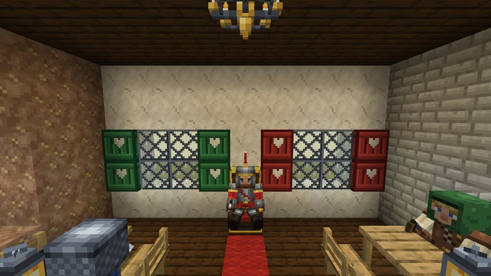
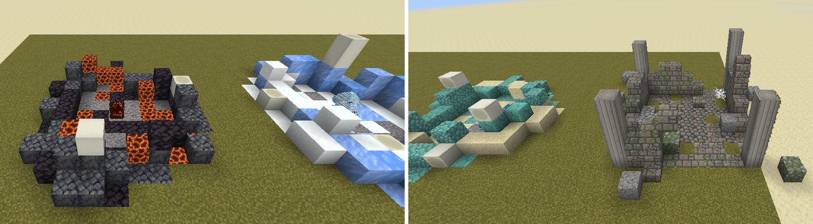

# Kingdoms at War – Dragon Warfare


Eine eigene, mittelalterliche Minecraft-Mod für **Minecraft Java 26.3** mit **NeoForge**.
Brüte Dracheneier aus und reite deinen eigenen Drachen, wirb Ritter und Soldaten an, baue deine Burg mit neuen
Steinen, Fenstern, Möbeln und Zinnen, finde Drachennester und Burgruinen – und begegne Trollen, Lindwürmern und
Irrlichtern.

> **Testversion 0.2.0 – Phase 2.**
> Drachen, Soldaten, wilde Kreaturen, Ausrüstung, Magie, Bauwerke, neue Bau-Blöcke, Essen und ein erzähltes Intro.
> Alles läuft auf einem echten Minecraft-26.3-Server und besteht die automatischen Tests (35 GameTests).

Das vollständige Konzept steht in [docs/KONZEPT.md](docs/KONZEPT.md) (mit allen Konzeptbildern).



---

## Entwicklungsstand

| Bereich | Stand |
|---|---|
| NeoForge-Projekt für Minecraft 26.3, Java 25, Gradle; Build und Tests auf GitHub | ✅ fertig |
| Erzähltes Intro beim ersten Betreten einer Welt (Kameraflug mit Drachen, Musik, Erzähler DE/EN) | ✅ fertig |
| Sechs Drachenarten: Ausbrüten, fünf Wachstumsstufen, Zähmen, Reiten, Fliegen, Odem, Drachenpanzer | ✅ fertig |
| Ritter und Soldaten: Rekrutierungstisch, Befehle mit dem Kommandostab, Banditen | ✅ fertig |
| Wilde Kreaturen: Wildschwein, Rothirsch, Gans, Irrlicht, Höhlentroll, Lindwurm | ✅ fertig |
| Erze mit Bestimmung: Stahl, Konterit, Aetherit, Draconium, Wyvernit, Edelstein | ✅ fertig |
| Ausrüstung: Stahl, Konterit, Draconium, Drachenschuppen (mit Set-Bonus), Gleiter, Krone, Trollkeule | ✅ fertig |
| Magie: Aetherit-Stab mit sechs Runen | ✅ fertig |
| Bauen: Steine, Dächer, Fachwerk, Putz, Bleiglas, Burgtür, Fensterläden, Laternen, Kronleuchter, Zinnen, Möbel | ✅ fertig |
| Landwirtschaft: sieben Feldfrüchte, Gerichte, Getränke, Festmahl, Zierblumen | ✅ fertig |
| Bauwerke in der Welt: Drachennester (6 Arten), Burgruinen mit Beute | ✅ fertig |
| Deutsch und Englisch | ✅ fertig |
| Dragon Architect (Gebäude scannen, NPCs bauen lassen, .litematic/.schem/.nbt) | ⏳ Phase 3 |
| Belagerungswaffen, Fahrzeuge, Kriegssystem, Modrinth-Veröffentlichung | ⏳ Phase 5 |

---

## Herunterladen und spielen

**Voraussetzungen**

- Minecraft Java Edition **26.3**
- **NeoForge 26.3.0.98** oder neuer ([NeoForge-Installer](https://neoforged.net/))
- Java 25 – bringt der Minecraft-Launcher automatisch mit

**Die Test-JAR bekommen**

1. Auf GitHub oben auf **Actions** klicken.
2. Den neuesten erfolgreichen Lauf von **Build** öffnen (grüner Haken).
3. Unten bei **Artifacts** die Datei **kingdomsatwar-0.2.0.jar** herunterladen
   (dafür musst du bei GitHub angemeldet sein).

Sobald es ein Release gibt, liegt die JAR auch dauerhaft unter **Releases**.

**Installieren**

1. NeoForge für 26.3 installieren und das NeoForge-Profil einmal im Launcher starten.
2. Die Datei `kingdomsatwar-0.2.0.jar` in den Ordner `mods` kopieren
   (Windows: `%appdata%\.minecraft\mods`).
3. Minecraft mit dem NeoForge-Profil starten und eine **neue** Welt anlegen: Erze, Kreaturen, Blumen,
   Drachennester und Burgruinen entstehen nur in neu erzeugten Gebieten.

Beim ersten Betreten einer Welt läuft das **Intro**: ein Kameraflug über die Welt, die sechs Drachen und dein
Königreich, mit eigener Musik und Erzähler. Überspringen mit Leertaste, Enter oder Esc, wieder ansehen mit `/kaw intro`.
Im Kreativmodus gibt es sechs neue Tabs.

---

## Inhalte

### Drachen


| Drachenart | Ei-Rezept: 4 Drachenei-Fragmente im Kreuz um … | Zum Ausbrüten … | Odem |
|---|---|---|---|
| Feuerdrache | Magmablock | nahe Lava oder Feuer legen | Flammen, setzen in Brand |
| Eisdrache | Blaueis | auf Eis oder Schnee legen | Frost, verlangsamt und lässt erstarren |
| Blitzdrache | Blitzableiter | bei Gewitter oder neben einem Blitzableiter | Funken und Blitzschläge |
| Naturdrache | Moosblock | im Hellen auf Gras, nahe Pflanzen | Sporen, vergiften |
| Erddrache | Roheisenblock | unter der Erde auf Stein | Geröll, wirft zurück und lähmt |
| Wasserdrache | Prismarin | unter Wasser | Wasserstrahl, wirft zurück und löscht Feuer |

- **Drachenei-Fragment:** Draconium + Aetherit + Konterit + Edelstein (formlos). Dracheneier liegen auch in
  **Drachennestern** in der Welt.
- Ein Ei bekommt Risse und schlüpft, wenn es am richtigen Ort liegt; der Schlüpfling gehört dem nächsten Spieler.
- **Fünf Wachstumsstufen:** Schlüpfling, Jungdrache, Halbwüchsiger (kann fliegen und Odem speien), Ausgewachsen
  (reitbar), Uralt. Füttern mit Fleisch oder **Drachenfutter** (rohes Rind-, Schweine- und Hammelfleisch + Süßbeeren,
  ergibt 2) lässt ihn schneller wachsen und heilt ihn.
- Wilde Schlüpflinge lassen sich mit etwas Glück mit **Edelsteinen** zähmen. Ausgewachsene wilde Drachen greifen an!
- **Schleichen + Rechtsklick:** folgen / sitzen / frei umherstreifen. **Rechtsklick** auf einen ausgewachsenen
  Drachen: aufsitzen. Springen zum Abheben und Steigen, Schleichen zum Sinken, **R** speit Odem.
- **Drachenpanzer** aus Stahl oder Draconium (feuerfest) für ausgewachsene Drachen; mit der Schere abnehmen.
- **Drachenschuppen** fallen von Drachen und liegen in Drachennestern (mit dem Pinsel freilegen).

### Ritter und Soldaten


Am **Rekrutierungstisch** (2 Smaragde, Buch, 3 Bretter, 2 Stöcke) wirbst du Soldaten an:

| Soldat | Preis | Rolle |
|---|---|---|
| Schwertkämpfer | 5 Smaragde | Nahkämpfer – das Rückgrat jeder Armee |
| Bogenschütze | 7 Smaragde | Fernkämpfer, schießt nie auf Freunde |
| Ritter | 12 Smaragde + 2 Stahlbarren | Plattenrüstung und Schild, hält die vorderste Reihe |
| Hauptmann | 20 Smaragde + 1 Edelstein | macht Soldaten in seiner Nähe stärker |

Mit dem **Kommandostab** gibst du Befehle: auf einen Feind zeigen = Angriff, auf den Boden zeigen = Stellung halten
(Schleichen: Patrouille), in den Himmel zeigen = alle folgen, Schleichen + eigenen Soldaten anklicken = entlassen.
Soldaten nehmen Waffen und Rüstung an, die du ihnen gibst, und verletzen weder dich noch deine Tiere und Drachen.
**Banditen** streifen nachts durch die Lande und hausen manchmal in Burgruinen.

### Wilde Kreaturen


| Kreatur | Lebensraum | Besonderheit | Beute |
|---|---|---|---|
| Wildschwein | Wälder, Taiga | greift an, wenn man es reizt | Schweinefleisch, Leder |
| Rothirsch | Wälder, Wiesen | scheu, Hirsche mit Geweih | Wildbret, Leder |
| Gans | Flüsse, Sümpfe, Ebenen | grau oder weiß, legt Federn, faucht | Federn, Geflügel |
| Irrlicht | Sümpfe, dunkle Wälder (nachts) | leuchtet, weicht aus, verblasst am Morgen | Irrlichtstaub |
| Höhlentroll | tief unter der Erde | riesig und stark, versteinert im Sonnenlicht | Leder, Eisenklumpen, selten Edelstein oder Trollkeule |
| Lindwurm | Berge, Tafelländer | flügelloser Drache, Biss und Schwanzhieb | Erddrachen-Schuppen, selten Draconium |

### Erze und Rohstoffe

| Erz | Fundort | Werkzeug | Verwendung |
|---|---|---|---|
| Kohlenstofferz | überall, Höhe 0 bis 192 | jede Spitzhacke | Brennstoff, **Stahl** |
| Edelstein-Erz | tief, Höhe −64 bis 16 | Eisenspitzhacke | Drachenei-Fragmente, Königskrone, Hauptleute, Drachen zähmen |
| Konteriterz | Berge, um Höhe 150 | Eisenspitzhacke | leichte **Konteritrüstung** |
| Aetheriterz (leuchtet) | Höhe −48 bis 48 | Eisenspitzhacke | **Magie**: Aetherit-Stab, Runen, Aetheritlaterne |
| Draconiumerz (leuchtet) | ganz tief, sehr selten | Diamantspitzhacke | **Draconium-Waffen** (setzen in Brand), Drachenpanzer |
| Wyverniterz | hohe Berge, ab Höhe 100 | Eisenspitzhacke | **Wyvernit-Gleiter** |

**Stahl:** 1 Eisenbarren + 2 Kohlenstoff → Stahlmischung → im Hochofen → Stahlbarren (auch Kohlenstoff aus Holzkohle).
Aus 9 Rohstoffen wird jeweils ein Speicherblock.

### Ausrüstung


- **Stahl:** Werkzeuge, Schwert und Rüstung – stärker als Eisen.
- **Konteritrüstung:** leicht, je Teil +4 % Tempo und sanftere Stürze.
- **Draconiumschwert und -axt:** mit Lohenruten als Griff, setzen Gegner in Brand.
- **Drachenschuppen-Rüstung** (6 Arten) mit Set-Bonus: Feuerresistenz (Feuer), Tempo und Frostschutz (Eis),
  doppeltes Tempo (Blitz), Regeneration (Natur), Resistenz (Erde), Wasseratmung und Delfinsgunst (Wasser).
- **Wyvernit-Gleiter:** gleitet wie Elytren. **Königskrone:** Glück +2. **Trollkeule:** schwer, schleudert Gegner weg.

### Magie


Der **Aetherit-Stab** (Aetherit, Irrlichtstaub, Stöcke) wirkt per Rechtsklick einen **Aether-Blitz**.
Hältst du eine **Rune** in der anderen Hand, wirkt er stattdessen deren Zauber:

| Rune | Zutat (+ Tiefenschiefer, Aetherit, Irrlichtstaub) | Zauber |
|---|---|---|
| Feuerrune | Lohenstaub | Feuerball (verbrennt Wesen, aber keine Blöcke) |
| Eisrune | Packeis | Frosthauch: verlangsamt, lässt erstarren, friert Wasser |
| Blitzrune | Kupferbarren | ruft einen Blitz herab |
| Naturrune | Moosblock | heilt dich und deine Verbündeten, Pflanzen sprießen |
| Erdrune | Roheisen | Erdstoß: schleudert Feinde fort |
| Wasserrune | Prismarinscherbe | Woge: drängt zurück, löscht Feuer, Wasseratmung |

Zauber kosten Haltbarkeit und brauchen eine kurze Pause. Reparatur mit Aetherit; Haltbarkeit und Reparatur lassen sich
anverzaubern.

### Bauen und Einrichten


| Baustoff | Herstellung | Varianten |
|---|---|---|
| Mittelalterlicher Stein, Grober Naturstein, Behauener Sandstein, Dunkle Steinziegel, Helle Kalksteinziegel, Verwitterte Steinziegel, Moosige Mauersteine, Gerissene Steinblöcke | Steinmetz aus Vanilla-Gestein | Treppe, Stufe, Mauer |
| Rote, braune und helle Dachziegel, Dunkle Schieferplatten, Holzschindeln, Kupferdach | Steinmetz bzw. Werkbank | Treppe, Stufe |
| Steinpfeiler, Holzbalken, Fachwerk (gerade, diagonal, Kreuz) | Werkbank / Steinmetz | – |
| Kalkputz (Sand, Ton, Knochenmehl) und Lehmputz (Ton, Erde, Weizen) | Werkbank (ergibt 4) | Treppe, Stufe |
| Bleiglas (8 Glas + Eisenklumpen) und Bleiglasscheiben | Werkbank | – |
| Burgtür (Bretter mit einem Eisenband), grüne und rote Fensterläden mit Herz | Werkbank | – |
| Stahllaterne, Aetheritlaterne, Kronleuchter mit acht Kerzen | Werkbank | – |
| Zinnen aus mittelalterlichem Stein, dunklen Steinziegeln oder hellen Kalksteinziegeln | Werkbank / Steinmetz | – |
| Eichenstuhl, Eichenbank, Eichentisch (verbindet sich zur Tafel), Thron | Werkbank | – |

Auf **Stühle, Bänke und den Thron** setzt man sich per Rechtsklick. **Zinnen** in einer Reihe ergeben von selbst
Zahn und Scharte. Der **Kronleuchter** hängt an der Decke.

### Landwirtschaft und Nahrung


- **Feldfrüchte:** Tomaten, Kohl, Gerste, Zwiebeln, **Hopfen**, **Weintrauben** und **Knoblauch** – Samen und
  Pflanzknollen fallen manchmal beim Abbauen von Gras, Bauern-Dorfbewohner bauen sie an.
- **Gerichte:** Brötchen, Gemüseeintopf, Fleischpastete, Apfelkuchen, Knoblauchbrot, Wildbret.
- **Getränke** (die Flasche bleibt übrig): **Bier** (Gerste, Hopfen) macht stark, **Rotwein** (Trauben) heilt langsam,
  **Met** (Honigwaben, Hopfen) schenkt Extraherzen – wer zu viel trinkt, dem wird schwindelig.
- **Festmahl:** ein Braten mit Beilagen auf einem Brett für die Tafel – vier üppige Portionen, direkt vom Tisch.
- **Zierblumen** (wachsen wild, passen in Blumentöpfe): Lavendel, Gartenrose, Feuerlilie, Frostblume und die
  **Mondblume**, die nachts leuchtet.

### Bauwerke in der Welt



- **Drachennester** aller sechs Arten (Badlands, verschneite Gipfel, hohe Berge, Dschungel, geröllige Hügel,
  Strände): ein Wall aus dem Nestmaterial, Knochen, Fundstücke im Kies (mit dem Pinsel freilegen), oft Dracheneier –
  und manchmal ein wilder Drache als Wächter.
- **Burgruinen** in Ebenen, Wäldern und der Taiga: verfallene Mauern mit Ecktürmen und Zinnen, eine Truhe mit Beute
  (Vorräte, Stahl, Edelsteine, mit Glück Runen, der Aetherit-Stab oder die Königskrone) – und manchmal Banditen.

---

## Befehle, Tasten, Einstellungen

| | |
|---|---|
| `/kaw intro` | das Intro noch einmal ansehen |
| `/kaw army <swordsman\|archer\|knight\|captain> [Anzahl]` | (nur Operatoren) Soldaten sofort in den Dienst stellen, z. B. `/kaw army knight 4` |
| **R** | Drachenodem beim Reiten (änderbar unter Optionen → Steuerung) |
| `showIntro` (Client) | Intro beim ersten Betreten einer Welt zeigen (Standard: an) |
| `armyLimit` (Server) | höchstens so viele Soldaten je Spieler (Standard: 32) |

---

## Für Entwickler

Das Projekt ist ein normales NeoForge-Projekt mit [ModDevGradle](https://github.com/neoforged/ModDevGradle).

| Befehl | Wirkung |
|---|---|
| `./gradlew build` | Mod bauen → `build/libs/kingdomsatwar-0.2.0.jar` |
| `./gradlew runClient` | Minecraft mit der Mod zum Testen starten |
| `./gradlew runData` | Modelle, Rezepte, Loot-Tables, Tags, Weltgenerierung und Übersetzungen neu erzeugen |
| `./gradlew runGameTestServer` | Automatische Tests in einem Minecraft-Server ausführen |
| `python3 tools/generate_textures.py` | Alle Texturen neu zeichnen (`--preview datei.png` für eine Übersicht) |
| `python3 tools/generate_entities.py` | Modelle und Texturen der Lebewesen neu erzeugen |
| `python3 tools/audio/build_audio.py` | Musik, Intro-Zeitplan und Stimmen neu bauen (siehe `tools/audio/README.md`) |

Unter Windows statt `./gradlew` einfach `gradlew.bat` verwenden. Java 25 wird benötigt (lädt Gradle bei Bedarf selbst).

**Aufbau**

```
src/main/java/io/github/sirschrolli/kingdomsatwar/
├── KingdomsAtWar.java        Hauptklasse der Mod
├── registry/                 Blöcke, Gegenstände, Lebewesen, Geräusche, Kreativ-Tabs, Tags
├── block/                    eigene Blöcke (Drachenei, Möbel, Zinne, Kronleuchter, Festmahl …)
├── entity/                   Drachen, Soldaten, Banditen, wilde Kreaturen, Sitz
├── dragon/  army/  magic/    Drachenarten, Rekrutierung und Befehle, Zauber
├── item/                     besondere Ausrüstung
├── worldgen/                 Erzadern, Blumen, Drachennester, Burgruinen
├── client/                   Modelle, Renderer, Intro, Oberflächen
├── datagen/                  Datengenerierung (erzeugt src/generated/resources)
└── gametest/                 automatische Tests
src/main/resources/           Texturen, Geräusche, Musik, Intro
src/generated/resources/      von runData erzeugte Dateien (nicht von Hand bearbeiten)
tools/                        Skripte für Texturen, Modelle, Audio und Teststruktur
docs/                         Konzept und Bilder
```

Bei jedem Push baut GitHub Actions die Mod, führt die Datengenerierung und die GameTests aus
und stellt die JAR als Artefakt bereit (`.github/workflows/build.yml`).
Ein Tag wie `v0.2.0` erzeugt automatisch ein Release mit der JAR (`.github/workflows/release.yml`).

---

## Nächste Schritte (aus dem Konzept)

1. **Phase 3 – Dragon Architect:** Bereiche markieren, Bauvorlagen speichern, NPC-Bauarbeiter (Block für Block oder
   abschnittsweise), Import von `.nbt`, `.schem` und `.litematic`.
2. **Phase 5 – Gesamtsystem:** Kriegssystem mit Belagerungswaffen und Fahrzeugen, alles verbinden, Modpack
   zusammenstellen, Modrinth.

## Danksagung

- **Erzählerstimme:** erzeugt mit dem freien Sprachmodell [Qwen3-TTS](https://github.com/QwenLM/Qwen3-TTS)
  (Apache-2.0) – eine eigens beschriebene, künstliche Stimme, keine echte Person.
- **Soldatenstimmen:** erzeugt mit der freien Sprachsynthese [Piper](https://github.com/rhasspy/piper).
  Deutsche Stimmen: [Thorsten-Voice](https://github.com/thorstenMueller/Thorsten-Voice) von Thorsten Müller (CC0).
  Englische Stimmen: Piper-Stimme „libritts_r“, trainiert auf [LibriTTS-R](https://www.openslr.org/141/)
  (CC BY 4.0, Y. Koizumi u. a.; Sprecher 680, 248 und 788).
- **Musik:** eigene Komposition, gespielt mit dem Soundfont FluidR3_GM von Frank Wen (MIT-Lizenz).
- **Geräusche der Lebewesen:** nutzen die Original-Geräusche von Minecraft mit veränderter Tonhöhe;
  es werden keine Minecraft-Dateien mitgeliefert (siehe `tools/sound_events.py`).

## Lizenz

Alle Rechte vorbehalten (siehe `mod_license` in `gradle.properties` – kann vor einer Veröffentlichung geändert werden).
Die Texturen sind eigene Pixelkunst; es werden keine Original-Minecraft-Dateien mitgeliefert.
