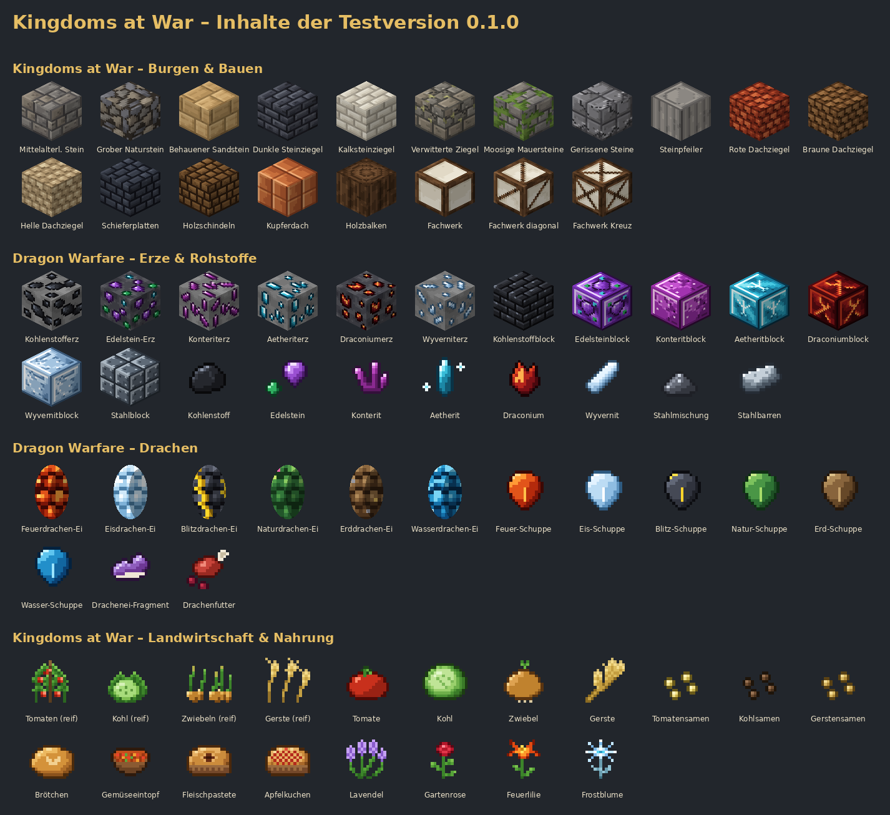

# Kingdoms at War – Dragon Warfare


Eine eigene, mittelalterliche Minecraft-Mod für **Minecraft Java 26.3** mit **NeoForge**.
Baue dein Königreich, sammle Drachenerze, bereite dich auf die Drachen vor – und später auf Armeen,
Belagerungen und NPC-Baumeister.

> **Testversion 0.1.0 – Phase 1 („Technische Grundlage“).**
> Das Grundprojekt lässt sich bauen, läuft auf einem echten Minecraft-26.3-Server und besteht alle automatischen Tests.
> Drachen als Lebewesen, NPCs, Armeen und das Bausystem folgen in den nächsten Phasen.

Das vollständige Konzept steht in [docs/KONZEPT.md](docs/KONZEPT.md) (mit allen Konzeptbildern).



---

## Entwicklungsstand

| Bereich | Stand |
|---|---|
| NeoForge-Projekt für Minecraft 26.3, Java 25, Gradle | ✅ fertig |
| Automatischer Build + Tests auf GitHub | ✅ fertig |
| Neue Erze mit Weltgenerierung, Rohstoffe, Stahl | ✅ fertig |
| Sechs Dracheneier, Drachenschuppen, Drachenei-Fragmente, Drachenfutter | ✅ fertig (Ausbrüten folgt in Phase 4) |
| Mittelalterliche Baublöcke (Stein, Dächer, Fachwerk) mit Treppen, Stufen, Mauern | ✅ erster Teil |
| Feldfrüchte, Gerichte, Zierblumen (wachsen auch wild) | ✅ erster Teil |
| Deutsch und Englisch | ✅ fertig |
| NPCs, Soldaten, Rekrutierung mit Smaragden | ⏳ Phase 2 |
| Dragon Architect (Gebäude scannen, NPCs bauen lassen, .litematic/.schem/.nbt) | ⏳ Phase 3 |
| Drachen (Ausbrüten, 5 Wachstumsstufen, Zähmen, Reiten, Fliegen) | ⏳ Phase 4 |
| Belagerungswaffen, Fahrzeuge, weitere Mobs, Modrinth-Veröffentlichung | ⏳ Phase 5 |

---

## Herunterladen und spielen

**Voraussetzungen**

- Minecraft Java Edition **26.3**
- **NeoForge 26.3.0.98** oder neuer ([NeoForge-Installer](https://neoforged.net/))
- Java 25 – bringt der Minecraft-Launcher automatisch mit

**Die Test-JAR bekommen**

1. Auf GitHub oben auf **Actions** klicken.
2. Den neuesten erfolgreichen Lauf von **Build** öffnen (grüner Haken).
3. Unten bei **Artifacts** die Datei **kingdomsatwar-0.1.0.jar** herunterladen
   (dafür musst du bei GitHub angemeldet sein).

Sobald es ein Release gibt, liegt die JAR auch dauerhaft unter **Releases**.

**Installieren**

1. NeoForge für 26.3 installieren und das NeoForge-Profil einmal im Launcher starten.
2. Die Datei `kingdomsatwar-0.1.0.jar` in den Ordner `mods` kopieren
   (Windows: `%appdata%\.minecraft\mods`).
3. Minecraft mit dem NeoForge-Profil starten. Im Kreativmodus gibt es vier neue Tabs.

> Tipp: Die neuen Erze und wilden Blumen entstehen nur in neu erzeugten Gebieten. Am einfachsten testest du die Mod in einer **neuen** Welt.

---

## Inhalte der Testversion

### Dragon Warfare – Erze und Rohstoffe

| Erz | Fundort | Werkzeug | Ergibt | Verwendung |
|---|---|---|---|---|
| Kohlenstofferz | überall, Höhe 0 bis 192 | jede Spitzhacke | Kohlenstoff | Brennstoff, zählt als Kohle (z. B. für Fackeln), Stahl |
| Edelstein-Erz | tief, Höhe −64 bis 16 | Eisenspitzhacke | Edelstein | Drachenei-Fragmente, Deko |
| Konteriterz | Berge, Höhe −16 bis 320 (meist um 150) | Eisenspitzhacke | Konterit | Drachenei-Fragmente, später Flugausrüstung |
| Aetheriterz (leuchtet leicht) | Höhe −48 bis 48 | Eisenspitzhacke | Aetherit | Drachenei-Fragmente, später Magie |
| Draconiumerz (leuchtet) | ganz tief, Höhe −64 bis 8 (meist um −36), sehr selten | Diamantspitzhacke | Draconium | Drachenei-Fragmente, später Drachenrüstung |
| Wyverniterz | hohe Berge, ab Höhe 100 | Eisenspitzhacke | Wyvernit | später Flugtechnik |

Alle Erze gibt es in Stein und als Tiefenschiefer-Variante (außer Wyvernit). Tiefenschiefer liegt nur unterhalb von Höhe 8:
Erze, die vor allem weiter oben vorkommen (Kohlenstoff, Konterit), sind in Tiefenschiefer darum selten –
Draconium steckt dagegen fast immer im Tiefenschiefer. Aus 9 Rohstoffen wird jeweils ein Speicherblock.
Glück (Fortune) erhöht die Ausbeute, Behutsamkeit (Silk Touch) liefert den Erzblock.

**Stahl:** 1 Eisenbarren + 2 Kohlenstoff → Stahlmischung → im Hochofen → Stahlbarren. 9 Stahlbarren → Stahlblock.
Kohlenstoff gibt es auch aus Holzkohle (Hochofen).

### Dragon Warfare – Drachen

| Drachenart | Ei-Rezept: 4 Drachenei-Fragmente im Kreuz um … |
|---|---|
| Feuerdrache | Magmablock |
| Eisdrache | Blaueis |
| Blitzdrache | Blitzableiter |
| Naturdrache | Moosblock |
| Erddrache | Roheisenblock |
| Wasserdrache | Prismarin |

- **Drachenei-Fragment:** Draconium + Aetherit + Konterit + Edelstein (formlos).
- **Drachenfutter:** rohes Rindfleisch, rohes Schweinefleisch, rohes Hammelfleisch und Süßbeeren (formlos, ergibt 2).
  Damit werden in Phase 4 die Drachen gezähmt.
- **Drachenschuppen** (6 Arten) gibt es vorerst nur im Kreativmodus; mit den Drachen in Phase 4 werden sie für Rüstungen wichtig.
- Die Eier lassen sich setzen und abbauen und gehen auch bei Explosionen nicht verloren. Das Ausbrüten kommt mit dem Drachensystem.

### Kingdoms at War – Burgen und Bauen

| Baustoff | Herstellung | Varianten |
|---|---|---|
| Mittelalterlicher Stein | Steinmetz aus Stein oder Bruchstein | Treppe, Stufe, Mauer |
| Grober Naturstein | Steinmetz aus Bruchstein, oder 2 Bruchstein + 2 Kies (ergibt 4) | Treppe, Stufe, Mauer |
| Behauener Sandstein | Steinmetz aus Sandstein oder geschnittenem Sandstein | Treppe, Stufe, Mauer |
| Dunkle Steinziegel | Steinmetz aus Tiefenschiefer oder Bruchtiefenschiefer | Treppe, Stufe, Mauer |
| Helle Kalksteinziegel | Steinmetz aus Kalzit | Treppe, Stufe, Mauer |
| Verwitterte Steinziegel | Steinmetz aus Steinziegeln oder Stein | Treppe, Stufe, Mauer |
| Moosige Mauersteine | Steinmetz aus bemoosten Steinziegeln oder bemoostem Bruchstein | Treppe, Stufe, Mauer |
| Gerissene Steinblöcke | Steinmetz aus rissigen Steinziegeln oder Stein | Treppe, Stufe, Mauer |
| Steinpfeiler | 2 mittelalterliche Steine übereinander (ergibt 2), oder Steinmetz aus Stein bzw. mittelalterlichem Stein | – |
| Rote Dachziegel | Steinmetz aus roter Keramik oder Ziegelsteinen, oder 5 Ziegel in U-Form (ergibt 4) | Treppe, Stufe |
| Braune Dachziegel | Steinmetz aus brauner Keramik | Treppe, Stufe |
| Helle Dachziegel | Steinmetz aus weißer oder hellgrauer Keramik | Treppe, Stufe |
| Dunkle Schieferplatten | Steinmetz aus Tiefenschieferfliesen oder Bruchtiefenschiefer | Treppe, Stufe |
| Holzschindeln | 4 Holzstufen im Quadrat (ergibt 4) | Treppe, Stufe |
| Kupferdach | Steinmetz aus Kupferblock (ergibt 4) | Treppe, Stufe |
| Holzbalken | 2 Stämme übereinander (ergibt 4) | – |
| Fachwerk (gerade, diagonal, Kreuz) | Holzbalken + Kalzit (ergibt 2); Muster durch erneutes Herstellen wechseln | – |

Treppen, Stufen und Mauern gehen auch an der Werkbank mit den üblichen Vanilla-Mustern.
Holzbalken, Fachwerk und Holzschindeln fangen Feuer; Holzbalken und Holzschindeln taugen auch als Brennstoff im Ofen.

### Kingdoms at War – Landwirtschaft und Nahrung

- **Tomaten, Kohl, Gerste, Zwiebeln:** Samen fallen manchmal beim Abbauen von Gras.
  Dorfbewohner mit dem Beruf Bauer pflanzen die neuen Samen ebenfalls an. Aus Tomaten und Kohl lassen sich wieder Samen herstellen.
- **Brötchen:** 2 Gerste nebeneinander (ergibt 2). **Gemüseeintopf:** Tomate, Kohl, Zwiebel, Karotte, Schüssel.
  **Fleischpastete:** Steak, Zwiebel, Weizen, Ei. **Apfelkuchen:** 2 Äpfel, Zucker, Ei, Weizen.
  Für die Rezepte mit Ei passt jede Eier-Sorte.
- **Zierblumen** (wachsen wild, passen in Blumentöpfe):
  Lavendel (Ebenen), Gartenrose (Wälder), Feuerlilie (Savannen), Frostblume (verschneite Gebiete).

---

## Für Entwickler

Das Projekt ist ein normales NeoForge-Projekt mit [ModDevGradle](https://github.com/neoforged/ModDevGradle).

| Befehl | Wirkung |
|---|---|
| `./gradlew build` | Mod bauen → `build/libs/kingdomsatwar-0.1.0.jar` |
| `./gradlew runClient` | Minecraft mit der Mod zum Testen starten |
| `./gradlew runData` | Modelle, Rezepte, Loot-Tables, Tags, Weltgenerierung und Übersetzungen neu erzeugen |
| `./gradlew runGameTestServer` | Automatische Tests in einem Minecraft-Server ausführen |
| `python3 tools/generate_textures.py` | Alle Texturen neu zeichnen (`--preview datei.png` für eine Übersicht) |
| `python3 tools/render_showcase.py` | Übersichtsbild `docs/bilder/inhalte-phase-1.png` neu erzeugen |

Unter Windows statt `./gradlew` einfach `gradlew.bat` verwenden. Java 25 wird benötigt (lädt Gradle bei Bedarf selbst).

**Aufbau**

```
src/main/java/io/github/sirschrolli/kingdomsatwar/
├── KingdomsAtWar.java        Hauptklasse der Mod
├── registry/                 Blöcke, Gegenstände, Kreativ-Tabs, Tags
├── block/                    eigene Blockklassen (Drachenei, Feldfrucht)
├── dragon/                   die sechs Drachenarten
├── worldgen/                 Erzadern und wilde Blumen
├── loot/                     eigene Loot-Tables
├── datagen/                  Datengenerierung (erzeugt src/generated/resources)
└── gametest/                 automatische Tests
src/main/resources/           Texturen, Logo, Teststruktur
src/generated/resources/      von runData erzeugte Dateien (nicht von Hand bearbeiten)
tools/                        Skripte für Texturen und Teststruktur
docs/                         Konzept und Konzeptbilder
```

Bei jedem Push baut GitHub Actions die Mod, führt die Datengenerierung und die GameTests aus
und stellt die JAR als Artefakt bereit (`.github/workflows/build.yml`).
Ein Tag wie `v0.1.0` erzeugt automatisch ein Release mit der JAR (`.github/workflows/release.yml`).

---

## Nächste Schritte (aus dem Konzept)

1. **Phase 2 – NPCs und Gebäude:** erste NPCs und Soldaten, einfache KI, Rekrutierung mit Smaragden, erste Gebäude und Befehle (`/kaw`).
2. **Phase 3 – Dragon Architect:** Bereiche markieren, Bauvorlagen speichern, NPC-Bauarbeiter (Block für Block oder abschnittsweise), Import von `.nbt`, `.schem` und `.litematic`.
3. **Phase 4 – Drachen:** Ausbrüten, fünf Wachstumsstufen, Zähmen, Reiten, Fliegen, Drachen-KI; weitere Mobs, Pflanzen und Gerichte.
4. **Phase 5 – Gesamtsystem:** Kriegssystem mit Belagerungswaffen und Fahrzeugen, alles verbinden, Modpack zusammenstellen, Modrinth.

## Lizenz

Alle Rechte vorbehalten (siehe `mod_license` in `gradle.properties` – kann vor einer Veröffentlichung geändert werden).
Die Texturen sind eigene Pixelkunst; es werden keine Original-Minecraft-Dateien mitgeliefert.
