# Kingdoms at War – Dragon Warfare


Eine eigene, mittelalterliche Minecraft-Mod für **Minecraft Java 26.3** mit **NeoForge**.
Vor langer Zeit verschlossen sechs Elementardrachen die **Schattenwelt** – jeder trägt ein Sechstel des Siegels in
seinem Herzen. Gründe dein Königreich, wirb Ritter und Soldaten an, baue deine Burg, spüre die riesigen Nester der
Drachen auf und bezwinge sie. Aus jedem besiegten Drachen bleibt ein Ei, aus dem dein eigener Drache schlüpft – und
ein Splitter des Siegels. Der sechste Splitter bricht das Siegel …

> **Testversion 0.7.0 – Die neue Oberwelt.**
> Die Geschichte mit Chronik, Kapiteln und Siegelkreis, **sechs riesige Drachen-Bosse** mit eigenem Körperbau,
> eigenen Angriffen und je einem gewaltigen Nest in einem eigenen Biom, **Nyxar, der Schattendrache**, in seiner
> Schattenzitadelle und die Bauwerke der Schattenwelt, die **Wirtschaft** mit Münzen, Stadt, Bürgern, Handel und
> Krönung, die **Magie** mit sechs Erzmagiern in ihren Magiertürmen – dazu Drachen zum Reiten, Soldaten, Kreaturen,
> Ausrüstung, Bau-Blöcke, Essen und das erzählte Intro.
> Neu in 0.7: **acht eigene Biome** in jeder neuen Welt – Aschefelder, Frostgipfel, Sturmküste, Urhain,
> Felsschluchten, Korallenküste, Königsauen und Nebelmoor –, jedes mit eigenem Boden, eigenen Bäumen und Pflanzen,
> eigenen Farben, Partikeln und Klängen; dazu **Torf** und **Schilf** aus dem Moor.
> Alles läuft auf einem echten Minecraft-26.3-Server und besteht die automatischen Tests (70 GameTests).
> **Als Nächstes:** eigene Dörfer mit eigenen Bewohnern, eigene Tiere und Monster statt Vanilla, danach Nether und End.

Das Konzept steht in [docs/KONZEPT.md](docs/KONZEPT.md) (mit allen Konzeptbildern), die Geschichte und der Plan des
großen Umbaus in [docs/DAS_SIEGEL.md](docs/DAS_SIEGEL.md).

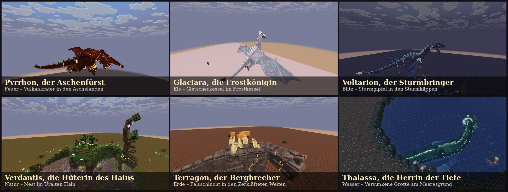

---

## Entwicklungsstand

| Bereich | Stand |
|---|---|
| NeoForge-Projekt für Minecraft 26.3, Java 25, Gradle; Build und Tests auf GitHub | ✅ fertig |
| Erzähltes Intro beim ersten Betreten einer Welt (Kameraflug mit Drachen, Musik, Erzähler DE/EN) | ✅ fertig |
| Geschichte „Das Siegel“: Chronik als Buch, Kapitel mit Titelkarten, Siegelkreis mit sechs Monolithen, Siegelbruch, Schattentor | ✅ fertig |
| Sechs Drachen-Bosse (je ca. 25 Blöcke), jeder mit eigenem Körperbau, eigener Erweckung, eigenen Angriffen und Bossleiste | ✅ fertig |
| Sechs riesige Nester – genau eins je Art und Welt – mit eigenem Biom und neuen Blöcken; Drachenkompass | ✅ fertig |
| Eigene Drachen: Eier nur von besiegten Bossen, fünf Wachstumsstufen, Reiten, Fliegen, Odem, Drachenpanzer | ✅ fertig |
| Ritter und Soldaten: Rekrutierungstisch, Befehle mit dem Kommandostab, Banditen | ✅ fertig |
| Wilde Kreaturen: Wildschwein, Rothirsch, Gans, Irrlicht, Höhlentroll, Lindwurm | ✅ fertig |
| Erze mit Bestimmung: Stahl, Konterit, Aetherit, Draconium, Wyvernit, Edelstein | ✅ fertig |
| Ausrüstung: Stahl, Konterit, Draconium, Drachenschuppen (mit Set-Bonus), Gleiter, Krone, Trollkeule | ✅ fertig |
| Magie: Aetherit-Stab, sieben Zauber in drei Stufen, Zaubertafeln, Magietisch, Zauberkreis (Radialmenü) | ✅ fertig |
| Sechs Erzmagier als Bosse, jeder in seinem eigenen Magierturm (sechs Bauweisen, je Element im passenden Land) | ✅ fertig |
| Bauen: Steine, Dächer, Fachwerk, Putz, Bleiglas, Burgtür, Fensterläden, Laternen, Kronleuchter, Zinnen, Möbel | ✅ fertig |
| Landwirtschaft: sieben Feldfrüchte, Gerichte, Getränke, Festmahl, Zierblumen | ✅ fertig |
| Deutsch und Englisch | ✅ fertig |
| Schattenwelt: eigene Dimension mit Biomen, Schattenvolk und Dörfern, Erzen, Kreaturen; Nyxar und seine Schattenzitadelle | ✅ fertig |
| Bauwerke der Schattenwelt: Mondtempel mit Gruft, Kristallminen, Mondleuchttürme, Ruinen der alten Welt, Felsbrücken | ✅ fertig |
| Wirtschaft: Münzen, Stadtbanner, Bürger mit acht Berufen, Baumeister und zwölf Gebäude, Handel, Ansehen, Krönung | ✅ fertig |
| Acht eigene Oberwelt-Biome mit eigenem Boden, eigenen Bäumen, Pflanzen, Felsen, Farben und Klängen | ✅ fertig |
| Eigene Dörfer und Bewohner, eigene Tiere und Monster statt Vanilla, keine Vanilla-Bauwerke; Nether und End | 🔨 in Arbeit |
| Dragon Architect, Belagerungswaffen, Kriegssystem, Modrinth-Veröffentlichung | ⏳ später |

---

## Herunterladen und spielen

**Voraussetzungen**

- Minecraft Java Edition **26.3**
- **NeoForge 26.3.0.98** oder neuer ([NeoForge-Installer](https://neoforged.net/))
- Java 25 – bringt der Minecraft-Launcher automatisch mit

**Die Test-JAR bekommen**

1. Auf GitHub oben auf **Actions** klicken.
2. Den neuesten erfolgreichen Lauf von **Build** öffnen (grüner Haken).
3. Unten bei **Artifacts** die Datei **kingdomsatwar-0.7.0.jar** herunterladen
   (dafür musst du bei GitHub angemeldet sein).

Sobald es ein Release gibt, liegt die JAR auch dauerhaft unter **Releases**.

**Installieren**

1. NeoForge für 26.3 installieren und das NeoForge-Profil einmal im Launcher starten.
2. Die Datei `kingdomsatwar-0.7.0.jar` in den Ordner `mods` kopieren
   (Windows: `%appdata%\.minecraft\mods`).
3. Minecraft mit dem NeoForge-Profil starten und eine **neue** Welt anlegen: Die neuen Biome gibt es nur in neu
   angelegten Welten; Erze, Kreaturen, Blumen, der Siegelkreis, die Drachennester und Burgruinen entstehen nur in neu
   erzeugten Gebieten.

Beim ersten Betreten einer Welt läuft das **Intro**: ein Kameraflug über die Welt, die sechs Drachen und dein
Königreich, mit eigener Musik und Erzähler. Überspringen mit Leertaste, Enter oder Esc, wieder ansehen mit `/kaw intro`.
Danach bekommst du die **Chronik des Siegels** – sie erzählt die Geschichte und zeigt dir den nächsten Schritt.
Im Kreativmodus gibt es sieben neue Tabs.

---

## Inhalte

### Die Geschichte: „Das Siegel“

Die **Chronik des Siegels** ist ein aufgeschlagenes Buch: links die Kapitel (erreicht, aktuell, noch verborgen) und
der Zustand des Siegels, rechts die Ziele des Kapitels, Hinweise und die Erzählung. Zu Beginn jedes Kapitels erscheint
eine Titelkarte.

| Kapitel | Was zu tun ist |
|---|---|
| Prolog | das Intro – die Welt, die Drachen, das Siegel |
| I Ein neues Königreich | mit dem Stadtbanner die Siedlung gründen und den ersten Bürger oder Soldaten anheuern |
| II Die Chronik des Siegels | den **Siegelkreis** finden (die Chronik verrät die Richtung) |
| III–VIII Die sechs Drachen | die Drachen in beliebiger Reihenfolge bezwingen und ihre Splitter einsetzen |
| IX Das Siegel bricht | der sechste Splitter öffnet das Tor in die Schattenwelt |

Der **Siegelkreis** liegt genau einmal pro Welt einige Hundert Blöcke vom Weltursprung entfernt auf ebenem Land:
eine runde Plattform aus Siegelstein mit sechs unzerstörbaren **Monolithen** – Gegensätze stehen sich gegenüber
(Feuer und Eis, Blitz und Wasser, Natur und Erde) – und dem großen Siegel in der Mitte. Jeder besiegte Drache
hinterlässt einen **Siegelsplitter**; in seinen Sockel eingesetzt, erwacht der Monolith und leuchtet in seiner Farbe.
**Der sechste Splitter bricht das Siegel:** Lichtsäulen, eine wachsende Lichtkugel, Risse, ein Blitz, eine
Druckwelle – und das Siegel wird zum **Schattentor**. Kapitel I und II gehören jedem Spieler selbst, die Drachen und
das Siegel der ganzen Welt.

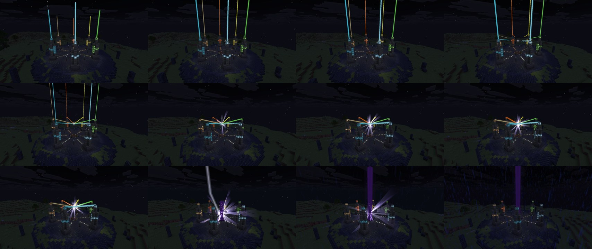

### Die Drachen-Bosse

Sechs einzigartige Bosse, je etwa 25 Blöcke lang. Jeder hat einen eigenen Körperbau (runde Formen, einzelne Zähne,
spitz zulaufende Hörner und Stacheln, Texturen in doppelter Auflösung), weiche, lebendige Bewegungen (Hals und
Schwanz schwingen nach, kraftvoller Flügelschlag, sauber angelegte Flügel, Gangarten mit Körperrollen, Atmen,
Ausholen und Nachschwingen), eine eigene Erweckung und eine eigene Bossleiste.

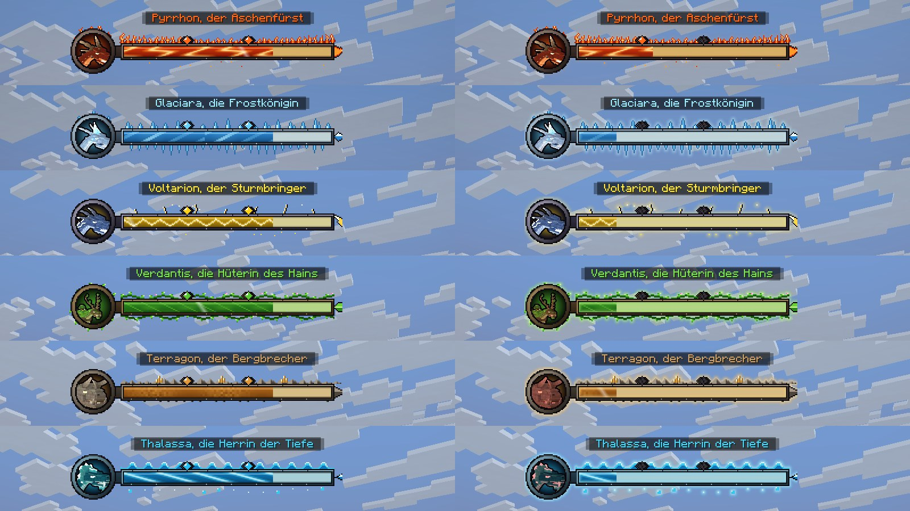

| Drache | Körperbau | Erweckung | Besondere Angriffe |
|---|---|---|---|
| **Pyrrhon**, der Aschenfürst (Feuer) | schwerer Drache mit vier Beinen, geschwungenen Hörnern und glühendem Feuersack | steigt aus dem Lavasee, Ascheregen | Flammenodem (auch im Flug), Feuerball-Salve, Meteorregen, Lava-Geysire, Flammenring |
| **Glaciara**, die Frostkönigin (Eis) | schlank, langer Hals, Kristallkrone, Flügel mit Eisfedern | ruht unsichtbar im Eiskristall, bis er zerspringt | Frostodem, Eisspeere aus dem Boden, Schneesturm, Eisgefängnis, Eiszapfenregen |
| **Voltarion**, der Sturmbringer (Blitz) | Wyvern: Flügel als Vorderbeine, Peitschenschwanz mit Klinge, Blitzstreifen | Gewitter zieht auf, er fährt mit einem Blitz herab | Kettenblitz, Blitzfeld, Sturzflug-Ansturm, Gewitter, Donnerschrei (betäubt) |
| **Verdantis**, die Hüterin des Hains (Natur) | Hirschgeweih, Hauer, Flügel aus Blättern, Moosmantel und Bäumchen auf dem Rücken | erhebt sich aus dem überwucherten Hügel | Giftsporen, Wurzelfessel, Dornensäulen, Samenregen, Rankendiener, Heilung aus den Blüten |
| **Terragon**, der Bergbrecher (Erde) | flügellos, massig, Felsplatten und Kristalle, Keulenschwanz | Erdbeben, bricht aus dem Boden | Felsbrocken, Erdbeben-Stampfer, Stalagmitenreihe, Eingraben und Auftauchen, Kristallpanzer |
| **Thalassa**, die Herrin der Tiefe (Wasser) | Seeschlange mit Flossen, Kopfkragen und Schwanzflosse | Strudel, steigt aus der Tiefe | Wasserstrahl, Flutwelle, Strudel, Blasengefängnis, Tiefensprung |

Dazu kommen Biss, Klaue, Schwanzhieb, Flügelschlag, Stampfen und Brüllen. Jeder Angriff kündigt sich an (Ausholen,
Ausführen, Erholen).

- **Erwacht erst aus nächster Nähe:** Der Drache schläft, bis man höchstens fünf Blöcke an ihn herankommt – wer nur
  am Nest vorbeiläuft, weckt ihn nicht (und sieht auch noch keine Bossleiste).
- **Trefferzonen:** Kopf, Hals, Körper, Flügel und Schwanz nehmen unterschiedlich viel Schaden.
- **Je mehr Schaden, desto gefährlicher:** Mit sinkendem Leben schlägt der Drache härter zu (bis zu 70 % mehr
  Schaden), greift schneller an (bis zu 40 %), bewegt sich schneller, macht kürzere Pausen, hängt Angriffe
  aneinander und setzt seine großen Angriffe häufiger ein.
- **Drei Phasen und ein letztes Aufbäumen:** Bei 60 % und 30 % Leben bäumt er sich brüllend auf – kurz
  unverwundbar, eine Druckwelle fegt über die Arena – und entfesselt dann seinen großen Angriff. Ab der zweiten Phase
  schlagen Gefahren seines Elements bei den Gegnern ein (Meteore, Eiszapfen, Blitze, Dornensaat, Felsbrocken,
  Wasserfontänen), jede mit leuchtendem Warnkreis; in der letzten Phase doppelt so oft, dazu eine Wut-Aura. Unter
  12 % bäumt er sich ein letztes Mal auf. Die Lebensleiste wächst mit dem Schwierigkeitsgrad und der Zahl der Spieler.
- **Bossleisten:** Jedes Element hat einen eigenen Rahmen (Flammen, Eiskristalle, Blitze, Ranken, Felsen, Wellen) mit
  dem Bildnis des Drachen, zwei Edelsteinen für die Phasen (sie zerspringen), strömender Füllung, einer Spur für
  erlittenen Schaden und Wut-Glühen in der letzten Phase.
- **Gemacht für den Kampf mit dem eigenen Heer:** Die Drachen greifen auch Soldaten an, Flächenangriffe treffen alle.
- Verlassen alle Spieler das Nest, kehrt der Drache in seinen Schlaf zurück und heilt sich.
- **Sieg:** Auf dem Nest-Altar erscheint im Lichtstrahl ein **reines Drachenei**, darüber schwebt der
  **Siegelsplitter**; dazu fallen viele Drachenschuppen, Draconium, Edelsteine und Schätze des Nests.

### Nyxar und die Schattenzitadelle

Hinter dem Siegel wartet der Endgegner: **Nyxar, der Schattendrache**, der „Lichtverschlinger“ – größer als die
sechs Elementdrachen (ca. 30 Blöcke), fast schwarz, mit einem Kamm aus Nachtkristallen, drei Augenpaaren, einer Krone
aus sechs Hörnern und zerfetzten Schwingen mit leuchtenden Adern. Zwischen seinen Rippen glimmt Seelenlicht.

- **Die Schattenzitadelle** steht genau einmal in der Schattenwelt (900–1700 Blöcke von der Mitte): eine achteckige
  Festung aus Schattenstein mit acht Türmen (Wohngeschosse, Leitern, Truhen, Turmhelme mit Kristallspitzen), Wehrgang
  mit Zinnen und leuchtenden Schießscharten, einem Torhaus mit Fallgitter und Freitreppe. Im offenen Thronhof liegt ein
  Siegel aus Seelenkristall, ein Prozessionsweg mit Seelenfeuer-Schalen führt zum Podest mit Nyxars Thron zwischen
  zwei Obelisken. In der Schattenwelt zeigt der **Drachenkompass** zur Zitadelle.
- **Erwachen:** Wer den Thronhof betritt, sieht Schatten sich spiralförmig sammeln – Nyxar nimmt Gestalt an, reißt
  die Schwingen auf und brüllt.
- **Angriffe:** Biss, Prankenhieb, Schwanzhieb, Flügelschlag, Schattenodem (auch im Flug, zehrt und verdunkelt die
  Sicht), Seelenpfeil-Salve, **Schattenschrei** (Dunkelheit und Schwäche), **Schattensprung** (zerfließt, gleitet als
  Seelenspur über den Boden und schlägt hinter seinem Ziel zu), **Schattenklauen** (greifen aus dunklen Flecken unter
  allen Gegnern empor), **Seelenraub** (Seelenfäden heilen ihn – weit genug weglaufen zerreißt sie), **Finsternis**
  (die Arena versinkt im Dunkel, Irrlichter jagen die Spieler) und in der letzten Phase **Schattenregen**.
- Magie und Gift von Nicht-Spielern prallen an ihm ab, Feuer trifft ihn härter.
- **Sieg:** Licht bricht über dem Thronhof durch, das **Herz der Schatten** schwebt dort, wo er fiel, dazu Abyssit,
  Seelenkristalle und Schattenessenz – und beim ersten Sieg endet die Geschichte vom Siegel.

### Bauwerke der Schattenwelt

Neben den Dörfern der Umbrer und der Zitadelle liegen überall in der Schattenwelt kleinere Bauwerke – etwa alle
200–300 Blöcke eines. Jedes sucht sich passendes Gelände (eben genug, nie unter Wasser, Leuchttürme nur an der Küste),
hält Abstand zu Dörfern und anderen Bauwerken und steht auf einer Lichtung. Mit `/locate structure` findet man sie
(`kingdomsatwar:moon_temple`, `crystal_mine`, `lighthouse`, `old_world_ruin`).

- **Verlassener Mondtempel** (Schattenwald, Bleiche Öde, Glimmerweiten): auf einem dreistufigen Sockel ein Säulenportikus
  mit Rosenfenster aus Nachtkristall, ein Schiff mit zwei Säulenreihen, Bänken und hängenden Mondlaternen, ein steiles
  Steindach, an drei Stellen eingestürzt (darunter Trümmer, Moos und Glimmerranken), und hinten die Apsis mit
  Halbkuppel, Mondaltar, Seelenkristall und einer Mondsichel aus Mondsilber. Eine Treppe führt hinab in die **Gruft**
  mit Sarkophagen – zwei Truhen mit Mondsilber, Seelenkristallen, Schattenessenz, verzauberten Büchern, selten einer
  Mondsilberklinge oder der Abyssit-Schmiedevorlage.
- **Kristallmine** (Kristallschluchten, Schattengipfel, Bleiche Öde): ein Förderturm aus Schattenholz über dem Schacht, eine
  Leiter 26 Blöcke hinab in eine Halle mit Stützbalken, Seelenlaternen und Truhe. Zwei Stollen mit Gleisen: nach
  Osten zu einer **Lore mit Beute**, nach Westen in eine **Kristallkammer** voller Nachtkristall – mit einem Spawner,
  aus dem Kristallkriecher kommen. In den Wänden glitzern Seelenkristall- und Mondsilberadern.
- **Mondleuchtturm** (an den Küsten): Felssockel, ein runder, nach oben schmaler werdender Turm mit Streifen aus
  Mondsilber, drei Geschosse mit Leiter, eine Galerie und der gläserne Laternenraum mit leuchtender Lampe unter einem
  Zeltdach. Daneben das Haus des Wärters (Bett, Ofen, Schornstein, Truhe) und ein Steg aufs Meer hinaus.
- **Ruine der alten Welt** (Glimmerweiten, Bleiche Öde, Schattenwald, Seelensumpf): ein Hof aus der Zeit vor dem Siegel – bemooste
  Mauerreste aus Bruchstein, Eichenpfosten, ein eingestürzter Balken, Kamin, Amboss, Truhe mit Vorräten der alten Welt
  (Stahl, Eisen, Saatgut, manchmal eine Karte) und ein Brunnen.
- **Felsbrücken**: natürliche Bögen aus Schattenstein über Schluchten und Senken, oben bewachsen, unten hängen
  Glimmerranken.

### Die neue Oberwelt

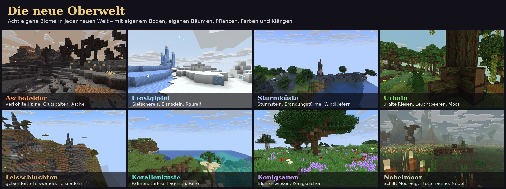

In jeder neuen Welt wachsen **acht eigene Biome** zwischen den bekannten Landschaften. Jedes hat seinen eigenen Boden,
eigene Bäume, Pflanzen und Felsen, eigene Farben für Himmel, Nebel, Wasser, Gras und Laub, eigene Partikel in der
Luft, eigene Musik und Klänge.

| Biom | Wo | Was es ausmacht |
|---|---|---|
| **Aschefelder** | in einem Teil der Wüsten | Asche, Aschenerde und Vulkangestein; verkohlte Haine, Aschedünen, Glutspalten mit glühendem Grund, rauchende Schlote, Felsnadeln aus Vulkangestein, Feuerlilien; Asche weht durch die Luft |
| **Frostgipfel** | auf allen vereisten Gipfeln und einem Teil der Schneehänge | Schnee, Gletschereis, Packeis, Raureifstein, tückische Pulverschnee-Mulden; Eisnadeln mit Adern aus Blaueis und Frostkristallen auf den Spitzen, Eiszapfen unter Überhängen, Schneewehen, Frostblumen |
| **Sturmküste** | an allen steinigen Küsten | Sturmstein mit Kiesbändern; Brandungstürme aus Sturmstein und Schiefer, Findlinge in der Brandung, Fulgurite mit Sturmkristallen, vom Wind gebeugte Fichten, fernes Donnergrollen und Funken in der Luft |
| **Urhain** | in einem Teil der kühlen Wälder | uralte Riesenbäume aus Urholz auf Wurzelfüßen, mit Ranken voller Leuchtbeeren; umgestürzte, bemooste Stämme, Podsol, Moos und Leuchtmoos, Farne, Leuchtkappen, Hainglocken, Dornengestrüpp, Laubstreu und Glühwürmchen |
| **Felsschluchten** | auf den Savannen-Hochebenen und den windgepeitschten Savannen | Felswände in Bändern aus Tuff, Schiefer, Kalzit, Andesit, Terrakotta und Tropfstein; hohe Felsnadeln, Geröll, Bernsteindrusen, Akazien und trockenes Gras |
| **Korallenküste** | an den warmen Stränden und im flachen Wasser davor | weißer Sand, türkise Lagunen mit Korallengärten, Riffen, Seegras und Meeresgurken; Palmen, Perlmuttfelsen, Schildkröten und Tropenfische |
| **Königsauen** | in einem Teil der gemäßigten Ebenen | wogende Blumenwiesen aus Lavendel, Kornblumen, Gartenrosen, Margeriten und Mohn; mächtige Königseichen, kleine Eichenhaine, einzelne Birken; Rothirsche |
| **Nebelmoor** | in den kühlen Sümpfen | Torf, Schlamm und Moos; Mooraugen mit Schilf und Seerosen, tote Bäume und Moorbirken mit fahlem Moos, Blasseichen, Mondblumen; trübes Wasser und dichter Nebel |

- **Torf** brennt im Ofen so lange wie ein Boot, **Schilf** wächst im flachen Wasser und am Ufer.
- Die Biome entstehen in den Weltarten **Standard**, **Große Biome** und **Zerklüftet** – auch auf Servern. Bestehende
  Welten behalten ihre Landschaft; die neuen Biome gibt es nur in neu angelegten Welten.
- Drachennester, Magiertürme, der Siegelkreis, Erze, Blumen und Kreaturen kennen die neuen Biome (siehe die Tabellen
  unten).
- Finden mit `/locate biome kingdomsatwar:ash_fields` (bzw. `frost_peaks`, `storm_coast`, `primeval_forest`,
  `rock_gorges`, `coral_coast`, `royal_meadows`, `mist_moor`).

### Die Nester

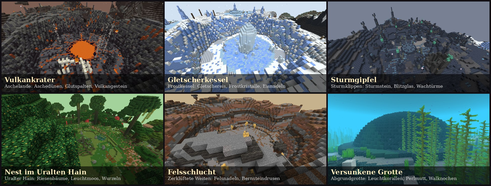

Jedes Nest ist ein riesiges Bauwerk, das es **genau einmal pro Welt** gibt – immer im passenden Biom. Um jedes Nest
liegt ein eigenes Biom von gut 200 Blöcken Durchmesser, das die Landschaft mit neuen Blöcken umgestaltet und eigene
Farben, Partikel und Geräusche hat.

| Nest | Wo | Biom ringsum |
|---|---|---|
| Pyrrhons **Vulkankrater** | Badlands, Wüste, Aschefelder | **Aschelande:** Aschedünen, Aschenerde, verkohlte Bäume, Vulkangestein mit Glutrissen, rauchende Glutspalten, fallende Asche |
| Glaciaras **Gletscherkessel** | Eiszapfen-Ebene, Schneeebene, Schneehänge, Frostgipfel | **Frostkessel:** Gletschereis, Raureifstein, Frosterde, Frostkristalle, Eiszapfen, Schneetreiben |
| Voltarions **Sturmgipfel** | zerklüftete und steinige Gipfel | **Sturmklippen:** Sturmstein, geladener Sturmstein, Fulgurit, Sturmkristalle, Kupferadern, verfallene Wachtürme |
| Verdantis' Nest im **Uralten Hain** | Dschungel, dunkler Wald, Urhain | **Uralter Hain:** Riesenbäume aus Urholz, Leuchtmoos, Leuchtkappen, Dornengestrüpp, knorrige Wurzeln |
| Terragons **Felsschlucht** | windgepeitschte Hügel, Felsschluchten | **Zerklüftete Weiten:** Felsnadeln, Schiefer, Geröll, Spaltgestein, Bernsteindrusen |
| Thalassas **Versunkene Grotte** | am Grund des tiefen Ozeans | **Abgrundgrotte:** Abgrundstein und -sand, Leuchtkorallen, Perlmutt, Schlote, Walknochen, versunkene Säulen |

**Nester finden**

- Der **Drachenkompass** (Kompass, Draconium, 2 Edelsteine, Aetherit) zeigt zum nächsten Nest; Schleichen +
  Rechtsklick wählt das nächste.
- Die **Chronik** kennt Gerüchte über jedes Nest („weit im eisigen Norden …“), nach der Entdeckung die genaue
  Entfernung.
- Rauchsäulen und Warnungen in der Statuszeile kündigen ein Nest schon von Weitem an.
- Nester liegen weit auseinander, Dörfer und andere Bauwerke halten großen Abstand zu ihnen.

### Drachen

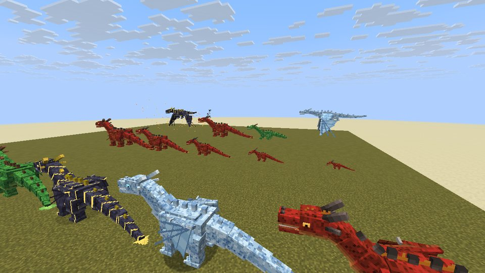

Wilde Drachen gibt es nicht mehr: **Dracheneier bekommt man nur von besiegten Drachen-Bossen.** Ein Ei schlüpft,
wenn es am richtigen Ort liegt **und ein Spieler in der Nähe ist** (bis 24 Blöcke) – ein Drache schlüpft nie allein,
und der Schlüpfling gehört dem, der dabei war.

| Drachenart | Zum Ausbrüten … | Odem |
|---|---|---|
| Feuerdrache | nahe Lava oder Feuer legen | Flammen, setzen in Brand |
| Eisdrache | auf Eis oder Schnee legen | Frost, verlangsamt und lässt erstarren |
| Blitzdrache | bei Gewitter oder neben einem Blitzableiter | Funken und Blitzschläge |
| Naturdrache | im Hellen auf Gras, nahe Pflanzen | Sporen, vergiften |
| Erddrache | unter der Erde auf Stein | Geröll, wirft zurück und lähmt |
| Wasserdrache | unter Wasser | Wasserstrahl, wirft zurück und löscht Feuer |

- **Fünf Wachstumsstufen:** Schlüpfling, Jungdrache, Halbwüchsiger (kann fliegen und Odem speien), Ausgewachsen
  (reitbar), Uralt. Füttern mit Fleisch oder **Drachenfutter** (rohes Rind-, Schweine- und Hammelfleisch + Süßbeeren,
  ergibt 2) lässt ihn schneller wachsen und heilt ihn.
- **Schleichen + Rechtsklick:** folgen / sitzen / frei umherstreifen. **Rechtsklick** auf einen ausgewachsenen
  Drachen: aufsitzen. Springen zum Abheben und Steigen, Schleichen zum Sinken, **R** speit Odem.
- **Drachenpanzer** aus Stahl oder Draconium (feuerfest) für ausgewachsene Drachen; mit der Schere abnehmen.
- **Drachenschuppen** fallen von den Bossen und liegen in den Nestern (mit dem Pinsel freilegen).

### Ritter und Soldaten

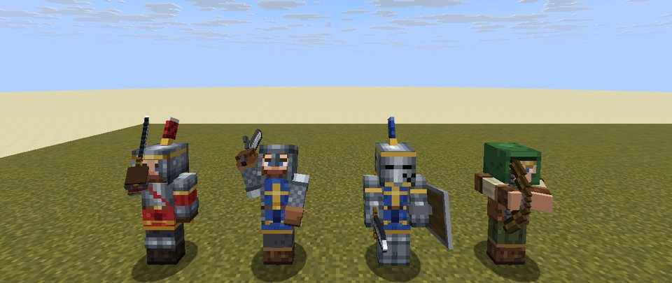

Am **Rekrutierungstisch** (2 Smaragde, Buch, 3 Bretter, 2 Stöcke) wirbst du Soldaten an – bezahlt wird der Sold in
Münzen:

| Soldat | Sold | Rolle |
|---|---|---|
| Schwertkämpfer | 5 Silber | Nahkämpfer – das Rückgrat jeder Armee |
| Bogenschütze | 7 Silber | Fernkämpfer, schießt nie auf Freunde |
| Ritter | 1 Gold 5 Silber + 2 Stahlbarren | Plattenrüstung und Schild, hält die vorderste Reihe |
| Hauptmann | 2 Gold 5 Silber + 1 Edelstein | macht Soldaten in seiner Nähe stärker |

Jede **Kaserne** deiner Siedlung erlaubt acht Soldaten mehr.

Mit dem **Kommandostab** gibst du Befehle: auf einen Feind zeigen = Angriff, auf den Boden zeigen = Stellung halten
(Schleichen: Patrouille), in den Himmel zeigen = alle folgen, Schleichen + eigenen Soldaten anklicken = entlassen.
Soldaten nehmen Waffen und Rüstung an, die du ihnen gibst, und verletzen weder dich noch deine Tiere und Drachen.
**Banditen** streifen nachts durch die Lande und hausen manchmal in Burgruinen.

### Münzen, Siedlung und Krönung

Bezahlt wird mit **Bronze-, Silber- und Goldmünzen** (je zehn sind eine der nächstgrößeren; Rechtsklick wechselt zehn
in eine größere, Schleichen + Rechtsklick eine in zehn kleinere). Münzen lassen besiegte Monster und Banditen fallen,
sie liegen in den Truhen der Bauwerke, die Drachen-Bosse hüten Gold – und deine Bürger kaufen dir Waren ab.

**Das Stadtbanner** (Banner, Goldbarren, Stock, 3 Steinziegel) gründet deine **Siedlung** – jeder Spieler hat eine,
mit einem Namen, den du ändern kannst. Rechtsklick auf das Banner öffnet das **Stadtfenster**: Übersicht (Stufe,
Betten, Gebiet, Ansehen, Baustellen), Anheuern, Bewohner, Bauen und Krone. Nur du kannst dein Banner abbauen; fällt es,
bleibt die Siedlung bestehen, bis es wieder steht.

**Bürger** heuerst du mit Münzen an. Jeder braucht ein Bett (die ersten zwei schlafen im Lager am Banner) und – außer
dem Baumeister – seine Werkstatt. Tagsüber arbeiten sie, nachts gehen sie ins Bett; Zombies, Plünderer und Banditen
haben es auf sie abgesehen.

| Beruf | Lohn | Werkstatt | Arbeit |
|---|---|---|---|
| Baumeister | 4 Silber | – | baut die Baustellen Block für Block nach Plan |
| Bauer | 3 Silber | Feld | erntet, sät nach, pflegt die Pflanzen, bringt die Ernte in die Truhe |
| Holzfäller | 3 Silber | Holzfällerhütte | fällt wilde Bäume rund um die Hütte und pflanzt nach |
| Bergmann | 5 Silber | Mine | steigt in den Schacht und hackt an der Erzwand (Kohle, Eisen, Kupfer, selten Gold und Edelsteine) |
| Schmied | 8 Silber | Schmiede | handelt mit Stahlwaffen und -rüstungen |
| Händler | 8 Silber | Markt | kauft Ernte, Holz und Stein, verkauft Baustoffe und Nützliches |
| Wirt | 6 Silber | Taverne | verkauft Essen, Bier, Wein, Met und das Festmahl |
| Kartograf | 1 Gold | Kartenhaus | zeichnet Karten zum Siegelkreis und zu Drachennestern |

**Bauen:** Im Stadtfenster nimmst du einen **Bauplan**; mit ihm in der Hand zeigen Lichtpunkte den Umriss, Rechtsklick
auf den Boden richtet die Baustelle ein (Schleichen + Rechtsklick dreht den Plan). Der **Baumeister** räumt den Platz,
legt das Fundament und setzt dann Block für Block – mit Hammerschlag und Staub.

| Stufe (ab Bewohnern) | Gebäude |
|---|---|
| Lager (0) | Wohnhaus (2 Betten), Feld, Holzfällerhütte |
| Weiler (4) | Brunnen, Schmiede |
| Dorf (8) | Mine, Markt, Taverne |
| Marktflecken (14) | Bürgerhaus (4 Betten), Kaserne, Kartenhaus |
| Stadt (22) | Thronsaal |

**Ansehen** gewinnst du durch Anheuern, fertige Gebäude, Handel, besiegte Monster in deiner Siedlung und vor allem durch
besiegte Drachen. Es senkt die Preise deiner Bürger (bis 30 %). Jeder Laden macht nach 16 Handeln eine Pause von
drei Stunden – in **Echtzeit**, auch wenn das Spiel aus ist (beides einstellbar).

**Die Krönung:** Wer das Siegel gebrochen hat, eine Stadt regiert, legendäres Ansehen genießt und die **Königskrone**
trägt, setzt sich im eigenen **Thronsaal** auf den Thron: Glocken läuten, goldenes Licht steigt auf, die Bürger eilen
herbei, Feuerwerk erhellt den Himmel – und du wirst **König** oder **Königin**. Von da an geben dir deine Bürger alles
umsonst.

### Wilde Kreaturen

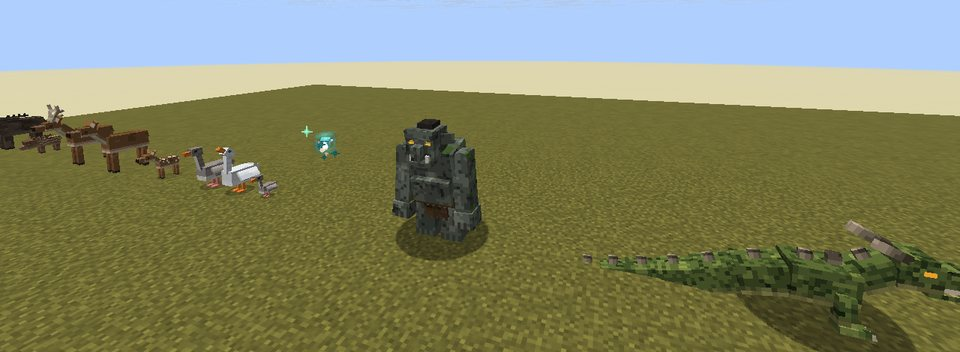

| Kreatur | Lebensraum | Besonderheit | Beute |
|---|---|---|---|
| Wildschwein | Wälder, Taiga | greift an, wenn man es reizt | Schweinefleisch, Leder |
| Rothirsch | Wälder, Wiesen | scheu, Hirsche mit Geweih | Wildbret, Leder |
| Gans | Flüsse, Sümpfe, Ebenen | grau oder weiß, legt Federn, faucht | Federn, Geflügel |
| Irrlicht | Sümpfe, dunkle Wälder (nachts) | leuchtet, weicht aus, verblasst am Morgen | Irrlichtstaub |
| Höhlentroll | tief unter der Erde | riesig und stark, versteinert im Sonnenlicht | Leder, Eisenklumpen, selten Edelstein oder Trollkeule |
| Lindwurm | Berge, Tafelländer | flügelloser Drache, Biss und Schwanzhieb | Erddrachen-Schuppen, selten Draconium |

### Erze und Rohstoffe

| Erz | Fundort | Werkzeug | Verwendung |
|---|---|---|---|
| Kohlenstofferz | überall, Höhe 0 bis 192 | jede Spitzhacke | Brennstoff, **Stahl** |
| Edelstein-Erz | tief, Höhe −64 bis 16 | Eisenspitzhacke | Drachenkompass, Königskrone, Hauptleute |
| Konteriterz | Berge, um Höhe 150 | Eisenspitzhacke | leichte **Konteritrüstung** |
| Aetheriterz (leuchtet) | Höhe −48 bis 48 | Eisenspitzhacke | **Magie**: Aetherit-Stab, Runen, Aetheritlaterne |
| Draconiumerz (leuchtet) | ganz tief, sehr selten | Diamantspitzhacke | **Draconium-Waffen** (setzen in Brand), Drachenpanzer |
| Wyverniterz | hohe Berge, ab Höhe 100 | Eisenspitzhacke | **Wyvernit-Gleiter** |

**Stahl:** 1 Eisenbarren + 2 Kohlenstoff → Stahlmischung → im Hochofen → Stahlbarren (auch Kohlenstoff aus Holzkohle).
Aus 9 Rohstoffen wird jeweils ein Speicherblock.

### Ausrüstung

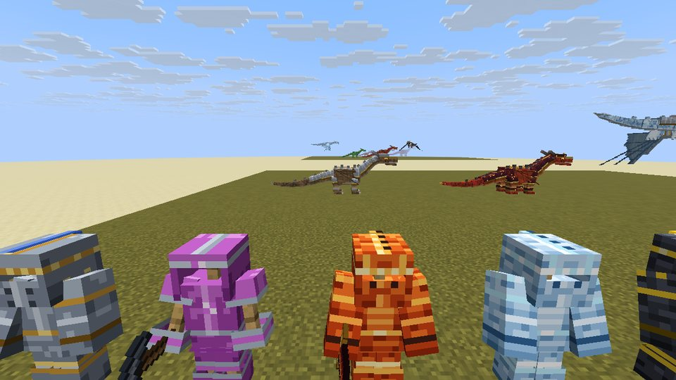

- **Stahl:** Werkzeuge, Schwert und Rüstung – stärker als Eisen.
- **Konteritrüstung:** leicht, je Teil +4 % Tempo und sanftere Stürze.
- **Draconiumschwert und -axt:** mit Lohenruten als Griff, setzen Gegner in Brand.
- **Drachenschuppen-Rüstung** (6 Arten) mit Set-Bonus: Feuerresistenz (Feuer), Tempo und Frostschutz (Eis),
  doppeltes Tempo (Blitz), Regeneration (Natur), Resistenz (Erde), Wasseratmung und Delfinsgunst (Wasser).
- **Wyvernit-Gleiter:** gleitet wie Elytren. **Königskrone:** Glück +2. **Trollkeule:** schwer, schleudert Gegner weg.

### Magie

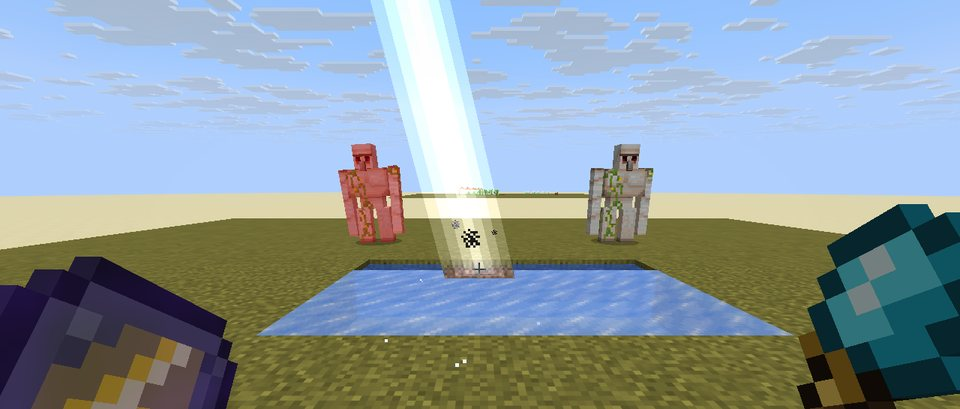

Der **Aetherit-Stab** (Aetherit, Irrlichtstaub, Stöcke) beherrscht von Anfang an den **Aether-Blitz**. Weitere Zauber
lernt er am **Magietisch** aus **Zaubertafeln**: Stab, Tafel und Aetherit einlegen, „Einschreiben“ – unter kreisenden
Runen schreibt sich der Zauber in den Stab. Jede weitere Tafel desselben Zaubers hebt ihn eine Stufe höher (bis III);
der Aether-Blitz wird mit Aetherit allein stärker.

| Zauber | Tafel | Stufe I | Stufe II | Stufe III |
|---|---|---|---|---|
| Aether-Blitz | – | Strahl reiner Magie | mehr Schaden, größere Reichweite | springt auf einen zweiten Feind über |
| Feuerball | Ignatius | setzt Feinde in Brand (nie Blöcke) | drei Feuerbälle im Fächer | zerbersten in einer Feuerwolke |
| Frosthauch | Isolde | verlangsamt, unterkühlt, friert Wasser | kälter und weiter | friert Feinde fest |
| Blitzschlag | Fulgor | Blitz an die anvisierte Stelle | springt auf zwei weitere Feinde | Kettenblitz: bis zu vier Feinde |
| Heilende Blüte | Sylvana | heilt dich und Verbündete | dazu ein Schild | Wurzeln packen Feinde |
| Erdstoß | Gorvan | schleudert Feinde fort | stärker und weiter | Felsdornen lassen taumeln |
| Woge | Marena | drängt zurück, löscht Feuer, Wasseratmung | heilt dich dabei | Wasserschild: weniger Schaden |

- **Einschreiben** kostet Erfahrung und Aetherit: Stufe I 3 Stufen + 1 Aetherit, II 6 + 2, III 9 + 3
  (Aether-Blitz: II 4 + 3, III 8 + 6). Der **Magietisch** entsteht aus Aetherit, Buch, Gold, Obsidian und poliertem
  Tiefenschiefer.
- **Zauberkreis:** Taste **V** halten, mit der Maus einen Zauber wählen (oder mit 1–7). Über der Schnellleiste zeigt
  ein Zeichen den gewählten Zauber und seine Abklingzeit; jeder Zauber kühlt für sich ab.
- **Zaubertafeln** lassen die Erzmagier fallen (je die Tafel ihres Elements); selten liegt eine in den Truhen ihrer
  Türme, in der Sturmwarte oder am Thron der Tiefe. Alte **Runen** aus früheren Versionen lehren wie eine Tafel.
- Zauber kosten Haltbarkeit; Reparatur mit Aetherit.

### Die Erzmagier und ihre Türme

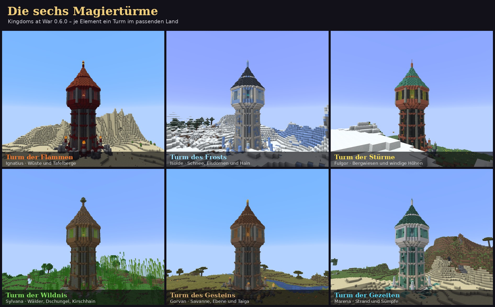

Sechs Erzmagier hüten die Zaubertafeln der Elemente – jeder in seinem eigenen **Magierturm**, im Land seines Elements:

| Erzmagier | Turm | Land |
|---|---|---|
| **Ignatius**, Erzmagier der Flammen | schwarzer Basalt, ziegelrotes Dach, eine Flamme auf der Spitze | Wüste, Tafelberge, Aschefelder |
| **Isolde**, Erzmagierin des Frosts | Reifstein und Packeis, Schieferdach, Frostkristall | Schneeebene, Eisdornen, Schneetaiga, Hain |
| **Fulgor**, Erzmagier der Stürme | Tiefenschiefer und Kupfer, grünes Kupferdach, Blitzableiter | Bergwiese, windige Hügel, Sturmküste |
| **Sylvana**, Erzmagierin der Wildnis | bemoostes Mauerwerk, Holzschindeln, eine blühende Krone | Wälder, Dschungel, Kirschhain, Urhain |
| **Gorvan**, Erzmagier des Gesteins | Tuff und Lehmziegel, braune Ziegel, Bernstein | Savanne, Ebene, Taiga, Felsschluchten |
| **Marena**, Erzmagierin der Gezeiten | Prismarin und Perlmutt, dunkles Prismarindach | Strand, Sumpf, Mangrovensumpf, Korallenküste, Nebelmoor |

- Über eine Wendeltreppe an der Wand geht es durch **Eingangshalle**, **Bibliothek** (mit den Aufzeichnungen des
  Magiers auf dem Lesepult – darin Hinweise für den Kampf), **Laboratorium** (mit Magietisch und Braustand) und
  **Kammer** (mit Zaubertisch) hinauf ins **Sanktum**. In jedem Geschoss steht eine Truhe.
- Im Sanktum meditiert der Erzmagier über seinem Ritualkreis. Betrittst du den Saal, **erwacht** er: Er wirft
  Geschosse, die dir folgen (ein beherzter Schlag wirft sie zurück), wirkt den Zauber seines Elements, blinzelt
  durch den Saal, ruft **Spiegelbilder** (zerplatzen beim ersten Treffer) und hüllt sich in einen **Runenschild**
  (bricht nach vier Schlägen). Bei zwei und einem Drittel seiner Kraft folgt eine neue **Phase**, und mit ihr sein
  **großer Zauber**: Meteorregen, Blizzard, Gewittersturm, Wildwuchs, Felsbeben oder Mahlstrom – jeder Einschlag
  kündigt sich am Boden an.
- Gegen sein eigenes Element ist er gefeit. Wer ins Geschoss darunter flieht, entkommt ihm – dann kehrt er geheilt an
  seinen Platz zurück.
- Auch mitten im Getümmel bleibt die Sicht frei: Einschläge werfen ihre Funken, Splitter und Wolken nicht direkt vor
  die Augen dessen, den sie treffen, und Schwächungen durch Bosse (wie auch die Wirkungen eigener Zauber) zeigen sich
  als Zeichen in der Anzeige statt als Wirbel vor den Augen – das gilt ebenso im Kampf gegen die Drachen.
- Besiegt lässt er seine **Zaubertafel**, Goldmünzen, Aetherit und ein verzaubertes Buch fallen; die Truhe im Sanktum
  hält weiteren Schatz bereit.

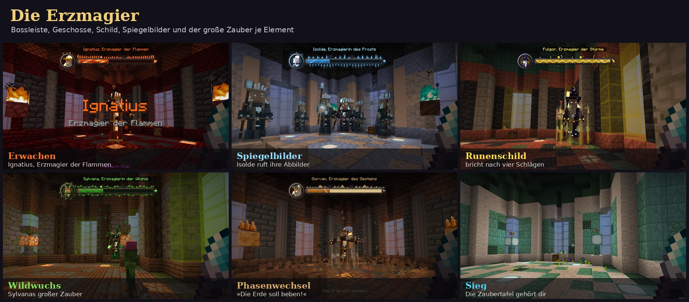

### Bauen und Einrichten

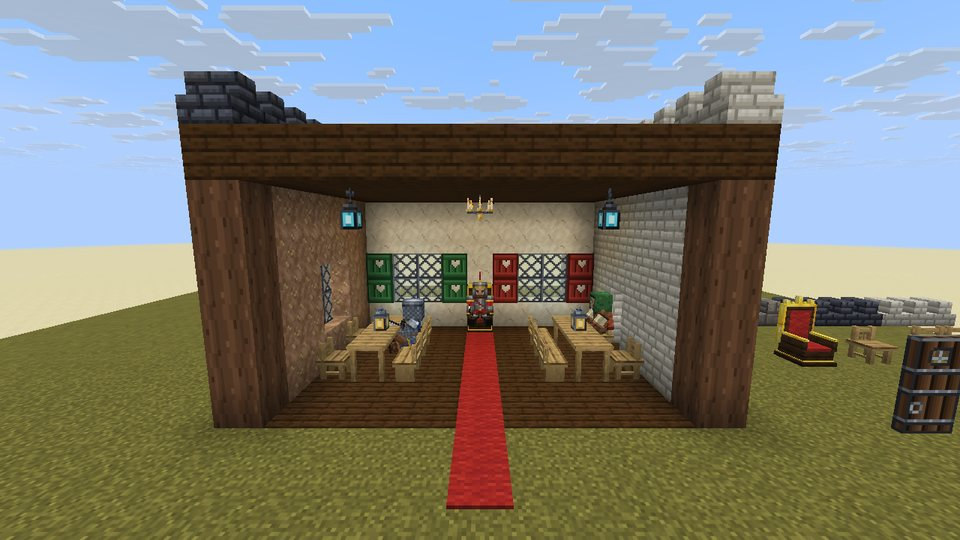

| Baustoff | Herstellung | Varianten |
|---|---|---|
| Mittelalterlicher Stein, Grober Naturstein, Behauener Sandstein, Dunkle Steinziegel, Helle Kalksteinziegel, Verwitterte Steinziegel, Moosige Mauersteine, Gerissene Steinblöcke | Steinmetz aus Vanilla-Gestein | Treppe, Stufe, Mauer |
| Rote, braune und helle Dachziegel, Dunkle Schieferplatten, Holzschindeln, Kupferdach | Steinmetz bzw. Werkbank | Treppe, Stufe |
| Steinpfeiler, Holzbalken, Fachwerk (gerade, diagonal, Kreuz) | Werkbank / Steinmetz | – |
| Kalkputz (Sand, Ton, Knochenmehl) und Lehmputz (Ton, Erde, Weizen) | Werkbank (ergibt 4) | Treppe, Stufe |
| Bleiglas (8 Glas + Eisenklumpen) und Bleiglasscheiben | Werkbank | – |
| Burgtür (Bretter mit einem Eisenband), grüne und rote Fensterläden mit Herz | Werkbank | – |
| Stahllaterne, Aetheritlaterne, Kronleuchter mit acht Kerzen | Werkbank | – |
| Zinnen aus mittelalterlichem Stein, dunklen Steinziegeln oder hellen Kalksteinziegeln | Werkbank / Steinmetz | – |
| Eichenstuhl, Eichenbank, Eichentisch (verbindet sich zur Tafel), Thron | Werkbank | – |

Auf **Stühle, Bänke und den Thron** setzt man sich per Rechtsklick. **Zinnen** in einer Reihe ergeben von selbst
Zahn und Scharte. Der **Kronleuchter** hängt an der Decke.

### Landwirtschaft und Nahrung

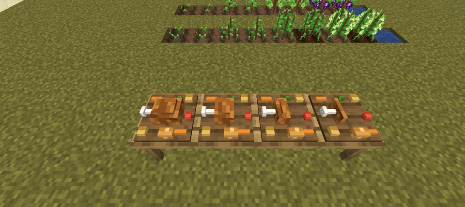

- **Feldfrüchte:** Tomaten, Kohl, Gerste, Zwiebeln, **Hopfen**, **Weintrauben** und **Knoblauch** – Samen und
  Pflanzknollen fallen manchmal beim Abbauen von Gras, Bauern-Dorfbewohner bauen sie an.
- **Gerichte:** Brötchen, Gemüseeintopf, Fleischpastete, Apfelkuchen, Knoblauchbrot, Wildbret.
- **Getränke** (die Flasche bleibt übrig): **Bier** (Gerste, Hopfen) macht stark, **Rotwein** (Trauben) heilt langsam,
  **Met** (Honigwaben, Hopfen) schenkt Extraherzen – wer zu viel trinkt, dem wird schwindelig.
- **Festmahl:** ein Braten mit Beilagen auf einem Brett für die Tafel – vier üppige Portionen, direkt vom Tisch.
- **Zierblumen** (wachsen wild, passen in Blumentöpfe): Lavendel, Gartenrose, Feuerlilie, Frostblume und die
  **Mondblume**, die nachts leuchtet.

### Bauwerke in der Welt

- **Der Siegelkreis** – einmal pro Welt, auf ebenem Land unweit des Weltursprungs (siehe „Die Geschichte“).
- **Die sechs Drachennester** – je eins pro Welt, mit eigenem Biom (siehe „Die Nester“). In ihren Schuttfeldern
  liegen Fundstücke, die man mit dem Pinsel freilegt.
- **Die sechs Magiertürme** – im Land ihres Elements (siehe „Die Erzmagier und ihre Türme“), mit
  `/locate structure kingdomsatwar:fire_mage_tower` (bzw. `ice_`, `lightning_`, `nature_`, `earth_`, `water_`) zu finden.
- **Burgruinen** in Ebenen, Wäldern und der Taiga: verfallene Mauern mit Ecktürmen und Zinnen, eine Truhe mit Beute
  (Vorräte, Stahl, Edelsteine, mit Glück Runen, der Aetherit-Stab, die Königskrone oder ein Drachenkompass) – und
  manchmal Banditen.

---

## Befehle, Tasten, Einstellungen

| | |
|---|---|
| `/kaw intro` | das Intro noch einmal ansehen |
| `/kaw army <swordsman\|archer\|knight\|captain> [Anzahl]` | (nur Operatoren) Soldaten sofort in den Dienst stellen, z. B. `/kaw army knight 4` |
| `/kaw lair` · `/kaw lair awaken` · `/kaw lair reset` | (nur Operatoren) Lage aller Nester anzeigen, den Drachen im Nest wecken, ein Nest zurücksetzen |
| `/kaw citadel` · `/kaw citadel tp` · `/kaw boss nyxar` | (nur Operatoren) Lage der Schattenzitadelle anzeigen, an den Fuß ihrer Freitreppe reisen, Nyxar vor sich erwecken |
| `/kaw story reset\|card <Kapitel>\|chronicle` | (nur Operatoren) Geschichte zurücksetzen, eine Titelkarte zeigen, die Chronik geben |
| `/kaw seal` · `/kaw seal shard\|insert <Element>` · `/kaw seal break\|reset` | (nur Operatoren) Zustand des Siegels, Splitter geben oder einsetzen, das Siegel brechen oder zurücksetzen |
| **R** | Drachenodem beim Reiten (änderbar unter Optionen → Steuerung) |
| **V** (halten) | Zauberkreis: Zauber des Aetherit-Stabs wählen (änderbar unter Optionen → Steuerung) |
| `showIntro` (Client) | Intro beim ersten Betreten einer Welt zeigen (Standard: an) |
| `armyLimit` (Server) | höchstens so viele Soldaten je Spieler (Standard: 32, je Kaserne 8 mehr) |
| `tradesBeforePause` (Server) | so oft kann man mit einem Bürger handeln, bevor sein Laden Pause macht (Standard: 16) |
| `tradePauseMinutes` (Server) | so lange dauert die Pause in echten Minuten (Standard: 180) |

---

## Für Entwickler

Das Projekt ist ein normales NeoForge-Projekt mit [ModDevGradle](https://github.com/neoforged/ModDevGradle).

| Befehl | Wirkung |
|---|---|
| `./gradlew build` | Mod bauen → `build/libs/kingdomsatwar-0.7.0.jar` |
| `./gradlew runClient` | Minecraft mit der Mod zum Testen starten |
| `./gradlew runData` | Modelle, Rezepte, Loot-Tables, Tags, Weltgenerierung und Übersetzungen neu erzeugen |
| `./gradlew runGameTestServer` | Automatische Tests in einem Minecraft-Server ausführen |
| `python3 tools/generate_textures.py` | Alle Texturen neu zeichnen (`--preview datei.png` für eine Übersicht) |
| `python3 tools/generate_entities.py` | Modelle und Texturen der Lebewesen neu erzeugen |
| `python3 tools/generate_citizens.py` | Texturen der Bürger neu zeichnen (`--preview` für eine Übersicht) |
| `python3 tools/audio/build_audio.py` | Musik, Intro-Zeitplan und Stimmen neu bauen (siehe `tools/audio/README.md`) |

Unter Windows statt `./gradlew` einfach `gradlew.bat` verwenden. Java 25 wird benötigt (lädt Gradle bei Bedarf selbst).

**Aufbau**

```
src/main/java/io/github/sirschrolli/kingdomsatwar/
├── KingdomsAtWar.java        Hauptklasse der Mod
├── registry/                 Blöcke, Gegenstände, Lebewesen, Geräusche, Kreativ-Tabs, Tags
├── block/                    eigene Blöcke (Drachenei, Möbel, Zinne, Kronleuchter, Festmahl …)
├── entity/                   Drachen, Drachen-Bosse (entity/boss), Soldaten, Banditen, Kreaturen, Sitz
├── dragon/  army/  magic/    Drachenarten, Rekrutierung und Befehle, Zauber
├── economy/                  Münzen, Ansehen, Siedlung und Baupläne (economy/town), Bürger und Handel (economy/citizen)
├── story/  world/            Chronik, Kapitel, Siegel und Schattentor
├── item/                     besondere Ausrüstung
├── worldgen/                 Erzadern, Blumen, Burgruinen, Nest-Biome, Nester (worldgen/lair), Siegelkreis (worldgen/seal),
│                             die acht Oberwelt-Biome mit Biomquelle, Böden und Features (worldgen/overworld)
├── client/                   Modelle, Renderer, Intro, Oberflächen
├── datagen/                  Datengenerierung (erzeugt src/generated/resources)
└── gametest/                 automatische Tests
src/main/resources/           Texturen, Geräusche, Musik, Intro
src/generated/resources/      von runData erzeugte Dateien (nicht von Hand bearbeiten)
tools/                        Skripte für Texturen, Modelle, Audio und Teststruktur
docs/                         Konzept und Bilder
```

Bei jedem Push baut GitHub Actions die Mod, führt die Datengenerierung und die GameTests aus
und stellt die JAR als Artefakt bereit (`.github/workflows/build.yml`).
Ein Tag wie `v0.7.0` erzeugt automatisch ein Release mit der JAR (`.github/workflows/release.yml`).

---

## Nächste Schritte

Der ganze Plan steht in [docs/DAS_SIEGEL.md](docs/DAS_SIEGEL.md):

1. **Eigene Welt** – die acht Oberwelt-Biome sind fertig, als Nächstes:
   - eigene **Dörfer** mit eigenen Bewohnern (nie in der Nähe der Drachennester), keine Vanilla-Bauwerke mehr;
   - eigene **Nutz- und Wildtiere** statt der Vanilla-Tiere – alles, was die Vanilla-Tiere fallen lassen, bleibt
     erhältlich;
   - eigene **Monster und Wassertiere**;
   - zuletzt **Nether und End**.
2. Danach Dragon Architect, Belagerungswaffen, Kriegssystem und die Veröffentlichung auf Modrinth.

## Danksagung

- **Erzählerstimme:** erzeugt mit dem freien Sprachmodell [Qwen3-TTS](https://github.com/QwenLM/Qwen3-TTS)
  (Apache-2.0) – eine eigens beschriebene, künstliche Stimme, keine echte Person.
- **Soldatenstimmen:** erzeugt mit der freien Sprachsynthese [Piper](https://github.com/rhasspy/piper).
  Deutsche Stimmen: [Thorsten-Voice](https://github.com/thorstenMueller/Thorsten-Voice) von Thorsten Müller (CC0).
  Englische Stimmen: Piper-Stimme „libritts_r“, trainiert auf [LibriTTS-R](https://www.openslr.org/141/)
  (CC BY 4.0, Y. Koizumi u. a.; Sprecher 680, 248 und 788).
- **Musik:** eigene Komposition, gespielt mit dem Soundfont FluidR3_GM von Frank Wen (MIT-Lizenz).
- **Geräusche der Lebewesen:** nutzen die Original-Geräusche von Minecraft mit veränderter Tonhöhe;
  es werden keine Minecraft-Dateien mitgeliefert (siehe `tools/sound_events.py`).

## Lizenz

Alle Rechte vorbehalten (siehe `mod_license` in `gradle.properties` – kann vor einer Veröffentlichung geändert werden).
Die Texturen sind eigene Pixelkunst; es werden keine Original-Minecraft-Dateien mitgeliefert.
