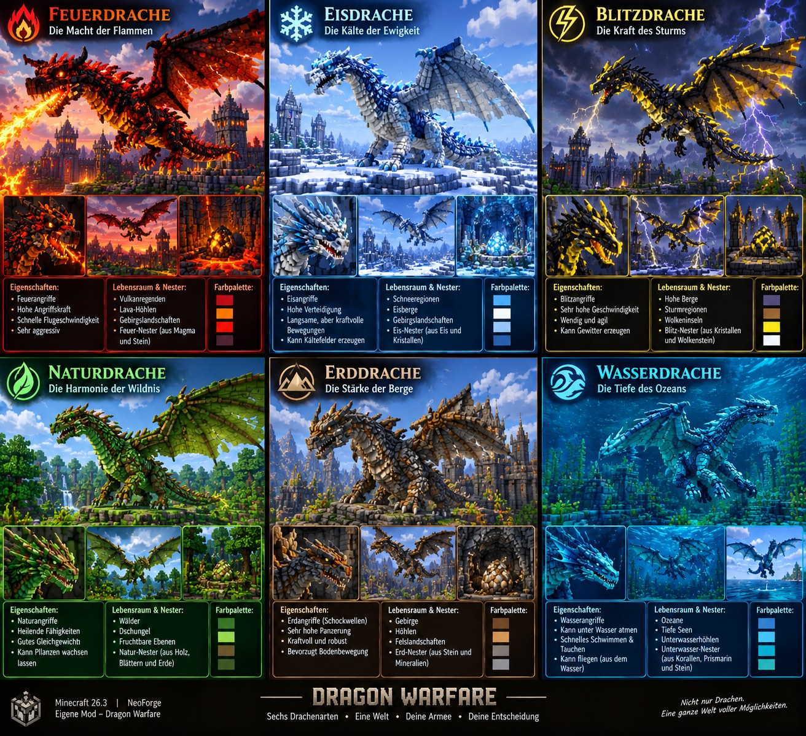
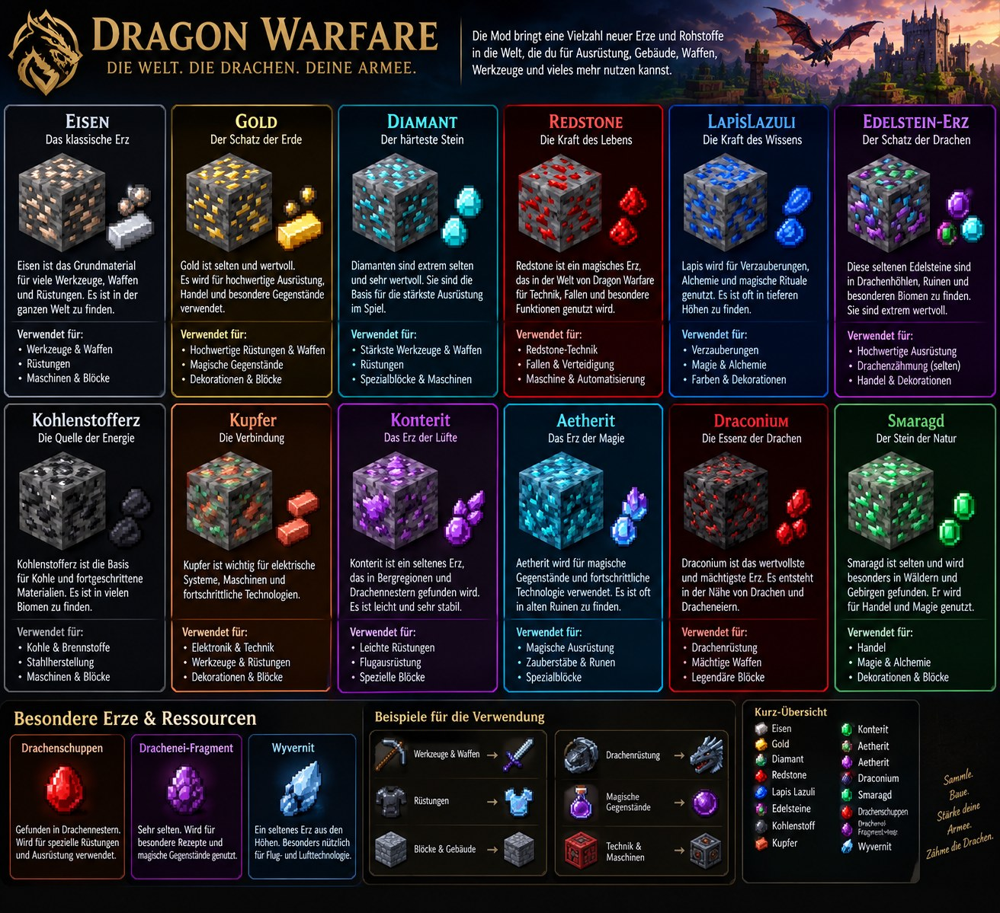
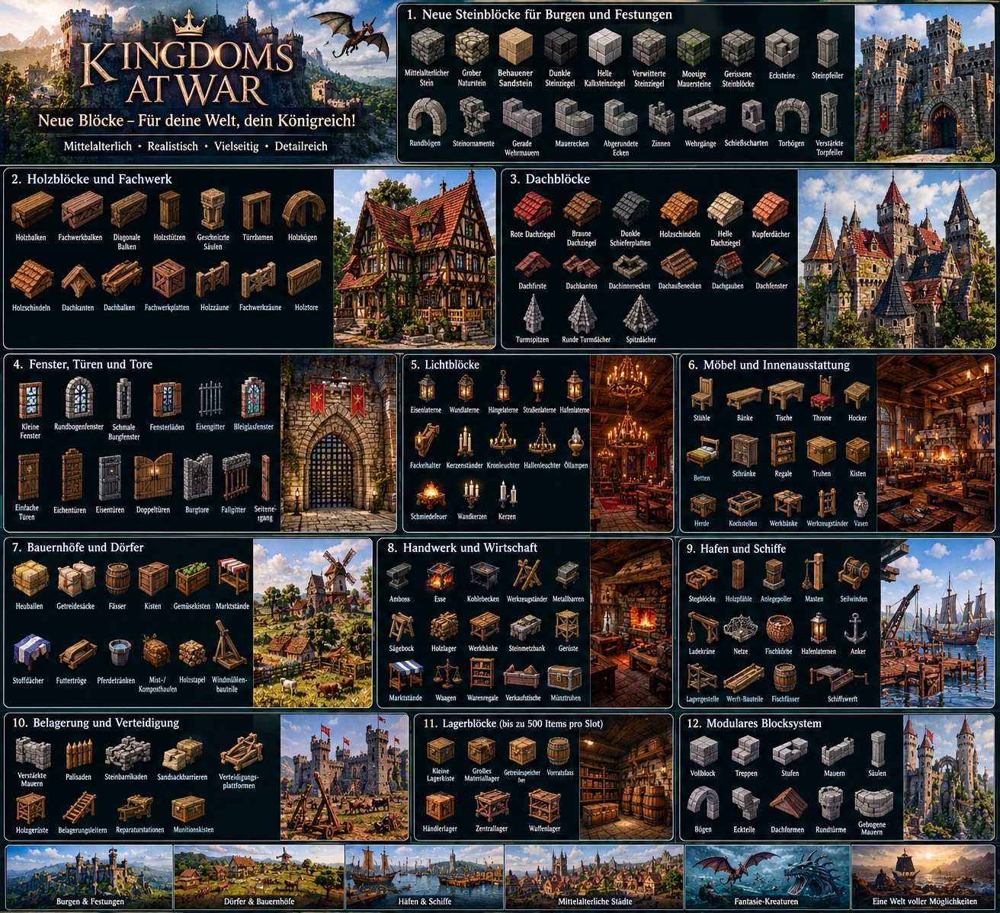
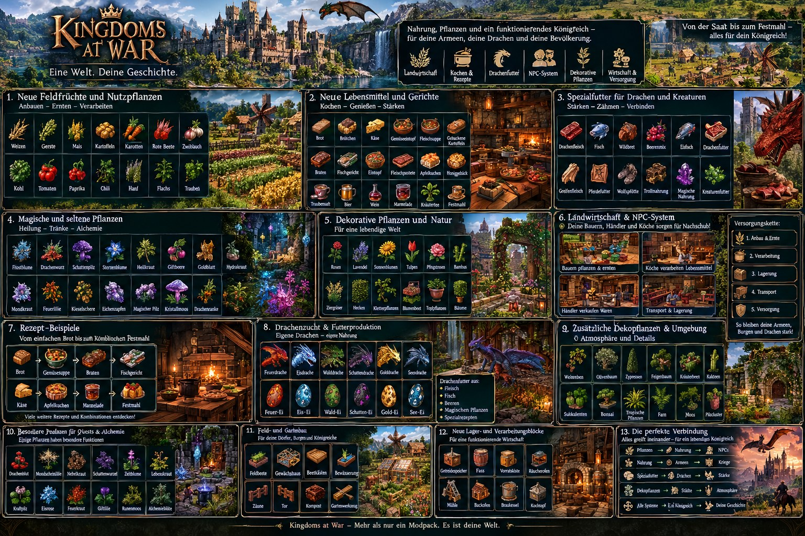

# 🏰 Unser Minecraft-Modpack – die vollständige Projektübersicht

> **Hinweis:** Diese Projektübersicht ist die Zusammenfassung der Gespräche **vor** Beginn der Programmierung.
> Was davon inzwischen umgesetzt ist, steht in der [README](../README.md) (Abschnitt „Entwicklungsstand“).
> Die Konzeptbilder findest du ganz unten.

Ich habe unsere bisherigen Gespräche über das Minecraft-Modpack zusammengetragen. Hier findest du die wichtigsten Entscheidungen, geplanten Funktionen, Drachenklassen, NPCs, Gebäude, Pflanzen, Nahrung und technischen Anforderungen.

Unser Ziel: Wir wollen ein eigenes, umfangreiches mittelalterliches Minecraft-Modpack entwickeln, in dem du Königreiche aufbauen, Armeen befehligen, Burgen errichten, Drachen züchten und deine Welt mit neuen Kreaturen, Pflanzen und Gebäuden gestalten kannst.

Wichtig: Ich unterscheide zwischen Dingen, die wir bereits besprochen oder ausgewählt haben, und Funktionen, die bisher nur geplant sind. Nicht alles ist schon programmiert oder spielbar.

## 1. ⚙️ Die technischen Grundlagen

Zunächst haben wir festgelegt, auf welcher Minecraft-Version unser Projekt laufen soll.

| Eigenschaft | Unsere Festlegung |
|---|---|
| Spiel | Minecraft Java Edition |
| Minecraft-Version | 26.3 |
| Mod-Loader | NeoForge |
| Projekt | Eigenes Minecraft-Modpack |
| Veröffentlichung | Modrinth |
| Grundidee | Eigenständiges mittelalterliches Modprojekt |
| Inspiration | Ancient Warfare und Ice and Fire |
| Sprache unserer Unterhaltung | Deutsch |
| Ziel | Ein möglichst umfangreiches, zusammenhängendes Spielerlebnis |

#### Was bedeutet das für unser Projekt?

Wir wollen nicht einfach eine alte Mod unverändert übernehmen. Stattdessen sollen die gewünschten Funktionen als eigenes Projekt umgesetzt und an unsere Minecraft-Version angepasst werden.

Das ist besonders wichtig, weil ältere Mods nicht automatisch mit Minecraft 26.3 und NeoForge funktionieren.

Unser technisches Ziel: Die verschiedenen Systeme sollen zusammenpassen, sodass du nicht für jede einzelne Funktion eine separate, unpassende Mod installieren musst.

Allerdings müssen wir die tatsächliche Kompatibilität jeder verwendeten Bibliothek und Mod noch überprüfen.

## 2. ⚔️ Das Kriegssystem – inspiriert von Ancient Warfare

Einer der wichtigsten Bestandteile unseres Modpacks ist ein umfangreiches Kriegssystem.

Du sollst nicht nur einzelne Gegner bekämpfen, sondern eigene Armeen aufbauen und damit gegen andere Fraktionen kämpfen können.

### 2.1 Eigene Soldaten

Geplant sind verschiedene Soldatentypen.

| Einheit | Aufgabe | Status |
|---|---|---|
| Schwertkämpfer | Nahkampf | Geplant |
| Speerkämpfer | Kampf auf mittlere Distanz | Geplant |
| Bogenschützen | Fernkampf | Geplant |
| Armbrustschützen | Schwererer Fernkampf | Geplant |
| Schildträger | Schutz der übrigen Truppen | Geplant |
| Schwere Infanterie | Durchbrechen gegnerischer Linien | Geplant |
| Kavallerie | Schnelle Angriffe | Geplant |
| Belagerungstruppen | Einsatz schwerer Kriegsmaschinen | Geplant |
| Wachposten | Verteidigung von Gebäuden | Geplant |
| Burggarnison | Schutz deiner Burg | Geplant |

Die einzelnen Einheitentypen müssen noch genauer ausgearbeitet und programmiert werden.

#### Wie ich mir das Spielprinzip vorstelle

Du könntest beispielsweise:

- Ein Dorf gründen.
- Ressourcen sammeln.
- Soldaten rekrutieren.
- Eine Kaserne bauen.
- Deine Armee ausrüsten.
- Einen Hauptmann einsetzen.
- Deine Soldaten zu einer gegnerischen Burg schicken.
- Mit Belagerungswaffen die Befestigung angreifen.
- Die eroberte Burg übernehmen und dort eigene Soldaten stationieren.

Das ist das angestrebte Spielprinzip, noch keine bereits vollständig vorhandene Spielfunktion.

### 2.2 NPC-Armeen

Wir haben außerdem darüber gesprochen, dass NPCs nicht bloß dekorative Figuren sein sollen.

Sie sollen sich möglichst wie richtige Bewohner und Soldaten verhalten.

Dazu gehören als geplante Funktionen:

- NPCs rekrutieren.
- Soldaten einer Armee zuweisen.
- Truppen zu Gruppen zusammenfassen.
- NPCs Befehle erteilen.
- Einheiten bewachen bestimmte Orte.
- Soldaten marschieren zu einem Ziel.
- NPCs verteidigen Gebäude.
- Armeen greifen feindliche Stellungen an.
- Soldaten verwenden ihre jeweiligen Waffen.
- NPCs können Ausrüstung tragen.
- Armeen können aus unterschiedlichen Einheitentypen bestehen.

Wichtig: Die vollständige KI für solche Armeen ist noch nicht fertig.

## 3. 🏹 Belagerungswaffen, Fahrzeuge und Kriegsmaschinen

Du hattest ausdrücklich gewünscht, dass unser Projekt auch Belagerungswaffen, Fahrzeuge und Katapulte umfasst.

Diese Funktionen gehören deshalb zu unserem Konzept.

### 3.1 Geplante Kriegsmaschinen

| Kriegsmaschine | Geplante Funktion |
|---|---|
| Katapult | Projektile gegen Mauern und Gebäude schleudern |
| Trebuchet | Große Belagerungsmaschine für schwere Geschosse |
| Rammbock | Tore angreifen |
| Belagerungsturm | Angreifern den Zugang zu Mauern ermöglichen |
| Balliste | Große Bolzen gegen Ziele verschießen |
| Belagerungsgeschütze | Befestigungen aus der Entfernung angreifen |

Diese Liste beschreibt die geplante Ausrichtung. Nicht alle Maschinen waren bereits einzeln verbindlich festgelegt.

### 3.2 Fahrzeuge

Zusätzlich sollen Fahrzeuge das mittelalterliche Kriegssystem erweitern.

Mögliche Funktionen innerhalb unseres Konzepts sind:

- Transport von Soldaten.
- Transport von Materialien.
- Bewegung schwerer Belagerungsmaschinen.
- Versorgung deiner Armee.
- Unterstützung bei längeren Feldzügen.

Die konkreten Fahrzeugtypen und ihre Steuerung müssen noch ausgearbeitet werden.

### 3.3 Das bisherige technische Beispiel

In einem früheren Entwurf des Projekts Kingdoms at War waren bereits einfache Testbefehle vorgesehen:

- `/kaw army 10` – sollte eine Formation mit Soldaten erzeugen; der damalige Entwurf verwendete dafür bis zu 20 Zombies.

- `/kaw castle` – sollte eine einfache Befestigung mit Mauern, Türmen und einem Hauptgebäude erzeugen.

- `/kaw catapult` – sollte ein dekoratives Katapult erzeugen.

Das waren Funktionen eines unvollständigen Quellcode-Entwurfs. Insbesondere das damalige Katapult konnte noch keine Projektile verschießen.

Diese Befehle sind daher nicht als Nachweis zu verstehen, dass eine spielbare Mod bereits fertig ist.

## 4. 🏰 Burgen, Dörfer und mittelalterliche Gebäude

Ein weiterer zentraler Bestandteil ist der Aufbau eigener Siedlungen und Festungen.

Du sollst nicht auf eine einzelne Burg beschränkt sein, sondern ganze mittelalterliche Königreiche gestalten können.

### 4.1 Burgen

Folgende Gebäudeelemente passen zu unserem bisherigen Konzept:

| Gebäudeteil | Geplante Verwendung |
|---|---|
| Ringmauer | Schutz des Burgareals |
| Wachtürme | Beobachtung und Verteidigung |
| Haupttor | Zugang zur Burg |
| Torhaus | Zusätzliche Verteidigung des Eingangs |
| Bergfried | Zentraler und besonders geschützter Turm |
| Innenhof | Platz für Gebäude und NPCs |
| Kaserne | Unterkunft für Soldaten |
| Schmiede | Herstellung und Reparatur von Ausrüstung |
| Lagerhaus | Aufbewahrung von Ressourcen |
| Stallungen | Unterbringung von Pferden und anderen Reittieren |
| Wohnhäuser | Unterkunft für NPCs |
| Werkstätten | Herstellung von Gegenständen |
| Bauernhöfe | Versorgung der Bevölkerung |
| Mauertreppen | Zugang zu den Wehrgängen |

Wir hatten außerdem bereits über eine große Minecraft-Burg gesprochen.

Die gewünschte Schematik sollte folgende Eigenschaften haben:

- Größe: 300 × 300 Blöcke
- Ringmauer
- Mehrere Türme
- Haupttor
- Innenhof
- Großer Bergfried
- Verwendung als echte Minecraft-Bauschematik

Du wolltest diese Burg später in Minecraft verwenden und nicht lediglich ein Bild davon erhalten.

Eine fertige, geprüfte .litematic-Datei wurde in unserem bisherigen Projekt allerdings noch nicht nachweislich erstellt.

### 4.2 Dörfer und Siedlungen

Neben Burgen brauchen wir auch kleinere Siedlungen.

Geplant beziehungsweise als sinnvolle Bestandteile unseres Konzepts vorgesehen sind:

- Bauernhäuser
- Wohnhäuser
- Gasthäuser
- Schmieden
- Lagerhäuser
- Marktplätze
- Bauernhöfe
- Mauern und Palisaden
- Wachtürme
- Kasernen
- Dorfzentren

Die NPCs sollen langfristig in diesen Gebäuden leben und bestimmte Aufgaben übernehmen können.

### 4.3 Verschiedene Baustile

Damit nicht jede Siedlung gleich aussieht, könnten wir verschiedene Baustile unterstützen:

- Europäisch-mittelalterlich
- Nordisch und wikingerartig
- Burganlagen aus Stein
- Ländliche Fachwerkdörfer
- Befestigte Grenzsiedlungen

Diese Baustile sind mögliche Ausbaustufen unseres Gebäudesystems. Eine endgültige Liste bereits ausgewählter Baustile hatten wir noch nicht festgelegt.

## 5. 🧱 Das Bau- und Schematiksystem – eine unserer wichtigsten Ideen

Dieser Punkt ist besonders wichtig, weil du ausdrücklich eine Möglichkeit wolltest, NPCs eigene Bauvorlagen zu geben.

Du möchtest nicht für jedes Haus eine fertige Vorlage aus der Mod verwenden müssen.

Stattdessen sollst du deine eigenen Gebäude bauen und die Bauvorlagen anschließend von NPCs errichten lassen können.

### 5.1 Unsere Entscheidung: Bauweise C

Du hattest dich für Option C entschieden.

Das Konzept umfasst zwei Bauweisen:

#### Bauweise 1: Realistischer Block-für-Block-Aufbau

NPCs platzieren die Blöcke schrittweise.

Dadurch entsteht der Eindruck, dass die Arbeiter das Gebäude tatsächlich bauen.

#### Bauweise 2: Schneller abschnittsweiser Aufbau

NPCs können größere Gebäudeteile schneller errichten.

Das ist praktisch für größere Burgen, umfangreiche Stadtmauern und größere Siedlungen.

Beide Bauweisen sollen zu unserem Projekt gehören.

### 5.2 Gebäude selbst scannen

Du hattest dir folgenden Ablauf vorgestellt:

- Du baust ein Haus in Minecraft.
- Du markierst den gewünschten Bereich.
- Du scannst das Gebäude.
- Das System erstellt eine Bauvorlage.
- Du weist einem NPC oder einer Baugruppe diese Vorlage zu.
- Die NPCs beginnen mit dem Bau.
- Sie platzieren die benötigten Blöcke.
- Das Gebäude entsteht entsprechend deiner Vorlage.

Damit könntest du theoretisch dein eigenes Dorf entwerfen und es anschließend von NPCs nachbauen lassen.

### 5.3 Litematica und andere Schematiken

Du hattest außerdem ein konkretes technisches Problem angesprochen:

Litematica ist in deiner gewünschten NeoForge-Konfiguration nicht einfach als vorhandene Lösung verfügbar.

Deshalb wolltest du ein entsprechendes System direkt in unser Modprojekt integrieren.

Der bisherige Konzeptname dafür war Dragon Architect.

Geplant waren:

- Gebäude scannen.
- Bauvorlagen speichern.
- Gespeicherte Vorlagen auswählen.
- Bauvorlagen NPCs zuweisen.
- Gebäude schrittweise errichten.
- Materialien für den Bau berücksichtigen.
- Größere Gebäude abschnittsweise aufbauen.

Als mögliche Importformate hatten wir folgende Formate vorgesehen:

| Format | Geplante Verwendung |
|---|---|
| .litematic | Vorlagen aus Litematica |
| .schem | Schematiken aus kompatiblen Editoren |
| .nbt | Strukturdateien im Minecraft-Format |

Wichtig: Die Unterstützung dieser Dateiformate ist noch nicht technisch nachgewiesen. Sie muss programmiert und anhand echter Dateien getestet werden.

Insbesondere .litematic und .schem dürfen nicht automatisch als untereinander kompatibel betrachtet werden.

#### Was das System später ermöglichen soll

Stell dir vor, du hast eine große Burg mit 300 × 300 Blöcken gebaut.

Du könntest die Burg als Bauvorlage speichern und einer Gruppe von NPC-Bauarbeitern zuweisen.

Diese würden dann, abhängig von der ausgewählten Bauweise, entweder einzelne Blöcke setzen oder größere Abschnitte schneller errichten.

Das wäre eine der wichtigsten Funktionen unseres eigenen Modprojekts.

## 6. 🐉 Unser Drachensystem: Dragon Realms

Neben dem Kriegssystem wollten wir ein eigenes Drachensystem entwickeln.

Der bisherige Projektname lautet Dragon Realms.

Dabei orientieren wir uns an Funktionen, die man aus Drachenmods wie Ice and Fire kennt, wollen die Umsetzung aber in unser eigenes Projekt integrieren.

### 6.1 Die drei bisher besprochenen Drachenelemente

Im bisherigen Entwurf waren drei Elemente vorgesehen:

| Element | Geplante Ausrichtung |
|---|---|
| Feuer | Feuerdrachen |
| Eis | Eisdrachen |
| Blitz | Blitzdrachen |

Diese drei Elemente bilden die bisherige Grundlage unseres Drachensystems.

Die genaue Anzahl aller Unterklassen und ihre endgültigen Namen waren noch nicht vollständig festgelegt.

### 6.2 Dracheneier

Für das System waren Eier der verschiedenen Drachenelemente vorgesehen.

Geplant waren:

- Feuereier
- Eiseier
- Blitzeier

Die Eier sollen als Grundlage für die Zucht beziehungsweise das Ausbrüten von Drachen dienen.

Die genauen Bedingungen für das Ausbrüten müssen noch festgelegt und programmiert werden.

### 6.3 Wachstum der Drachen

Wir hatten fünf Wachstumsstufen vorgesehen.

| Stufe | Entwicklungsphase | Geplante Bedeutung |
|---|---|---|
| 1 | Jungtier | Kleiner Drache |
| 2 | Frühes Wachstum | Größer und kräftiger |
| 3 | Heranwachsend | Weitere Entwicklung |
| 4 | Fast ausgewachsen | Deutlich größere Gestalt |
| 5 | Ausgewachsen | Voll entwickelte Drachenform |

Die Tabelle beschreibt die fünf vorgesehenen Entwicklungsstufen. Die exakten Größen, Werte und Bezeichnungen sind noch nicht abschließend definiert.

### 6.4 Drachenfähigkeiten

Die Drachen sollen sich abhängig von ihrem Element unterscheiden.

**Feuerdrachen**

Als geplante Eigenschaften bieten sich an:

- Feuerangriffe
- Feuerresistenz
- Angriffe gegen feindliche Einheiten
- Einsatz bei Belagerungen

**Eisdrachen**

Mögliche Eigenschaften:

- Eisangriffe
- Verlangsamung von Gegnern
- Kontrolle über größere Kampfbereiche
- Unterstützung bei der Verteidigung

**Blitzdrachen**

Mögliche Eigenschaften:

- Blitzangriffe
- Schnelle Angriffe
- Elektrische Effekte
- Besondere Fähigkeiten gegen gegnerische Truppen

Diese Fähigkeiten sind eine Ausarbeitung des bisherigen Elementkonzepts und noch keine bestätigten, implementierten Funktionen.

### 6.5 Zähmen, Reiten und Fliegen

Zu den vorgesehenen Drachenfunktionen gehören außerdem:

- Drachen ausbrüten
- Drachen aufziehen
- Drachen zähmen
- Drachen als Reittiere nutzen
- Fliegen
- Drachen im Kampf einsetzen
- Drachenmodelle und Animationen integrieren
- Drachen-KI entwickeln

Die konkrete Steuerung und das Zusammenspiel mit dem Kriegssystem müssen noch umgesetzt werden.

### 6.6 Drachen im Kriegssystem

Ein wichtiger Vorteil unseres Gesamtkonzepts wäre die Verbindung von Drachen und Armeen.

Langfristig könnten Drachen beispielsweise:

- Burgen angreifen
- Armeen unterstützen
- Feindliche Truppen bekämpfen
- Als Reittiere dienen
- Deine Festungen verteidigen

Damit wären Drachen nicht nur Tiere zum Sammeln, sondern ein eigenständiger Bestandteil des Spiels.

## 7. 🐲 Unsere Drachenklassen und Drachenbilder

Du hattest mich ausdrücklich darum gebeten, die Drachenklassen noch einmal als Bild darzustellen.

Außerdem wolltest du bereits zuvor erstellte Drachenbilder erneut sehen.

Daraus ergeben sich zwei Anforderungen für unser Projekt:

- Erstens: Wir brauchen eine übersichtliche Einteilung der Drachen nach ihren Elementen und Klassen.

Zweitens: Wir wollen visuelle Darstellungen, damit die verschiedenen Drachenarten erkennbar voneinander unterschieden werden können.

Die bisher eindeutig belegten Elemente sind Feuer, Eis und Blitz.

Eine vollständige, endgültige Liste aller Drachenklassen mit ihren Namen und Eigenschaften kann ich aus den verfügbaren Gesprächsdetails nicht zuverlässig rekonstruieren. Ich möchte deshalb keine zusätzlichen Klassen als bereits gemeinsam beschlossene Entscheidungen ausgeben.

Auch die zuvor angefragten Bilder sind nicht automatisch als fertige Texturen oder 3D-Modelle für die Mod verfügbar.

Für das spielbare Projekt müssen die Drachenmodelle, Texturen und Animationen technisch integriert werden.

## 8. 🐺 Neue Mobs und Kreaturen

Wir haben auch über zusätzliche Kreaturen für das Modpack gesprochen.

Du hattest gefragt, welche Mobs ich für das Projekt empfehlen würde, und wolltest die Vorschläge möglichst mit Bildern sehen.

Dabei soll die Welt nicht nur aus Soldaten und Drachen bestehen.

Wir brauchen auch Kreaturen, die die Erkundung, das Überleben und die mittelalterliche Spielwelt abwechslungsreicher machen.

Für die weitere Ausarbeitung lassen sich die Mobs in verschiedene Gruppen einteilen:

| Kategorie | Möglicher Zweck |
|---|---|
| Wilde Tiere | Ergänzung der natürlichen Spielwelt |
| Nutztiere | Landwirtschaft und Versorgung |
| Friedliche Fantasiewesen | Erkundung und Atmosphäre |
| Feindliche Kreaturen | Herausforderungen in der Wildnis |
| Stärkere Monster | Besondere Gegner |
| Magische Kreaturen | Verbindung zur Fantasy-Welt |
| Drachen | Zentrales Element unseres Drachensystems |
| Seltene Kreaturen | Belohnung für Erkundung |

Diese Tabelle ist eine Ordnung für die geplanten Inhalte und keine vollständige Liste bereits ausgewählter Mobs.

#### Wie die Mobs zum Modpack passen sollen

Die Kreaturen sollten mit den übrigen Systemen zusammenspielen.

Beispielsweise könnten bestimmte Monster die Erkundung gefährlicher machen, während friedliche Tiere die Landwirtschaft ergänzen.

Drachen bilden dabei eine besondere Gruppe mit eigenem Wachstums-, Zähmungs- und Kampfsystem.

Offener Punkt: Die endgültige Liste der zusätzlichen Kreaturen und die dazugehörigen Bilder müssen noch festgelegt beziehungsweise erstellt werden.

## 9. 🌾 Neue Nahrung und Pflanzen

Am 21. Oktober haben wir außerdem über neue Nahrungsmittel und Pflanzen gesprochen.

Du wolltest nicht nur neue Zutaten zum Kochen, sondern auch Pflanzen, die ausschließlich zur Dekoration dienen.

Du hattest dich dabei für Option E entschieden.

Die genaue Beschreibung dieser Option ist in den verfügbaren Gesprächsdetails nicht vollständig enthalten. Deshalb kann ich nicht sicher behaupten, welche einzelnen Pflanzen oder Nahrungsmittel ursprünglich unter E aufgeführt waren.

Die folgenden Punkte halten den erkennbaren Umfang unseres Vorhabens fest.

### 9.1 Neue Nahrung

Wir wollen die Nahrungsvielfalt erweitern.

Das System könnte neue Zutaten und zubereitete Speisen umfassen.

| Bereich | Geplante Funktion |
|---|---|
| Neue Feldfrüchte | Zusätzliche Zutaten |
| Neue Zutaten | Erweiterung der Kochmöglichkeiten |
| Neue Gerichte | Verwendung verschiedener Zutaten |
| Mittelalterliche Speisen | Passend zur Weltgestaltung |
| Landwirtschaft | Anbau neuer Nahrungspflanzen |

Welche einzelnen Rezepte, Zutaten und Lebensmittel endgültig enthalten sein sollen, ist noch offen.

### 9.2 Nutzpflanzen

Nutzpflanzen sollen einen praktischen Zweck erfüllen.

Dazu gehören beispielsweise Pflanzen, die als Nahrung oder als Zutaten verwendet werden können.

Der konkrete Anbau, die Wachstumszeiten und die Rezepte müssen noch ausgearbeitet werden.

### 9.3 Dekorative Pflanzen

Ein besonderer Wunsch von dir war, zusätzliche Pflanzen einzufügen, die nicht zum Kochen benötigt werden.

Sie sollen vor allem dazu dienen, die Welt schöner und abwechslungsreicher zu gestalten.

Denkbare Einsatzbereiche sind:

- Burggärten
- Innenhöfe
- Dorfplätze
- Mittelalterliche Gärten
- Wege und Mauern
- Dekoration rund um Wohnhäuser
- Parks und Landschaften
- Gärten von Adelshäusern

Solche Pflanzen könnten unterschiedliche Formen, Größen und Farben besitzen.

Sie müssten nicht unbedingt essbar sein und könnten ausschließlich der Gestaltung dienen.

#### Unser Ziel für das Pflanzensystem

Die neuen Pflanzen sollen nicht bloß zusätzliche Gegenstände im Inventar sein.

Sie sollen helfen, Dörfer, Burgen, Gärten und Landschaften abwechslungsreicher zu gestalten.

Die genauen Pflanzennamen und Rezepte haben wir anhand der verfügbaren Informationen noch nicht vollständig festgelegt.

## 10. 💎 Ressourcen, Emeralds und Netherite

Ein weiterer wichtiger Punkt war, dass vorhandene Minecraft-Ressourcen weiterhin eine Rolle spielen sollen.

Insbesondere hatten wir festgehalten, dass Emeralds und Netherite erhalten bleiben sollen.

### 10.1 Emeralds

Smaragde sollen weiterhin verwendet werden können.

Im Zusammenhang mit den Dörfern hatten wir außerdem die Idee besprochen, dass Smaragde für die Rekrutierung von NPCs eingesetzt werden können.

Das würde den Handel mit dem Aufbau einer Armee verbinden.

Ein mögliches Spielprinzip wäre:

- Du sammelst Smaragde.
- Du gehst zu einem Dorf.
- Du rekrutierst neue Einheiten.
- Du stellst eine Armee zusammen.

Die konkreten Rekrutierungspreise und die verfügbaren Einheiten müssen noch festgelegt werden.

### 10.2 Netherite

Netherite soll im Spiel erhalten bleiben.

Eine endgültige neue Funktion für Netherite innerhalb unseres eigenen Kriegssystems wurde in den verfügbaren Details nicht festgelegt.

Wir sollten deshalb nicht davon ausgehen, dass es bereits ein vollständig ausgearbeitetes Netherite-Ausrüstungssystem für Soldaten gibt.

## 11. 🧑‍🌾 NPCs als Bewohner, Arbeiter und Soldaten

Ein besonders interessantes Ziel unseres Modpacks ist, dass NPCs mehrere Aufgaben übernehmen können.

Sie sollen nicht ausschließlich Gegner oder dekorative Figuren sein.

### 11.1 Geplante NPC-Rollen

| Rolle | Aufgabe |
|---|---|
| Bewohner | Leben in Dörfern und Siedlungen |
| Bauern | Nahrung produzieren |
| Arbeiter | Materialien verarbeiten |
| Bauarbeiter | Gebäude errichten |
| Wachen | Gebäude und Wege bewachen |
| Soldaten | Armeen bilden |
| Hauptleute | Soldatengruppen führen |
| Händler | Handel ermöglichen |
| Schmiede | Ausrüstung herstellen |
| Burggarnison | Festungen verteidigen |

Diese Rollen sind die geplante Richtung des NPC-Systems.

### 11.2 Zusammenspiel mit dem Bausystem

Die Bauarbeiter sollen langfristig eigene Gebäude errichten können.

Du sollst ihnen dafür eine Vorlage zur Verfügung stellen können.

Das ist der Grund, warum wir das Schematiksystem nicht nur als separates Werkzeug, sondern als Teil des Modpacks betrachten.

### 11.3 Zusammenspiel mit dem Kriegssystem

Soldaten sollen ebenfalls in das NPC-System eingebunden sein.

Dadurch könnten Bewohner, Bauarbeiter und Soldaten gemeinsam eine funktionierende Siedlung bilden.

Die vollständige Verbindung dieser Systeme ist allerdings noch zu programmieren.

## 12. 🌍 Wie die einzelnen Systeme zusammenarbeiten sollen

Unser eigentliches Ziel geht über eine Sammlung einzelner Funktionen hinaus.

Wir wollen ein zusammenhängendes Spielsystem entwickeln.

So könnte ein langfristiger Spielablauf aussehen.

#### Phase 1: Eine Siedlung gründen

Du findest einen geeigneten Ort und errichtest die ersten Gebäude.

Du sammelst Ressourcen und baust eine Unterkunft für deine Bewohner.

#### Phase 2: Die Wirtschaft aufbauen

Du errichtest Bauernhöfe, Lagerhäuser und Werkstätten.

Neue Pflanzen erweitern die Landwirtschaft und die Gestaltungsmöglichkeiten.

#### Phase 3: Eine Armee aufstellen

Du verwendest Ressourcen und Smaragde, um Soldaten zu rekrutieren.

Anschließend stattest du deine Truppen aus.

#### Phase 4: Deine Burg bauen

Du errichtest eine Burg mit Mauern, Türmen, Toren und einem Bergfried.

Mit dem geplanten Schematiksystem könnten NPCs später deine eigenen Bauvorlagen umsetzen.

#### Phase 5: Drachen aufziehen

Du findest oder erhältst Dracheneier und ziehst die Drachen über mehrere Wachstumsstufen auf.

Du entwickelst deine Drachen weiter und lernst ihre unterschiedlichen Fähigkeiten kennen.

#### Phase 6: Dein Königreich verteidigen

Du stationierst Soldaten auf deinen Mauern und organisierst die Verteidigung.

Belagerungswaffen sollen dabei helfen, gegnerische Befestigungen anzugreifen.

#### Phase 7: Neue Gebiete erobern

Du führst deine Armee in neue Gebiete.

Dort kannst du weitere Siedlungen errichten und dein Königreich erweitern.

Das ist die übergeordnete Vision unseres Modpacks: Aufbau, Wirtschaft, NPCs, Krieg, Drachen und Erkundung sollen miteinander verbunden sein.

## 13. 📦 Der bisherige Entwicklungsstand

Hier müssen wir zwischen unseren Ideen und dem tatsächlichen technischen Stand unterscheiden.

In unseren Gesprächen hatten wir bereits über Quellcode-Projekte und eine Testversion gesprochen.

Du wolltest das Modpack möglichst früh selbst ausprobieren können.

Die damaligen Projektdateien waren allerdings noch keine nachweislich fertigen, spielbaren Mods.

| Bestandteil | Bisheriger Stand |
|---|---|
| Grundkonzept für das Modpack | Besprochen |
| Minecraft 26.3 | Festgelegt |
| NeoForge | Festgelegt |
| Ancient-Warfare-ähnliches System | Geplant |
| NPC-Armeen | Geplant |
| Burgen und Gebäude | Geplant |
| Belagerungswaffen | Geplant |
| Dragon Realms | Konzipiert |
| Drei Drachenelemente | Festgehalten |
| Fünf Drachenwachstumsstufen | Vorgesehen |
| NPC-Bausystem, Option C | Ausgewählt |
| Dragon Architect | Geplant |
| Import von Schematiken | Geplant |
| Neue Nahrung | Geplant |
| Neue Nutzpflanzen | Geplant |
| Dekorative Pflanzen | Gewünscht |
| Neue Mobs | Gewünscht, endgültige Liste offen |
| Drachenbilder | Angefragt |
| Burgschematik mit 300 × 300 Blöcken | Gewünscht |
| Fertige und geprüfte Mod-JAR | Nicht nachgewiesen |
| Spielbares Gesamtmodpack | Nicht nachgewiesen |

#### Was war mit der Testversion?

Du hattest bereits nach einem Downloadlink gefragt, damit du das Projekt ausprobieren kannst.

Der damalige Stand war, dass die vorhandenen Entwürfe noch unvollständig waren und keine fertig kompilierte, spielbare JAR nachgewiesen werden konnte.

Ich kann dir daher keinen bereits funktionierenden Download versprechen, der nachweislich alle oben genannten Funktionen enthält.

## 14. 📋 Die vollständige Funktionsliste auf einen Blick

Hier ist die zusammengefasste Übersicht unseres gesamten Vorhabens.

| Nr. | Bereich | Geplante Funktionen | Priorität im Gesamtkonzept |
|---|---|---|---|
| 1 | Technische Basis | Minecraft 26.3, NeoForge | Grundvoraussetzung |
| 2 | Modprojekt | Eigenständiges Projekt für Modrinth | Grundvoraussetzung |
| 3 | Soldaten | Verschiedene Einheitentypen | Hoch |
| 4 | Armeen | Truppen organisieren und befehligen | Hoch |
| 5 | NPCs | Bewohner, Arbeiter, Wachen und Soldaten | Hoch |
| 6 | Burgen | Mauern, Tore, Türme und Bergfried | Hoch |
| 7 | Dörfer | Häuser, Höfe und Werkstätten | Hoch |
| 8 | Bauarbeiter | NPCs errichten Gebäude | Hoch |
| 9 | Schematiksystem | Gebäude scannen und speichern | Hoch |
| 10 | Litematica-Import | Eigene Bauvorlagen verwenden | Hoch |
| 11 | Schneller Bau | Gebäude abschnittsweise errichten | Hoch |
| 12 | Langsamer Bau | Blöcke schrittweise platzieren | Hoch |
| 13 | Kriegsmaschinen | Katapulte und weitere Belagerungswaffen | Hoch |
| 14 | Fahrzeuge | Transport und Unterstützung | Mittel |
| 15 | Drachen | Feuer, Eis und Blitz | Hoch |
| 16 | Drachenwachstum | Fünf Entwicklungsstufen | Hoch |
| 17 | Drachenzucht | Eier, Ausbrüten und Aufziehen | Hoch |
| 18 | Drachenreiten | Reiten und Fliegen | Hoch |
| 19 | Drachen-KI | Verhalten und Kampf | Hoch |
| 20 | Neue Mobs | Zusätzliche Kreaturen | Mittel |
| 21 | Nahrung | Neue Zutaten und Speisen | Mittel |
| 22 | Nutzpflanzen | Zusätzliche Nahrungspflanzen | Mittel |
| 23 | Dekorative Pflanzen | Pflanzen für Gärten und Landschaften | Mittel |
| 24 | Ressourcen | Smaragde und Netherite erhalten | Wichtig |
| 25 | Rekrutierung | Smaragde für NPC-Rekrutierung | Wichtig |
| 26 | Burgschematik | Große Burg mit 300 × 300 Blöcken | Wichtig |
| 27 | Modrinth | Projekt veröffentlichen | Später |
| 28 | Testversion | Spielbare JAR und Testmodpack | Erforderlich |

Die Prioritäten sind eine Zusammenfassung der Bedeutung der Funktionen für unser Gesamtprojekt, keine bereits verbindlich festgelegte Entwicklungsreihenfolge.

## 15. 🛠️ Was wir als Nächstes entwickeln sollten

Damit aus unserem Konzept tatsächlich ein spielbares Modpack wird, würde ich die Arbeit in fünf Entwicklungsphasen aufteilen.

#### Phase 1: Technische Grundlage

- NeoForge-Projekt für die gewünschte Minecraft-Version einrichten.
- Java- und Gradle-Konfiguration überprüfen.
- Mod-Grundstruktur erstellen.
- Eigene Blöcke und Gegenstände registrieren.
- Eine erste Test-JAR bauen.

#### Phase 2: NPCs und Gebäude

- Erste NPCs erstellen.
- Einfache Soldaten implementieren.
- Einheiten mit grundlegender KI ausstatten.
- Erste Gebäude und Befehle hinzufügen.
- Ein einfaches Rekrutierungssystem entwickeln.

#### Phase 3: Dragon Architect

- Gebäudebereiche markieren.
- Bauvorlagen speichern.
- NPC-Bauarbeiter implementieren.
- Block-für-Block-Bau ermöglichen.
- Schnellen, abschnittsweisen Bau ergänzen.
- Import von .litematic, .schem und .nbt untersuchen und umsetzen.

#### Phase 4: Drachen und weitere Inhalte

- Dracheneier und Drachen implementieren.
- Die drei Elemente Feuer, Eis und Blitz integrieren.
- Fünf Wachstumsstufen umsetzen.
- Zähmen, Reiten und Fliegen entwickeln.
- Neue Mobs, Pflanzen und Nahrungsmittel ergänzen.

#### Phase 5: Gesamtsystem und Testversion

- NPCs, Gebäude, Drachen und Kriegssystem verbinden.
- Kompatibilität überprüfen.
- Fehler beheben.
- Ein vollständiges Modpack zusammenstellen.
- Eine spielbare Testversion erstellen.
- Die Veröffentlichung für Modrinth vorbereiten.

Diese Reihenfolge ist ein Entwicklungsvorschlag, nicht die Beschreibung bereits abgeschlossener Arbeit.

## 🏆 Mein Fazit zu unserem Projekt

Unser Modpack soll im Kern vier große Systeme miteinander verbinden:

1. **Kingdoms at War:** Soldaten, Armeen, Burgen, Belagerungswaffen und Krieg.
2. **Dragon Realms:** Feuer-, Eis- und Blitzdrachen mit Eiern, fünf Wachstumsstufen, Zähmung, Reiten und Fliegen.
3. **Dragon Architect:** Eigene Gebäude scannen, Schematiken importieren und NPCs mit den Bauvorlagen Gebäude errichten lassen. Dabei wollen wir sowohl den realistischen Block-für-Block-Bau als auch den schnelleren abschnittsweisen Aufbau ermöglichen.
4. **Eine erweiterte mittelalterliche Welt:** Neue Mobs, Nahrung, Nutzpflanzen und dekorative Pflanzen sowie ein Zusammenspiel von Dörfern, Landwirtschaft und Ressourcen.

Das langfristige Ziel ist eine Minecraft-Welt, in der du ein eigenes Königreich aufbauen, deine Burg mit selbst erstellten Vorlagen erweitern, Soldaten befehligen und Drachen als Teil deiner Armee einsetzen kannst.

Der wichtigste nächste Schritt ist, aus diesem Konzept ein funktionierendes technisches Grundprojekt zu machen. Erst wenn dieses erfolgreich kompiliert und in Minecraft 26.3 mit NeoForge gestartet wurde, können wir die einzelnen Systeme schrittweise zu einer echten Testversion zusammenbauen.

## 🖼️ Konzeptbilder

### Dragon Warfare – Sechs Drachenarten

### Dragon Warfare – Erze und Rohstoffe

### Kingdoms at War – Neue Blöcke

### Kingdoms at War – Nahrung, Pflanzen und NPC-Versorgung

